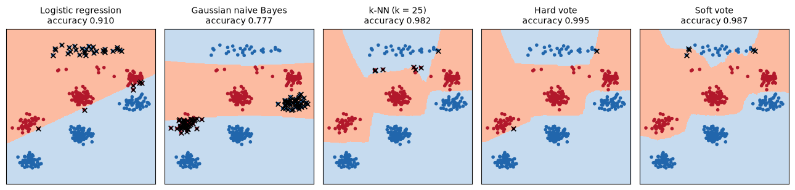
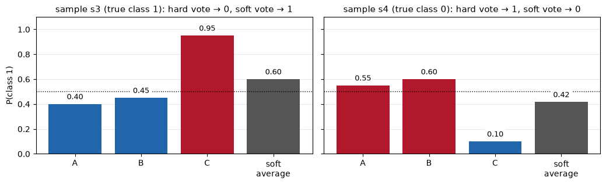
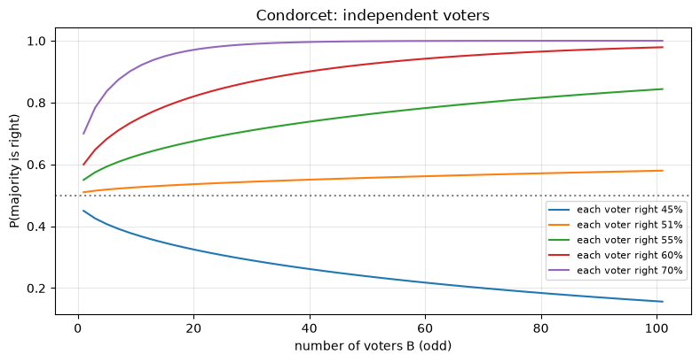
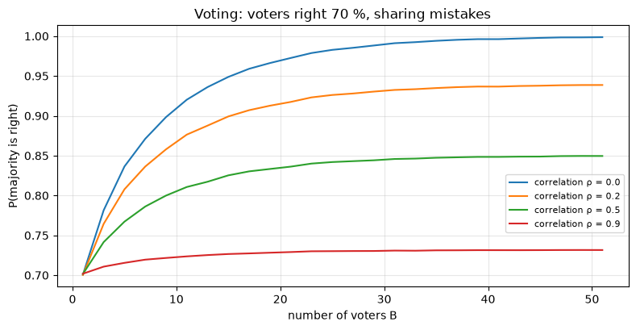
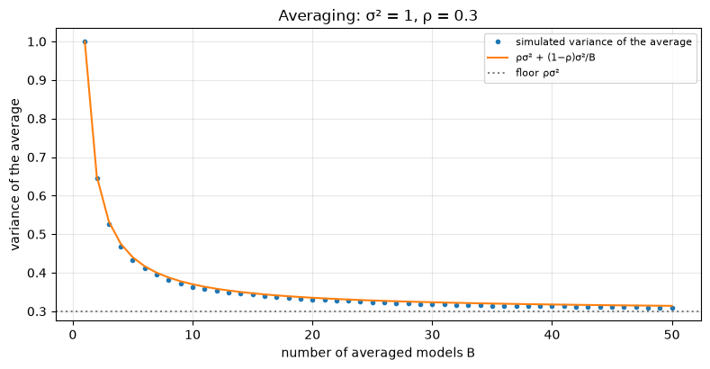
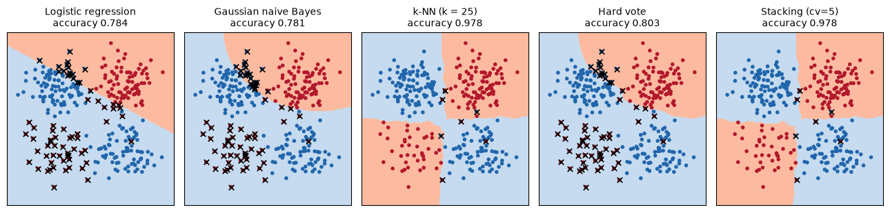

# Voting ensembles — explained from zero

> **Who this is for:** someone who is new to machine learning. You need school algebra (an average, a percentage,
> "multiply the chances of independent events") and a little Python. Every other idea — classifiers, probabilities,
> logistic regression, naive Bayes, k-nearest neighbours, correlation, variance, cross-validation — is built up here
> from scratch, with a picture or a tiny example first and the formula second.
>
> **How to read it:** sections 1–3 give the idea with no math. Sections 4–5 give the math, one small step at a time.
> Sections 6–9 are about using voting in real ML work and — just as important — when **not** to use it.
> Every claim is demonstrated in the notebooks in [`lab/`](lab/README.md).

## Table of contents

0. [Voting in 30 seconds](#0-voting-in-30-seconds)
1. [The problem voting solves](#1-the-problem-voting-solves)
2. [The toolbox: the ideas you need first](#2-the-toolbox-the-ideas-you-need-first)
3. [Voting step by step, in plain words](#3-voting-step-by-step-in-plain-words)
4. [The math: why (and when) a crowd beats its members](#4-the-math-why-and-when-a-crowd-beats-its-members)
5. [A complete example by hand](#5-a-complete-example-by-hand)
6. [Using voting in practice](#6-using-voting-in-practice)
7. [Why voting makes sense for machine learning](#7-why-voting-makes-sense-for-machine-learning)
8. [Where voting does NOT fit — and why](#8-where-voting-does-not-fit--and-why)
9. [Common misconceptions](#9-common-misconceptions)
10. [The labs](#10-the-labs)
11. [Glossary](#11-glossary)
12. [Further reading](#12-further-reading)
13. [Appendix - Assumptions made](#appendix---assumptions-made)

---

## 0. Voting in 30 seconds

* An **ensemble** is a group of models that answer the same question together. **Voting** is the simplest way to
  combine them: train a few *different* models on the same data, ask all of them, and combine their answers.
* **Classification** (the answer is a category):
  * **hard voting** — every model names a class; the class named most often wins (the *mode* of the labels);
    * **weighted:** each model's vote counts its weight instead of 1; the class with the largest total weight wins
      ([3.3](#33-weighted-voting));
  * **soft voting** — every model says how likely each class is; average those probabilities and pick the largest;
    * **weighted:** take a weighted average of the probabilities instead ([3.3](#33-weighted-voting)).
* **Regression** (the answer is a number): take the **mean** of the models' numbers — or the **median**, which ignores
  one wildly wrong model.
* It works when two things are true: each model is **better than a coin flip**, and the models make **different
  mistakes**. Then wherever one is wrong, the others outvote it (Condorcet's jury theorem, section 4).
* It fails when the models are wrong **together** — then the majority confidently outvotes the one model that was
  right (section 8). The fix is to *learn* how much to trust each model: weights chosen by cross-validation, or
  **stacking**.

---

## 1. The problem voting solves


An old story: six blindfolded children meet an elephant for the first time. One touches the trunk and says "it is a
snake". One touches a leg: "a tree trunk". One the ear: "a big fan". One the side: "a wall". One the tusk: "a spear".
One the tail: "a rope". Each report is **partly right** — every child describes their part correctly — and each is
**wrong about the whole animal**. Put the six reports together and you get a decent description of an elephant.

Two details of the story are what make it work, and they are exactly the two conditions for voting in ML:

1. **Each child is mostly right about what they touched.** If a child made things up, adding their report would make
   the combined picture *worse*. In ML: each model must be better than guessing.
2. **The children touched *different* parts.** If all six had touched the trunk, the combined report would be a very
   confident "snake". Six identical opinions are one opinion. In ML: the models must make *different mistakes*.

The machine-learning version is the picture below, drawn by Lab 5 on the lab's "good-fit" dataset. Three very different models
learn to separate red points (class 1) from blue points (class 0); black crosses mark their mistakes on test data.



* **Logistic regression** (a straight-line model) gets the tilted boundary in the middle right, but cannot handle the
  blue strip on top — blue lives at the bottom *and* at the top, and no straight line separates that.
* **Gaussian naive Bayes** handles the blue strip on top (it models "blue is spread out, red is concentrated") but
  cannot tilt its boundary, so it misses a red group on the left and a blue group on the right.
* **k-nearest neighbours** (k = 25) follows every bend, but four tiny red groups under the blue strip have fewer points
  than its 25 neighbours, so the strip outvotes them.

Each model is wrong somewhere **different**. Wherever one is wrong, the other two are right, so a simple majority vote
is wrong almost nowhere: **0.995** accuracy, against 0.910, 0.777 and 0.982 for the members (Lab 5).

---

## 2. The toolbox: the ideas you need first

### 2.1 Features, labels, classifiers, regressors

A dataset is a table: **rows = samples** (patients, emails, points on a map), **columns = features** (age, number of
links, x1, x2). For each training row we also know the right answer, the **label** $y$.

* A **classifier** learns from labelled rows to predict a *category* for new rows: spam / not spam, class 0 / class 1.
* A **regressor** predicts a *number*: a price, a temperature.

We always keep some rows aside as a **test set**: the model never sees them while learning, and we measure how often
it is right on them (**accuracy** = share of test rows predicted correctly). Accuracy on the training rows would be
optimistic — a model can memorise.

### 2.2 Probability outputs — "how sure are you?"

Many classifiers can say more than a class: they give a **probability** for each class, numbers between 0 and 1 that
add up to 1. "P(class 1) = 0.9" means "I am fairly sure it is class 1"; "0.55" means "slightly leaning to class 1".
The predicted class is the one with the largest probability. In scikit-learn, `predict()` gives the class and
`predict_proba()` gives the probabilities.

A model's probabilities are **calibrated** (honest) if, among all the points where it says 0.9, about 90 % really are
class 1. Many models are not: some are over-confident (say 0.99 when they are right 75 % of the time), some
under-confident. This matters a lot for soft voting (section 4.5).

### 2.3 Logistic regression in one page (the "straight line" member)

Logistic regression draws a **straight line** (in more dimensions: a flat plane) through the feature space. For a
point $x$ it computes a score $z = w_1 x_1 + w_2 x_2 + b$ — how far, and on which side of the line, the point is — and
squashes it into a probability with the **sigmoid** $\sigma(z) = 1/(1 + e^{-z})$: far on one side → close to 1, far on
the other → close to 0, on the line → 0.5. Training picks $w, b$ that make the training labels as likely as possible,
plus a penalty $\tfrac12\lVert w\rVert^2$ that keeps the weights small (strength set by `C`; scikit-learn minimises
$C \times$ log-loss $+ \tfrac12\lVert w\rVert^2$). Features are first **standardised** (shifted to mean 0, scaled to
standard deviation 1) so that no feature dominates just because of its units.

*Good at:* straight boundaries, also tilted ones, and features that work *together*. *Blind spot:* anything curved, or
a class that appears on both sides of the other.

### 2.4 Gaussian naive Bayes in one page (the "bell curve per feature" member)

Naive Bayes describes each class by a **bell curve (Gaussian) per feature**: "in class 1, x2 is around 1.2 give or take
1.0". To classify a new point it asks, for each class, *how typical is this point?* — multiplying the bell-curve
heights of all its features and the class's share of the data — and turns those numbers into probabilities.

The word **naive** is the key: it treats every feature **on its own**, as if the features were unrelated within a
class. That makes it fast and robust with little data, and it can draw **curved** boundaries (when one class is
spread out and the other concentrated, the spread-out class wins far away on both sides). *Blind spots:* (a) it
cannot see information that only exists in a *combination* of features — e.g. a tilted line where `x1` on its own says
nothing; (b) when features are copies of each other it counts the same evidence several times and becomes wildly
**over-confident** (lab Lab 11).

### 2.5 k-nearest neighbours in one page (the "ask your neighbours" member)

k-NN keeps all training points. To classify a new point it finds the **k closest training points** and lets them vote;
P(class 1) = share of class 1 among those k. With small k it follows every wiggle of the data; with large k it
smooths. *Good at:* any shape, given enough data. *Blind spots:* a group with fewer than about k/2 points gets outvoted
by its surroundings; distances get confused by many useless features; prediction is slow on big data (it searches the
training set every time); and its probabilities come in coarse steps of 1/k.

### 2.6 Mode, mean, median

* **Mode** = the most common value. Votes for classes: "1, 1, 0" → mode 1. Natural for categories.
* **Mean** = the average. Numbers 11, 9, 30 → 16.67. One extreme value drags it.
* **Median** = the middle value after sorting. 9, 11, 30 → 11. Extreme values do not move it: half the values could
  be absurd and the median would still be one of the sensible ones.

For regression the mode is nearly useless: three models will practically never output exactly the same number, so
every value appears once and there is no "most common" one. Use the mean or the median.

### 2.7 Independence, correlation and variance

* Two events are **independent** if knowing one tells you nothing about the other (two different coins). Then the
  chance that both happen is the product of their chances: $0.7 \times 0.7 = 0.49$.
* **Correlation** $\rho$ (rho) measures how much two quantities move together: $+1$ = always together, $0$ = unrelated,
  $-1$ = always opposite. For ensembles the interesting quantity is the correlation between models' **mistakes**:
  do they go wrong on the same points?
* **Variance** measures how much a quantity scatters around its average (the average squared distance from the mean).
  A model whose predictions jump around when the training data changes a little has **high variance**. Averaging
  several such predictions reduces the scatter — but only as far as they scatter *independently* (section 4.3). The
  folder overview explains bias and variance in one page: [`../README.md`](../README.md#3-bias-and-variance-in-one-page)
  (and [decision trees in one page](../README.md#2-decision-trees-in-one-page), used by the later techniques; voting
  itself works with any models).

### 2.8 Cross-validation

To choose a setting (such as voting weights) without touching the test set, split the **training** data into, say,
5 parts ("folds"). Train on 4, measure on the 5th, rotate so every fold is held out once, and average the 5 scores.
The setting with the best average wins. Only then is the test set used — once.

---

## 3. Voting step by step, in plain words

### 3.1 Hard voting (majority vote)

1. Train $B$ different classifiers on the same training data (here $B = 3$).
2. For a new point, ask each one for its **class**.
3. Count the votes per class; the class with the most votes is the answer. That is the **mode** of the predicted
   labels — no model is "selected"; each point gets its own count. (With weights, each vote counts its member's
   weight instead of 1: [section 3.3](#33-weighted-voting).)
4. If two classes get the same number of votes (possible with an even number of models, more than two classes, or
   weights), a fixed rule breaks the tie. scikit-learn picks the class that comes **first in its sorted list of
   classes** (section 6.4).

### 3.2 Soft voting (average the probabilities)

1. Ask each classifier for its **probabilities** (`predict_proba`).
2. Average them, class by class (with weights: a weighted average, [section 3.3](#33-weighted-voting)).
3. The class with the largest average wins.

Soft voting lets a member that is *very* sure outweigh two that are barely leaning the other way. That is good when
the "very sure" is earned, bad when a member is over-confident (section 4.5). It needs every member to have
`predict_proba` — a plain `SVC` does not (section 6.6).



On sample s3 above, A and B lean to class 0 (0.40, 0.45) and C is very sure of class 1 (0.95): hard voting says 0
(two votes to one), soft voting says 1 (average 0.60). On s4 it is the other way round. Section 5 works through it;
Lab 1 draws the picture.

### 3.3 Weighted voting

Give each member a weight $w_b$. It works with both kinds of vote:

* **Weighted hard vote:** each member adds its weight (1 by default) to the class it predicts, and the class with the
  largest total wins. scikit-learn computes `argmax(bincount(labels, weights))`.
  * The winner needs the largest total, not more than half. With weights (2, 1, 1) and three members who name three
    different classes, the class named by the weight-2 member wins with 2 of the 4.
  * Ties are common in a hard vote, more so with more than two classes: equal weights and three different answers is
    a three-way tie. The first class in `classes_` wins it (section 4.6).
  * There is one weight per member, for all classes: a member cannot count more on class 3 than on class 5.
* **Weighted soft vote:** a weighted average of the probabilities.

Weights let you trust a better member more — but they must be **chosen on training data by cross-validation**, never
by looking at the test set (section 6.3).

### 3.4 Regression

1. Ask each regressor for its number.
2. Combine with the **mean** (scikit-learn's `VotingRegressor`), a **weighted mean**, or the **median** (do it yourself
   with `np.median`) when one member may be wildly off.

There is no *hard* vote for regression: regressors practically never output the same number. Its counterpart is the
**median** (for 0/1 labels and an odd number of members, the majority vote *is* their median); the mean is the
counterpart of soft voting.

---

## 4. The math: why (and when) a crowd beats its members

### 4.1 Writing the votes down

For a point $x$, member $b$ predicts $\hat y_b(x)$ and gives probabilities $p_{b,c}(x)$ for each class $c$. With weights
$w_b$ (all 1 for plain voting):

$$\text{hard: } \hat y(x) = \arg\max_c \sum_{b=1}^{B} w_b\,[\hat y_b(x) = c], \qquad
\text{soft: } \hat y(x) = \arg\max_c \frac{\sum_b w_b\, p_{b,c}(x)}{\sum_b w_b}$$

($[\cdot]$ is 1 if true, 0 if false; $\arg\max_c$ = "the class $c$ with the largest value".) For regression,
$\hat y(x) = \sum_b w_b\,\hat y_b(x) / \sum_b w_b$, or the median of the $\hat y_b(x)$.

### 4.2 Condorcet's jury theorem: independent voters that beat a coin

Take $B$ voters (odd, so no ties). Assume each is right with probability $p$, **independently** of the others. The
majority is right when more than half are right. The number of right voters follows the **binomial** distribution:
the chance that exactly $k$ of $B$ are right is $\binom{B}{k} p^k (1-p)^{B-k}$ ($\binom{B}{k}$ = the number of ways to
choose which $k$). So

$$P(\text{majority right}) = \sum_{k > B/2} \binom{B}{k}\, p^k\,(1-p)^{B-k}.$$

*Three voters, $p = 0.7$:* either all three are right ($0.7^3 = 0.343$) or exactly two are (3 ways ×
$0.7^2 \times 0.3 = 0.441$): total **0.784** — better than any single voter's 0.7. With $p = 0.4$ the same formula gives
0.352 — *worse* than one voter.

Why it climbs: the share of voters who are right averages out to $p$ as $B$ grows (the law of large numbers), so if
$p > 0.5$ the share ends up above one half with near certainty. For $p = 0.7$: 0.922 with 11 voters, 1.000 with 101.
If $p < 0.5$ the same argument pushes the majority towards **always wrong** ($p = 0.45$: 0.367 with 11, 0.156 with
101). And close to 0.5 the climb is slow ($p = 0.55$: 0.844 even with 101; $p = 0.51$ barely moves). (Lab 2, figure
below.)



### 4.3 Why correlation kills it

The theorem's quiet assumption is **independence**. Real models are trained on the same data and share many mistakes.

*A simple model of shared mistakes (figure below).* Suppose that with probability $\rho$ all voters copy
one common answer (right with probability $p$), and otherwise they vote independently. The correlation between any two
voters' correctness is then exactly $\rho$. In the "copy" rounds counting cannot help, so even infinitely many voters
are right at most

$$\rho\,p + (1-\rho)\times 1.$$

With $p = 0.7$: $\rho = 0.2$ caps the majority at 0.94, $\rho = 0.5$ at 0.85, $\rho = 0.9$ at 0.73 — barely above a
single voter (Lab 3 simulates 0.939, 0.850, 0.732 with 51 voters).



*The same thing for averaging numbers.* Let $B$ models have errors $e_1, \dots, e_B$, each with variance $\sigma^2$ and
each pair with correlation $\rho$. The variance of their average is

$$\mathrm{Var}\Big(\frac1B\sum_b e_b\Big) = \frac{1}{B^2}\Big(\underbrace{B\sigma^2}_{\text{own variances}} + \underbrace{B(B-1)\rho\sigma^2}_{\text{all pairs}}\Big)
= \rho\sigma^2 + \frac{(1-\rho)\,\sigma^2}{B}.$$

The second term shrinks as $B$ grows; the first, $\rho\sigma^2$, **never** does. Independent models ($\rho = 0$) average
their noise away; perfectly correlated ones ($\rho = 1$) do not average anything (Lab 3, figure below: $\sigma^2 = 1$,
$\rho = 0.3$, $B = 10$ → formula 0.370, simulation 0.364; the curve flattens at 0.3).



So "the aggregate of several models is always less noisy" is only true up to the floor $\rho\sigma^2$, and only if
the members are not worse than each other — averaging a good model with a bad one can be worse than the good one.

The folder overview derives the same formula with $\sigma^2$ and $\rho$ defined as averages over the members, which
makes it exact even when the members have different variances and different pairwise correlations. It checks the
formula against measured trees and shows how bagging and random forests each attack one of its two terms:
[`../README.md`, section 3](../README.md#3-bias-and-variance-in-one-page).

### 4.4 Diversity: how to get different mistakes

Members make different mistakes when they **look at the problem differently**:

* **different model families** (a straight line, bell curves per feature, nearest neighbours — this folder's voting
  labs);
* **different features** (each member sees a different subset of the columns — "random subspaces");
* **different data** (each member trains on a different random sample of the rows — that is **bagging**, the next
  technique in this folder).

Diversity is not "different algorithms" but "different **errors**", and you can measure it: count how many test points
each member gets wrong alone, and the correlation between members' mistakes. On the good-fit map, 128 test points are
missed by exactly one member, 2 by two, none by three, and the mistake correlations are −0.15, 0.02, −0.07; on the
bad-fit map the two weak members' mistakes correlate at 0.86 (Lab 6).

### 4.5 Soft vs hard: when averaging probabilities helps

Hard voting throws information away: a 51 % "yes" counts as much as a 99 % "yes". If the members' probabilities are
**honest** (calibrated), soft voting uses that information: a confident, *usually right* member can overrule two
hesitant ones. On noisy two-moons data soft voting reaches 0.880 against hard voting's 0.843, and where the two
disagree soft is right 12 times out of 13 (Lab 7).

It backfires when a member is **confidently wrong**:

* On the good-fit cap, logistic regression says "class 1" with probability ≈ 0.92 (it is far from its line, so the
  sigmoid is near 1) while the other two say ≈ 0.2. Soft voting gets 5 of 29 cap points wrong; hard voting 1 (Lab 7).
* Gaussian naive Bayes given nine noisy copies of one feature counts the same evidence nine times: it is more than 99 %
  sure on 82 % of the points while right on only 74 %. The soft vote then follows it on 90 % of the points and drops
  to 0.833, *below* the hard vote's 0.850. Calibrating it (`CalibratedClassifierCV`) brings the soft vote to 0.880
  (Lab 11).

The members' probabilities also live on different **scales**: k-NN with k = 25 can only say multiples of 1/25 and, on
the good-fit test set, sits at exactly 0 or 1 for 91 % of the points, naive Bayes for 11 %, logistic regression never
(from-scratch notebook §3). Soft voting silently gives the most "extreme" member the loudest voice.

### 4.6 Ties

With an even number of members, more than two classes, or weights, two classes can get the same total. Any fixed rule
works mathematically; what matters is knowing which one your library uses. scikit-learn computes
`argmax(bincount(votes, weights))`, and `argmax` returns the **first** maximum, so the tie goes to the class that comes
first in the sorted `classes_` — class 0 before class 1, `"cat"` before `"dog"`. (Lab 4: with weights (1, 1, 2), 7 test
points tied, all went to class 0.) The common one-liner `max(votes, key=votes.count)` (like `Counter.most_common`)
instead picks whichever label it *saw first*, so a home-made vote can disagree with scikit-learn on ties
(from-scratch §1).

---

## 5. A complete example by hand

Three classifiers A, B, C give P(class 1) for five samples:

| sample | true class | A | B | C |
|---|---|---|---|---|
| s1 | 1 | 0.90 | 0.80 | 0.30 |
| s2 | 0 | 0.60 | 0.40 | 0.20 |
| s3 | 1 | 0.40 | 0.45 | 0.95 |
| s4 | 0 | 0.55 | 0.60 | 0.10 |
| s5 | 1 | 0.70 | 0.30 | 0.65 |

**Step 1 — each member's own prediction** (class 1 if P > 0.5):

| | s1 | s2 | s3 | s4 | s5 | right |
|---|---|---|---|---|---|---|
| A | 1 | 1 ✗ | 0 ✗ | 1 ✗ | 1 | 2 / 5 = 0.4 |
| B | 1 | 0 | 0 ✗ | 1 ✗ | 0 ✗ | 2 / 5 = 0.4 |
| C | 0 ✗ | 0 | 1 | 0 | 1 | 4 / 5 = 0.8 |

**Step 2 — hard vote** (votes for class 1): s1: 2 → **1** ✓; s2: 1 → **0** ✓; s3: 1 → **0** ✗; s4: 2 → **1** ✗;
s5: 2 → **1** ✓. Accuracy **0.6** — *worse than C alone* (0.8): A and B are wrong together on s3 and s4, and two
votes beat one.

**Step 3 — soft vote** (average of the three probabilities):
s1: (0.90 + 0.80 + 0.30)/3 = **0.667** → 1 ✓; s2: 1.20/3 = **0.400** → 0 ✓; s3: 1.80/3 = **0.600** → 1 ✓;
s4: 1.25/3 = **0.417** → 0 ✓; s5: 1.65/3 = **0.550** → 1 ✓. Accuracy **1.0**: C was very sure on s3 and s4 (0.95,
0.10) while A and B were only leaning (0.40–0.60), and the average listens to that.

**Step 4 — weighted hard vote, weights (A, B, C) = (2, 1, 1):**

| | weight for class 0 | weight for class 1 | result |
|---|---|---|---|
| s1 | 1 (C) | 3 (A + B) | 1 ✓ |
| s2 | 2 (B + C) | 2 (A) | **tie** → class 0 (first in `classes_`) ✓ |
| s3 | 3 (A + B) | 1 (C) | 0 ✗ |
| s4 | 1 (C) | 3 (A + B) | 1 ✗ |
| s5 | 1 (B) | 3 (A + C) | 1 ✓ |

Accuracy 0.6. Giving the weight to the *wrong* member (A) did not help; the cross-validation of section 6.3 is how you
find the right weights.

**Step 5 — regression with one broken member.** Three regressors predict three targets:

| | true | R1 | R2 | R3 (broken) | mean | median | weighted mean (2, 2, 1) |
|---|---|---|---|---|---|---|---|
| t1 | 10 | 11 | 9 | 30 | 16.67 | 11 | (22 + 18 + 30)/5 = 14.0 |
| t2 | 20 | 19 | 22 | 60 | 33.67 | 22 | (38 + 44 + 60)/5 = 28.4 |
| t3 | 15 | 14 | 15 | 40 | 23.00 | 15 | (28 + 30 + 40)/5 = 19.6 |
| mean absolute error | | 1.00 | 1.00 | 28.33 | **9.44** | **1.00** | **5.67** |

The mean is dragged by R3; the median simply ignores it; down-weighting R3 helps but less than ignoring it. The mode
does not exist (every row has three different numbers).

Lab 1 of the library notebook and §1 of the from-scratch notebook reproduce every number above.

---

## 6. Using voting in practice

### 6.1 The recipe in scikit-learn

```python
from sklearn.ensemble import VotingClassifier, VotingRegressor
from sklearn.linear_model import LogisticRegression
from sklearn.model_selection import train_test_split
from sklearn.naive_bayes import GaussianNB
from sklearn.neighbors import KNeighborsClassifier
from sklearn.pipeline import make_pipeline
from sklearn.preprocessing import StandardScaler

X_train, X_test, y_train, y_test = train_test_split(X, y, test_size=0.3, random_state=0, stratify=y)

members = [                                   # (name, model) pairs - a required argument, there is no default
    ("lr", make_pipeline(StandardScaler(), LogisticRegression())),   # scaler INSIDE the pipeline (6.5)
    ("nb", GaussianNB()),
    ("knn", KNeighborsClassifier(n_neighbors=25)),
]
hard = VotingClassifier(members, voting="hard").fit(X_train, y_train)
soft = VotingClassifier(members, voting="soft").fit(X_train, y_train)   # every member needs predict_proba
print(hard.score(X_test, y_test), soft.score(X_test, y_test))

# regression: VotingRegressor averages (optionally weighted); for a median do it yourself
reg = VotingRegressor([("a", model_a), ("b", model_b), ("c", model_c)]).fit(X_train, y_train)
median_pred = np.median(reg.transform(X_test), axis=1)   # transform() = one column of predictions per member
```

`VotingClassifier` re-fits a fresh copy of every member on the data you pass to `fit`; the fitted copies are in
`estimators_`.

### 6.2 The settings that matter

| Parameter | What it does | Advice |
|---|---|---|
| `estimators` | list of `(name, model)`; models can be any classifiers (or regressors for `VotingRegressor`) | pick **different kinds** of model; check their mistakes overlap little (Lab 6) |
| `voting` | `"hard"` (count labels; each vote counts its weight, 1 by default) or `"soft"` (average `predict_proba`, weighted by `weights`) | soft if the members' probabilities are calibrated; hard if one member may be confidently wrong (Labs 7, 11) |
| `weights` | one number per member, for hard (weighted count) and soft (weighted average) votes alike ([3.3](#33-weighted-voting)) | default equal; choose by cross-validation on training data only (6.3) |
| `n_jobs` | fit the members in parallel | useful when members are slow |
| members' own settings | e.g. k of k-NN, C of logistic regression | **tune them first** — a well-tuned single member may already be as good as the vote (Lab 14) |

### 6.3 Choosing weights by cross-validation

The grid below tries 27 weight vectors for a **weighted hard vote** ([3.3](#33-weighted-voting)):

```python
from sklearn.model_selection import GridSearchCV
grid = {"weights": [[a, b, c] for a in (1, 2, 3) for b in (1, 2, 3) for c in (1, 2, 3)]}
search = GridSearchCV(VotingClassifier(members, voting="hard"), grid, cv=5).fit(X_train, y_train)
print(search.best_params_, search.score(X_test, y_test))   # the test set is used once, at the end
```

**What CV picks.**

* Good-fit map: equal weights are already among the best. 15 of the 27 weight vectors tie at CV accuracy 0.9935
  (Lab 9).
* Bad-fit map: CV picks (1, 1, 3), so k-NN's vote outweighs the other two together. Accuracy recovers to 0.978
  (Lab 10).
* Regression: CV gives the wild polynomial member weight 0 (Lab 8).

**The grid's two limits.**

* It only tries the weights you list.
* It re-fits all three members 5 times for **each** of the 27 candidates: 405 member fits.

**What practitioners do instead.**

* Competition practice and AutoML libraries (AutoGluon, auto-sklearn) fit the weights to the members' predictions on
  held-out data, usually **out-of-fold predictions** (6.3.1).
* They use one of two techniques: greedy forward selection (6.3.2) or a numerical optimiser (6.3.3).

#### 6.3.1 The idea: score weights on predictions the members made blind

A weight should reward a member for being right on points it has **not** seen. Its predictions on its own training
points cannot show that: a 1-nearest-neighbour member is 100 % right there (8.1). The test set must stay unseen (6.5).
**Out-of-fold (OOF) predictions** give every training point one prediction from each member that did not see it:

1. Split the training set into K folds (here 5). Use the **same** split for every member, so that for each point all
   members were trained on the same rows. For classification use `StratifiedKFold`: every fold then contains every
   class, so each fold's model outputs all C probabilities.
2. For each fold, fit each member on the other K − 1 folds and predict the held-out fold: K fits per member, done once.
3. Collect the predictions into the **OOF table** (M members, C classes, n training points). The n points come from
   the K rounds of step 2: each round's held-out fold, called the **validation fold**, supplies about n/K of them, and
   together the K validation folds are the whole training set.
   * regression: M × n numbers, member m's prediction for point i;
   * C-class classification: M × n × C probabilities, member m's C probabilities for point i (they sum to 1).
4. Choose the weights whose combined OOF prediction scores best against `y_train`:

   $$w^\ast = \arg\min_{\,w_m \ge 0,\ \sum_m w_m = 1}\ \text{loss}\Big(y_\text{train},\ \sum_m w_m\,\text{OOF}_m\Big).$$

   The OOF table is fixed, so $w$ is the only unknown. Trying a weight vector costs one weighted average and no
   fitting, so thousands of candidates are cheap.
5. Re-fit every member on the whole training set and combine them with the chosen weights:
   `VotingRegressor(members, weights=w)` or `VotingClassifier(members, voting="soft", weights=w)`. Both divide by the
   sum of the weights, so only their ratios matter.

**What is trained when.**

* At step 1 nothing is trained: `members` is a list of unfitted recipes.
* Step 2 trains **temporary copies**: each member K times, each copy on K − 1 folds. They exist only to fill the OOF
  table; `cross_val_predict` makes a fresh copy for every fold and throws it away afterwards.
* Step 5 trains the **final** members once, on all training rows.

So the weights are learned from the fold copies and used with the final copies. The final copies saw all the rows
instead of (K − 1)/K of them. That is the standard practice.

With the weights scaled to sum to 1, the combined prediction for point $i$ is

$$\hat y_i = \sum_m w_m\,\hat y_{m,i}\ \ \text{(regression)}, \qquad
\hat P_i(c) = \sum_m w_m\,P_{m,i}(c),\ \ \text{predicted class} = \arg\max_c \hat P_i(c)\ \ \text{(classification)}.$$

In classification **one weight per member** multiplies all C of its probabilities, so the blend is again a set of
probabilities that sum to 1. Both techniques work on this table:

```python
import numpy as np
from sklearn.metrics import log_loss, mean_squared_error
from sklearn.model_selection import KFold, StratifiedKFold, cross_val_predict

M = len(members)
folds = StratifiedKFold(5, shuffle=True, random_state=0)     # regression: KFold(5, shuffle=True, random_state=0)
# oof[m, i]: member m's prediction for training row i (C probabilities or one number), from a copy that never saw i
# cross_val_predict has already trained each fold copy with that member's own loss (k-NN has none: it stores rows)
oof = np.array([cross_val_predict(m, X_train, y_train, cv=folds, method="predict_proba")
                for _, m in members])                         # classification: shape (M, n, C)
# oof = np.array([cross_val_predict(m, X_train, y_train, cv=folds) for _, m in members])   # regression: (M, n)

def blend(w, oof):
    """Weighted average of the members' OOF outputs: (n,) numbers or (n, C) probabilities."""
    return np.tensordot(w / w.sum(), oof, axes=1)

# a tuning loss, not a training loss: the weights are hyperparameters, scored on the blend with the metric you report
loss = lambda w: log_loss(y_train, blend(w, oof))            # regression: mean_squared_error(y_train, blend(w, oof))
w = find_weights(loss, M)    # forward selection (6.3.2) or SLSQP (6.3.3): M weights ≥ 0 that sum to 1
```

Two cautions apply to both techniques:

* **The OOF score of the chosen weights is optimistic**, because the weights were picked to make it high. Judge the
  result on data the weights never saw: the test set, once, or an outer cross-validation around the whole procedure.
* **Every fitted weight is one more number learned from the training set.** With few rows, or with members that are
  about equally good, fitted weights mostly fit noise, and equal weights do as well or better (6.3.4).

**A bagging ensemble as a member.**

* A random forest, or any bagging ensemble, is one member: a black box like the others.
* In step 2 the whole forest is fitted on the K − 1 folds, so its bootstrap samples are drawn from those rows only.
  None of its trees sees the held-out fold.
* The bootstrap happens *inside* the member; out-of-fold works one level up, *across* members.
* Bagging itself never needs this rule: its trees get fixed, equal weights, so nothing is learned from their
  predictions.

**Out-of-fold is not out-of-bag.** Both follow one principle: predict each row only with models that did not see it.

* **Out-of-fold (OOF)** uses K-fold splits, works for any model and costs K extra fits per member.
* **Out-of-bag (OOB)** is a free by-product inside bagging. Each row is predicted by the trees whose bootstrap sample
  missed it, about 37 % of them (`oob_prediction_` / `oob_decision_function_`;
  [`../02-bagging/README.md`, section 4.6](../02-bagging/README.md#46-the-out-of-bag-estimate)).
* A forest member's OOB predictions could fill its column of the OOF table; they are honest too. But they come from
  about a third of the trees, while the other columns come from models trained on (K − 1)/K of the rows (80 % with
  5 folds), so the columns are not like for like. Using OOF for every member is cleaner.

#### 6.3.2 Technique 1: greedy forward selection (Caruana's ensemble selection, often called hill climbing)

- Start with the best single member. 
- Then repeatedly try adding **one more copy** of each member to the blend, keep the
copy that improves the OOF score most, and repeat.
- [Caruana et al.](https://www.cs.cornell.edu/~alexn/papers/shotgun.icml04.revised.rev2.pdf) repeat this for a fixed number of steps and return the best of the nested ensembles. The code below
  stops at the first step that does not help, which is a simplification: with replacement, the score curve is flat
  enough that this rarely loses much.
- A member's weight is its share of the copies, and a
member never added gets weight 0 ([Caruana et al., 2004](https://www.cs.cornell.edu/~alexn/papers/shotgun.icml04.revised.rev2.pdf)).

```python
def forward_select(loss, M, n_steps=100, tol=0.0):
    """Caruana's ensemble selection: add one member at a time (repeats allowed); weight = share of additions."""
    one = np.eye(M)                                             # identity matrix of order M x M, one[m] = one copy of member m
    counts = one[np.argmin([loss(one[m]) for m in range(M)])]   # start: the best single member
    best = loss(counts)
    for _ in range(n_steps):
        trials = [loss(counts + one[m]) for m in range(M)]      # try one more copy of each member
        m = int(np.argmin(trials))
        if trials[m] >= best - tol:                             # the best copy gains no more than tol: stop
            break
        counts, best = counts + one[m], trials[m]
    return counts / counts.sum()

# from the previous 6.3.1 codes nippet
loss = lambda w: log_loss(y_train, blend(w, oof))            # regression: mean_squared_error(y_train, blend(w, oof))
w = forward_select(loss, len(members))
# any score works, e.g. accuracy (lower = better, hence the minus):
# w = forward_select(lambda w: -accuracy_score(y_train, np.unique(y_train)[blend(w, oof).argmax(axis=1)]), len(members))
```

* **Regression:** score the blended numbers with the metric you will report (RMSE, MAE, ...).
* **Multi-class classification:** score the blended probabilities with log loss, accuracy, macro-F1, ... Forward selection
  only *compares* scores and never needs a slope, so it is the one technique here that can optimise accuracy or F1
  directly. For the same reason it is the only one that can weight a **hard** vote ([3.3](#33-weighted-voting)): build the OOF table from
  `predict` labels and blend by weighted counting.
* The weights are non-negative, sum to 1 and change in coarse steps (one copy at a time). AutoGluon's final
  `WeightedEnsemble` model and auto-sklearn's ensemble are built this way.
* **`n_steps` is a cap, and it can cut the search short.** If the loop uses all `n_steps` additions and the last one
  still improved the score, there was more to gain, and nothing in the output says so. The cap also sets how fine the
  weights can get: after N copies every weight is a multiple of 1/N. With many members, raise `n_steps`; the stop rule
  ends the loop earlier on its own when nothing more helps.
* **`tol` is the smallest gain that counts**, like `min_delta` in early stopping. With `tol=0` the loop goes on while
  any copy lowers the score at all, which can mean many steps that gain next to nothing on the OOF rows. A small
  positive `tol` stops it when the best copy gains no more than that.

#### 6.3.3 Technique 2: a numerical optimiser on the weights

Let an optimiser search all weights at once: minimise the OOF loss over $w$ subject to $w_m \ge 0$ and
$\sum_m w_m = 1$. `scipy.optimize.minimize` with `method="SLSQP"` (sequential least squares programming) handles both constraints:

```python
from scipy.optimize import minimize

M = len(members)

# bounds for each weight value
# the shape is [(0,1),(0,1),(0,1),(0,1),..M times]
# the constraint is of an equality kind: w.sum()-1 = 0.
# SQSLP is one of the many ways to solve constrained optimization problems
# - here it is to solve the minimzation of weighted sum of losses problem under the constraint that all weights add to 1
res = minimize(loss, x0=np.full(M, 1 / M), method="SLSQP",       # start from equal weights
               bounds=[(0, 1)] * M, constraints={"type": "eq", "fun": lambda w: w.sum() - 1})
w = res.x
```

* **Regression:** minimise the squared error. This is least squares with non-negative weights that sum to 1.
* **Multi-class classification:** minimise **log loss**, not accuracy. The optimiser steps downhill along the slope of
  the loss, and accuracy has no slope: a tiny change of a weight flips no prediction, so accuracy stays the same and
  SLSQP stops where it started. Log loss moves with every probability. Pick the class by `argmax` afterwards.
* **SLSQP is gradient-based, so score it with a smooth loss.**
  * scipy's solver table lists it as "Uses Gradient"
    ([scipy docs](https://docs.scipy.org/doc/scipy/tutorial/optimize.html#local-minimization-solver-comparison)).
  * Smooth scores: squared error, log loss.
  * Scores with jumps (accuracy, F1, the error of a hard vote): use forward selection (6.3.2) instead.
  * scipy's docs list no failure cases; the last point follows from the gradient-based design.
* With either loss and these constraints, the loss surface over the weights is a single bowl, so there is no wrong
  valley to get stuck in. Its bottom is often flat, though: quite different weights can give almost the same loss.
  Read the exact values loosely.

#### 6.3.4 Which one, and why equal weights come first

| | Forward selection | Optimiser (SLSQP) |
|---|---|---|
| What is fitted | M weights ≥ 0 summing to 1, in steps of one copy | M weights ≥ 0 summing to 1 |
| Scores it can optimise | any: RMSE, MAE, log loss, accuracy, F1 | smooth ones: squared error, log loss |
| Weighted hard vote ([3.3](#33-weighted-voting)) | yes | no (no slope) |
| Result goes into | `VotingClassifier` / `VotingRegressor(weights=w)` | `VotingClassifier(voting="soft")` / `VotingRegressor(weights=w)` |

**Equal weights are the baseline to beat.** In forecasting, the plain average of several forecasts beats "optimal"
estimated weights so often that the effect has a name: the *forecast combination puzzle* (Stock & Watson, 2004).
Smith & Wallis (2009) explain it: estimated weights carry estimation noise, and when the best weights are close to
equal, that noise costs more than the weights gain. The labs show both sides:

* On the good-fit map, equal weights already tie for best (Lab 9).
* On the bad-fit map and in Lab 8, one member is much better or much worse than the rest, and fitted weights pay off:
  (1, 1, 3) in Lab 10 and weight 0 for the wild polynomial in Lab 8.

Fit weights when the members clearly differ in quality and there are many rows to fit them on. Otherwise keep equal
weights.

### 6.4 Reading the output

| scikit-learn attribute / method | What it is | Plain words |
|---|---|---|
| `estimators_` | the fitted members | each member, trained on the full training set |
| `named_estimators_["knn"]` | one fitted member by name | to inspect or predict with a single member |
| `classes_` | sorted class labels | **ties go to the first one** in this list |
| `predict(X)` | the vote | hard: `argmax(bincount(labels, weights))`; soft: `argmax` of the averaged probabilities |
| `predict_proba(X)` | averaged probabilities | only for `voting="soft"` |
| `transform(X)` | members' outputs side by side | hard: one column per member with its label as a position in `classes_` (0, 1, …); soft: their probabilities |
| `VotingRegressor.transform(X)` | members' numbers side by side | use it for a median or a custom rule |

### 6.5 Avoiding leakage

* Every learned preprocessing step (here `StandardScaler`) sits **inside** a member's `Pipeline`, so in
  cross-validation it is re-fitted on each training fold only.
* Weights, `voting="hard"/"soft"`, and the members' own hyper-parameters are chosen with cross-validation **on the
  training set**. The test set is touched once per comparison.
* Stacking must use **out-of-fold** member predictions; training the combiner on predictions the members made on their
  own training points is a leak (section 8.1, from-scratch §5).

### 6.6 Members without probabilities (`SVC`)

A plain `SVC` has no `predict_proba`, so it can take part in a **hard** vote but a **soft** vote raises
`AttributeError: This 'SVC' has no attribute 'predict_proba'`. The classic fix `SVC(probability=True)` fits a logistic
curve on top of the SVM scores with an internal 5-fold cross-validation (slower). In scikit-learn 1.9 that switch is
**deprecated** in favour of `CalibratedClassifierCV(SVC(), ensemble=False)`, which does the same job (Lab 4). Either
way the probabilities come from a second model and are not guaranteed to agree with `SVC.predict()` on every point.

---

## 7. Why voting makes sense for machine learning

**The core belief behind voting:** different kinds of model have different **inductive biases** — built-in
assumptions about what a pattern looks like (straight, bell-shaped per feature, locally smooth). On real data no single
assumption is right everywhere, so each model is right in some regions and wrong in others. If those regions differ,
a vote keeps the good parts of each.

1. **Error cancellation.** If the members are better than chance and their mistakes are not too correlated, the
   majority is right more often than any member (Condorcet, 4.2). On the good-fit map the members score 0.910, 0.777
   and 0.982, the hard vote 0.995 (Lab 5).
2. **Variance reduction.** Averaging noisy predictions shrinks their scatter by the factor in 4.3 — the idea behind
   bagging and random forests, the next techniques in this folder.
3. **Robustness.** A median, or a vote, survives one member that breaks (the polynomial in Lab 8: mean error 0.965
   for the mean, 0.314 for the median).
4. **Cheap to try.** No new algorithm: three existing models and one line of code. Members can be trained in parallel.

**It is the right tool when** you have a few reasonably good models of *different* kinds, their mistakes overlap
little, and the extra cost (several models to run) is acceptable. The next section is what happens when one of those
breaks.

---

## 8. Where voting does NOT fit — and why

| # | Situation | Why voting fails | Use instead | Lab |
|---|---|---|---|---|
| 8.1 | Only one member can solve part of the task; the others fail **together** (bad-fit data) | the correlated majority outvotes the one right member | weights chosen by CV, **stacking**, or just the good member | 10 |
| 8.2 | Members no better than a coin on some region | Condorcet in reverse: more voters → more surely wrong | better members; drop the weak ones | 2 |
| 8.3 | Members are copies / near-copies | correlated mistakes; ρσ² floor | diversify (other model families, features, data — bagging) | 12 |
| 8.4 | A member's probabilities are over-confident (uncalibrated) | soft voting follows the loudest member | hard voting, or calibrate first (`CalibratedClassifierCV`) | 11 |
| 8.5 | Regression with a member that is occasionally wild | the mean is dragged by it | median, or CV weights | 8 |
| 8.6 | Tight memory / latency budget | B models to train, store and run | the best single model | 13 |
| 8.7 | Decisions must be explained | no single set of coefficients to show | one interpretable model | 13 |
| 8.8 | A single well-tuned member is already as good | nothing left to fix | the tuned single model | 14 |

### 8.1 The bad-fit dataset: one good member, outvoted

**Why:** the vote assumes mistakes are spread out. The bad-fit data is an XOR: class 1 in the top-right and (a smaller
group in) the bottom-left corner, class 0 in the other two. Only k-NN can draw an XOR. Logistic regression and naive
Bayes both call the entire bottom-left corner class 0 — the *same* mistake (their error correlation is 0.86) — so the
majority always overrules k-NN there.



Lab 10: logistic regression 0.784, naive Bayes 0.781, k-NN **0.978**, hard vote **0.803**. The soft vote reaches 0.927
(LR and NB are unsure in that corner, k-NN is sure) but still loses part of it.

**Fixes:** weights chosen by 5-fold CV on the training set — (1, 1, 3) — give 0.978. **Stacking** gives 0.978 too: it
trains a logistic regression on the members' probabilities and *learns* weights 0.31, 0.30 and 7.07 — it discovered
that only k-NN is worth listening to. Stacking must be trained on **out-of-fold** predictions: for each training point,
use a copy of each member that did not see that point. Otherwise an over-fitting member looks perfect: in the
from-scratch notebook a 1-nearest-neighbour member is 100 % right on its own training points, a stacker trained on
those in-sample outputs puts weight 9.44 on it (vs ~1.3 on the others) and scores exactly 1-NN's 0.803 on test, while
the out-of-fold stacker scores **0.861**, better than every member (0.831, 0.831, 0.803) and the hard vote (0.831).

Honest conclusion: on this data the best "ensemble" is essentially k-NN alone.

### 8.2 Members worse than chance

**Why:** Condorcet's theorem cuts both ways. With $p = 0.45$ the majority of 11 independent voters is right only 0.367
of the time, of 101 voters 0.156 (Lab 2). The bad-fit corner is a local version: there, two of three members are
certainly wrong. **Fix:** improve or remove members that are worse than chance anywhere it matters.

### 8.3 Copies are not a committee

**Why:** three k-NNs with k = 25, 31, 37 make nearly the same mistakes (correlations 0.83–0.93; 7 points missed by all
three, 3 by one or two). The vote scores 0.980 — no better than a single copy (0.975–0.982). Same number of members as
in Lab 5, no gain (Lab 12). **Fix:** diversity — different model families, features or training samples.

### 8.4 Over-confident members break soft voting

**Why:** soft voting assumes all members' probabilities are honest and on one scale. Naive Bayes fed nine noisy copies
of one feature is > 99 % sure on 82 % of points but right on 74 %; the soft vote copies it on 90 % of points and scores
0.833, below the hard vote (0.850). **Fix:** use hard voting, or calibrate the member first (0.880 with
`CalibratedClassifierCV`) (Lab 11). Logistic regression far from its line is a milder case (the good-fit cap, Lab 7).

### 8.5 Regression: one wild member drags the mean

**Why:** `VotingRegressor` averages. A degree-15 polynomial fitted to 50 points is fine in the middle but off by up to
46.7 near the edges (mean absolute error 2.36); the averaged ensemble inherits a third of that (0.965). **Fix:** the
median (0.314, as good as the best member's 0.313) or weights from CV — (1, 1, 0), 0.363 (Lab 8).

### 8.6 Cost

**Why:** B models to train, store and run. On a 132,800-point copy of the good-fit map the vote takes 41 ms to fit and
402 ms to predict, about the sum of its members (k-NN alone: 19 ms / 247 ms; logistic regression: 14 ms / 1.4 ms)
(Lab 13; machine-dependent). **Fix:** if the gain is small, ship the best single model.

### 8.7 Interpretability

**Why:** logistic regression can be explained with three numbers (weights −0.78, 1.39 and intercept −0.08 on scaled
features, Lab 13); a vote of three different models has no such summary — you would have to explain all three and the
vote. **Fix:** an interpretable single model where explanations are required, or model-agnostic tools (permutation
importance, SHAP) applied to the whole ensemble.

### 8.8 A well-tuned single model may already be enough

**Why:** the good-fit map was *built* so that k-NN with k = 25 fails on the tiny groups. Choose k by cross-validation
instead and it picks k = 1: k-NN alone then scores 0.997 on test, slightly above the vote's 0.995 (Lab 14). The map is
a teaching device for *how* a vote repairs different blind spots, not proof that voting beats tuned models.
**Fix:** tune each member first; keep the vote only if it beats the best tuned member on validation data.

**Rule of thumb:** before trusting a vote, ask — *Is every member better than chance where it matters? Do their
mistakes overlap little (measure it)? Are their probabilities honest (for soft voting)? Does the vote beat the best
tuned member on validation data?*

---

## 9. Common misconceptions

| Myth | Reality |
|---|---|
| "In hard voting a model is selected from the ensemble by majority vote." (old notes) | No model is selected. For **each point** the class predicted most often wins — the mode of the labels. |
| "The combined result is almost always better than a single model." / "The accuracy of the VotingClassifier is generally higher than the individual classifiers." (old notes) | Only when members beat chance **and** their mistakes are weakly correlated (4.2–4.3). The hand example's hard vote (0.6) is worse than member C (0.8); on the bad-fit map the vote (0.803) is far worse than k-NN (0.978). |
| "The aggregate result of multiple models is always less noisy." (old notes) | Averaging removes noise only down to the floor ρσ² (4.3), and averaging a good model with a bad one can be worse than the good one (Lab 8: mean 0.965 vs best member 0.313). |
| "Taking the mode works for regression too." (old notes) | Real-valued predictions practically never coincide, so there is no mode. Use the mean or the median (2.6, 5). |
| "Combine a linear and a non-linear model and you capture both the linear and the non-linear relationships." (old notes) | Only if they are wrong in *different* places and a third opinion breaks the tie; two members can only tie or agree. In Lab 5 a straight-line model, naive Bayes and k-NN together beat all three — because their mistakes did not overlap, not because "linear + non-linear" adds up by itself. |
| "Soft voting works with any classifier." | Every member needs `predict_proba`; a plain `SVC` does not have one (6.6). And the probabilities must be honest (8.4). |
| "Soft voting is always better than hard voting." | Better when probabilities are calibrated (Lab 7: 0.880 vs 0.843); worse when a member is confidently wrong (Lab 11: 0.833 vs 0.850). |
| "More members is always better." | Only *different* ones. Copies add nothing (Lab 12); correlated members hit a ceiling (Lab 3); members worse than chance make it worse (Lab 2). |
| "Tune the weights to get the best test accuracy." | That leaks the test set into the model. Choose weights by cross-validation on the training set (6.3). |
| "Ties are broken randomly." | scikit-learn breaks them deterministically: the first class in `classes_` (4.6). |

---

## 10. The labs

Everything above is demonstrated in two Jupyter notebooks. Setup and a map of which lab proves which claim are in
**[`lab/README.md`](lab/README.md)**.

**[`lab/voting_lab.ipynb`](lab/voting_lab.ipynb)** — scikit-learn:

| Part | Labs | README sections |
|---|---|---|
| A. How voting works | 1 hand example · 2 Condorcet · 3 correlated voters and averages · 4 scikit-learn internals: ties, `classes_`, `SVC` probabilities | 2, 3, 4, 5, 6.4, 6.6 |
| B. Why it is useful | 5 good-fit map: members vs hard vs soft · 6 diversity measured · 7 hard vs soft · 8 regression mean vs median · 9 weights by CV | 1, 4.4, 4.5, 6.3, 7 |
| C. Where it fails | 10 bad fit: outvoted (weights, stacking) · 11 over-confident member · 12 copies · 13 cost and interpretability · 14 a tuned single model | 8, 9 |

**[`lab/voting_from_scratch.ipynb`](lab/voting_from_scratch.ipynb)** — NumPy only, compared with scikit-learn:

| Section | Theory step (README §) | Implementation hurdle shown |
|---|---|---|
| 1 Vote rules | 3.1–3.4, 4.1, 4.6, 5 | ties: `np.argmax` (scikit-learn's rule) vs the `max(votes, key=votes.count)` one-liner; aligning probability columns by class name (members with a different column order or a missing class) |
| 2.1 Logistic regression | 2.3 | numerically stable sigmoid and log-loss (`np.exp` overflow, `log(0)` shown); difference to scikit-learn = its solver tolerance (9.0e-05, 3.4e-09 with `tol=1e-12`) |
| 2.2 Gaussian naive Bayes | 2.4 | `var_smoothing` ε = 10⁻⁹ × largest variance; log-sum-exp (naive version returns `nan`); match to 7.8e-16 |
| 2.3 k-NN | 2.5 | exact match; tie-in-distance caveat |
| 3 Probability scales | 4.5 | k-NN at exactly 0/1 for 91 % of points, NB 11 %, LR 0 % |
| 4 Whole ensemble vs scikit-learn | 6 | (i) own vote rules on scikit-learn's members = `VotingClassifier` 100 % (hard and soft, both datasets); (iii) everything-own vs everything-scikit-learn 100 % identical |
| 5 Stacking | 8.1 | in-sample stacker trusts 1-NN (weight 9.44, test 0.803) vs out-of-fold stacker (0.861) |

---

## 11. Glossary

| Term | Meaning |
|---|---|
| **Ensemble** | A group of models whose answers are combined into one. |
| **Member / base model** | One model inside the ensemble. |
| **Hard voting** | Each member names a class; the most common class wins (the mode). |
| **Soft voting** | Average the members' class probabilities; the largest average wins. |
| **Weighted voting** | Each member's vote or probabilities multiplied by its weight before adding up; works with hard and soft voting (3.3). |
| **Mode / mean / median** | Most common value / average / middle value after sorting. |
| **Calibrated** | A model whose "90 % sure" is right about 90 % of the time. |
| **Condorcet's jury theorem** | Independent voters each right with p > 0.5: the majority's accuracy → 1 as their number grows (→ 0 if p < 0.5). |
| **Binomial distribution** | The chances of k successes out of B independent tries with success probability p. |
| **Correlation (ρ)** | How strongly two quantities move together, from −1 to +1. For ensembles: of the members' mistakes. |
| **Diversity** | Members making different mistakes. |
| **Variance** | Average squared distance from the mean; how much something scatters. |
| **Inductive bias** | The built-in assumption a model makes about the shape of a pattern (straight, bell-shaped, local…). |
| **Cross-validation (CV)** | Rotating which part of the training data is held out, to choose settings without the test set. |
| **Stacking** | A second-level model that learns how to combine the members' outputs. |
| **Out-of-fold prediction** | A member's prediction for a training point made by a copy of the member that did not see that point. |
| **Greedy forward selection (ensemble selection, hill climbing)** | Fitting voting weights by repeatedly adding the member copy that most improves the out-of-fold score (6.3.2). |
| **Leakage** | Letting test-set information influence training or model choice. |
| **Tie-breaking** | The rule for a draw; scikit-learn: first class in `classes_`. |

---

## 12. Further reading

* scikit-learn user guide, *Voting Classifier* and *Voting Regressor* (section "Ensembles: gradient boosting, random
  forests, bagging, voting, stacking") — the API used here; the `VotingClassifier` / `VotingRegressor` reference pages.
* Aurélien Géron, *Hands-On Machine Learning with Scikit-Learn, Keras & TensorFlow*, chapter 7 — the logistic
  regression + random forest + SVC `VotingClassifier` example that the old notes reproduced, and the soft-voting /
  `probability=True` remark.
* "Simple guide for ensemble learning methods", Towards Data Science
  (<https://towardsdatascience.com/simple-guide-for-ensemble-learning-methods-d87cc68705a2>) — the article the old
  notes linked as their starting point ("Please follow this"); their mode / mean / weighted-mean list follows it.
* Ludmila Kuncheva, *Combining Pattern Classifiers* (2nd ed.) — the chapters on combining label outputs (majority
  vote, Condorcet) and on diversity, in depth.
* Zhi-Hua Zhou, *Ensemble Methods: Foundations and Algorithms* — the chapters on combination methods and on
  diversity.
* Marquis de Condorcet (1785), *Essai sur l'application de l'analyse à la probabilité des décisions rendues à la
  pluralité des voix* — the original jury theorem.
* David Wolpert (1992), *Stacked Generalization*, Neural Networks 5(2) — stacking and why out-of-sample predictions are
  needed.
* Rich Caruana, Alexandru Niculescu-Mizil, Geoff Crew & Alex Ksikes (2004),
  [*Ensemble Selection from Libraries of Models*](https://www.cs.cornell.edu/~alexn/papers/shotgun.icml04.revised.rev2.pdf), ICML — forward selection with repeated members (6.3.2).
* James Stock & Mark Watson (2004), *Combination Forecasts of Output Growth in a Seven-Country Data Set*, Journal of
  Forecasting 23(6), and Jeremy Smith & Kenneth Wallis (2009), *A Simple Explanation of the Forecast Combination
  Puzzle*, Oxford Bulletin of Economics and Statistics 71(3) — why equal weights so often beat fitted ones (6.3.4).
* Kazuki Onodera, Théo Viel, Gilberto Titericz & Chris Deotte (2025), *The Kaggle Grandmasters Playbook: 7
  Battle-Tested Modeling Techniques for Tabular Data*, NVIDIA Technical Blog
  (<https://developer.nvidia.com/blog/the-kaggle-grandmasters-playbook-7-battle-tested-modeling-techniques-for-tabular-data>)
  — hill climbing on out-of-fold predictions as competition practice (6.3).
* **Several targets at once** (multi-output regression, multi-label classification). In scikit-learn 1.9.1,
  `VotingRegressor`, `VotingClassifier` and the stacking estimators accept only a 1-D target. These papers build
  multi-label and multi-target models from one model per label, combined by voting or averaging:
  * Jesse Read, Bernhard Pfahringer, Geoff Holmes & Eibe Frank, *Classifier Chains for Multi-label Classification*,
    ECML PKDD (2009) and Machine Learning 85(3) (2011). A chain fits one classifier per label, and each one also sees
    the labels before it in the chain as extra inputs. An **ensemble of classifier chains** (ECC) trains chains with
    random label orders and combines them by a vote per label, which removes the dependence on one order.
  * Grigorios Tsoumakas & Ioannis Vlahavas, *Random k-Labelsets: An Ensemble Method for Multilabel Classification*,
    ECML (2007), and Tsoumakas, Ioannis Katakis & Vlahavas, *Random k-Labelsets for Multilabel Classification*, IEEE
    TKDE 23(7) (2011). In **RAkEL**, each member predicts the whole combination of a random subset of k labels as one
    class. A label's final answer is the average vote of the members whose subset contains it, thresholded at 0.5.
    It is not in scikit-learn.
  * Eleftherios Spyromitros-Xioufis, Grigorios Tsoumakas, William Groves & Ioannis Vlahavas, *Multi-target
    Regression via Input Space Expansion: Treating Targets as Inputs*, Machine Learning 104(1) (2016). Its **ensemble
    of regressor chains (ERC)** averages several chains with different target orders. The variants that use
    out-of-fold (cross-validated) predictions are the ones the paper recommends (6.3.1).
* Alexandru Niculescu-Mizil & Rich Caruana (2005), *Predicting Good Probabilities with Supervised Learning* — which
  models are over- or under-confident and how to calibrate them.

---

## Appendix - Assumptions made

No further input was available, so the following decisions were made on the author's behalf:

1. **Audience.** "Extremely new to ML" was taken to mean: school algebra and basic Python, no statistics. Every model
   used as a member (logistic regression, Gaussian naive Bayes, k-NN), probability outputs, calibration, correlation,
   variance, the binomial formula and cross-validation are introduced before use (section 2).
2. **Scope.** Voting for classification (hard or soft, each optionally weighted) and regression (mean, median, weighted mean),
   Condorcet's theorem, the correlation formula, diversity, ties, weights by CV. **Stacking** appears only as the fix
   for voting's main failure (8.1, Lab 10, from-scratch §5), not as a full technique. Bagging and random forests are
   only mentioned as ways to get diversity (they are the next folders).
3. **Old content kept, corrected or dropped** (see `../EVALUATION.md` §2.2 and the AUDIT file's voting section):
   * *Kept and re-explained:* the elephant analogy and image (now `images/elephant-ensemble.png`, link fixed), hard vs
     soft voting, mode / mean / weighted mean, "include diverse classifiers so that models which fall prey to similar
     errors do not aggregate the errors", the `VotingClassifier` / `VotingRegressor` API and the remark that
     `estimators` is a required argument, the duplicated LR + random forest + SVC code (now in 6.6 / misconceptions
     with its `SVC` caveat), "combining a linear and a non-linear model".
   * *Corrected:* hard voting "selects a model" → mode of the labels per point; "almost always better" / "generally
     higher accuracy" → only with better-than-chance members and weakly correlated errors (Condorcet); "aggregate is
     always less noisy" → only down to ρσ²; mode for regression → mean or median; soft voting now states that it needs
     comparable, calibrated probabilities and that `SVC` needs `probability=True` (deprecated in scikit-learn 1.9 in
     favour of `CalibratedClassifierCV(SVC(), ensemble=False)`); the external blog link that stood in for content is
     now a credited reference; the `VotingRegressor` link now points to the current docs.
   * *Dropped:* nothing of substance; the boosting notes that shared the old `Ensemble Learning.ipynb` belong to the
     AdaBoost / gradient boosting folders.
4. **Members.** Logistic regression in a `Pipeline` with `StandardScaler` (default C = 1), `GaussianNB` (default
   `var_smoothing`), `KNeighborsClassifier(n_neighbors=25)`. k = 25 was chosen as close to the rule of thumb
   k ≈ √n_train ≈ 30, and because it makes k-NN fail on the tiny groups; k-NN is **not** scaled because both map
   coordinates are in the same units. Lab 14 shows openly that a CV-tuned k (k = 1) makes k-NN alone as good as the
   vote on this map (8.8).
5. **Datasets.** All synthetic and saved to `lab/data/` (no downloads).
   * *Good fit* (`good_fit.csv`, 1328 points): eleven Gaussian groups built so that each member fails in a different
     place (tilted wings → naive Bayes, class-0 cap → logistic regression, 7-point groups → k-NN with k = 25). Checked
     privately on 30 data-seed × split combinations (the hard vote beat every member in all 30), then fixed at seed 0.
     Simpler designs (curved boundaries on uniform data, two Gaussians, moons) were tried first: in 2-D k-NN was always
     the best member and LR and NB failed in the *same* places, so no vote could beat all three.
   * *Bad fit* (`bad_fit.csv`, 1050 points): an XOR with a smaller bottom-left group — only k-NN can solve it, the other
     two fail together.
   * Lab 7 and Lab 11 use `make_moons` (noise 0.3) and the stacking section uses `make_moons(1200, noise=0.4)` — chosen
     because 1-NN over-fits there; Lab 8 uses a 100-point sine curve with data seed 2, where the degree-15 polynomial
     is wild at the edges (other seeds are milder — the lab says so).
6. **Splits and seeds.** `train_test_split(test_size=0.3, stratify=y, random_state=0)` for both datasets in both
   notebooks; every random step has a fixed seed, so re-running gives identical numbers.
7. **Environment used to execute and verify the notebooks:** Python 3.13.5, NumPy 2.5.4, SciPy 1.18.1,
   scikit-learn 1.9.1, Matplotlib 3.11.2. Numbers quoted in this README are taken from those runs; other versions may
   differ in the last decimals. `SVC(probability=True)` raises a `FutureWarning` in 1.9 — Lab 4 catches and prints it on
   purpose.
8. **From-scratch notebook.** NumPy implements the vote rules and all three members (scikit-learn only for datasets,
   `train_test_split` and the reference models). Logistic regression uses plain gradient descent on scikit-learn's
   objective, so it matches to scikit-learn's solver tolerance (~1e-4); naive Bayes and k-NN match to ~1e-16 / exactly.
9. **Structure and links.** Theory here; two executed notebooks with saved outputs. Every plot in this README is saved
   into `images/` by the lab cell that computes it (`lab/voting_lab.ipynb`: section 1 by Lab 5, 3.2 by Lab 1,
   4.2–4.3 by Labs 2 and 3, 8.1 by Lab 10); the elephant picture is the illustration kept from the old notes. Links to
   `../README.md` assume the folder README planned in `../EVALUATION.md`.
10. **Nothing was committed.** The changes are left in the working tree for review.
