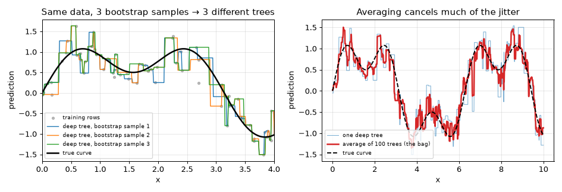
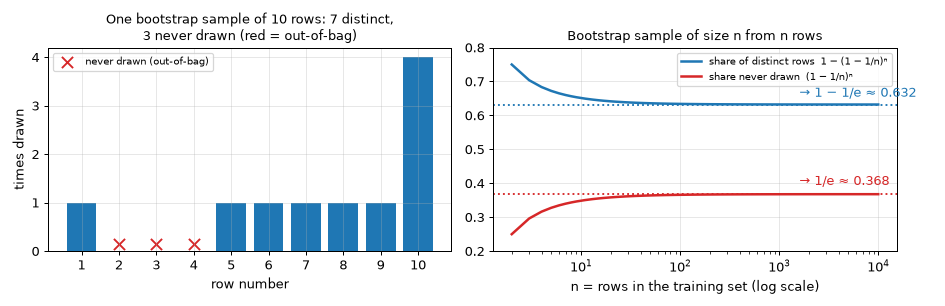
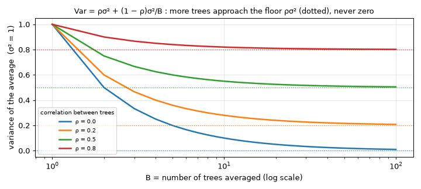
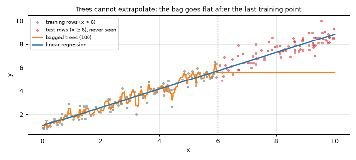

# Bagging (bootstrap aggregating) — explained from zero

> **Who this is for:** someone who is new to machine learning. You need school algebra (averages, squares, powers)
> and a little Python. Every other idea — decision trees, bias, variance, correlation, sampling with replacement — is
> built up here from scratch, with a picture or a tiny example first and the formula second.
>
> **How to read it:** sections 1–3 give the idea with no math. Sections 4–5 give the math, one small step at a time,
> and a complete example you can check with a pencil. Sections 6–9 are about using bagging in real ML work and — just
> as important — when **not** to use it. Every claim is demonstrated in the notebooks in [`lab/`](lab/README.md).

## Table of contents

0. [Bagging in 30 seconds](#0-bagging-in-30-seconds)
1. [The problem bagging solves](#1-the-problem-bagging-solves)
2. [The toolbox: the only five ideas you need](#2-the-toolbox-the-only-five-ideas-you-need)
3. [Bagging step by step, in plain words](#3-bagging-step-by-step-in-plain-words)
4. [The math: why averaging works, and where it stops working](#4-the-math-why-averaging-works-and-where-it-stops-working)
5. [A complete example by hand](#5-a-complete-example-by-hand)
6. [Using bagging in practice](#6-using-bagging-in-practice)
7. [Why bagging makes sense for machine learning](#7-why-bagging-makes-sense-for-machine-learning)
8. [Where bagging does NOT fit — and why](#8-where-bagging-does-not-fit--and-why)
9. [Common misconceptions](#9-common-misconceptions)
10. [The labs](#10-the-labs)
11. [Glossary](#11-glossary)
12. [Further reading](#12-further-reading)
13. [Appendix - Assumptions made](#appendix---assumptions-made)

---

## 0. Bagging in 30 seconds

* A **deep decision tree** fits its training data almost perfectly — including the noise. Change the data a little
  and you get a noticeably different tree. Its predictions *jitter*: it has **high variance**.
* **Bagging** = **b**ootstrap **agg**regat**ing**:
  1. make $B$ new training sets by **drawing rows at random, with replacement**, from the one you have
     (each is called a **bootstrap sample**; it holds about **63.2 %** of the distinct rows, some of them several times),
  2. fit one deep tree on each,
  3. **average** their predictions (regression) or **average their class probabilities / take a vote** (classification).
* Each tree's jitter is partly its own, so averaging cancels part of it. The **variance drops**; the **bias stays
  about the same** as one tree's. The drop has a floor: trees grown from the same data stay **correlated**, and the
  variance of the average never goes below $\rho\sigma^2$ (section 4.3).
* Free bonus: every tree skipped about 36.8 % of the rows. Predicting each row with only the trees that never saw it
  gives the **out-of-bag (OOB)** estimate of test error — without a separate validation set.

---

## 1. The problem bagging solves

You want to predict a wiggly curve from 200 noisy measurements. A deep decision tree is the obvious flexible tool:
it keeps splitting until almost every leaf holds a single training point, so it can follow any shape. But it follows
the **noise** too. Draw a slightly different set of 200 points from the same process and the steps land in different
places, at different heights.



* **Left:** three deep trees fitted to three bootstrap samples of the *same* 200 points (zoom on $0 \le x \le 4$).
  Each has about 127 leaves for 200 rows (Lab 3). Where they agree, the data is clear; where they disagree, each tree
  is copying a different bit of noise.
* **Right:** the average of 100 such trees (red) is far calmer than any one of them and stays close to the true curve:
  its error against the true curve is 0.238 versus 0.337 for a single tree (Lab 3).

The question bagging answers: *I only have one training set — how can I get many slightly different trees from it,
so that their disagreements cancel?* Answer: **resample the training set**.

| Why you would bag | Example |
|---|---|
| **Steadier predictions** | variance of a deep tree halved (0.124 → 0.059), test MSE 0.247 → 0.185 (Labs 7–8) |
| **An error estimate for free** | OOB MSE 0.153 from one fit, vs 5-fold CV 0.164 from five fits (Lab 9) |
| **Easy parallelism** | the $B$ trees are independent: fit them on $B$ cores at once (`n_jobs=-1`) |
| **Any base model** | trees, k-NN, neural nets… — but only *unstable* ones gain (section 8) |

---

## 2. The toolbox: the only five ideas you need

The folder README has longer versions of 2.1 and 2.2:
[decision trees in one page](../README.md#2-decision-trees-in-one-page) and
[bias and variance in one page](../README.md#3-bias-and-variance-in-one-page). The recap below is enough on its own.

### 2.1 A decision tree, briefly

A **regression tree** predicts a number by asking yes/no questions about the inputs: *"is $x \le 2.5$?"* → go left
or right → another question → … → a **leaf**, which predicts the **average** $y$ of the training rows that ended up
there.

How it picks a question: for every feature and every possible threshold (the **midpoints** between neighbouring
training values), split the rows into a left group and a right group and compute the **sum of squared errors** (SSE)
of each group around its own mean. Keep the split with the smallest total SSE, then repeat inside each group.

* A tree that is allowed to grow until its leaves are pure (`max_depth=None`, the default) is **deep**: it can fit
  almost anything, noise included.
* A tree with a single question is a **stump** (`max_depth=1`): two leaves, a staircase with one step.
* A **classification tree** works the same way but measures how *mixed* a group is with the **Gini impurity**
  $1 - \sum_k p_k^2$ ($p_k$ = share of class $k$), and a leaf predicts class shares.

### 2.2 Bias and variance — "wrong on average" vs "jittery"

Imagine you could collect many brand-new training sets from the same source, retrain the model on each, and look at
its prediction at one input $x$:

* **Bias** — how far the *average* of those predictions is from the truth. A stump is biased: one step can't follow
  a wave, no matter which data it sees.
* **Variance** — how much the predictions *spread* around their own average. A deep tree has high variance: every
  new dataset gives a different set of steps.
* **Noise** — the randomness in $y$ itself. No model can predict it.

For squared error these three add up exactly (averaged over training sets and over the noise):

$$\text{expected test error at } x = \text{bias}^2 + \text{variance} + \text{noise}.$$

Lab 7 measures them on the good-fit data with 50 fresh training sets: a deep tree has bias² 0.002 and variance 0.124
(the noise is $0.35^2 = 0.1225$); a stump has bias² 0.431 and variance 0.007. Deep trees are **low-bias,
high-variance**; stumps are **high-bias, low-variance**. Bagging only attacks variance — so it is made for deep trees.

### 2.3 Sampling with replacement: the bootstrap sample

Put the $n$ row numbers of your training set in a hat. Draw one, write it down, **put it back**, and repeat $n$ times.
The list you wrote is a **bootstrap sample**:

* some rows appear twice or three times, some once, and some **never**;
* it has the same size as the original data, so a tree trained on it behaves like a tree trained on "a new dataset of
  the same size" — but it is made from the data you already have.



Left: one bootstrap sample of 10 rows. Row 10 was drawn 4 times; rows 2, 3, 4 were never drawn. Right: the share of
distinct rows in a bootstrap sample of size $n$ settles at **≈ 63.2 %** as $n$ grows, so ≈ 36.8 % are left out
(derived in section 4.1).

Software usually stores a bootstrap sample as **counts** — how many times each row was drawn — and passes the
counts to the tree as **sample weights**: a row with count 2 counts twice in every average and every SSE. That is
exactly the same as copying the row, and needs no copy of the data (scikit-learn does this; the from-scratch notebook
shows the two give identical trees).

### 2.4 Variance of an average, and correlation

If you average $B$ numbers that each wobble with variance $\sigma^2$, and their wobbles are **independent**, the average
wobbles with variance $\sigma^2 / B$: ten independent measurements are ten times steadier than one.

**Correlation** $\rho$ (rho), between −1 and 1, says how much two wobbles move together. $\rho = 0$: unrelated.
$\rho = 1$: they always move together — averaging them is pointless. Two trees grown from bootstrap samples of the
*same* data share many rows (any row is in both with probability $0.632^2 \approx 0.40$), so their wobbles are
**positively correlated**: $0 < \rho < 1$. Section 4.3 shows what that does to the average.

### 2.5 Out-of-bag rows

The rows a tree never drew are its **out-of-bag (OOB) rows** — about 36.8 % of the training rows for each tree. To
that tree they are *new data*. That is the raw material for a free error estimate (section 4.6).

---

## 3. Bagging step by step, in plain words

1. **Pick** the base model (usually a deep decision tree) and the number of models $B$ (`n_estimators`).
2. **For $b = 1 \dots B$:** draw a bootstrap sample (by default $n$ draws with replacement from the $n$ training rows)
   and fit one model on it. The $B$ fits are independent, so they can run in parallel.
3. **Predict** a new input with all $B$ models and **combine**:
   * regression — the plain **average** of the $B$ predictions;
   * classification — the **average of the $B$ predicted class probabilities**, then the most probable class
     ("soft voting"; scikit-learn does this whenever the base model has `predict_proba`). Without probabilities each
     model casts one **vote** and the class with most votes wins ("hard voting").
4. **Evaluate for free (optional):** for every training row, average only the models whose sample did not contain it
   (its OOB prediction) and score those predictions: the **OOB score**.

**Variants** — same recipe, different sampling:

| Name | Rows per model | Features per model | scikit-learn settings |
|---|---|---|---|
| **Bagging** | bootstrap (with replacement) | all | `bootstrap=True` (default) |
| **Pasting** | a subset drawn **without** replacement | all | `bootstrap=False, max_samples<1.0` |
| **Random subspaces** | **all** rows | a random subset of features | `bootstrap=False, max_samples=1.0, max_features<1.0` |
| **Random patches** | a random subset of rows | a random subset of features | `max_samples`, `max_features` both used |

`max_samples` sets how many rows each model draws (a fraction or a count) and `max_features` how many features;
`bootstrap_features=True` draws the features *with* replacement (so a model can get the same column twice, which adds
nothing — Lab 14). **Random forests** (next folder) take a different route: they keep all features per tree but
sample a few **at every split**.

---

## 4. The math: why averaging works, and where it stops working

### 4.1 Why a bootstrap sample holds about 63.2 % of the rows

Fix one row. In a single draw from $n$ rows, the chance of **not** picking it is $1 - \frac1n$. The draws are
independent, so the chance of missing it in all $n$ draws is

$$P(\text{row never drawn}) = \left(1 - \frac1n\right)^n .$$

What happens for large $n$? Take the logarithm: $\ln\left(1 - \frac1n\right)^n = n \ln\left(1 - \frac1n\right)$. For a small
number $u$, $\ln(1 - u) \approx -u - \frac{u^2}{2}$, so with $u = \frac1n$:

$$n \ln\left(1 - \frac1n\right) \approx n\left(-\frac1n - \frac{1}{2n^2}\right) = -1 - \frac{1}{2n} \;\longrightarrow\; -1,$$

and therefore $\left(1 - \frac1n\right)^n \to e^{-1} \approx 0.368$. So **≈ 36.8 % of the rows are left out of any one
bootstrap sample and ≈ 63.2 % are in it** (some of them several times).

| $n$ | 2 | 6 | 10 | 100 | 750 |
|---|---|---|---|---|---|
| $(1 - 1/n)^n$ = share never drawn | 0.250 | 0.335 | 0.349 | 0.366 | 0.368 |

Lab 2 checks this by simulation (0.634 distinct at $n = 100$). Two things people get wrong:

* This is about **one tree**. The ensemble as a whole sees practically every row (a row is missed by all $B$ trees with
  probability $0.368^B$).
* It assumes $n$ draws. With $m$ draws (`max_samples=m`) the share never drawn is $(1 - \frac1n)^m \approx e^{-m/n}$, and the
  expected number of distinct rows is $n\left(1 - (1 - \frac1n)^m\right)$. With $n = 750$ and $m = 100$: $(1 - \frac{1}{750})^{100} = 0.875$ —
  each tree **misses 87.5 %** of the rows and sees about 94 distinct rows; with $m = 750$ it sees about 474 (Lab 2
  measures 93.5 and 473.4).

### 4.2 Averaging independent predictions divides the variance by B

Let $X_1, \dots, X_B$ be the predictions of $B$ models at one input $x$ (random, because the training data was random),
each with variance $\sigma^2$. Variance of a sum = sum of all variances and all pairwise covariances:

$$\text{Var}\Big(\sum_{b} X_b\Big) = \sum_b \text{Var}(X_b) + \sum_{b \ne c} \text{Cov}(X_b, X_c).$$

If the $X_b$ are **independent**, every covariance is 0, so $\text{Var}(\sum X_b) = B\sigma^2$, and dividing the sum by $B$
divides the variance by $B^2$:

$$\text{Var}\Big(\frac1B \sum_b X_b\Big) = \frac{B\sigma^2}{B^2} = \frac{\sigma^2}{B}.$$

### 4.3 But bagged trees are correlated: the floor $\rho\sigma^2$

Bagged trees are **not** independent — they are grown from the same data. Say every pair has correlation $\rho$, i.e.
$\text{Cov}(X_b, X_c) = \rho\sigma^2$. There are $B(B-1)$ ordered pairs, so

$$\text{Var}\Big(\sum_b X_b\Big) = B\sigma^2 + B(B-1)\rho\sigma^2
\quad\Longrightarrow\quad
\boxed{\text{Var}\Big(\frac1B \sum_b X_b\Big) = \rho\sigma^2 + \frac{(1-\rho)\,\sigma^2}{B}}$$

(divide by $B^2$ and regroup: $\frac{\sigma^2}{B} + \frac{(B-1)\rho\sigma^2}{B} = \rho\sigma^2 + \frac{(1-\rho)\sigma^2}{B}$).



* As $B$ grows the second term vanishes but the first one does not: the variance falls towards the **floor
  $\rho\sigma^2$**, never to zero. With $\rho = 0.5$, going from 10 to 100 trees only takes the variance from 0.547 to
  0.505 (Lab 5).
* **More trees** only shrink $\frac{(1-\rho)\sigma^2}{B}$. To go lower you must lower $\rho$ — make the trees *less
  correlated*. That is exactly what random forests add (a random subset of features at every split).
* On real trees (Lab 7): one tree inside the bag has $\sigma^2 = 0.127$, two trees of the same bag have $\rho = 0.454$
  (measured across 50 fresh training sets), so the floor is $0.058$; the formula gives 0.0592 for $B = 50$ and the
  measured variance of the bag is 0.0592.

So the correct statement is: bagging makes the trees' errors **less correlated, not uncorrelated** — they share a big
chunk of the same rows and the same algorithm — and the leftover correlation sets the floor.

### 4.4 Bias stays (about) the same

The average of the trees' *expected* predictions is the expected prediction of one tree, because all bagged trees are
built the same way:

$$E\Big[\frac1B\sum_b X_b\Big] = \frac1B \sum_b E[X_b] = E[X_1].$$

So **the bag has the same bias as one bagged tree**. A bagged tree saw only ≈ 63 % distinct rows, so its bias can be a
little larger than that of a tree trained on everything — negligible for a deep tree on enough data (Lab 7: bias²
0.002 vs 0.001, both within measurement noise), but visible on tiny datasets (Lab 18: at $n = 10$ the bag's bias² is
0.161 vs 0.098 for one tree). And a **biased** model stays biased: bagged stumps have bias² 0.409 vs 0.431 for one
stump (Lab 7). Bagging is a variance-reduction method — and a stump has almost no variance to reduce, so bagging
stumps changes very little at all (8.2).

### 4.5 Why bagging suits unstable, low-bias learners

Put 4.3 and 4.4 together: bagging keeps the bias and removes part of the variance. That helps only if the variance
was a big part of the error to begin with — that is, for **unstable** models whose fitted shape changes a lot when the
data changes a little. Leo Breiman, who introduced bagging in 1996, made exactly this point.

* **Deep trees**: variance 0.124 of an expected error of 0.249 (Lab 7) — half the error is variance. Bagging halves
  it. Ideal.
* **Linear regression**: the 100 bootstrap slopes all lie between −0.045 and 0.035 (Lab 16). Nothing to average
  away: bagged and plain linear regression score 0.8452 and 0.8455.
* **Stumps**: wrong for every sample in the same way (bias); bagging cannot help (Lab 16).

### 4.6 The out-of-bag estimate

For training row $i$, let $O_i$ be the set of trees whose bootstrap sample did **not** contain row $i$ (about $0.368B$ of
them). Its OOB prediction is their average:

$$\hat f_{\text{OOB}}(x_i) = \frac{1}{|O_i|}\sum_{b \in O_i} \hat f_b(x_i),$$

and the **OOB score** is the usual metric computed with these predictions ($R^2$ for `BaggingRegressor`, accuracy for
`BaggingClassifier`).

* It is **honest**: none of the trees used for row $i$ saw row $i$ — like cross-validation, but with no extra fits.
* It **is** an aggregate: OOB predictions are averaged over the trees in $O_i$ (≈ 36.6 per row with 100 trees, Lab 6).
* It exists whenever `bootstrap=True`, also with the default `max_samples` (all rows). It does not exist for
  pasting with all rows or random subspaces (`bootstrap=False`): there is no left-out row.
* It is slightly pessimistic for the final model (each OOB prediction uses ≈ 37 % of the trees).
* A row drawn by **every** tree has no OOB prediction — probability $0.632^B$: 25 % of the rows for $B = 3$, about $10^{-20}$
  for $B = 100$. scikit-learn warns and fills such rows with 0, which wrecks the score (Lab 6: 0.458 instead of 0.645).

### 4.7 Combining class predictions

With $K$ classes and tree $b$ giving class probabilities $\hat p_{b,1}, \dots, \hat p_{b,K}$:

* **soft voting** (scikit-learn's default when the base model has `predict_proba`):
  $\hat p_k(x) = \frac1B\sum_b \hat p_{b,k}(x)$, predict $\arg\max_k \hat p_k(x)$;
* **hard voting** (used when there is no `predict_proba`): each tree votes for one class, $\hat p_k$ = share of votes.

Deep trees have pure leaves, so their probabilities are 0 or 1 and the two rules coincide (Lab 4: 0 of 250 rows
differ). With shallow trees they can differ (5 of 250 rows) and neither is always better.

---

## 5. A complete example by hand

Six training rows, one feature:

| row | 1 | 2 | 3 | 4 | 5 | 6 |
|---|---|---|---|---|---|---|
| $x$ | 1 | 2 | 3 | 4 | 5 | 6 |
| $y$ | 1 | 3 | 2 | 6 | 7 | 5 |

Base model: a **stump** (one split, small enough to compute by hand). $B = 3$ bootstrap samples, each 6 draws with
replacement (with $n = 6$ we expect $6 \times (1 - 0.335) \approx 4$ distinct rows per sample; these have 3, 4 and 3):

| sample | rows drawn | counts (rows 1–6) | distinct rows | OOB rows |
|---|---|---|---|---|
| 1 | 1, 1, 4, 4, 5, 5 | 2, 0, 0, 2, 2, 0 | {1, 4, 5} | {2, 3, 6} |
| 2 | 2, 2, 3, 3, 4, 6 | 0, 2, 2, 1, 0, 1 | {2, 3, 4, 6} | {1, 5} |
| 3 | 1, 1, 3, 3, 5, 5 | 2, 0, 2, 0, 2, 0 | {1, 3, 5} | {2, 4, 6} |

**Step 1 — one stump per sample.** Try the midpoints between neighbouring in-bag $x$ values; each row counts as many
times as it was drawn.

*Sample 1* (in-bag $x$ = 1, 4, 5):
* $x \le 2.5$: left {row 1 ×2}: mean 1, SSE 0. Right {row 4 ×2, row 5 ×2}: mean $(2\cdot6 + 2\cdot7)/4 = 6.5$,
  SSE $= 2(0.5)^2 + 2(0.5)^2 = 1$. **Total 1.0.**
* $x \le 4.5$: left {1 ×2, 4 ×2}: mean 3.5, SSE $= 2(2.5)^2 + 2(2.5)^2 = 25$. Right {5 ×2}: SSE 0. Total 25.

→ Stump 1: **$x \le 2.5$ → 1, else → 6.5.**

*Sample 2* (in-bag $x$ = 2, 3, 4, 6):
* $x \le 2.5$: left {2 ×2}: SSE 0. Right {3 ×2, 4, 6}: mean $(4 + 6 + 5)/4 = 3.75$, SSE $= 2(1.75)^2 + 2.25^2 + 1.25^2 = 12.75$. Total 12.75.
* $x \le 3.5$: left {2 ×2, 3 ×2}: mean 2.5, SSE $= 4(0.5)^2 = 1$. Right {4, 6}: mean 5.5, SSE $= 0.25 + 0.25 = 0.5$. **Total 1.5.**
* $x \le 5$: left {2 ×2, 3 ×2, 4}: mean $16/5 = 3.2$, SSE $= 2(0.2)^2 + 2(1.2)^2 + 2.8^2 = 10.8$. Right {6}: SSE 0. Total 10.8.

→ Stump 2: **$x \le 3.5$ → 2.5, else → 5.5.**

*Sample 3* (in-bag $x$ = 1, 3, 5):
* $x \le 2$: left {1 ×2}: SSE 0. Right {3 ×2, 5 ×2}: mean 4.5, SSE $= 4(2.5)^2 = 25$. Total 25.
* $x \le 4$: left {1 ×2, 3 ×2}: mean 1.5, SSE $= 4(0.5)^2 = 1$. Right {5 ×2}: SSE 0. **Total 1.0.**

→ Stump 3: **$x \le 4$ → 1.5, else → 7.**

**Step 2 — aggregate.** Each stump's prediction for every row, and their average:

| row ($x$) | 1 | 2 | 3 | 4 | 5 | 6 |
|---|---|---|---|---|---|---|
| stump 1 | 1 | 1 | 6.5 | 6.5 | 6.5 | 6.5 |
| stump 2 | 2.5 | 2.5 | 2.5 | 5.5 | 5.5 | 5.5 |
| stump 3 | 1.5 | 1.5 | 1.5 | 1.5 | 7 | 7 |
| **bag (average)** | **1.667** | **1.667** | **3.5** | **4.5** | **6.333** | **6.333** |
| true $y$ | 1 | 3 | 2 | 6 | 7 | 5 |

A new input $x = 3$: the stumps say 6.5, 2.5 and 1.5 — three very different answers (that spread is **variance**) —
and the bag says $(6.5 + 2.5 + 1.5)/3 = 3.5$. Notice that the bag has **more than two levels**: averaging three
one-step staircases gives a smoother, four-level staircase.

**Step 3 — out-of-bag predictions.** Each row is predicted only by the stumps that did not see it:

| row | 1 | 2 | 3 | 4 | 5 | 6 |
|---|---|---|---|---|---|---|
| stumps that did not see it | 2 | 1, 3 | 1 | 3 | 2 | 1, 3 |
| OOB prediction | 2.5 | $(1 + 1.5)/2 = 1.25$ | 6.5 | 1.5 | 5.5 | $(6.5 + 7)/2 = 6.75$ |
| error $y - \hat y$ | −1.5 | 1.75 | −4.5 | 4.5 | 1.5 | −1.75 |

* OOB MSE $= (2.25 + 3.0625 + 20.25 + 20.25 + 2.25 + 3.0625)/6 = 51.125/6 = 8.52$; with $\bar y = 4$ and
  $\sum (y - \bar y)^2 = 28$, OOB $R^2 = 1 - 51.125/28 = -0.83$.
* The bag's **training** MSE is only $8.944/6 = 1.49$ — flattering, because every stump saw most of those rows. The OOB
  number is the honest one (and it says: three stumps on six points is a poor model).

Lab 1 computes all of this with scikit-learn (`DecisionTreeRegressor(max_depth=1)` with `sample_weight=counts`), and
section 4 of the from-scratch notebook reproduces it with NumPy — the same thresholds, leaves, averages and OOB
predictions.

---

## 6. Using bagging in practice

### 6.1 The recipe in scikit-learn

```python
from sklearn.ensemble import BaggingRegressor          # BaggingClassifier for classes
from sklearn.model_selection import train_test_split
from sklearn.tree import DecisionTreeRegressor

X_train, X_test, y_train, y_test = train_test_split(X, y, test_size=1/3, random_state=0)

bag = BaggingRegressor(
    estimator=DecisionTreeRegressor(),   # deep tree: low bias, high variance (4.5)
    n_estimators=100,                    # B; more never over-fits, only costs time (6.4)
    max_samples=1.0,                     # draws per tree, as a fraction of the rows; tune it (6.4)
    bootstrap=True,                      # with replacement = bagging; False = pasting
    oob_score=True,                      # free error estimate on the training rows (4.6)
    n_jobs=-1,                           # fit the trees in parallel
    random_state=0,
)
bag.fit(X_train, y_train)
print(bag.oob_score_)                    # OOB R^2 (accuracy for BaggingClassifier)
print(bag.score(X_test, y_test))         # touch the test set once, at the end
```

### 6.2 The knobs

| Parameter | What it does | Advice |
|---|---|---|
| `estimator` | the base model (default: a deep decision tree) | use a low-bias, unstable model (8.1, 8.2) |
| `n_estimators` ($B$) | number of models; default **10** | 10 is usually too few; the OOB error levelled off near 100 in Lab 8. More trees never hurt accuracy, only time |
| `max_samples` | draws per model (count or fraction); default all rows | tune by OOB/CV: smaller → more diverse but weaker trees. Lab 10's best was 0.2 |
| `bootstrap` | `True` = with replacement (bagging), `False` = without (pasting) | keep `True` unless CV says otherwise; OOB needs it |
| `max_features` | features per model (count or fraction); default all | `< 1.0` gives random subspaces/patches — can hurt when few features matter (Lab 14) |
| `bootstrap_features` | draw those features with replacement | rarely useful: duplicate columns add nothing |
| `oob_score` | compute the OOB estimate | turn it on; needs `bootstrap=True` and `warm_start=False` |
| `n_jobs`, `random_state` | parallelism, reproducibility | `n_jobs=-1`; always set `random_state` |
| `warm_start` | add trees to an existing fit | cannot be combined with `oob_score=True` |

### 6.3 Reading the output

| Attribute | What it is | Careful |
|---|---|---|
| `estimators_` | the $B$ fitted models | each can be used on its own (`bag.estimators_[0].predict(...)`) |
| `estimators_samples_` | for each model, the row numbers **drawn** | these are **draws**: 750 entries per tree but ≈ 474 distinct rows (Lab 2). `np.bincount(s, minlength=n)` gives the counts the tree was fitted with |
| `estimators_features_` | for each model, the feature columns it uses | with feature sampling, map importances back through it (Lab 15) |
| `oob_score_` | OOB $R^2$ / accuracy | only if `oob_score=True` |
| `oob_prediction_` (regressor) | each training row's OOB prediction | rows without an OOB tree are 0 (4.6) |
| `oob_decision_function_` (classifier) | each training row's OOB class probabilities | rows sum to 1; their arg-max reproduces `oob_score_` (Lab 13) |
| `feature_importances_` | **not provided** | average the trees' importances yourself (6.6) |

Inside each tree, `tree_.n_node_samples` (shown as `samples` by `plot_tree`) counts **distinct** rows, because the
bootstrap reached the tree as weights; `min_samples_leaf` in the base tree also counts distinct rows (from-scratch §3).

### 6.4 Choosing settings without leaking the test set

* Choose $B$, `max_samples`, `bootstrap`, `max_features` with the **OOB score** (one fit per setting) or with
  **cross-validation** on the training set — not with the test set.
* Lab 8 picks $B = 96$ as the first $B$ whose OOB MSE is within 1 % of its value at 300 trees.
* Lab 9: OOB 0.153, 5-fold CV 0.164, test 0.185 — the same quantity within sampling noise; OOB needed one fit, CV five.
* Lab 10 compares bagging and pasting by CV (pasting has no OOB) and touches the test set once, for the winner.
* Lab 13 chooses between `max_samples=100` and all 750 rows by OOB (0.817 vs 0.849); the test set only confirms
  (0.828 vs 0.848).
* Bagging needs no scaling for trees. If a base model needs a scaler, put it in a `Pipeline` *as the base estimator*
  so each model scales its own bootstrap sample.

### 6.5 Checking that the trees are diverse

The old notes' check is still useful, read correctly: compute each tree's errors on held-out rows (misclassified =
1/0, or residuals), correlate every pair of trees, and look at the heat-map.

* Values near 1 mean near-duplicate trees (no diversity). The "> 0.9 pairs" test only detects that case. In Lab 12
  no pair exceeds 0.9 — and yet the correlations are far from 0: 0.40 on average for the classification trees, 0.75
  for the regression trees. "No pair above 0.9" ≠ "uncorrelated".
* Correlation is scale-free: two trees can have the same MSE (0.2513) and error correlation 0.77, and the most
  correlated pair (0.90) can have different MSEs (0.246 vs 0.235). Correlated errors do not imply similar MSEs, nor
  the reverse — the two checks tell you different things.
* This heat-map correlates errors **across test rows for one training set**. The $\rho$ in 4.3 is the correlation
  **across training sets at a fixed $x$** (Lab 7: 0.454). Both say "far from independent"; they are different numbers.

### 6.6 Feature importance

`BaggingRegressor`/`BaggingClassifier` have no `feature_importances_`: the base model could be anything. With trees,
average each tree's `feature_importances_`, putting each value back on its original column via
`estimators_features_` (use `np.add.at` if `bootstrap_features=True` repeated a column). Lab 15 does this on Friedman
#1 data (5 informative + 5 noise features): the noise features get ≈ 0.012 each, the strongest feature 0.394, and
permutation importance on held-out data agrees on the ranking. Impurity importances come from the training data and
can favour features with many split points, so cross-check with permutation importance.

---

## 7. Why bagging makes sense for machine learning

1. **Flexible models over-fit by being jittery.** A deep tree has almost no bias; its error is mostly variance (half
   of it in Lab 7). Bagging removes a large part of exactly that component, without making the model less flexible.
2. **It needs no new data.** The bootstrap turns one dataset into many plausible ones. It is the same trick
   statisticians use to estimate uncertainty (Efron's bootstrap); bagging uses it to *reduce* uncertainty.
3. **It cannot over-fit by adding trees.** Adding a tree only moves the average closer to its limit (Lab 8): $B$ is
   a cost/accuracy dial, not a complexity dial.
4. **Validation comes free.** The OOB estimate replaces a validation split or cross-validation (Labs 6, 9, 13).
5. **Embarrassingly parallel.** The trees never talk to each other; with $k$ cores, fitting is about $k$ times faster.
6. **It is the foundation of random forests**, which add per-split feature sampling to lower $\rho$ — the one thing
   bagging cannot do (4.3).

**It is mathematically the right tool when** (a) the base model is low-bias and unstable, (b) the error is dominated by
variance, (c) you have enough rows that losing ≈ 37 % per tree does not hurt each tree much, and (d) test inputs look
like training inputs (no extrapolation). The next section is what happens when one of those breaks.

---

## 8. Where bagging does NOT fit — and why

| # | Situation | Why bagging fails | Use instead | Lab |
|---|---|---|---|---|
| 8.1 | Stable base model (linear regression, strongly regularised models) | bootstrap fits are nearly identical: nothing to average | the model alone | 16 |
| 8.2 | High-bias base model (stumps, shallow trees) | averaging keeps the bias | deeper trees; boosting | 7, 16 |
| 8.3 | Predicting outside the training range (**bad-fit dataset**) | every tree is flat beyond the last training point, so the average is too | linear model, or linear trend + trees on the remainder | 17 |
| 8.4 | Very small datasets | each tree sees ≈ 63 % of very few rows: bias rises and eats the gain | simpler/regularised models; bag only if CV says it helps | 18 |
| 8.5 | Trees that all look alike (one dominant feature, little noise) | $\rho$ is high, the floor $\rho\sigma^2$ is high | random forest (per-split feature sampling) | 5, 7, 12 |
| 8.6 | Few informative features + per-tree feature sampling | a tree that misses the key feature can't use it anywhere | plain bagging or random forest | 14 |
| 8.7 | Interpretability, latency or memory constraints | $B$ models to store and run; no single tree to read | one pruned tree, a linear model, or distil the bag | 19 |
| 8.8 | Too few trees for OOB | rows seen by every tree have no OOB prediction | ≥ 50–100 trees, or cross-validation | 6 |

### 8.1 A stable base model
**Why:** bagging averages away the differences between bootstrap fits. A linear regression barely changes between
bootstrap samples — Lab 16's 100 slopes range only from −0.045 to 0.035 — so there is nothing to average. Bagged and
plain linear regression score 0.8452 and 0.8455 on the wiggly data, and their predictions differ by at most 0.041.
**Fix:** don't bag stable models; if the model is wrong, it is wrong because of bias — change the model.

### 8.2 A high-bias base model
**Why:** 4.4 — the bag has the bias of one tree. A stump has bias² 0.431 and variance 0.007; bagged stumps 0.409 and
0.012 (Lab 7). Averaging moves neither number much, and the variance does not even fall: bias² drops about 5 %
(stumps whose cut points differ a little average into a slightly softer step), while variance goes from 0.007 to
0.012 — a stump is already stable, so there is nothing for averaging to cancel. Contrast deep trees in the same lab:
variance 0.124 → 0.059. Their test MSE (0.655) barely beats one stump (0.693) and is far from bagged deep trees (0.185, Lab 16).
**Fix:** grow the trees deep; to reduce bias with shallow trees use **boosting** (folders 04–06), which fits each new
tree to the previous ones' mistakes.

### 8.3 Extrapolation — the bad-fit dataset
**Why:** a tree predicts the average $y$ of a leaf, and every leaf holds training rows. Beyond the largest training $x$,
every input falls into the right-most leaf, so each tree — and their average — predicts a **constant**. Lab 17 trains
on a straight line $y = 1 + 0.8x$ for $x < 6$ and tests on $6 \le x \le 10$: the bag predicts 5.603 at $x = 6$, 8 and 10
while the truth climbs to 9.0. Test MSE: bagged trees 4.73, one tree 6.52, linear regression 0.300 (bagged linear 0.301
— no change, as in 8.1). The OOB score cannot warn you: OOB rows lie inside the training range (OOB $R^2$ = 0.84 in the
from-scratch comparison).



**Fix:** a model that can extrapolate (a linear model, or fit a linear trend first and bag trees on what is left);
otherwise, do not predict outside the range you trained on.

### 8.4 Very small datasets
**Why:** the old notes warned that small data makes bootstrap samples "highly overlapping". The overlap is in fact
the same at every size — a row is in two given samples with probability ≈ 0.40 for $n = 10$ (0.424) and $n = 500$
(0.400). The real problem is that each tree sees only ≈ 63 % of an already tiny set: ≈ 6.5 rows when $n = 10$. Lab 18:
the bag's bias² rises above the single tree's (0.161 vs 0.098 at $n = 10$; 0.054 vs 0.023 at $n = 20$), and the bag's
total error is 0.83 and 0.77 of the tree's — versus 0.47–0.49 for $n \ge 100$. **Fix:** with very little data prefer
simpler models; if you bag, let OOB/CV confirm it helps, and consider larger `max_samples`.

### 8.5 Trees that are too much alike
**Why:** the floor $\rho\sigma^2$ (4.3). Bagged trees share rows *and* features; if one feature dominates, every tree
splits on it first and they become similar, so $\rho$ is high and extra trees buy nothing. Even on the friendly
good-fit data, $\rho = 0.454$ and 50 trees already reach the floor (Lab 7); the regression trees' test residuals
correlate 0.75 on average (Lab 12). **Fix:** a **random forest** — a random subset of features at *every split* lowers
$\rho$ while keeping each tree strong.

### 8.6 Per-tree feature sampling when only a few features matter
**Why:** random subspaces/patches give each **whole tree** a random subset of features. On Friedman #1 (5 of 10
features informative), half the features per tree raises the CV MSE from 4.33 (plain bagging) to ≈ 10; 80 % gives
4.96 (Lab 14). A tree that never received feature 3 — the strongest — cannot use it anywhere. **Fix:** plain bagging,
or a random forest (per-split sampling gives every tree access to every feature).

### 8.7 Interpretability, latency, memory
**Why:** $B$ trees cost $B$ times the storage and prediction time: 255 nodes for one tree, 126 058 for 500 (Lab 19). You
can read one tree's rules; you cannot read 100 averaged trees. **Fix:** if you need a readable model, use one pruned
tree or a linear model; if you need speed, use fewer trees (the OOB curve shows how many you need) or distil the bag
into a single model.

### 8.8 Too few trees for an OOB estimate
**Why:** a row drawn by all $B$ trees has no OOB prediction ($0.632^B$ of the rows). With $B = 3$, 54 of 200 rows (27 %)
had none; scikit-learn warned, set their prediction to 0 and reported an OOB $R^2$ of 0.458 instead of 0.645 (Lab 6).
**Fix:** use enough trees (≥ 50–100), or cross-validation.

**Rule of thumb:** before bagging, ask — *Is my base model unstable and low-bias? Is variance a big part of my error?
Do I have enough rows? Will I predict inside the training range? Can I afford $B$ models?*

---

## 9. Common misconceptions

| Myth | Reality |
|---|---|
| "Bootstrapping creates new samples." | It creates new **training sets** made of the *existing* rows, some repeated, some left out. No new data points. |
| "Bagging's base models see all the samples: `estimators_samples_` has 750 entries per tree." | Those are **draws**. Only ≈ 63.2 % are distinct (≈ 474 of 750, Lab 2). |
| "Only 63 % of the instances are used by the model; 37 % are never seen." | 63 / 37 % is per **tree** and assumes $n$ draws. The ensemble sees practically every row. |
| "With `max_samples=100` of 750, 37 % of the rows are out-of-bag." | $(1 - 1/750)^{100} = 87.5\,\%$ are out-of-bag for each tree (4.1). |
| "OOB samples exist only when `max_samples != n_samples`." | They exist whenever `bootstrap=True` — with the default `max_samples` too (Lab 6). |
| "OOB samples are not used in aggregation." | OOB predictions **are** aggregates — over the trees that did not see the row; that is how `oob_score_` is computed (Lab 6). |
| "Sampling without replacement is called subsetting." | It is called **pasting**. |
| "Use with replacement for small datasets and without for large ones." | Both work at any size; choose with OOB/CV. Bootstrap gives the OOB estimate for free. |
| "Bagging is much better than pasting." | Usually close once `max_samples` is tuned: best CV MSE 0.136 vs 0.142 in Lab 10. Pasting *all* rows = every tree identical = one tree. |
| "The noise picked up by the base trees is uncorrelated." | **Less** correlated, not uncorrelated: they share rows and the algorithm. $\rho = 0.454$ in Lab 7. |
| "More trees drive the variance to zero." | To the floor $\rho\sigma^2$ (4.3). Lowering $\rho$ needs random forests. |
| "No pair of trees correlates above 0.9, so there's no significant correlation." | The 0.9 check only rules out near-duplicates. Mean error correlation was 0.40 / 0.75 (Lab 12). |
| "Correlated errors mean similar MSEs." | Correlation is scale-free: same MSE with correlation 0.77, correlation 0.90 with different MSEs (Lab 12). |
| "Bagging reduces bias." | It reduces variance; bias ≈ one tree's (4.4). Bagged stumps stay biased. |
| "More trees can over-fit." | No: test and OOB error flatten and stay flat (Lab 8). |
| "Bagging improves any model." | Only unstable, low-bias ones. Bagged linear regression = linear regression (Lab 16). |
| "`BaggingClassifier` takes a majority vote." | It averages `predict_proba` (soft voting) when the base model has it; it falls back to votes otherwise (Lab 4). |
| "Each tree in the bag is better than one big tree." | The opposite: each bagged tree is worse (0.777 vs 0.828 accuracy); the **average** is better (0.848, Lab 11). |
| "`Counter((single > trees).all(axis=1))` → `False: 16` means 16 trees were at least as precise." | It counts trees the single tree beats on **all classes at once**; `False` = ties or wins on at least one class (Lab 11). |
| "A bag with 750 rows per tree beating one with 100 is strange." | Expected: ≈ 474 vs ≈ 94 distinct rows per tree — the small-sample trees are more biased (Lab 13). |
| "`bootstrap_features=True` with `max_samples=0.6` is random subspaces." | That samples rows too (random **patches**) and draws features **with replacement** (duplicates). Subspaces keep all rows (Lab 14). |
| "On small data bagging fails because bootstrap samples overlap more." | Overlap is ≈ 40 % at every $n$. Small data fails because each tree sees too few rows (Lab 18). |
| "Compare bagging configurations on the test set." | That leaks the test set into model selection. Use OOB or CV; touch the test set once (6.4). |

---

## 10. The labs

Everything above is demonstrated in two Jupyter notebooks. Setup, run instructions and a map of which lab proves which
claim are in **[`lab/README.md`](lab/README.md)**.

**[`lab/bagging_lab.ipynb`](lab/bagging_lab.ipynb)** — scikit-learn:

| Part | Labs | README sections |
|---|---|---|
| A. How bagging works | 1 hand example · 2 the 63.2 % rule · 3 one deep tree is unstable · 4 how predictions are combined · 5 the variance formula · 6 OOB rebuilt by hand | 2, 3, 4, 5 |
| B. Why it is useful | 7 bias²/variance on 50 fresh training sets · 8 error vs number of trees · 9 OOB vs CV vs test · 10 bagging vs pasting, `max_samples` · 11 each tree vs one full tree · 12 error-correlation heat-maps · 13 100 vs 750 rows per tree, OOB class shares · 14 random subspaces vs patches · 15 averaged feature importance | 4, 6, 7 |
| C. Where it fails | 16 stable / high-bias base models · 17 extrapolation (bad-fit data) · 18 small data · 19 cost and interpretability | 8 |

**[`lab/bagging_from_scratch.ipynb`](lab/bagging_from_scratch.ipynb)** — NumPy only, compared with scikit-learn:

| Section | Theory step (README §) | Implementation hurdle shown |
|---|---|---|
| 1 Best split | 2.1 split by smallest SSE | naive $O(n^2)$ vs sort + cumulative sums: same split, several hundred × faster at 4 000 rows |
| 2 Growing a tree | 2.1 | midpoint thresholds, tied $x$ values, float32 rounding — tree matches `DecisionTreeRegressor` exactly |
| 3 Bootstrap as counts | 2.3, 4.1 | counts ≡ duplicated rows (identical trees), except for row-count rules like `min_samples_leaf`; memory |
| 4 Hand example | 5 | — (same numbers) |
| 5 Bagging | 3 | reproduces `BaggingRegressor` tree by tree from `estimators_samples_` (difference 0.0) |
| 6 OOB | 4.6 | rows with no OOB tree: NaN vs scikit-learn's 0 (0.645 vs 0.458) |
| 7 Classification | 2.1, 4.7 | Gini split search with weights; ties between features (exact in 1-D; in 2-D same classes, 0.08 max probability gap) |
| 8 Cost | 8.7 | time and nodes grow linearly with $B$ |
| 9 Comparison on both CSVs | — | identical metrics with scikit-learn's draws; close metrics with our own draws |

---

## 11. Glossary

| Term | Meaning |
|---|---|
| **Bagging** | Bootstrap aggregating: fit one model per bootstrap sample, average/vote their predictions. |
| **Bootstrap sample** | $n$ rows drawn **with replacement** from $n$ training rows; ≈ 63.2 % distinct. |
| **Sampling with / without replacement** | A drawn row is put back (can be drawn again) / is not put back. |
| **Pasting** | Like bagging, but rows are drawn **without** replacement. |
| **Random subspaces** | Each model gets all rows and a random subset of features. |
| **Random patches** | Each model gets a random subset of rows and of features. |
| **Base model / estimator** | The model that is copied $B$ times (usually a deep decision tree). |
| **Decision tree, leaf, stump** | A model of yes/no questions; the end box that predicts; a tree with one question. |
| **Deep tree** | A tree grown until its leaves are (nearly) pure; low bias, high variance. |
| **Bias** | How far the model's *average* prediction (over training sets) is from the truth. |
| **Variance** | How much the model's prediction changes from one training set to another. |
| **Unstable model** | One whose fit changes a lot when the data changes a little (high variance). |
| **Correlation ($\rho$)** | A number in [−1, 1]: how much two quantities move together. |
| **Floor $\rho\sigma^2$** | The variance an average of correlated trees cannot go below, however many trees. |
| **Out-of-bag (OOB) rows** | The rows a model's bootstrap sample did not contain (≈ 36.8 %). |
| **OOB prediction / score** | A row's prediction averaged over the models that did not see it; the metric computed from those. |
| **Soft / hard voting** | Average the class probabilities / count one vote per model. |
| **Sample weight** | How many times a row counts; scikit-learn passes the bootstrap counts this way. |
| **Cross-validation (CV)** | Split the training data into $k$ folds; train on $k-1$, score on the held-out one, rotate. |
| **Data leakage** | Letting the test set influence choices made during training (e.g. picking settings by test score). |
| **Extrapolation** | Predicting for inputs outside the range seen in training. |

---

## 12. Further reading

* Leo Breiman, *Bagging Predictors*, Machine Learning 24 (1996) — the original paper; the "unstable procedures" argument
  of section 4.5.
* Tin Kam Ho, *The Random Subspace Method for Constructing Decision Forests*, IEEE TPAMI (1998) — random subspaces.
* Gilles Louppe and Pierre Geurts, *Ensembles on Random Patches*, ECML PKDD (2012) — random patches.
* Hastie, Tibshirani, Friedman, *The Elements of Statistical Learning*, §8.7 (bagging) and §15.2 (the
  $\rho\sigma^2 + \frac{1-\rho}{B}\sigma^2$ formula); James et al., *An Introduction to Statistical Learning*, §8.2 (this
  repo's ISLR notes are in [`../../islr_notes`](../../islr_notes)).
* Aurélien Géron, *Hands-On Machine Learning with Scikit-Learn, Keras & TensorFlow*, ch. 7 — the old notes' structure
  (bagging vs pasting, OOB, random patches and subspaces) follows this chapter; its "63 % / 37 %" figures assume
  `max_samples` = all rows.
* scikit-learn user guide, *Bagging meta-estimator*, and the source `sklearn/ensemble/_bagging.py` (how bootstrap counts
  are passed as `sample_weight`; how OOB scores are computed).
* Bradley Efron, *Bootstrap Methods: Another Look at the Jackknife*, Annals of Statistics (1979) — the bootstrap itself.

---

## Appendix - Assumptions made

No further input was available, so the following decisions were made on the author's behalf:

1. **Audience.** "Extremely new to ML" was taken to mean comfortable with school algebra and basic Python, with no
   statistics. Decision trees, bias/variance, sampling with replacement, variance of an average and correlation are
   built from scratch (section 2); calculus appears only as the optional $\ln(1-u) \approx -u$ step in 4.1. The folder
   README's one-page primers are linked for longer versions.
2. **Scope.** In: bagging for regression and classification, pasting, `max_samples`, OOB evaluation, random subspaces
   and random patches, averaged feature importance, error-correlation diagnostics. Out (only mentioned): random forests
   (next folder), boosting, extra-trees, bagging non-tree models in depth.
3. **Rewrite, not patch.** The old `Bagging.ipynb` (now `../_archive/Bagging.ipynb`, with the user's uncommitted
   corrections) was absorbed completely. **Kept and re-explained:** bootstrap vs pasting, the diversity argument, the
   user's corrections (Var = ρσ² + (1−ρ)σ²/B, "less correlated, not uncorrelated", correlation ≠ similar MSE), the
   small-data warning (substance kept, reason corrected — 8.4), the per-tree vs single-tree comparison (Lab 11), the
   error-correlation heat-maps and the > 0.9 check (Lab 12, correctly interpreted), OOB score and
   `oob_decision_function_` (Lab 13), `BaggingRegressor` (throughout), random patches/subspaces (Lab 14), averaged
   feature importance (Lab 15 — the unfinished "3." is finished), the `plot_tree` of one bagged tree (Lab 19), and the
   old classification dataset (`make_classification`, 3 classes, `random_state=42`) for Labs 2, 4, 11–13.
4. **Errors fixed** (all listed in `../EVALUATION.md` §2.3 and the repo audit): `estimators_samples_` counts draws, not
   distinct rows (≈ 63.2 % distinct); OOB rows exist whenever `bootstrap=True` and OOB predictions are aggregated over
   the trees that did not see the row; 63/37 % is per tree and for $n$ draws (87.5 % left out with 100 of 750);
   "bagging ≫ pasting" overclaims; the "random subspaces" model was random patches with features drawn with
   replacement; "subsetting" → pasting; the `Counter(...all(axis=1))` reading; the recall histogram that plotted
   class 1 twice; "Hmm… strange" explained (≈ 474 vs ≈ 94 distinct rows per tree); configurations chosen by OOB/CV with
   the test set used once per comparison. The ChatGPT link for the 63 %/37 % derivation was replaced by the derivation
   in 4.1. The old `make_regression` example was replaced by the good-fit dataset, which shows variance visibly.
5. **A correction to the old notes' interpretation (beyond EVALUATION.md):** the heat-maps measure correlation of
   errors across test rows for one training set, which is *not* the $\rho$ of the variance formula (correlation across
   training sets). Both are reported (Labs 7 and 12) and the difference is explained in 6.5.
6. **Datasets.** Generated, no downloads: *good fit* = $\sin x + 0.5\sin 3x$ plus noise (sd 0.35), 300 rows on
   $[0, 10]$, split 200/100 — 1-D so the instability and smoothing are visible, and so the from-scratch comparison can be
   exact (no ties between features). *Bad fit* = $1 + 0.8x$ plus noise (sd 0.5), 200 rows; the training rows are those with
   $x < 6$ (110 rows) and the test rows those with $x \ge 6$ (90 rows) — chosen because it shows the extrapolation failure
   directly. The CSVs have a single feature column `x1` and the target `y`; the train/test rule for the bad-fit set lives
   in the notebooks, not in the CSV. Labs that need several features use scikit-learn's `make_classification` (old
   dataset) and `make_friedman1` (5 informative + 5 noise features).
7. **Bias/variance measurements** use 50 fresh training sets (30 in Lab 18) from the same generator. With that many
   sets, a bias² estimate carries an error of about variance/50, so very small bias² values (≈ 0.002) are reported as
   "≈ 0", not as differences.
8. **Exactness of the from-scratch code.** Our trees use scikit-learn's own bootstrap draws (`estimators_samples_` →
   `np.bincount`), its split rule (proxy improvement, first-best position, midpoint "sum of halves" thresholds, 1e-7
   tie tolerance, float32 inputs) and its leaf rule. The result matches to the last bit on 1-D data (difference 0.0,
   OOB $R^2$ equal to 12 decimals). With several features, scikit-learn breaks ties between equally good features in a
   random order that is not reproduced; the from-scratch notebook demonstrates the consequence (2-D moons: identical
   classes, probabilities within 0.08) instead of emulating its random-number generator.
9. **Environment used to execute the notebooks:** Python 3.13.5, NumPy 2.5.4, SciPy 1.18.1 (not imported),
   scikit-learn 1.9.1, Matplotlib 3.11.2. Runtimes: `bagging_lab.ipynb` ≈ 21 s, `bagging_from_scratch.ipynb` ≈ 7 s
   on an Apple-silicon MacBook Pro. Timings printed in the notebooks vary from run to run; every other number quoted
   here comes from the saved outputs and is reproducible (fixed seeds).
10. **Structure.** Section names follow `src/PCA/README.md`; "the toolbox" has five ideas instead of PCA's six. Four
    images were generated for this README (`images/*.png`) by a scratch script; they use the same data and seeds as the
    labs.
11. **Not done.** No hyper-parameter search beyond what the labs need; bagging of non-tree models is shown only for
    linear regression and `SVC` (to show the vote fallback). Random forests are left to `../03-random-forest/`.
12. **Nothing was committed.** The changes are left in the working tree for review.
