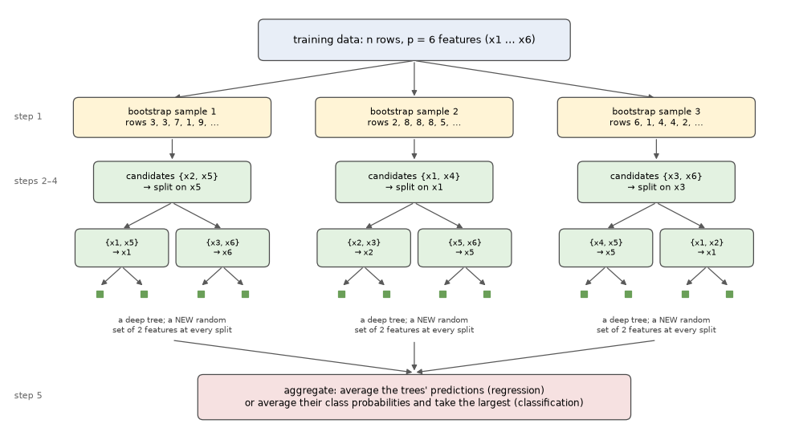
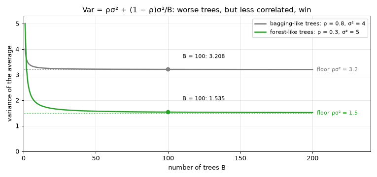
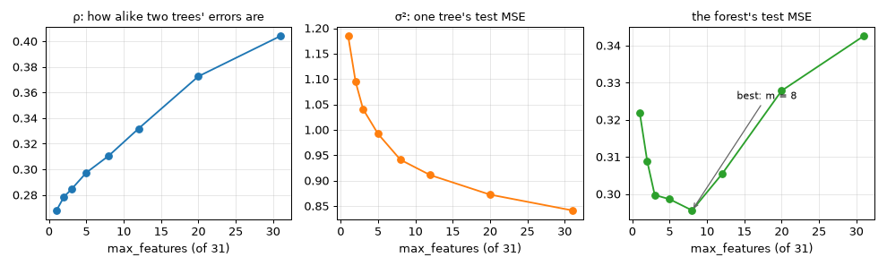

# Random Forest — explained from zero

> **Who this is for:** someone who is new to machine learning. You need school algebra (averages, squares,
> fractions) and a little Python. Every other idea — decision trees, impurity, bias, variance, correlation, the
> bootstrap — is built up here from scratch, with a picture or a tiny example first and the formula second.
>
> **How to read it:** sections 1–3 give the idea with no math. Sections 4–5 give the math, one small step at a time,
> and work one complete example by hand. Sections 6–9 are about using random forests in real ML work and — just as
> important — when **not** to use them. Every claim is demonstrated in the notebooks in [`lab/`](lab/README.md).
>
> Random forests are bagging plus one extra trick. If you have not read the bagging notes
> ([`../02-bagging/README.md`](../02-bagging/README.md)), section 2.6 gives the short version.

## Table of contents

0. [Random forest in 30 seconds](#0-random-forest-in-30-seconds)
1. [The problem random forests solve](#1-the-problem-random-forests-solve)
2. [The toolbox: the six ideas you need](#2-the-toolbox-the-six-ideas-you-need)
3. [Random forest step by step, in plain words](#3-random-forest-step-by-step-in-plain-words)
4. [The math: why it works](#4-the-math-why-it-works)
5. [A complete example by hand](#5-a-complete-example-by-hand)
6. [Using random forests in practice](#6-using-random-forests-in-practice)
7. [Why random forests make sense for machine learning](#7-why-random-forests-make-sense-for-machine-learning)
8. [Where random forests do NOT fit — and why](#8-where-random-forests-do-not-fit--and-why)
9. [Common misconceptions](#9-common-misconceptions)
10. [The labs](#10-the-labs)
11. [Glossary](#11-glossary)
12. [Further reading](#12-further-reading)
13. [Appendix - Assumptions made](#appendix---assumptions-made)

---

## 0. Random forest in 30 seconds

* A **decision tree** that is allowed to grow deep fits its training data almost perfectly, but it is **unstable**:
  change a few training rows and you get a very different tree (high *variance*).
* **Bagging** trains many deep trees, each on a different random resample of the rows (a *bootstrap sample*), and
  averages them. The average is much more stable than any single tree.
* But bagged trees are still **alike**: if one feature is clearly the best, every tree asks about it first, and they
  make similar mistakes. Averaging similar mistakes does not cancel them.
* A **random forest** adds one rule: **at every split, a tree may only choose among a fresh random handful of
  features** (`max_features` of them). That forces the trees to differ, so their mistakes are less correlated and
  the average is better — even though each individual tree gets a little worse.
* Result: one of the most reliable "out of the box" models for tabular data, with a free built-in error estimate
  (out-of-bag) and built-in feature-importance scores (which must be read with care, section 4.6).

---

## 1. The problem random forests solve

Imagine you want to predict something that depends on a quantity you cannot measure directly — say the true
temperature `z` of a chemical bath. You have **31 thermometers**: one expensive, precise one (`x0`) and thirty cheap,
noisy ones (`x1 … x30`). Every thermometer is useful; the precise one is the most useful *on its own*.

* **One deep tree** looks for the single best question at the top — a threshold on `x0` — and keeps splitting. It
  memorises the training data, noise included. Test error (Lab 5): **0.703**.
* **Bagging** (300 trees on bootstrap samples, averaged) cuts the error to **0.342**. But look inside: **every one of
  the trees** asks its first question about `x0` (Lab 3). The trees are near-copies at the top, so they share
  their mistakes, and the cheap thermometers are almost ignored — together they hold information the precise one
  lacks.
* **A random forest** lets each split choose among only 5 randomly picked thermometers. `x0` is available at a given
  split only 5/31 ≈ 16 % of the time, so trees are forced to also use — and therefore to average over — the cheap
  ones. Every single tree is worse than the bagged trees, but the forest's error drops to **0.299**.



The picture is the whole algorithm. Step 1 is bagging's bootstrap; steps 2–4 grow a deep tree in which **each split
picks its best question from a new random subset of the features**; step 5 averages (or votes). The only line that
differs from bagging is the "candidates {…}" in every green box.

What you get from a random forest:

| Benefit | Example in the labs |
|---|---|
| **Lower error than one tree or plain bagging** when several features carry signal | Lab 5: 0.703 → 0.342 → 0.299 |
| **Hardly any tuning**: deep trees, a few hundred of them, default `max_features` | Lab 9: CV and OOB pick the same setting |
| **A free validation score** (out-of-bag) | Lab 8: OOB R² 0.935 vs 5-fold CV 0.933 vs test 0.940 |
| **No feature scaling, mixed feature types, non-linear effects and interactions** handled automatically | Lab 5 (a sine of a hidden signal) |
| **Feature-importance scores** (with caveats) | Labs 2, 14, 15 |

---

## 2. The toolbox: the six ideas you need

### 2.1 A decision tree in one paragraph

A **decision tree** predicts by asking a sequence of yes/no questions about the features: "is `x3 ≤ 1.7`? — yes →
is `x0 ≤ −0.2`? — no → predict 2.4". Each question sends the training rows left or right; each final group (a
**leaf**) predicts the average target of its rows (regression) or the share of each class (classification). The tree
is grown **greedily**: at each node it tries every feature and every threshold and keeps the question that makes the
two groups "purest". The folder README has the long version with pictures:
[decision trees in one page](../README.md#2-decision-trees-in-one-page).

### 2.2 Impurity — "how mixed is this group?"

* **Classification — Gini impurity.** If a node's rows are in classes with shares $p_1, \dots, p_K$:
  $\text{Gini} = 1 - \sum_k p_k^2$. All one class → $1 - 1 = 0$ (pure). Half-half of two classes →
  $1 - 0.25 - 0.25 = 0.5$ (as mixed as two classes get). It is the chance that two rows drawn at random from the node
  have different labels.
* **Regression — MSE impurity.** The variance of the targets in the node: the average of $(y - \bar y)^2$. All rows
  have the same target → 0.

In a random forest rows have **weights** (how many times the bootstrap drew them), so "share" and "average" are
weighted: a row drawn 3 times counts 3 times.

### 2.3 How a tree picks a split — the weighted impurity decrease

A split sends $N_L$ of the node's $N_t$ rows left and $N_R$ right. How much did it help?

$$\Delta = i_t - \frac{N_L}{N_t}\,i_L - \frac{N_R}{N_t}\,i_R$$

(the node's impurity minus the size-weighted impurity of the two children). The tree tries every feature and every
threshold between two neighbouring values and keeps the largest $\Delta$. Multiplying by $N_t/N$ (the share of all
training rows that reach the node) gives the **weighted impurity decrease**, which is what feature importance adds up
(section 4.6).

Doing this naively is slow: trying all $n-1$ thresholds and recomputing both children each time costs $n^2$ steps per
feature. Sorting once and keeping **running totals** (cumulative sums) costs about $n \log n$ — the from-scratch
notebook times both (section 3 there: ≈ 360 ms vs ≈ 1.2 ms at 16,000 rows).

### 2.4 Bias, variance, and why deep trees are unstable

Imagine re-collecting the training set many times and refitting the model each time. At a fixed input $x$:

* **bias** = how far the *average* prediction (over those refits) is from the truth — a systematic error;
* **variance** = how much the predictions *scatter* around their own average — an instability error.

Expected squared error = bias² + variance + noise (the part no model can remove). A **deep tree** has low bias (it
can bend to any shape) and high variance (its exact splits depend on which rows it happened to see). In Lab 6 a single
deep tree has bias² 0.106 but variance 0.494. Averaging many trees attacks the variance. The folder README has more:
[bias and variance in one page](../README.md#3-bias-and-variance-in-one-page).

### 2.5 Correlation, and the variance of an average

The **correlation** $\rho$ of two random quantities measures how much they move together: $\rho = 1$ — always in
step; $\rho = 0$ — unrelated. If you average $B$ quantities that each have variance $\sigma^2$:

* if they are **independent** ($\rho = 0$), the average has variance $\sigma^2 / B$ — 100 of them, 100× less;
* if they are **identical** ($\rho = 1$), averaging does nothing: still $\sigma^2$;
* in between (section 4.1): $\rho\sigma^2 + (1-\rho)\,\sigma^2/B$.

The trees of a forest are trained on overlapping data, so they are positively correlated. **How correlated they are
decides how much averaging can help.** That single fact is the reason random forests exist.

### 2.6 Bagging recap: bootstrap, averaging, out-of-bag

([long version](../02-bagging/README.md))

* **Bootstrap sample:** draw $n$ rows *with replacement* from the $n$ training rows. Some rows appear 2, 3, 4 times;
  about $1 - 1/e \approx$ **63.2 %** of the distinct rows appear at least once, so about **36.8 %** are left out.
* **Bagging** (*bootstrap aggregating*): fit one deep tree per bootstrap sample, then average the predictions
  (regression) or the class probabilities (classification).
* **Out-of-bag (OOB) rows** of a tree are the ≈ 36.8 % it never saw. Predicting each training row with only the trees
  for which it was out-of-bag gives an honest error estimate for free.

A random forest is exactly this, plus per-split feature sampling.

---

## 3. Random forest step by step, in plain words

Choose the number of trees $B$ (`n_estimators`) and the number of candidate features per split $m$ (`max_features`).
Then, for each of the $B$ trees:

1. **Bootstrap.** Draw a bootstrap sample of the training rows (scikit-learn does not copy rows; it gives each row a
   *weight* equal to the number of times it was drawn).
2. **Grow a tree from the root.** At the current node, look at the rows that reached it.
3. **Pick $m$ candidate features at random** (without replacement) — a *new* random set at *every* node. (Detail: if
   all of the drawn features happen to be constant in this node, keep drawing until at least one is usable.)
4. **Find the best split among those $m$ features only** (largest impurity decrease, section 2.3), split, and repeat
   steps 3–4 in each child. Stop when a node is pure or too small (`min_samples_leaf`, `max_depth`, …). By default
   the trees are grown **fully** — no pruning.

Finally:

5. **Aggregate.** Regression: the forest's prediction is the **average** of the $B$ trees. Classification: average
   the trees' class probabilities and pick the most likely class (scikit-learn's "soft vote"; Breiman's original
   paper used a majority vote of the trees' classes).

With $m = p$ (all features) steps 3–4 reduce to an ordinary tree and the forest is exactly **bagging**. With
$m = 1$ every split is on a random feature (only the threshold is optimised). The useful range is in between.

---

## 4. The math: why it works

### 4.1 The variance of an average of correlated trees

Let $T_1(x), \dots, T_B(x)$ be the trees' predictions at a point $x$ — random, because the training set, the
bootstrap and the feature draws are random. Assume each has variance $\sigma^2$ and each pair has correlation $\rho$
(covariance $\rho\sigma^2$). The variance of a sum is the sum of all variances and all covariances:

$$\text{Var}\Big(\frac1B\sum_{b=1}^B T_b\Big) = \frac{1}{B^2}\Big[\underbrace{B\,\sigma^2}_{\text{variances}} + \underbrace{B(B-1)\,\rho\sigma^2}_{\text{covariances}}\Big] = \rho\sigma^2 + \frac{1-\rho}{B}\,\sigma^2 .$$

Read it term by term:

* the second term **shrinks as you add trees** and vanishes for large $B$;
* the first term, $\rho\sigma^2$, **does not depend on $B$ at all**: it is a floor that no number of trees can break.

So once a forest has enough trees, **its variance is about $\rho\sigma^2$**, and the only ways to improve are to make
the trees less correlated (smaller $\rho$) or individually more stable (smaller $\sigma^2$).



The picture is the hand-worked example of section 5: bagging-like trees ($\rho = 0.8$, $\sigma^2 = 4$) are stuck near
3.2; forest-like trees are individually worse ($\sigma^2 = 5$) but much less alike ($\rho = 0.3$) and end near 1.5.

### 4.2 Why per-split feature sampling lowers ρ — and what it costs

Bagged trees are correlated because their bootstrap samples overlap heavily (each shares ~63 % of its distinct rows
with any other) **and** because the greedy split search is deterministic: given similar data it asks similar questions.
If one feature is strong, *every* bagged tree uses it at the root, so the trees agree at the top and differ only in
small details deep down.

Restricting each split to $m$ random candidates breaks that: the strong feature is available at a given split with
probability only $m/p$. Different trees start with different questions, partition the data differently, and their
errors overlap less — **ρ falls**. The price: at many splits the best feature is not available, so each tree is a bit
worse — **σ² rises** (and, usually, the bias of each tree rises a little, section 4.3).

The forest's error $\approx \rho\sigma^2$ is a product of a falling and a rising curve, so it has a minimum somewhere
in the middle. Lab 4 measures both on the thermometer data:



ρ falls from 0.404 (m = 31, bagging) to 0.268 (m = 1); σ² rises from 0.841 to 1.185; the forest's test MSE is
U-shaped with its best value 0.296 at m = 8.

**Recommended $m$.** Breiman and *The Elements of Statistical Learning* (ESL, §15.3) suggest
$m = \lfloor\sqrt p\rfloor$ for classification and $m = \lfloor p/3\rfloor$ for regression, as starting points to tune.
**scikit-learn's defaults** (checked in Lab 3, version 1.9): `RandomForestClassifier(max_features="sqrt")`, but
`RandomForestRegressor(max_features=1.0)` — **all features, i.e. plain bagging**. (Since version 1.1 the regressor's
default is written `1.0`; the older `"auto"` meant the same.) For regression you have to set `max_features`
yourself (`"sqrt"`, `1/3`, or tune it) to get a random forest.

### 4.3 Bias: averaging does not change it

The average of the trees has the same expected value as one tree:
$E\big[\frac1B\sum_b T_b(x)\big] = E[T(x)]$. So

$$\text{bias of the forest} = \text{bias of one of its randomised trees.}$$

A random forest is a **variance-reduction** method. Lab 6 checks this over 30 independent training sets: one deep
tree vs bagging have bias² 0.106 vs 0.113, one randomised tree vs the forest 0.080 vs 0.083 (equal up to the small
effect of bootstrapping), while variance drops 13× (bagging) and 40× (forest).

Is a randomised tree's bias higher or lower than an ordinary tree's? ESL's answer — usually a little higher, because
the best feature is sometimes unavailable. Lab 11 shows an extreme case (3 useful features among 150: each tree is
barely better than a coin flip). Lab 6 shows the opposite: on the thermometer data the forest's bias is *lower* than
bagging's (0.083 vs 0.113), because unrestricted trees lean almost only on `x0` and ignore what the 30 cheap
thermometers say together. Either way, it is the **variance** that averaging removes.

### 4.4 More trees never over-fit; the out-of-bag estimate

From 4.1, adding trees only shrinks the term $(1-\rho)\sigma^2/B$; nothing gets worse. The test error falls quickly
and then flattens — it does **not** turn back up (Lab 7: 0.824 with 1 tree, 0.306 with 100, 0.296 with 500). What
*can* over-fit is **each tree**: that is controlled by tree-size settings (`min_samples_leaf`, `max_depth`,
`max_leaf_nodes`), not by `n_estimators`.

**Out-of-bag (OOB) error.** A row is left out of one bootstrap sample with probability
$(1 - 1/n)^n \approx e^{-1} \approx 0.368$. For each training row, average only the trees that did not see it and
compare with its true target; averaging over rows gives the OOB error. It behaves like a cross-validation estimate
(Lab 8: OOB R² 0.935, 5-fold CV 0.933, test 0.940) at the cost of one fit instead of five. With few trees it is a
bit pessimistic, because each OOB prediction uses only ~37 % of the trees.

### 4.5 Per-split vs per-tree feature sampling

Bagging libraries can also sample features — but **once per tree** ("random subspace" method,
`BaggingRegressor(max_features=…)`): the whole tree sees only those features. A random forest samples **at every
split**. The difference matters:

* per tree: a tree that did not get the strong feature never uses it; each tree is permanently handicapped;
* per split: the strong feature is missing at some splits but available again at the next; every tree can use every
  feature somewhere.

Lab 3 (5 of 31 features either way): random subspace test MSE 0.352, bagging 0.343, random forest 0.299. Every
random-forest tree uses all 31 features somewhere; every random-subspace tree uses exactly 5.

### 4.6 Feature importance: MDI and its biases

**Mean decrease in impurity (MDI)** — scikit-learn's `feature_importances_`, also called *Gini importance*. For one
tree, add up, over every split node $t$ that uses feature $j$, the weighted impurity decrease of that split:

$$\text{MDI}_j(\text{tree}) = \sum_{t \text{ splits on } j} \frac{N_t}{N}\Big[\,i_t - \frac{N_L}{N_t}\,i_L - \frac{N_R}{N_t}\,i_R\,\Big]$$

($N$ = weighted rows at the root, $N_t$ = weighted rows at node $t$). Normalise so the tree's importances sum to 1,
then average over the trees (and renormalise). Two things the old notes got wrong (Lab 2): you add the **decrease**
(parent minus children), not the node's raw impurity; and you add it to the feature the node actually uses.

MDI is free and fast, but **biased**:

1. **Computed on the training rows.** Deep trees memorise the training data; late splits that only fit noise still
   "decrease impurity" and earn importance.
2. **Favours features with many distinct values.** A continuous feature offers hundreds of thresholds and wins many
   of those noise-fitting splits; a 0/1 feature offers one. Lab 14: a **pure-noise** continuous feature gets the
   largest MDI (0.557), above the truly most important feature (0.321).
3. **Correlated features share the credit** — and how they share it depends on `max_features`. Lab 15: the precise
   thermometer gets 0.829 of the importance under bagging but 0.168 in the forest, for the same underlying signal.

**Permutation importance** fixes the first two: on **held-out** data, shuffle one feature's column (breaking its link
to the target) and measure how much the score drops. A feature the model does not really use costs nothing when
shuffled (Lab 14: the noise feature's permutation importance is 0.006 ± 0.022). It still has problem 3 in the other
direction: if 30 other features carry the same information, shuffling one costs little (Lab 15) — permute
correlated features **as a group**.

---

## 5. A complete example by hand

### 5.1 The variance arithmetic

Suppose one tree's prediction at some point has variance $\sigma^2 = 4$ and bagged trees have correlation
$\rho = 0.8$. With $B = 100$ trees:

$$0.8 \times 4 + (1 - 0.8) \times \frac{4}{100} = 3.2 + 0.008 = \mathbf{3.208}$$

— barely better than one tree's 4; and even with infinitely many trees, $\rho\sigma^2 = 3.2$.

Now restrict the features per split. Each tree gets worse, say $\sigma^2 = 5$, but the trees are much less alike,
$\rho = 0.3$:

$$0.3 \times 5 + 0.7 \times \frac{5}{100} = 1.5 + 0.035 = \mathbf{1.535}$$

Worse trees, half the variance. Lab 1 computes both numbers and confirms them by simulation (3.209 and 1.523).

### 5.2 A tiny tree and its feature importance (MDI)

Eight rows, two features, two classes (A, B):

| row | 1 | 2 | 3 | 4 | 5 | 6 | 7 | 8 |
|---|---|---|---|---|---|---|---|---|
| $x_1$ | 1 | 2 | 3 | 4 | 5 | 6 | 7 | 8 |
| $x_2$ | 2 | 4 | 6 | 8 | 3 | 1 | 5 | 7 |
| class | A | A | A | A | B | A | B | B |

**Step 1 — root impurity.** 5 A and 3 B: $\text{Gini} = 1 - (5/8)^2 - (3/8)^2 = 1 - 25/64 - 9/64 = 30/64 = \mathbf{0.46875}$.

**Step 2 — best root split.** Try $x_1 \le 4.5$ (the midpoint between 4 and 5): left = rows 1–4 = 4 A (Gini 0);
right = rows 5–8 = 1 A, 3 B, Gini $= 1 - (1/4)^2 - (3/4)^2 = 6/16 = 0.375$. Decrease:

$$\Delta = 0.46875 - \tfrac48 \cdot 0 - \tfrac48 \cdot 0.375 = 0.46875 - 0.1875 = \mathbf{0.28125}$$

No other split does better. The next best on $x_1$ is $x_1 \le 6.5$ (5 A 1 B | 2 B), decrease 0.2604; the best on
$x_2$ is $x_2 \le 2.5$ (2 A | 3 A 3 B), only 0.09375 — in $x_2$ the classes are interleaved. So the root splits on
$x_1$. The left child is pure → leaf.

**Step 3 — split the right child** (rows 5–8: $x_2$ = 3 B, 1 A, 5 B, 7 B). $x_2 \le 2.0$ (midpoint of 1 and 3)
separates the A from the three B's: both children pure. With $N_t/N = 4/8$:

$$\tfrac48\,\big[\,0.375 - \tfrac14 \cdot 0 - \tfrac34 \cdot 0\,\big] = \mathbf{0.1875}$$

(Splitting on $x_1$ instead could not isolate the A, which sits in the middle at $x_1 = 6$.)

**Step 4 — MDI.** $x_1$ earned 0.28125, $x_2$ earned 0.1875; total 0.46875 (= the root impurity, because every
leaf is pure). Normalised:

$$\text{MDI}(x_1) = \frac{0.28125}{0.46875} = \mathbf{0.6}, \qquad \text{MDI}(x_2) = \frac{0.1875}{0.46875} = \mathbf{0.4}.$$

**The old notes' version, for contrast.** It added each split node's **raw impurity** to `importance[feature − 1]`.
The root (feature index 0) adds 0.46875 to index −1, which Python reads as the *last* feature, $x_2$; the right node
(index 1) adds 0.375 to index 0, $x_1$. Normalised: $x_1 = 0.375/0.84375 = 0.444$, $x_2 = 0.556$ — **the ranking is
reversed.**

Lab 1 of the library notebook reproduces every number, and scikit-learn's tree grows exactly this tree and reports
`feature_importances_ = [0.6, 0.4]`; Lab 2 shows the old version giving `[0.444, 0.556]`. The from-scratch notebook
reproduces the same numbers with its own functions (sections 2, 3, 5, 7).

---

## 6. Using random forests in practice

### 6.1 The recipe in scikit-learn

```python
from sklearn.ensemble import RandomForestClassifier, RandomForestRegressor
from sklearn.model_selection import train_test_split

X_train, X_test, y_train, y_test = train_test_split(X, y, test_size=0.3, random_state=0)

forest = RandomForestRegressor(
    n_estimators=300,        # more is never worse, only slower (4.4)
    max_features="sqrt",     # THE random-forest knob; the regressor's default 1.0 = bagging (4.2)
    min_samples_leaf=1,      # tree size: raise it for very noisy targets or to save memory (6.4)
    oob_score=True,          # free out-of-bag estimate (4.4)
    n_jobs=-1,               # trees are independent: use all CPU cores
    random_state=0,
)
forest.fit(X_train, y_train)
print(forest.oob_score_)               # R² (regressor) or accuracy (classifier) on out-of-bag rows
print(forest.score(X_test, y_test))    # touch the test set once, at the end
```

No scaling is needed: trees only compare a feature with thresholds, so units do not matter.

### 6.2 Hyper-parameters

| Parameter | What it does | Good default / how to choose |
|---|---|---|
| `n_estimators` | number of trees $B$ | a few hundred; increase until the OOB score stops improving (never hurts accuracy) |
| `max_features` | candidates per split $m$ | classification `"sqrt"`; regression `1/3` or `"sqrt"` (the regressor's default `1.0` is bagging); tune with OOB or CV |
| `min_samples_leaf` | smallest leaf (in **distinct rows**, see 6.4) | 1 (classification), 1–5 (regression); larger = shallower trees, less variance, more bias |
| `max_depth`, `max_leaf_nodes` | other ways to limit tree size | `None` (fully grown); limit them mainly to save memory/time |
| `bootstrap`, `max_samples` | resample rows? how many per tree? | `True`, all rows; smaller `max_samples` = more diverse, weaker trees and faster fitting |
| `criterion` | impurity measure | `"gini"` / `"squared_error"`; rarely matters |
| `class_weight` | re-weight classes | `"balanced"` or `"balanced_subsample"` for imbalanced classes |
| `oob_score` | compute the OOB estimate | `True` whenever `bootstrap=True` |

**Extremely randomised trees** (`ExtraTreesClassifier/Regressor`, Geurts et al. 2006) go one step further: besides
sampling candidate features, they draw each candidate's **threshold at random** and keep the best of those random
splits, and by default they do not bootstrap. Trees are even less correlated and much faster to grow, at the cost of
some extra bias per tree. On the thermometer data they score 0.270 vs the forest's 0.299 (Lab 5); on other data the
order can flip. Treat them as one more `max_features`-style knob worth one CV run.

### 6.3 Reading the output

| scikit-learn attribute | What it is | Plain words |
|---|---|---|
| `estimators_` | the fitted trees | each is a `DecisionTree…` you can inspect or predict with |
| `estimators_samples_` | each tree's bootstrap draws (row numbers) | `np.bincount` of it = the sample weights that tree was trained with |
| `oob_score_` | OOB R² or accuracy | an honest score without a validation set |
| `oob_prediction_` / `oob_decision_function_` | per-row OOB prediction / class probabilities | use them for OOB-based tuning or diagnostics |
| `feature_importances_` | MDI, averaged over trees, sums to 1 | quick look only — biased (4.6) |
| `tree.tree_.children_left`, `children_right` | node numbers of each node's children; `-1` = leaf | the tree's shape |
| `tree.tree_.feature`, `threshold` | the question at each node (`-2` at leaves) | "is `x[feature] <= threshold`?" |
| `tree.tree_.impurity` | Gini or MSE of the node's training rows | used by MDI |
| `tree.tree_.n_node_samples`, `weighted_n_node_samples` | distinct rows / bootstrap-weighted rows at the node | in a forest tree these differ (Lab 2: 353 vs 560 at a root) |
| `tree.tree_.value` | the node's prediction | regression: the weighted mean; classification (scikit-learn ≥ 1.4): **class fractions** — multiply by `weighted_n_node_samples` for counts |

### 6.4 Cost: time and memory

* **Fitting** costs roughly $B \times$ (number of nodes) $\times\, m \cdot n_t \log n_t$: proportional to the number of
  trees and to `max_features` (the from-scratch notebook times the root split: ≈ 0.1 ms with 1 candidate, ≈ 6 ms with
  150). Trees are independent, so `n_jobs=-1` gives a near-linear speed-up.
* **Memory**: a fully grown tree has about $2\times$(distinct rows it saw) $- 1$ nodes; scikit-learn stores about
  72 bytes per node (one output). Lab 16: 100 deep trees on 20,000 rows take **176 MB**; with
  `min_samples_leaf=5`, 29 MB.
* **Sample weights, not copies.** scikit-learn passes the bootstrap counts as `sample_weight`; nothing is duplicated.
  One consequence: `min_samples_leaf` and `min_samples_split` count **distinct** rows. (The from-scratch notebook
  shows a tree on duplicated rows growing 315 nodes where the weighted tree grows 191.)

### 6.5 Avoiding leakage while tuning

* The **test set** is for the final, one-time score. Choosing hyper-parameters by their test score (as the old notes'
  Optuna loop did) makes the reported test score optimistic.
* Choose `max_features`, `min_samples_leaf`, … with **cross-validation on the training set**, or with the **OOB
  score** (one fit per setting instead of five). Lab 9: both choose `max_features=5, min_samples_leaf=1`; the test set
  is then used once (MSE 0.296).
* Any preprocessing that learns from data (feature selection, imputation, target encoding) goes inside a `Pipeline`,
  so that cross-validation refits it on each training fold (Lab 11).
* OOB and shuffled CV assume independent rows. With time series or groups (several rows per customer), use
  `TimeSeriesSplit` / `GroupKFold` and do not trust the OOB score.

---

## 7. Why random forests make sense for machine learning

**The core belief behind random forests:** the relationship between features and target is complicated
(non-linear, with interactions) but **many features carry some of the signal**, so many different good trees exist.
Deep trees can represent the complicated shape (low bias); averaging many *different* good trees removes their
instability (low variance). When that belief holds:

1. **Strong accuracy with little effort.** Deep trees + `sqrt`/`p/3` + a few hundred trees is a competitive baseline
   on most tabular problems; tuning usually moves the score only a little (Lab 9's CV table).
2. **No preprocessing.** No scaling, no need to linearise effects or to hand-craft interactions; mixed numeric and
   (integer-coded) categorical features work.
3. **Built-in honesty.** The OOB score is a validation estimate that costs nothing (Lab 8).
4. **Hard to over-fit by adding trees** (Lab 7). The main risk knob is tree size, and the default (fully grown) is
   usually right.
5. **Robust to noisy, redundant features.** When many features measure the same thing, the forest averages over
   them instead of betting on one (Labs 3, 6, 15).
6. **Parallel and simple.** Trees are independent: fitting scales across cores, and the algorithm has few moving parts.

**It is the right tool when** the data are tabular, the signal is spread over several features, and the
relationship is non-linear. The next section is what happens when one of those breaks.

---

## 8. Where random forests do NOT fit — and why

| # | Situation | Why it fails | Use instead | Lab |
|---|---|---|---|---|
| 8.1 | **A few relevant features among many irrelevant ones** (the bad-fit dataset) | most random candidate sets contain no relevant feature; trees become near-random | larger `max_features` (tuned), feature selection in a pipeline, gradient boosting | 11 |
| 8.2 | Smooth, linear or additive target | a staircase of axis-aligned steps approximates a tilted plane badly | linear / additive models; or a linear model + forest on its residuals | 12 |
| 8.3 | Predictions needed outside the training range | each leaf predicts an average of training targets | models with a trend (linear, or detrend first) | 13 |
| 8.4 | Feature importance used for decisions | MDI is computed on training data and favours many-valued features | permutation importance on held-out data | 14 |
| 8.5 | Strongly correlated features | credit is shared (MDI) or hidden (permutation) | group features; permute groups | 15 |
| 8.6 | Tight memory or latency budgets | deep trees have ~2 nodes per training row, × hundreds of trees | limit tree size, fewer trees, boosted shallow trees, linear models | 16 |

### 8.1 A few needles in a haystack (the bad-fit dataset)

**Why:** with $p = 150$ features of which 3 matter and the default $m = \sqrt{150} \approx 12$ candidates, the chance
that a split sees *at least one* relevant feature is $1 - \binom{147}{12}/\binom{150}{12} \approx$ **22.3 %**. About
four splits in five are made between noise features. Each tree is then barely better than a coin flip (average
single-tree accuracy 0.570). Averaging still helps a lot — the weak trees' mistakes partly cancel, and the forest
reaches 0.792 — but it cannot make up for trees that rarely see a relevant feature: the rest of the gap closes only
when each tree gets better. Lab 11: forest test accuracy 0.792 with
the default, versus 0.850 with `max_features=100` (chosen by OOB), 0.858 after selecting 10 features by mutual
information *inside a pipeline*, 0.871 for gradient boosting, and 0.875 for an "oracle" forest that is told the
three relevant features. **Fix:** tune `max_features` (here, large); select features inside cross-validation; or use
boosting, which concentrates on whichever features keep reducing the error.

### 8.2 Smooth linear targets

**Why:** a tree's prediction is piecewise constant along each feature axis. A plane tilted in 10 directions needs
enormous numbers of small steps, and the forest flattens at the edges of the data. Lab 12 reruns the old notes'
`make_regression` example (a linear target in 10 informative features plus noise s.d. 0.1): forest MSE **7382**
(R² 0.81) — the old notes printed 7365 without comment — while linear regression gets **0.01** (R² 1.0000).
**Fix:** a linear (or generalised additive) model; if there is also non-linear structure, fit the linear model first
and a forest on its residuals.

### 8.3 Extrapolation

**Why:** every leaf predicts an average of training targets, so the forest's prediction never leaves the range of
targets it has seen. Lab 13: trained on $y \approx 2x$ for $x \in [0, 5]$, the forest predicts 9.83 at $x = 8$ where
the truth is 16 (linear regression: 15.95). The bagging notes treat this in detail
([`../02-bagging/README.md`](../02-bagging/README.md)). **Fix:** a model with a trend, or remove the trend before
fitting the forest.

### 8.4 Misleading impurity importance

**Why:** MDI is computed on the training rows that deep trees memorise, and a feature with many distinct values offers
many thresholds for noise-fitting splits (section 4.6). Lab 14: a pure-noise continuous feature gets MDI 0.557, the
real 0/1 feature 0.321; on the test set their permutation importances are 0.006 ± 0.022 and 0.173. Larger leaves
(`min_samples_leaf=20`) reduce the bias (noise MDI 0.098) but do not remove it. **Fix:** permutation importance (or
drop-column importance) on held-out data; use MDI only as a quick first look.

### 8.5 Correlated features

**Why:** when several features carry the same information, the model can use any of them. MDI splits the credit in a
way that depends on `max_features` (Lab 15: the precise thermometer gets 0.829 under bagging, 0.168 in the forest), and
permutation importance hides it (shuffling one thermometer costs little because the others substitute: the 31
single-feature importances sum to 0.308, but shuffling all 31 together costs 1.719 of R²). **Fix:** cluster or group
correlated features and report (or permute) groups.

### 8.6 Size and speed

**Why:** a fully grown tree has about two nodes per distinct training row; a forest multiplies that by hundreds.
Lab 16: 176 MB for 100 trees on 20,000 rows, a few milliseconds to predict one row versus ≈ 0.04 ms for a linear model;
the from-scratch notebook extrapolates ~9 GB at a million rows. **Fix:** `min_samples_leaf` / `max_depth` /
`max_leaf_nodes` (29 MB with `min_samples_leaf=5`, checked by CV), fewer trees (100 was as good as 500 in Lab 7), or a
gradient-boosted model of small trees.

**Rule of thumb:** before choosing a random forest, ask — *Is the signal spread over several features, or hidden in a
few among many? Is the relationship non-linear, or essentially a straight line? Will I need predictions outside the
training range? Do I need small, fast models? Am I going to trust `feature_importances_`?*

---

## 9. Common misconceptions

| Myth | Reality |
|---|---|
| "A random forest is a collection of **weak learners**." | Its trees are deep, **strong**, high-variance learners (each fits its own training rows perfectly; test R² ≈ 0.80 in Lab 5). "Weak learner" — barely better than guessing — is boosting vocabulary. |
| "Random forests are **lower-bias** models than their trees." | Averaging leaves bias unchanged: forest bias = the bias of one randomised tree (4.3, Lab 6). The forest's gain is **variance**. |
| "`RandomForestRegressor` samples features by default." | Its default `max_features=1.0` means **all** features: the default regressor is **bagging** (Lab 3: identical predictions). Set `max_features` yourself. |
| "A random forest is bagging with a random feature subset **per tree**." | That is the *random subspace* method. A forest draws a new subset **at every split** (4.5, Lab 3: 0.299 vs 0.352). |
| "The trees' errors are uncorrelated, so they cancel out." | They are **less** correlated, never uncorrelated: the variance floor is ρσ² (4.1). Lab 4: ρ ≈ 0.3–0.4. |
| "More trees will eventually over-fit." | Adding trees only shrinks $(1-\rho)\sigma^2/B$; the error levels off (Lab 7). Tree **size** is what can over-fit. |
| "The spread between a forest's trees is the forest's variance." | That spread is the trees' σ². The forest's variance is how much *its average* changes with a new training set — measured in Lab 6 (0.017 vs the trees' 0.676). |
| "MDI = sum of the impurities of the nodes that use a feature." | It is the sum of the **weighted impurity decreases** of those splits, normalised per tree and averaged (4.6; the old version even reversed the ranking in section 5). |
| "`feature_importances_` tells me which features matter." | It is biased towards many-valued features and computed on training data (Lab 14: pure noise ranked first). Use permutation importance on held-out data. |
| "`tree_.value` holds class counts." | In scikit-learn ≥ 1.4 it holds **class fractions** for classifiers; multiply by `weighted_n_node_samples` for (weighted) counts (Lab 2). |
| "Remove trees whose residuals are highly correlated to keep the forest diverse." | Lower `max_features` to decorrelate. Selecting trees by their residuals on the test set leaks it; even on OOB rows it is rarely worth it. |
| "Tune hyper-parameters to maximise the score on `x_test`." | That is test-set leakage. Tune with CV or OOB; touch the test set once (Lab 9). |
| "The median of the trees is better than the mean" / "it makes no difference." | Neither always: the median is more robust to corrupted targets (Lab 10: 1.027 → 0.263) but worse for bagged trees on smooth data (3.802 → 4.077). |
| "Boosting always beats random forests." | Often on tuned tabular benchmarks, not always; a forest needs far less tuning and cannot over-fit by adding trees. On the sparse-signal data boosting clearly beats the *default* forest (Lab 11: 0.871 vs 0.792). |

---

## 10. The labs

Everything above is demonstrated in two Jupyter notebooks. Setup, run instructions and a question-by-question map are
in **[`lab/README.md`](lab/README.md)**.

**[`lab/random_forest_lab.ipynb`](lab/random_forest_lab.ipynb)** — scikit-learn, 16 labs:

| Part | Labs | README sections |
|---|---|---|
| A. How it works | 1 hand example · 2 inside `tree_` + correct MDI · 3 per-split vs per-tree sampling, defaults · 4 ρ vs σ² trade-off | 2, 4.1, 4.2, 4.5, 4.6, 5 |
| B. Why it's useful | 5 tree vs bagging vs forest · 6 bias & variance over 30 training sets · 7 trees vs tree size, OOB curve · 8 OOB vs CV · 9 tuning without the test set · 10 mean vs median | 4.3, 4.4, 6, 7 |
| C. Where it fails | 11 sparse signal (bad-fit data) · 12 linear target · 13 extrapolation · 14 misleading MDI · 15 correlated features · 16 size and speed | 8 |

**[`lab/random_forest_from_scratch.ipynb`](lab/random_forest_from_scratch.ipynb)** — NumPy only, checked against
scikit-learn:

| Section | Theory step (README §) | Implementation hurdle shown |
|---|---|---|
| 1 Data | — | scikit-learn's trees work in `float32` |
| 2 Impurity | 2.2 | — (8-row example: 0.46875, 0.375) |
| 3 Best split | 2.3, 5 | split-search cost: naive $O(n^2)$ vs sort + cumulative sums (≈ 360 ms vs ≈ 1.2 ms) |
| 4 Feature sampling | 3 | lazy drawing past `max_features` when drawn features are constant |
| 5 One tree | 3 | sample weights vs duplicated rows (`min_samples_leaf` counts distinct rows) |
| 6 Forest, OOB | 2.6, 4.4 | bootstrap counts as weights; OOB bookkeeping |
| 7 MDI | 4.6, 5 | weighted decrease, per-tree normalisation (the old bug, reproduced) |
| 8 Cost and memory | 6.4 | time ∝ `max_features`; ≈ 2 nodes per distinct row |
| 9 Bagging limit vs scikit-learn | 4.2 | exact ties between features → scikit-learn's feature order must be replayed; then **100/100 trees identical, prediction difference 0** |
| 10 Random forest vs scikit-learn | 3, 4.4 | different random numbers → statistical agreement (as close as scikit-learn with another seed); replayed random numbers → 100/100 and 95/100 identical trees (the rest: last-bit rounding of exact ties) |

---

## 11. Glossary

| Term | Meaning |
|---|---|
| **Decision tree (CART)** | A model that predicts by a sequence of yes/no questions "is `x[j] <= t`?"; each leaf predicts an average or class shares. |
| **Leaf / node / root** | End point of a tree / any question point / the first question. |
| **Impurity (Gini, MSE)** | How mixed a node's targets are: $1-\sum p_k^2$ for classes, the variance for numbers. |
| **Weighted impurity decrease** | $\frac{N_t}{N}[i_t - \frac{N_L}{N_t}i_L - \frac{N_R}{N_t}i_R]$: how much a split cleaned up, scaled by how many rows reach it. |
| **Bias / variance** | Systematic error of the average model / scatter of the model across training sets. |
| **Bootstrap sample** | $n$ rows drawn with replacement from $n$; ≈ 63.2 % distinct rows. |
| **Bagging** | Bootstrap aggregating: average models fitted on bootstrap samples. |
| **Random forest** | Bagged deep trees in which every split chooses among `max_features` randomly drawn features. |
| **`max_features` ($m$, "mtry")** | Number of candidate features per split. $m = p$ is bagging. |
| **Correlation ρ (between trees)** | How alike two trees' predictions (errors) are; sets the variance floor ρσ². |
| **Decorrelation** | Making trees less alike (lower ρ) — the purpose of per-split feature sampling. |
| **Random subspace method** | Bagging with one random feature subset **per tree**. |
| **Extremely randomised trees** | Forest variant that also draws thresholds at random. |
| **Out-of-bag (OOB)** | Rows a tree did not see; OOB error = error of predicting each row with only those trees. |
| **MDI ("Gini importance")** | Feature importance = total weighted impurity decrease of the feature's splits, normalised and averaged over trees. |
| **Permutation importance** | Drop in a held-out score when one feature's column is shuffled. |
| **Weak learner** | (Boosting term) a model only slightly better than guessing — *not* what a forest's trees are. |
| **Sample weight** | How much a row counts; a forest uses bootstrap counts as weights instead of copying rows. |
| **Data leakage** | Letting test-set information influence training or model choice. |

---

## 12. Further reading

* Leo Breiman, *Random Forests*, Machine Learning 45 (2001) — the original paper (strength vs correlation, OOB,
  importance).
* Hastie, Tibshirani, Friedman, *The Elements of Statistical Learning* (2nd ed.), chapter 15 — the variance formula
  $\rho\sigma^2 + (1-\rho)\sigma^2/B$, recommended `max_features`, bias of forests.
* James, Witten, Hastie, Tibshirani, *An Introduction to Statistical Learning* (2nd ed.), §8.2 — a gentle introduction
  (this repo's ISLR notes are in [`../../islr_notes`](../../islr_notes)).
* Gilles Louppe, *Understanding Random Forests: From Theory to Practice* (PhD thesis, 2014) — MDI theory and the
  scikit-learn implementation, by one of its authors.
* Strobl, Boulesteix, Zeileis, Hothorn, *Bias in random forest variable importance measures* (BMC Bioinformatics, 2007).
* Geurts, Ernst, Wehenkel, *Extremely randomized trees* (Machine Learning, 2006); Tin Kam Ho, *The random subspace
  method for constructing decision forests* (IEEE PAMI, 1998).
* scikit-learn user guide, *Ensembles: forests of randomized trees*, and the example *Permutation Importance vs Random
  Forest Feature Importance (MDI)*.
* **Several targets at once** (multi-output regression, multi-label classification). In scikit-learn 1.9.1, a
  forest fitted on a 2-D target is **one** forest, not one per target:
  * every leaf stores all targets' values;
  * the impurity of a node is the average of the per-target impurities, so a split is scored by its total drop in
    error over all targets;
  * a large-variance target therefore steers the splits unless the targets are standardised.
  * scikit-learn user guide, *Decision Trees → Multi-output problems*: "use splitting criteria that compute the
    average reduction across all n outputs". The source is the criterion code in `sklearn/tree/_criterion.pyx`.
  * The trees underneath:
    * Mark Segal, *Tree-Structured Methods for Longitudinal Data*, JASA 87 (1992), and Glenn De'ath, *Multivariate
      Regression Trees*, Ecology 83(4) (2002): one tree for a whole vector of responses. De'ath's version sums the
      squared errors over the responses.
    * Hendrik Blockeel, Luc De Raedt & Jan Ramon, *Top-down Induction of Clustering Trees*, ICML (1998): predictive
      clustering trees, the basis of the papers below.
  * Mark Segal & Yuanyuan Xiao, *Multivariate Random Forests*, WIREs Data Mining and Knowledge Discovery 1(1) (2011)
    — random forests for a vector response.
  * Dragi Kocev, Celine Vens, Jan Struyf & Sašo Džeroski, *Tree Ensembles for Predicting Structured Outputs*,
    Pattern Recognition 46(3) (2013).
    * One random forest for all targets and one per target were not significantly different in accuracy.
    * The shared forest was 4 times faster to build and 3.4 times smaller.
    * The paper's trees standardise each target's variance, so that every target counts equally. scikit-learn's
      trees do not.
  * Gjorgji Madjarov, Dragi Kocev, Dejan Gjorgjevikj & Sašo Džeroski, *An Extensive Experimental Comparison of
    Methods for Multi-label Learning*, Pattern Recognition 45(9) (2012). It compares 12 methods with 16 measures on
    11 datasets. A shared random forest of predictive clustering trees (RF-PCT) and HOMER (a method that splits the
    labels into a hierarchy) were the best overall.
  * Eleftherios Spyromitros-Xioufis et al., *Multi-target Regression via Input Space Expansion*, Machine Learning
    104(1) (2016). There, the multi-objective random forest (one forest for all targets) did **not** beat
    independent per-target bagged trees.
* The old notes linked a ChatGPT conversation about using the median of the trees and an interactive DBSCAN
  visualiser as a model for a forest animation; they are replaced by Lab 10 and the static diagram in section 1.

---

## Appendix - Assumptions made

No further input was available, so the following decisions were made on the author's behalf:

1. **Audience.** "Extremely new to ML" was taken to mean comfortable with school algebra and basic Python but not with
   trees, statistics or probability. Decision trees, impurity, bias/variance, correlation and the bootstrap are
   recapped in section 2 (with links to the folder README and the bagging notes for the long versions) so that this
   README stands alone.
2. **Scope.** In: random forests for regression and classification, per-split feature sampling, the variance formula,
   bias, OOB, tuning, MDI vs permutation importance, ExtraTrees (one paragraph), the random subspace method (as a
   contrast). Out: quantile regression forests, isolation forests, proximity matrices, missing-value handling inside
   trees, SHAP values, and forests for survival analysis.
3. **Datasets.** All data are generated (no downloads). *Good fit* — "31 thermometers": one hidden signal `z`,
   one precise feature (noise s.d. 0.3) and 30 cheap ones (s.d. 0.6), target $3\sin(1.5z)$ + noise, 1500 rows. It was
   chosen after trying several designs because it makes bagged trees all split on the same feature (high ρ) while the
   other features carry real extra information, so per-split sampling wins clearly (0.343 → 0.299). *Bad fit* —
   "3 needles among 150": 800 rows, 150 standard-normal features, only 3 relevant (non-linear: sine, square, step).
   The task suggested ~300 features and ~1000 rows; that CSV would be ~2 MB, so 150 × 800 was used to stay under 1 MB
   (662 KB) while keeping the effect (22 % of default candidate sets contain a relevant feature). Smaller extra
   datasets are generated inside single labs (the 8-row example, the MDI-bias data, `make_regression` from the old
   notes, `make_friedman1`, a 1-D line for extrapolation).
4. **The good-fit target is a multiple of 1/64.** This changes nothing statistically but makes every weighted sum
   of targets exact in floating point, which the from-scratch notebook needs for a bit-exact comparison (section 9
   there shows what happens without it). Features are stored with 4 (good fit) and 2 (bad fit) decimals.
5. **Exactness against scikit-learn.** The task expected an exact match only without feature sampling. It turned out
   that even then scikit-learn's trees depend on its random *order of trying features* (exact ties are common in small
   nodes), so the from-scratch notebook includes a transcription of scikit-learn's per-node feature-drawing loop
   (`make_sklearn_sampler`, from `sklearn/tree/_splitter.pyx`). With it: 100/100 identical trees in the bagging limit
   on both datasets, 100/100 (good fit) and 95/100 (bad fit) with feature sampling. The remaining 5 trees each start
   at an exact tie that scikit-learn's compiled code breaks with fused multiply-add rounding (verified case by case);
   this is platform-dependent and was deliberately not imitated. The forest that is compared *statistically* uses
   NumPy's own random numbers, as the task asked.
6. **Measuring ρ.** Lab 4 defines σ² as one tree's test MSE and ρ as the average pairwise similarity of the trees'
   error vectors (uncentred), which makes $\rho\sigma^2 + (1-\rho)\sigma^2/B$ exactly equal to the forest's test MSE.
   The heatmaps use ordinary (centred) correlation, as the old notes did. The *sampling* variance of the forest is
   measured separately over 30 independent training sets (Lab 6), with the exact $E[y \mid x]$ of the generator.
7. **A finding that refines the brief.** The task said a forest's bias is about one deep tree's, "slightly higher".
   Lab 6 confirms that averaging leaves bias unchanged, but on the thermometer data the randomised trees (and hence
   the forest) have *lower* bias than unrestricted trees (0.083 vs 0.113). Section 4.3 states the general rule
   (forest bias = bias of one randomised tree; usually slightly higher, sometimes lower) and Labs 6 and 11 show both
   directions.
8. **Old content kept, corrected or dropped** (see `../EVALUATION.md` §2.4). Kept and re-explained: per-split vs
   per-tree feature sampling, the pruning advice (Lab 7), the base-trees-vs-forest comparison (Lab 5), the error
   correlation heatmap (Lab 4), MDI (Labs 2, 14, 15), the `tree_` array exploration (Lab 2, now explaining `value`,
   `children_left/right`, `impurity`, `weighted_n_node_samples`), the median-of-trees idea (Lab 10, with a real result),
   the bootstrap-and-aggregation visual (static figure, section 1), the bagging-vs-boosting remark (misconceptions
   table). Corrected: regressor default = bagging (MSE 7365 vs 7363 explained), "lower-bias" → variance reduction,
   the MDI off-by-one and raw-impurity bug, Optuna on the test set → CV/OOB tuning without Optuna, "weak learner",
   between-tree spread ≠ ensemble variance, the crashing `rf_reg.est` and `X.isna()` cells (removed), California housing
   download → generated data, the uncommented `make_regression` MSE → a "where it fails" lab. Dropped: the 758-second
   Optuna run, seaborn, the external ChatGPT and DBSCAN links (credited in section 12).
9. **scikit-learn behaviour verified in the installed source** (`sklearn/ensemble/_forest.py`, `sklearn/tree/_splitter.pyx`,
   `_criterion.pyx`, `_tree.pyx`): bootstrap counts passed as `sample_weight`; the "at least one drawn feature must be
   non-constant" rule; MDI as weighted impurity decrease normalised per tree and averaged over trees with more than one
   node; classifier `tree_.value` stored as fractions.
10. **Environment used to execute the notebooks:** Python 3.13.5, NumPy 2.5.4, SciPy 1.18.1 (not imported),
    scikit-learn 1.9.1, Matplotlib 3.11.2, on an Apple-silicon Mac. Timings and the last few decimals may differ on
    other machines and versions; every number quoted here is from that run.
11. **Structure.** Same shape as `src/PCA/` (theory README + `lab/` with README, requirements and notebooks), plus the
    from-scratch notebook. The figures are drawn by a scratch script (not part of the repo); the third figure recomputes
    Lab 4's numbers with the same code and seeds.
12. **Nothing was committed.** The changes are left in the working tree for review.
