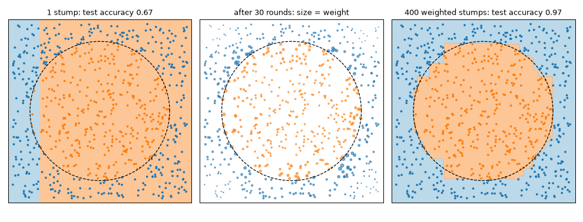
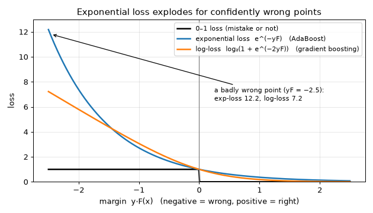
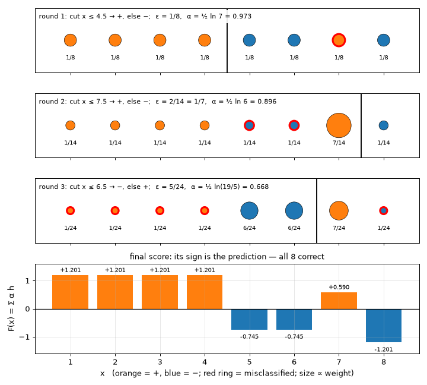

# AdaBoost — explained from zero

> **Who this is for:** someone who is new to machine learning. You need school algebra (fractions, powers, what an
> average is) and a little Python. Every other idea — decision stumps, weighted errors, loss functions, `e` and `ln`,
> margins — is built up here from scratch, with a picture or a tiny example first and the formula second.
>
> **How to read it:** sections 1–3 give the idea with no math. Sections 4–5 give the math, one small step at a time, and a
> complete example you can check with a pencil. Sections 6–9 are about using AdaBoost in real ML work and — just as
> important — when **not** to use it. Every claim is demonstrated in the notebooks in [`lab/`](lab/README.md).
> AdaBoost is one member of a family; the folder overview is [`../README.md`](../README.md).

## Table of contents

0. [AdaBoost in 30 seconds](#0-adaboost-in-30-seconds)
1. [The problem AdaBoost solves](#1-the-problem-adaboost-solves)
2. [The toolbox: the only seven ideas you need](#2-the-toolbox-the-only-seven-ideas-you-need)
3. [AdaBoost step by step, in plain words](#3-adaboost-step-by-step-in-plain-words)
4. [The math: why the formulas are what they are](#4-the-math-why-the-formulas-are-what-they-are)
5. [A complete example by hand](#5-a-complete-example-by-hand)
6. [Using AdaBoost in practice](#6-using-adaboost-in-practice)
7. [Why AdaBoost makes sense for machine learning](#7-why-adaboost-makes-sense-for-machine-learning)
8. [Where AdaBoost does NOT fit — and why](#8-where-adaboost-does-not-fit--and-why)
9. [Common misconceptions](#9-common-misconceptions)
10. [The labs](#10-the-labs)
11. [Glossary](#11-glossary)
12. [Further reading](#12-further-reading)
13. [Appendix - Assumptions made](#appendix---assumptions-made)

---

## 0. AdaBoost in 30 seconds

* **AdaBoost** (ADAptive BOOSTing, Freund & Schapire, 1995–97) is a **classifier** built from many tiny, weak ones —
  usually **decision stumps**, trees that ask a single question such as “is x₁ ≤ 0.3?”.
* It trains them **one after another**. Every training point carries a **weight**. After each stump, the points it got
  **wrong** get heavier and the ones it got right get lighter, so the next stump is forced to concentrate on the hard cases.
* Each stump also gets a **say**, α (the old notes call it the *stage value* P): the more accurate the stump was on the
  weighted data, the bigger its say.
* To classify a new point, every stump answers +1 or −1, the answers are multiplied by their say and **added up**; the
  **sign** of the total is the prediction. That is a *weighted sum*, not a one-stump-one-vote election.
* Why these exact formulas? Because AdaBoost is, step by step, minimising one particular measure of error — the
  **exponential loss** (section 4). The same fact explains its main weakness: it panics about points with **wrong labels**
  (section 8).

---

## 1. The problem AdaBoost solves

You want to tell two kinds of points apart, say orange (inside a circle) from blue (outside). You have a learner that is
**fast but dumb**: it can only draw one straight, axis-parallel cut and say “orange on this side, blue on that side”.



* **Left:** the best single cut. It is right about two thirds of the time (test accuracy 0.67) — better than a coin, but a
  poor model of a circle.
* **Middle:** AdaBoost's trick. After each cut it re-weights the points; drawn with size ∝ weight, after 30 rounds the points
  near the circle (the ones the cuts keep getting wrong) are big and the easy points far away have shrunk.
* **Right:** 400 such cuts, each fitted to the re-weighted points, each with its own say, added up. The result follows the
  circle with a staircase of straight steps: test accuracy 0.97.

That is the **boosting question** (Kearns & Valiant, 1988–89): *can many learners that are only slightly better than
guessing be combined into one that is as accurate as you like?* Schapire (1990) proved yes, and AdaBoost (Freund & Schapire,
1997) was the first practical answer: “boosting” a weak learner into a strong one.

| Compared with … | AdaBoost differs because … |
|---|---|
| one deep decision tree | many shallow trees, each fixing the previous ones' mistakes; much less wiggly (section 7) |
| bagging / random forests | trees are trained **in sequence** on **re-weighted** data, not in parallel on random resamples; boosting mainly lowers **bias**, bagging lowers **variance** |
| gradient boosting | AdaBoost re-weights the *data*; gradient boosting fits each new tree to the current *residuals* (errors). They are relatives: AdaBoost is gradient boosting with the exponential loss (section 4.7) |

---

## 2. The toolbox: the only seven ideas you need

### 2.1 Classification, features and labels as ±1

Each data point has **features** x (here two numbers, x₁ and x₂) and a **label** y, its class. With two classes it is
convenient to write the labels as **y = +1** and **y = −1** (orange and blue). Then “right” and “wrong” become arithmetic:
if a classifier answers h(x) ∈ {+1, −1},

* y·h(x) = +1 means the answer was **right** (both +1 or both −1),
* y·h(x) = −1 means it was **wrong**.

### 2.2 Decision trees and decision stumps

A **decision tree** classifies a point by asking yes/no questions about one feature at a time (“x₁ ≤ 0.3?”), following
the branches down to a leaf that names a class. The long version is in the folder overview:
[decision trees in one page](../README.md#2-decision-trees-in-one-page). Here we need only the smallest tree:

* A **decision stump** is a tree of depth 1: **one question, two leaves**. “If x₁ ≤ t say +1, else say −1” (or the reverse).
  In scikit-learn: `DecisionTreeClassifier(max_depth=1)`.
* To build a stump you try **every feature** and **every threshold** t (in practice, halfway between neighbouring
  sorted values) and keep the best one. That is the old notes' “a stump is created for each feature and the one with the
  minimum Gini index/entropy is picked”.
* A stump on its own is a **weak learner**: a model only somewhat better than random guessing.

### 2.3 Weighted data and the weighted error ε

AdaBoost gives every training point i a **weight** wᵢ ≥ 0, and keeps the weights adding up to 1. A weight is “how much this
point counts”: a point with weight 0.25 counts as much as a quarter of the whole data set.

The **weighted error** of a classifier is the total weight of the points it gets wrong:

$$\varepsilon = \sum_{i \,:\, h(x_i) \ne y_i} w_i \qquad (\text{weights summing to }1)$$

With equal weights 1/N it is the ordinary error rate. The old notes call it the **total error, TE**. ε = 0 is perfect,
ε = ½ is a coin flip (for two classes), ε = 1 is perfectly wrong.

### 2.4 How a weighted stump chooses its cut: weighted Gini impurity

A tree judges a cut by how **pure** the two sides are. The **Gini impurity** of a group of points is the chance that two
points drawn at random from it (by weight) have *different* classes:

$$\text{Gini} = 1 - \sum_{c} p_c^2, \qquad p_c = \frac{\text{weight of class } c \text{ in the group}}{\text{weight of the group}}$$

All one class: Gini = 0 (pure). Half-half: Gini = ½. A cut is scored by the weighted average of its two sides,
W_L·Gini_L + W_R·Gini_R (W = total weight on that side), and the **lowest** score wins. Each side then predicts its heavier
class.

> **Gini vs “fewest weighted mistakes”.** AdaBoost's theory (section 4.3) asks each round for the stump with the smallest
> weighted *error* ε. scikit-learn's stump picks the smallest weighted *Gini* instead. Both are sensible, and they often
> disagree: in the from-scratch notebook they pick different stumps in 373 of 400 rounds (the Gini stump has on average
> 0.029 more weighted error in those rounds). To reproduce scikit-learn exactly you must use Gini.

### 2.5 Bias and variance in one paragraph

A model's error on new data has two main sources (long version:
[bias and variance in one page](../README.md#3-bias-and-variance-in-one-page)). **Bias**: the model is too simple to
describe the pattern — a single stump can never draw a circle, however much data you give it. **Variance**: the model is so
flexible that it copies the noise of its particular training set — a fully grown tree changes a lot if you change a few
points. Bagging and random forests average many high-variance trees to cut **variance**. Boosting adds up many high-bias
stumps, each correcting the last, to cut **bias** — and keeps variance low because each piece is so simple.

### 2.6 `e`, `ln` and the stage value

* **e ≈ 2.718** is the number for which “grow by e^x” is the natural way to grow. e^0 = 1, e^1 ≈ 2.72, e^2 ≈ 7.39,
  e^−1 ≈ 0.37. Every e^x is positive.
* **ln** (natural logarithm) undoes it: ln(e^x) = x. Useful rules: ln 1 = 0; ln(a/b) is positive when a > b and negative
  when a < b; ln(a·b) = ln a + ln b.

So AdaBoost's stage value α = ½ ln((1 − ε)/ε) is **positive when ε < ½** (more right than wrong), **zero at ε = ½**
(a coin flip deserves no say) and **grows without limit as ε → 0** (a nearly perfect stump gets a huge say). For ε = 1/8:
(1 − ε)/ε = 7 and α = ½ ln 7 ≈ 0.973.

### 2.7 Margin and loss

AdaBoost's combined score for a point is F(x) = Σ α_m h_m(x). Its sign is the prediction; its size is how *strongly* the
stumps agree. Multiply by the label to get the **margin**:

$$\text{margin} = y \cdot F(x) \qquad \begin{cases} > 0 & \text{right} \\ < 0 & \text{wrong} \end{cases}$$

A **loss function** turns the margin into a penalty. The **0–1 loss** is 1 for a mistake and 0 otherwise — what we actually
care about, but a flat step that gives no hint *how* to improve. AdaBoost uses the smooth **exponential loss**
e^(−y·F(x)), which is ≥ 1 whenever the point is wrong (so it is an upper bound on mistakes), small for confidently right
points and **huge for confidently wrong ones**:



A point with margin −2.5 costs 12.2 under exponential loss but 7.2 under log-loss (the loss behind logistic regression and
gradient boosting). Keep this picture in mind for section 8.

That's the whole toolbox.

---

## 3. AdaBoost step by step, in plain words

This is the old notes' list, kept and made precise. Labels are ±1; N is the number of training points; M is the number of
rounds you allow (`n_estimators`).

1. **Equal weights.** Give every training point the weight wᵢ = 1/N.
2. **Fit a weak learner to the weighted data.** Usually a stump: try every feature and every threshold, keep the best one
   (lowest weighted Gini in scikit-learn; lowest weighted error in the textbook). Call its answers h_m(x) ∈ {+1, −1}.
3. **Total error.** ε_m (TE) = the sum of the weights of the points it misclassifies.
   **Stop** if ε_m = 0 (the stump is perfect — nothing left to fix) or ε_m ≥ ½ (no better than a coin).
4. **Stage value (the stump's say).** α_m = P = ½ ln((1 − ε_m)/ε_m).
5. **Re-weight.** Misclassified points: w_new = w_old · e^(α_m) (heavier). Correctly classified points:
   w_new = w_old · e^(−α_m) (lighter). In one formula, wᵢ ← wᵢ · e^(−α_m yᵢ h_m(xᵢ)).
6. **Normalise.** Divide every weight by the sum of all weights so they add up to 1 again. (After this step the points the
   last stump got wrong hold **exactly half** of the total weight — section 4.3.)
7. **Repeat** steps 2–6 until M stumps have been built, or step 3 says stop.
8. **Predict** with the **weighted majority**: F(x) = α₁h₁(x) + α₂h₂(x) + … + α_M h_M(x), and output **sign(F(x))**:
   +1 if F > 0, −1 if F < 0. Each stump's vote counts in proportion to its α — the “weighted majority hypothesis” of
   Freund & Schapire, in which, as their abstract puts it, the weight of each weak hypothesis is “a function of its accuracy”.

The algorithm never needs to know in advance how good the weak learners will be: ε and α are measured as it goes — that is
the “adaptive” in AdaBoost.

---

## 4. The math: why the formulas are what they are

Most notes give α = ½ ln((1 − ε)/ε) and the update e^(±α) as recipes. They are not arbitrary: both fall out of one
optimisation problem (Friedman, Hastie & Tibshirani, 2000).

### 4.1 The model is an additive model

After M rounds AdaBoost's score is a sum of simple pieces:

$$F_M(x) = \sum_{m=1}^{M} \alpha_m h_m(x)$$

We need to choose M stumps h_m and M numbers α_m. Choosing all of them at once is hopeless, so AdaBoost does it
**greedily**: keep everything already built fixed and add **one** new piece α·h per round. This is called **forward
stagewise additive modelling**.

### 4.2 What is being minimised: the exponential loss

The goal is the average exponential loss on the training set:

$$L(F) = \frac{1}{N}\sum_{i=1}^{N} e^{-y_i F(x_i)}$$

Why this loss? (a) It is ≥ the 0–1 loss for every point, so making it small forces few training mistakes. (b) It is smooth,
so we can minimise it with algebra. (c) As the next step shows, it makes the minimisation in each round split neatly into
“choose h” and “choose α”.

### 4.3 One round: the weights, ε and α all fall out

Suppose Fₘ₋₁ is fixed and we add α·h. For point i,
e^(−yᵢ(Fₘ₋₁(xᵢ) + α h(xᵢ))) = e^(−yᵢFₘ₋₁(xᵢ)) · e^(−α yᵢ h(xᵢ)). The first factor does not depend on the new piece;
call it the point's **weight**, wᵢ = e^(−yᵢFₘ₋₁(xᵢ)) (scaled so that they sum to 1). The loss to minimise is

$$\sum_i w_i\, e^{-\alpha y_i h(x_i)} = e^{-\alpha}\!\!\sum_{\text{right}} w_i + e^{\alpha}\!\!\sum_{\text{wrong}} w_i = (1-\varepsilon)\,e^{-\alpha} + \varepsilon\, e^{\alpha}$$

because yᵢh(xᵢ) is +1 for right and −1 for wrong points, and the wrong points' weights add up to ε. Three conclusions:

* **The weights are not a trick — they are the loss.** A point's weight is its current exponential loss e^(−y F). Points
  the ensemble gets badly wrong (very negative margin) have exponentially large weight.
* **Which h?** For any α > 0 the expression grows with ε, so the best stump is the one with the **smallest weighted
  error** on the current weights (step 2).
* **Which α?** Set the derivative with respect to α to zero:
  −(1 − ε)e^(−α) + ε e^(α) = 0 ⟹ e^(2α) = (1 − ε)/ε ⟹

$$\boxed{\alpha = \tfrac12 \ln\frac{1-\varepsilon}{\varepsilon}}$$

  This is the **exact minimiser** — the stage value is the best possible step size for this stump. It is positive only if
  ε < ½; a stump with ε > ½ would get a negative say (you would do better by flipping it).
* **The update.** The new weights are wᵢ·e^(−α yᵢ h(xᵢ)): × e^(α) for wrong and × e^(−α) for right points (step 5).
  Normalising (step 6) only divides by a common number, which changes nothing about which h or α is best.

**A neat consequence.** After the update, the wrong points' weight is ε·e^(α) = ε·√((1−ε)/ε) = √(ε(1−ε)) and the right
points' weight is (1−ε)·e^(−α) = √(ε(1−ε)) — **equal**. So, after normalising, the stump just used has weighted error
exactly ½ on the new weights: it is useless for the next round, which is forced to find something new. Practical shortcut:
after normalising, each wrong point's weight is w/(2ε) and each right point's is w/(2(1 − ε)).

### 4.4 How fast the training error falls

Before normalising, the total weight after round m is (1−ε)e^(−α) + εe^(α) = 2√(ε_m(1 − ε_m)) =: Z_m. Starting from total
weight 1, the average exponential loss after M rounds is therefore exactly the product of these factors, and because the
exponential loss is ≥ the 0–1 loss,

$$\text{training error after } M \text{ rounds} \;\le\; \frac1N\sum_i e^{-y_iF_M(x_i)} \;=\; \prod_{m=1}^{M} 2\sqrt{\varepsilon_m(1-\varepsilon_m)}$$

Each factor is < 1 whenever ε_m < ½. If every stump is at least a little better than a coin, ε_m ≤ ½ − γ, each factor is
≤ √(1 − 4γ²) ≤ e^(−2γ²), so the training error is ≤ e^(−2Mγ²): it falls **exponentially fast** with the number of rounds.
(With γ = 0.1, after 100 rounds the bound is e^(−2) ≈ 0.14.) Lab 4 shows the bound and the exponential loss coinciding to
2.2 × 10⁻¹⁶ on the circle data; stumps there have ε ≈ 0.47 in late rounds, yet the bound still falls from 0.973 to 0.016 in
1000 rounds.

### 4.5 Margins: why more rounds can still help after training error is 0

Once every training point is right, the training error cannot fall further — but the **margins** can grow. Use the
normalised margin y·F(x)/Σα, which lies between −1 and +1 (+1: every stump agrees and is right). Schapire, Freund, Bartlett
& Lee (1998) showed that test error is bounded by the share of training points with a **small** margin plus a term that
does **not** grow with the number of rounds. Extra rounds keep pushing the smallest margins up, which is why AdaBoost's
test error often keeps falling — or at least does not rise — long after training error reaches 0. In Lab 5 (5-D “nested
spheres”, 20 000 test points) training error hits 0 at round 169 while the test error keeps falling (0.0663 → 0.0635 at
round 400) and the smallest margin rises from +0.001 to +0.039 by round 800. The explanation has limits: from round 400 to
800 the margins still grow but the test error no longer improves, and on noisy labels (section 8.1) more rounds hurt.

### 4.6 More than two classes (SAMME) — and what scikit-learn computes

With K classes a random guess is wrong (K − 1)/K of the time, so “better than chance” means ε < 1 − 1/K, which for K = 3 is
0.667, not 0.5. **SAMME** (Zhu, Zou, Rosset & Hastie, 2009) fixes the stage value accordingly:

$$\alpha_m = \eta\left(\ln\frac{1-\varepsilon_m}{\varepsilon_m} + \ln(K-1)\right), \qquad w_i \leftarrow w_i\, e^{\alpha_m}\ \text{only if point } i \text{ is wrong, then normalise}$$

η is the `learning_rate` (shrinkage, section 6.2). α is zero exactly at ε = 1 − 1/K and positive below it, so a stump that
is wrong on 55 % of the weight still gets a positive say with three classes (Lab 9: 396 of 400 rounds had ε > 0.5).
Prediction: each learner adds α to the class it predicts; the class with the highest total wins. scikit-learn's
`AdaBoostClassifier` implements exactly this; the older `SAMME.R` variant was deprecated in version 1.4 and removed in 1.6,
and the `algorithm` parameter itself is no longer present in 1.9 (checked in the installed `_weight_boosting.py`) — do not
pass it.

**For two classes, scikit-learn's α is twice the textbook α — and it does not matter.** With K = 2 and η = 1, ln(K − 1) = 0
and α_SAMME = ln((1−ε)/ε) = 2·α_textbook. Why does it give the same model?

* *Weights.* The textbook multiplies right points by e^(−α) and wrong points by e^(+α). Multiply **every** point by the same
  number e^(α) — normalising removes any common factor — and you get 1 for right and e^(2α) for wrong points: exactly SAMME's
  “only the wrong ones × e^(α_SAMME)”. Same normalised weights, so the same next stump.
* *Predictions.* sign(Σ 2α_m h_m) = sign(Σ α_m h_m). Doubling every say changes no sign.

Lab 1 and the from-scratch notebook check both on the hand example below (identical weights to 1e-16, same predictions).

Other scikit-learn details (all verified in the source and reproduced bit for bit in the from-scratch notebook):

* **Stops early** when ε = 0 (that learner is kept with weight 1 and boosting ends) or when ε ≥ 1 − 1/K (that learner is
  thrown away; if it was the first one, a `ValueError` “…worse than random…” is raised).
* Before each round, weights smaller than 2.2 × 10⁻¹⁶ are raised to that value, so that no point's weight can vanish.
* `decision_function` returns Σ α_m·(+1 for the predicted class, −1/(K−1) for the others) / Σ α_m; for two classes that is
  one number, 2·Σ α_m h_m(x)/Σ α_m, between −2 and +2.

### 4.7 Exponential loss vs log-loss: the root of the noise problem

Gradient boosting with **log-loss** log(1 + e^(−2yF)) minimises a different loss with the same forward-stagewise idea.
Near a margin of 0 the two losses are almost the same (the figure in 2.7), which is why AdaBoost and log-loss boosting often
give similar classifiers. They differ for **badly wrong** points: the exponential loss — and hence the AdaBoost weight
e^(−yF) — keeps growing **exponentially** as the margin becomes more negative, while log-loss grows only **linearly** and its
pull on any one point is capped. A mislabeled point sits on the wrong side of a correct model for ever, so under exponential
loss its weight keeps multiplying. Friedman, Hastie & Tibshirani (2000) also showed that the exponential loss is minimised by
F(x) = ½ ln(P(y=+1|x)/P(y=−1|x)), half the log-odds — the basis of scikit-learn's `predict_proba` (section 8.5).

---

## 5. A complete example by hand

Eight points on a line, x = 1, 2, …, 8, with labels **+ + + + − − + −**. A stump is “x ≤ t → one class, else the other”,
with t halfway between neighbours (1.5, 2.5, …, 7.5).



**Round 1.** All weights 1/8. Every cut, each side predicting its heavier class:

| cut t | 1.5 | 2.5 | 3.5 | **4.5** | 5.5 | 6.5 | 7.5 |
|---|---|---|---|---|---|---|---|
| weighted error | 0.375 | 0.375 | 0.250 | **0.125** | 0.250 | 0.375 | 0.250 |
| weighted Gini, W_L·G_L + W_R·G_R | 0.4286 | 0.3750 | 0.3000 | **0.1875** | 0.3667 | 0.4583 | 0.3571 |

Example for t = 4.5: the left side {1,2,3,4} is all +, Gini 0; the right side {5,6,7,8} has three − and one +, so
Gini = 1 − (¾)² − (¼)² = 0.375, weighted by W_R = ½: 0.1875. The best stump is **x ≤ 4.5 → +, else −**; it misclassifies
only x = 7.

* ε₁ = 1/8 = 0.125, α₁ = ½ ln((7/8)/(1/8)) = ½ ln 7 = **0.973**.
* Update (shortcut of 4.3): wrong x = 7 gets (1/8)/(2·1/8) = **1/2**; each right point gets (1/8)/(2·7/8) = **1/14**.

**Round 2.** Weights: 1/14 everywhere except x = 7 with 7/14. Now a stump that ignores x = 7 is expensive. The best stump is
**x ≤ 7.5 → +, else −**: it gets x = 7 (and x = 8) right but x = 5 and x = 6 wrong.

* ε₂ = 2/14 = 1/7 = 0.1429, α₂ = ½ ln 6 = **0.896**.
* Update: x = 5, 6 get (1/14)/(2/7) = **1/4 = 6/24** each; right points are multiplied by 1/(2·6/7) = 7/12: x = 7 becomes
  (7/14)(7/12) = **7/24**, the others (1/14)(7/12) = **1/24**. Check: 4·1/24 + 2·6/24 + 7/24 + 1/24 = 24/24. ✔

**Round 3.** Weights 1/24 (x = 1–4, 8), 6/24 (x = 5, 6), 7/24 (x = 7). The best stump is **x ≤ 6.5 → −, else +**. It
sacrifices the four light points x = 1–4 and x = 8 to get the heavy x = 5, 6, 7 right.

* ε₃ = 4/24 + 1/24 = 5/24 = 0.2083, α₃ = ½ ln((19/24)/(5/24)) = ½ ln(19/5) = **0.668**.

**Final score** F(x) = 0.973·h₁ + 0.896·h₂ + 0.668·h₃:

| x | h₁ (≤4.5 → +) | h₂ (≤7.5 → +) | h₃ (≤6.5 → −) | F(x) | sign | label |
|---|---|---|---|---|---|---|
| 1–4 | + | + | − | 0.973 + 0.896 − 0.668 = **+1.201** | + | + ✔ |
| 5, 6 | − | + | − | −0.973 + 0.896 − 0.668 = **−0.745** | − | − ✔ |
| 7 | − | + | + | −0.973 + 0.896 + 0.668 = **+0.590** | + | + ✔ |
| 8 | − | − | + | −0.973 − 0.896 + 0.668 = **−1.201** | − | − ✔ |

All eight points are right, although every single stump got between one and five of them wrong.

**Checks.**

* Training-error bound (4.4): 2√(1/8·7/8) · 2√(1/7·6/7) · 2√(5/24·19/24) = 0.661 · 0.700 · 0.812 = **0.376**, and the
  average exponential loss (4·e^(−1.201) + 2·e^(−0.745) + e^(−0.590) + e^(−1.201))/8 = **0.376** — equal, as promised.
* **scikit-learn** (`AdaBoostClassifier`, stumps, 3 rounds) finds the same cuts 4.5, 7.5, 6.5 and the same ε, reports
  `estimator_weights_` = ln 7, ln 6, ln(19/5) = 1.946, 1.792, 1.335 (**2×** our α, section 4.6), uses the same round-3
  weights 1/24, 6/24, 7/24, and returns `decision_function` = 2F/Σα = 0.947, −0.587, 0.466, −0.947 — the same signs.

Lab 1 does this computation in code and plots it; section 2 of the from-scratch notebook asserts every number to 10⁻¹⁵.

---

## 6. Using AdaBoost in practice

### 6.1 The recipe in scikit-learn

```python
import numpy as np
from sklearn.ensemble import AdaBoostClassifier
from sklearn.model_selection import train_test_split
from sklearn.tree import DecisionTreeClassifier

X_train, X_test, y_train, y_test = train_test_split(X, y, test_size=0.3, random_state=0)

model = AdaBoostClassifier(
    estimator=DecisionTreeClassifier(max_depth=1),   # stumps (also the default)
    n_estimators=400,                                # rounds; default 50 - choose it by validation (6.4)
    learning_rate=1.0,                               # shrinkage; smaller = more rounds needed
    random_state=0,
)                                                    # no `algorithm=` argument: only SAMME exists now (4.6)
model.fit(X_train, y_train)                          # no feature scaling needed: stumps only compare values
print(model.score(X_test, y_test))

# errors after every round, from ONE fit - use a validation set, not the test set, to pick n_estimators
val_errors = [np.mean(pred != y_val) for pred in model.staged_predict(X_val)]
```

### 6.2 Hyper-parameters

| Parameter | Default | What it does | Practical advice |
|---|---|---|---|
| `estimator` | `DecisionTreeClassifier(max_depth=1)` | the weak learner | depth 1–3. Stumps add one-feature effects only; depth *d* allows interactions of up to *d* features. Too deep → ε = 0 → stops after 1 round (8.3) |
| `n_estimators` | **50** | maximum number of rounds | a few hundred for stumps is typical (400 chosen by CV on the circle, Lab 6); more rounds can **over-fit noisy labels** (8.1) |
| `learning_rate` (η) | 1.0 | multiplies every α | smaller η needs proportionally more rounds (roughly, η × rounds matters, Lab 8); helps on noisy data |
| `random_state` | None | seeds the base trees' tie-breaking | set it for reproducible results |

### 6.3 Reading the output

| Attribute / method | What it is | Plain words |
|---|---|---|
| `estimators_` | the fitted weak learners | may be **fewer** than `n_estimators` if it stopped early |
| `estimator_weights_` | α_m = η(ln((1−ε)/ε) + ln(K−1)) | each learner's say (2× the textbook α for two classes); unused slots are 0 |
| `estimator_errors_` | ε_m | weighted error of each learner on the weights it was trained with; unused slots are 1 |
| `decision_function(X)` | Σ α·(±) / Σ α | normalised score; for two classes in [−2, 2], positive → `classes_[1]` |
| `staged_predict`, `staged_decision_function`, `staged_score` | the same after 1, 2, …, M rounds | error curves from one fit (Labs 3–5, 7–8, 10) |
| `predict_proba(X)` | softmax of the normalised score | **not calibrated** — for two classes never above 0.881 (8.5) |
| `feature_importances_` | weighted average of the learners' impurity importances | which features the stumps used most |

### 6.4 Avoiding leakage

The number of rounds is a hyper-parameter. Choosing it by looking at the **test** error (the easy mistake with
`staged_predict`) makes the test score optimistic. Choose it with cross-validation or a validation split taken from the
training data, then use the test set **once**. All labs do this (Labs 6, 7, 8 and 10 use 5-fold CV on the training set).
No scaler is needed for tree-based AdaBoost; if you add preprocessing that learns from data, put it in a `Pipeline`.

---

## 7. Why AdaBoost makes sense for machine learning

1. **It turns bias into accuracy.** A stump has high bias and low variance. Adding stumps lowers the bias step by step
   while each piece stays simple, so the sum is flexible where needed (Lab 6: one stump 0.670 → 400 stumps 0.970 test accuracy
   on the circle, level with a random forest at 0.967).
2. **It is an additive model with a clear structure.** With stumps, F(x) = f₁(x₁) + f₂(x₂) + … — one step function per
   feature. That is exactly right when the class depends on a **sum of one-feature effects**, like the circle
   x₁² + x₂² < r² (Lab 3 shows the staircase forming). Depth-2 trees add pairwise interactions, and so on.
3. **It focuses effort where the boundary is.** The weights move to the hard points near the boundary (Lab 2: the 20 % of
   points nearest the circle hold 74 % of the weight by round 300); easy points stop costing attention.
4. **Its training error provably falls fast** (4.4) as long as each learner beats chance, and on clean data extra rounds
   tend to **grow margins** rather than over-fit (4.5).
5. **Few knobs, no scaling, any weak learner.** Three hyper-parameters; trees need no feature scaling; any learner that
   accepts sample weights can be boosted.

**It is the right tool when** labels are reasonably clean, a shallow tree is a sensible weak learner, the classes need
more than one cut but not a deep interaction structure, and you want a strong classifier rather than calibrated
probabilities.

---

## 8. Where AdaBoost does NOT fit — and why

| # | Situation | Why AdaBoost fails | Use instead | Lab |
|---|---|---|---|---|
| 8.1 | **Noisy (flipped) labels** — the bad-fit dataset | exponential loss: weight of a wrong point grows without limit; later rounds chase noise | early stopping by CV, smaller `learning_rate`, log-loss gradient boosting, random forest | 10 |
| 8.2 | Label outliers (points whose label is implausible for where they sit) | same mechanism, concentrated on a few points | clean labels; robust losses; random forest | 11 |
| 8.3 | Base learner too strong (deep trees) | ε = 0 in round 1 → nothing to boost | depth 1–3; or bagging / random forest for deep trees | 12 |
| 8.4 | Base learner too weak (XOR-like interactions, many classes) | no stump beats chance (ε ≥ 1 − 1/K) or each round learns little | deeper base trees | 13, 9 |
| 8.5 | You need probabilities | `predict_proba` is squeezed towards 0.5 | `CalibratedClassifierCV`; log-loss gradient boosting | 14 |
| 8.6 | Very large data, many rounds | rounds are sequential, cannot use many cores | histogram gradient boosting (LightGBM-style, XGBoost); random forest | 15 |
| 8.7 | Boundary is a tilted line | stumps make axis-parallel steps; a diagonal needs very many | a linear model, or rotate/engineer features | 3 (staircase) |

### 8.1 Noisy labels — the bad-fit dataset
**Why:** in 4.3 the weight of a point is its exponential loss e^(−yF). A point with a **wrong label** stays on the wrong side
of a correct model, so its margin keeps going down and its weight keeps multiplying. The bad-fit data is the circle with exactly
20 % of the labels flipped. Lab 10: flipped points are 20.7 % of the training rows but soon hold about twice that share of the
weight (stumps: 40.4 % after 2000 rounds; depth-3 trees: 44 % after only 10). With depth-3 trees the training error falls to 0
(every flipped label memorised) while the test error **rises** from 0.233 (round 62) to 0.280 (round 2000); against the true,
unflipped labels it goes from 0.077 to 0.170. Stumps cannot isolate single points, so their test error plateaus instead
(0.223 → 0.243; true labels 0.067 → 0.100). **Fix:** stop early (rounds chosen by CV: 46 for depth 3 → 0.250 / 0.100 on noisy /
true test labels), a smaller learning rate (η = 0.1 → 0.233 / 0.090), log-loss gradient boosting (0.240 / 0.103), or a random
forest that does not re-weight at all (0.227 / 0.070, best here). This is the old notes' “noisy data, specifically noise in the
output variable, can be problematic” — now measured.

### 8.2 Outliers: harmful in the labels, harmless in the features
**Why:** the old advice “outliers force the ensemble down the rabbit hole of working hard to correct cases that are
unrealistic” is right for **label** outliers and wrong for **feature** outliers with tree learners. Lab 11: pushing 10
training points 10× further out (correct labels) changes nothing (test accuracy 0.967 → 0.970), because a stump only uses the
*order* of values. Relabelling 10 points in the centre of the circle (1.4 % of rows) gives them 21.0 % of the weight by round
800 and drops test accuracy to 0.920: stumps cannot cut a hole in the middle, so the chase distorts the edge. **Fix:** check and
clean labels; drop points whose label is implausible; use a forest or log-loss boosting.

### 8.3 A too-strong base learner
**Why:** boosting needs mistakes to re-weight. A fully grown tree classifies its training data perfectly, so ε₁ = 0,
scikit-learn keeps that one tree with weight 1 and stops. Lab 12: 1 of 50 trees is fitted; the “ensemble” predicts exactly
like its single tree (0.963 on clean data, 0.690 on the noisy data). **Fix:** depth 1–3 trees for boosting; deep trees belong in
bagging or a random forest.

### 8.4 A too-weak base learner
**Why:** if no stump beats random guessing, there is nothing to boost. XOR (the class depends on whether x₁ and x₂ have the
same sign) is the classic: by symmetry every stump has ε = 0.5 = 1 − 1/K, and scikit-learn raises *“…worse than random,
ensemble can not be fit”* (Lab 13). With many classes a two-leaf stump can name only two of them: on the 10 digit classes
stumps have ε ≈ 0.8 (allowed, since 1 − 1/10 = 0.9) and 300 of them reach 0.848 test accuracy vs 0.987 for depth-4 trees; on
three rings, stumps never predict the small centre class at all (0.829 vs 0.956 with depth 3, Lab 9). **Fix:** deeper base
trees (depth 2 solves XOR).

### 8.5 Probabilities are poorly calibrated
**Why:** scikit-learn turns the normalised score f = Σα h/Σα ∈ [−1, 1] into p = 1/(1 + e^(−2f)) (the half-log-odds of 4.7), so
for two classes p can never exceed 1/(1 + e^(−2)) = 0.881. After hundreds of rounds many stumps disagree, f sits near 0 and
p near 0.5 even for easy points. Lab 14: accuracy 0.967 but probabilities only between 0.322 and 0.609; Brier score 0.191 vs
0.023 after isotonic calibration (Niculescu-Mizil & Caruana, 2005, found the same on real data). **Fix:**
`CalibratedClassifierCV` on cross-validation folds of the training set, or a log-loss model.

### 8.6 Sequential training
**Why:** round m needs round m − 1's weights, so rounds cannot run in parallel; `AdaBoostClassifier` has no `n_jobs`. Lab 15:
fit time grows in proportion to the rounds, while a random forest of the same size runs roughly 3–4× faster on all cores than
on one. **Fix:** for big data, histogram-based gradient boosting (each round much cheaper and parallel inside), or a random
forest.

### 8.7 Tilted boundaries
**Why:** every stump cuts parallel to an axis, so the boundary is a staircase (Lab 3). A diagonal boundary like x₁ > x₂ needs
many tiny steps and still looks jagged. **Fix:** a linear model, or add the feature x₁ − x₂.

**Rule of thumb:** before choosing AdaBoost, ask — *Are my labels clean? Is a shallow tree a sensible weak learner here? Do I
need probabilities? Is the data so big that sequential training hurts?*

---

## 9. Common misconceptions

| Myth | Reality |
|---|---|
| “`n_estimators` is usually set to 500; it must be hundreds, if not thousands.” | scikit-learn's default is **50**. The right number depends on the data: choose it by CV (400 on the circle, Lab 6; 46–149 on the noisy data, Lab 10). With noisy labels more rounds make the model **worse** (8.1). |
| “Boosting uses voting, like bagging.” | The prediction is the sign of a **weighted sum** Σ α_m h_m(x); stumps with small ε have much more say than others. It is a weighted majority, not one-model-one-vote. |
| “Each new model fits the residuals of the previous one.” | That is **gradient boosting**. AdaBoost **re-weights the data points** and fits each new learner to the original labels (they are related: section 4.7). |
| “The stage value ½ ln((1−TE)/TE) is just a convenient formula.” | It is the **exact minimiser** of the exponential loss for that learner (4.3). |
| “Any weak learner works, whatever its error.” | It must beat random guessing on the weighted data: ε < ½ for two classes, ε < 1 − 1/K for K classes (4.6), and AdaBoost stops otherwise. |
| “AdaBoost is only for two classes.” | SAMME handles K classes by adding ln(K − 1) to α (4.6, Lab 9). |
| “The stump with minimum Gini/entropy is the one AdaBoost theory asks for.” | Theory asks for minimum **weighted error**; scikit-learn's trees use **Gini** (or entropy). They differ in most rounds (373 of 400 in the from-scratch notebook); both work. |
| “`estimator_weights_` are the α from the textbook.” | For two classes they are **2×** the textbook α (times `learning_rate`). Same weights after normalising, same predictions (4.6). |
| “AdaBoost never over-fits.” | On clean data it is remarkably resistant (margins, 4.5); with noisy labels and flexible learners it over-fits clearly (Lab 10). |
| “Boosting is more accurate than bagging.” | Sometimes. On noisy labels a random forest wins (Lab 10: 0.070 vs 0.090–0.170 against the true labels). |
| “Combining models always gives a less noisy result.” | Not if every round chases the same mislabelled points (8.1). |
| “Remove outliers before AdaBoost.” | Remove **label** outliers. Extreme **feature** values are harmless for tree learners (8.2). |
| “Deeper base trees are always better.” | Too deep → ε = 0 → only one tree (8.3). Depth 1–3 is the usual range. |
| “`predict_proba` gives probabilities you can trust.” | It is squeezed towards 0.5 (8.5); calibrate it first. |

---

## 10. The labs

Everything above is demonstrated in two Jupyter notebooks. Setup, run instructions and a map of which lab proves which claim
are in **[`lab/README.md`](lab/README.md)**.

**[`lab/adaboost_lab.ipynb`](lab/adaboost_lab.ipynb)** — scikit-learn, 15 labs:

| Part | Labs | README sections |
|---|---|---|
| A. How AdaBoost works | 1 hand example · 2 weights moving · 3 boundary built from cuts · 4 training-error bound · 5 margins | 3, 4, 5 |
| B. Why it's useful | 6 stumps → strong model · 7 base-tree depth · 8 learning rate × rounds · 9 three classes (SAMME) | 4.6, 6, 7 |
| C. Where it fails | 10 noisy labels (bad fit) · 11 outliers · 12 too-strong learner · 13 too-weak learner · 14 probabilities · 15 sequential cost | 8 |

**[`lab/adaboost_from_scratch.ipynb`](lab/adaboost_from_scratch.ipynb)** — NumPy only, compared with scikit-learn:

| Section | Theory step (README §) | Implementation hurdle shown |
|---|---|---|
| 1 Weighted stump | 2.2–2.4, 3 step 2 | split-search cost (naive O(n²) ≈ 18 ms vs sort + cumulative sums ≈ 0.1 ms per stump); ties and float32 midpoints; Gini vs min-error choice |
| 2 Textbook AdaBoost | 3, 4.3, 5 | — (hand example to 10⁻¹⁵) |
| 3 SAMME | 4.6 | ε = 0 and ε ≥ 1 − 1/K; weights overflowing without normalisation (round 16 574), tiny weights and scikit-learn's clipping |
| 4 Decision function | 4.6, 6.3 | — |
| 5 Comparison | all | exact match: 100 % identical predictions, identical stumps, differences in α, ε and `decision_function` of 0.0 on both CSVs |

---

## 11. Glossary

| Term | Meaning |
|---|---|
| **Boosting** | Building a strong model from weak ones trained in sequence, each focusing on what the previous ones got wrong. |
| **Weak learner** | A model only somewhat better than random guessing on the weighted data (ε < ½, or < 1 − 1/K). |
| **Decision stump** | A decision tree with one question and two leaves (`max_depth=1`). |
| **Sample weight (wᵢ)** | How much a training point counts; AdaBoost's weights sum to 1. |
| **Weighted error (ε, TE)** | Total weight of the misclassified points. |
| **Stage value / say (α, P)** | A learner's multiplier in the final sum: ½ ln((1−ε)/ε) (textbook), ln((1−ε)/ε) + ln(K−1) (SAMME). |
| **Normalising** | Dividing all weights by their sum so they add up to 1. |
| **Weighted majority / weighted sum** | F(x) = Σ α_m h_m(x); the prediction is its sign (or the class with the largest total). |
| **Gini impurity** | 1 − Σ p_c²: chance that two random (weighted) points from a group have different classes. |
| **Margin** | y·F(x) (or normalised, y·F(x)/Σα): positive = right, larger = more confident. |
| **Exponential loss** | e^(−y F(x)); what AdaBoost minimises. |
| **Log-loss** | log(1 + e^(−2yF(x))) for ±1 labels; what logistic regression and gradient-boosted classifiers minimise. |
| **Forward stagewise additive modelling** | Building a sum of pieces by adding one piece per step while keeping the earlier ones fixed. |
| **SAMME** | “Stagewise Additive Modeling using a Multi-class Exponential loss”: the K-class AdaBoost used by scikit-learn. |
| **Learning rate / shrinkage (η)** | Multiplier on every α; smaller steps, more rounds. |
| **Calibration** | Whether predicted probabilities match observed frequencies. |
| **Additive model** | A model that is a sum of simple functions; with stumps, one function per feature. |
| **Data leakage** | Letting test-set information influence training choices (e.g. picking `n_estimators` on the test set). |

---

## 12. Further reading

* Y. Freund & R. E. Schapire, *A decision-theoretic generalization of on-line learning and an application to boosting*,
  J. Computer and System Sciences 55 (1997) — the AdaBoost paper. The old notes' sentence about the algorithm needing “no
  prior knowledge of the accuracies of the weak hypotheses” and building a “weighted majority hypothesis” paraphrases its abstract.
* R. E. Schapire, *The strength of weak learnability*, Machine Learning 5 (1990) — the first proof that boosting is possible.
* J. Friedman, T. Hastie & R. Tibshirani, *Additive logistic regression: a statistical view of boosting*, Annals of
  Statistics 28 (2000) — AdaBoost as forward stagewise minimisation of the exponential loss (section 4).
* R. E. Schapire, Y. Freund, P. Bartlett & W. S. Lee, *Boosting the margin*, Annals of Statistics 26 (1998) — margins (4.5).
* J. Zhu, H. Zou, S. Rosset & T. Hastie, *Multi-class AdaBoost*, Statistics and Its Interface 2 (2009) — SAMME (4.6).
* T. Hastie, R. Tibshirani & J. Friedman, *The Elements of Statistical Learning*, 2nd ed., chapter 10 — boosting, the
  nested-spheres example (Lab 5), loss functions and robustness.
* R. E. Schapire & Y. Freund, *Boosting: Foundations and Algorithms*, MIT Press (2012).
* T. G. Dietterich, *An experimental comparison of three methods for constructing ensembles of decision trees*, Machine
  Learning 40 (2000) — boosting vs bagging under label noise (8.1).
* A. Niculescu-Mizil & R. Caruana, *Predicting good probabilities with supervised learning*, ICML 2005 — boosted models'
  calibration (8.5).
* scikit-learn user guide, *AdaBoost* (ensemble methods), and the source `sklearn/ensemble/_weight_boosting.py`.
* **Several targets at once** (multi-label classification). In scikit-learn 1.9.1, `AdaBoostClassifier` and
  `AdaBoostRegressor` reject a 2-D target, so the only route is one AdaBoost per label (`MultiOutputClassifier`).
  The papers boost all labels in one run:
  * R. E. Schapire & Y. Singer, *Improved boosting algorithms using confidence-rated predictions*, Machine Learning 37
    (1999). It introduces **AdaBoost.MH**, which turns multi-label (and multi-class) learning into one binary problem
    over (row, label) pairs. There is one weight per pair, and the boosting minimises the Hamming loss.
  * R. E. Schapire & Y. Singer, *BoosTexter: A boosting-based system for text categorization*, Machine Learning 39
    (2000) — AdaBoost.MH (and its ranking version AdaBoost.MR) applied to multi-label text.
  * B. Kégl, *The return of AdaBoost.MH: multi-class Hamming trees*, ICLR (2014). Each round grows one
    vector-valued tree that serves all classes, instead of K one-vs-all problems. It reports results on par with SVMs
    and the best multi-class boosting method of the time (AOSOLogitBoost).
* The old notes' “Data preparation for AdaBoost” advice (quality data, outliers, noisy labels) closely follows Jason
  Brownlee's *Boosting and AdaBoost for Machine Learning* (Machine Learning Mastery); credited here and tested in Labs 10–11.

---

## Appendix - Assumptions made

No further input was available, so the following decisions were made on the author's behalf:

1. **Audience.** “Extremely new to ML” was taken to mean school algebra and basic Python, but no calculus, statistics or
   prior ML. Every concept (stump, weighted error, Gini, bias/variance, e and ln, margin, loss) is introduced before use.
   Section 4.3 uses one derivative; the shortcut “wrong points share ½ of the weight” lets the hand example be done without it.
2. **Scope.** Discrete AdaBoost for classification: the textbook binary version and SAMME (what scikit-learn implements).
   Real AdaBoost / SAMME.R (removed from scikit-learn), AdaBoost.R2 (`AdaBoostRegressor`), LogitBoost and gentle AdaBoost are
   not covered; gradient boosting and XGBoost have their own folders (`../05-gradient-boosting/`, `../06-xgboost/`).
   Decision trees and bias/variance are recapped here and treated fully in the folder README (linked, not copied).
3. **Old content kept, corrected, dropped** (source: `_archive/Ensemble Learning.ipynb` cell 3 and the boosting bullets of
   cell 1; findings from `../EVALUATION.md` §2.1 and the repo audit). Kept: the step list and naming (equal weights 1/N, stumps,
   one stump per feature with minimum Gini/entropy, total error TE, stage value P = ½ ln((1−TE)/TE), W_new = W_old·e^(±P),
   normalising, termination, the “weighted majority hypothesis”) and the data-preparation advice (quality data, outliers, noisy
   labels — now Labs 10–11). Corrected: default `n_estimators` is **50**, not 500, and “hundreds or thousands are needed”
   overclaims (Lab 6, section 9); the stage value is now derived as the exact minimiser of the exponential loss (4.3); multi-class
   SAMME with ln(K−1) added (4.6, Lab 9); the requirement TE < ½ (< 1 − 1/K) stated (4.3, 4.6); the prediction rule
   sign(Σ α_m h_m) written down (3, 4.1); the conflation of AdaBoost's re-weighting with gradient boosting's residual fitting and
   the claim that boosting “uses voting” fixed (1, 9); “always less noisy” and “better than bagging” qualified (9). Also new:
   Gini vs min-error stump choice; the 2× scale of scikit-learn's weights; outliers split into label vs feature outliers.
   Dropped: nothing of substance; the vague “no further improvement can be made” termination rule is replaced by the precise
   stopping rules (ε = 0, ε ≥ 1 − 1/K, M reached).
4. **Datasets.** Good fit: 1000 points uniform in [−1, 1]², rounded to 3 decimals, class = inside the circle of radius
   √(2/π) (about half the area), no label noise — chosen because one stump is poor (0.670) but the boundary is a **sum of
   one-feature effects** (x₁² + x₂²), which boosted stumps can build (0.970). Bad fit: the **same points** with exactly 20 % of
   the labels flipped — the textbook AdaBoost failure, and it lets the labs measure error against the true labels as well.
   Rounding to 3 decimals deliberately creates repeated values (so the ties hurdle is real). Other data: three rings (Lab 9),
   5-D nested spheres after ESL §10.1 (Lab 5, because on the 2-D circle the test error stays flat rather than falling after the
   training error reaches 0), symmetric XOR (Lab 13), `load_digits` (bundled with scikit-learn). No downloads; all seeds fixed.
5. **Train/test protocol.** One 70/30 split (`random_state=0`), identical row indices for both CSVs. Hyper-parameters (number of
   rounds) chosen by 5-fold CV on the training set; the test set is used once per comparison. Calibration is fitted with internal
   CV on the training set.
6. **Environment used to execute the notebooks:** Python 3.13.5, NumPy 2.5.4, SciPy 1.18.1, scikit-learn 1.9.1, Matplotlib
   3.11.2. Every number quoted here comes from those runs; other versions may differ in the last decimals. Timings (Lab 15 and
   from-scratch hurdle 1) depend on the machine and vary slightly between runs; the text gives them as approximate.
   `lab/requirements.txt` asks for **scikit-learn ≥ 1.6** rather than the folder-wide ≥ 1.4: in 1.4–1.5 the default algorithm
   was still the deprecated SAMME.R, which gives different numbers and a warning.
7. **Exactness target.** The from-scratch notebook reproduces scikit-learn **bit for bit** (differences of 0.0, 100 % identical
   predictions and stumps) on both CSVs for 400 and 2000 rounds and on a 3-class problem. This relies on copying scikit-learn's
   details: Gini split choice, float32 features, midpoint thresholds, sequential summation order, weight clipping at machine
   epsilon. Ties between equally good splits on *different* features are broken by scikit-learn in a random feature order
   (seeded by `random_state`); ours takes the lower feature index. No such exact tie occurred on these data; on other data
   this could make a stump differ.
8. **Structure.** PCA-style README (sections 0–13) plus a `lab/` folder with two executed notebooks (outputs saved so they read on
   GitHub), the two CSVs, `requirements.txt` and a lab guide. Images were made by a scratch script from the same data; they
   are not regenerated by the notebooks.
9. **The folder README links** (`../README.md#2-decision-trees-in-one-page`, `#3-bias-and-variance-in-one-page`) point to the
   shared foundations written for the whole folder; the key ideas are recapped in section 2 so this file stands alone.
10. **Nothing was committed.** All changes are left in the working tree for review.
