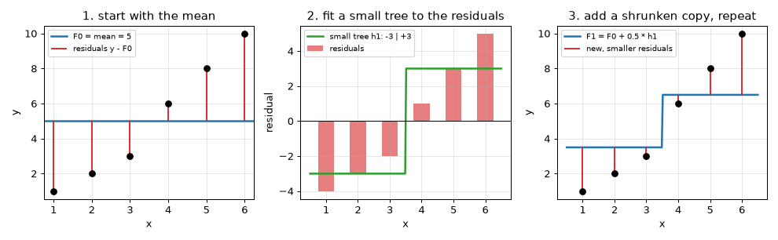
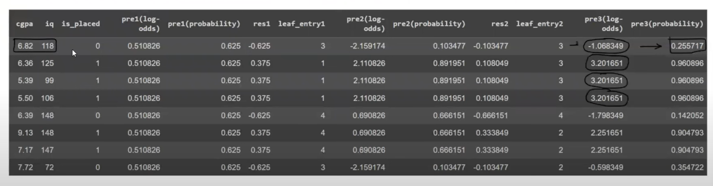
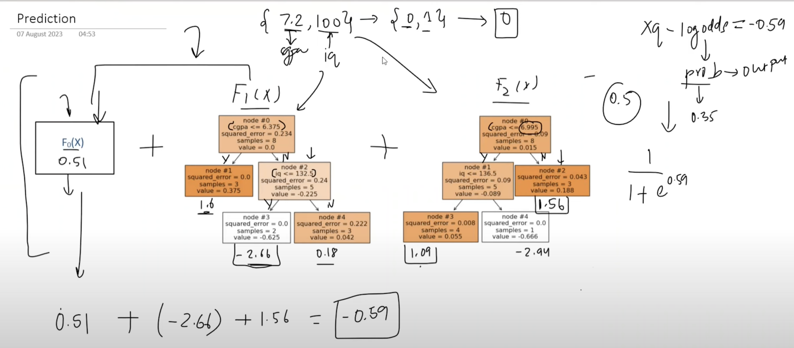

# Gradient Boosting — explained from zero

> **Who this is for:** someone who is new to machine learning. You need school algebra (what a squared number is,
> what an average is, what a slope is) and a little Python. Every other idea — decision trees, loss functions,
> gradients, log-odds, softmax — is built up here from scratch, with a picture or a tiny example first and the formula
> second.
>
> **How to read it:** sections 1–3 give the idea with no math. Sections 4–5 give the math, one small step at a time,
> and two complete examples worked by hand. Sections 6–9 are about using gradient boosting in real ML work and — just
> as important — when **not** to use it. Every claim is demonstrated in the notebooks in [`lab/`](lab/README.md).

## Table of contents

0. [Gradient boosting in 30 seconds](#0-gradient-boosting-in-30-seconds)
1. [The problem gradient boosting solves](#1-the-problem-gradient-boosting-solves)
2. [The toolbox: the only seven ideas you need](#2-the-toolbox-the-only-seven-ideas-you-need)
3. [Gradient boosting step by step, in plain words](#3-gradient-boosting-step-by-step-in-plain-words)
4. [The math: why it works](#4-the-math-why-it-works)
5. [Two complete examples by hand](#5-two-complete-examples-by-hand)
6. [Using gradient boosting in practice](#6-using-gradient-boosting-in-practice)
7. [Why gradient boosting makes sense for machine learning](#7-why-gradient-boosting-makes-sense-for-machine-learning)
8. [Where gradient boosting does NOT fit — and why](#8-where-gradient-boosting-does-not-fit--and-why)
9. [Common misconceptions](#9-common-misconceptions)
10. [The labs](#10-the-labs)
11. [Glossary](#11-glossary)
12. [Further reading](#12-further-reading)
13. [Appendix - Assumptions made](#appendix---assumptions-made)

---

## 0. Gradient boosting in 30 seconds

* You want to predict a number (a price) or a class (placed / not placed) from a table of features.
* Start with the dumbest possible guess: the **same constant** for everybody (the average price; the overall share of
  "placed", written as log-odds).
* Look at what is still wrong for each row — the **residual** (true value minus current guess).
* Fit a **small decision tree** to those residuals: it learns *where* the guess is too low and *where* it is too high.
* Add a **shrunken** copy of that tree to the guess (e.g. 10 % of it). The residuals get a little smaller.
* Repeat a few hundred times. The final model is **the constant + a long sum of small trees**.
* The name: each step moves the predictions in the direction that lowers the loss fastest — the negative
  **gradient** — which for squared error is exactly the residual. "Boosting" = many weak models built one after
  another, each fixing the previous ones' mistakes.

---

## 1. The problem gradient boosting solves

Six people; x is years of experience, y is a salary score.

| x | 1 | 2 | 3 | 4 | 5 | 6 |
|---|---|---|---|---|---|---|
| y | 1 | 2 | 3 | 6 | 8 | 10 |

One decision tree with a single split ("is x ≤ 3.5?") is far too crude — it predicts only two values. A very deep tree
fits these six points perfectly but would also fit every bit of noise in real data. A straight line misses the bend.
What we want is a way to build a flexible model **gradually**, checking as we go how much detail is real.



Look at the picture (it is round 1 of section 5.1):

1. **Start with the mean** (5). The red lines are the residuals: −4, −3, −2, +1, +3, +5.
2. **Fit a small tree to the residuals**, not to y. It finds the pattern "left side too high by about 3, right side
   too low by about 3" and predicts −3 / +3.
3. **Add a shrunken copy** (half of it here): the guess becomes 3.5 / 6.5 and every residual is smaller. Then do it
   again on the *new* residuals — the next tree finds the next-biggest pattern still left (x ≤ 4.5), and so on.

That is all gradient boosting does: **many small trees, each one trained on what the previous ones still get
wrong, each added with a small weight.** With real tabular data (dozens of features, curved effects, features that
only matter together) this is one of the most accurate methods available (Lab 7).

---

## 2. The toolbox: the only seven ideas you need

### 2.1 Predictions, residuals, loss

A model gives a prediction $F(x)$ for each row. The **residual** is $y - F(x)$: positive means "predicted too low".
A **loss function** $L(y, F)$ turns "how wrong" into one number per row; training means making the total
$\sum_i L(y_i, F(x_i))$ small. The three regression losses used here:

| Loss | Formula per row | Behaviour |
|---|---|---|
| squared error | $\tfrac12 (y - F)^2$ | big mistakes count a lot (an error of 10 costs 100 times an error of 1) |
| absolute error | $\lvert y - F \rvert$ | every unit of error costs the same; robust to outliers |
| Huber | squared for small errors, absolute beyond a cut-off $\delta$ | a compromise |

(Why the ½? It makes the slope come out as exactly $y - F$; see 2.3. Libraries differ: some write $(y-F)^2$, some
average over $n$. A constant factor never changes *which* model is best.) **MSE** is the *mean* squared error,
$\frac1n\sum (y_i - F_i)^2$.

### 2.2 The best constant

If you must predict **one** number $\gamma$ for everybody, which is best? For squared error it is the **mean** of y;
for absolute error it is the **median** (section 4.1 proves it). Gradient boosting always starts with this best
constant, called $F_0$.

### 2.3 A slope (derivative) and a gradient

The **derivative** $\frac{\partial L}{\partial F}$ is the slope of the loss when you nudge the prediction $F$ a
little. For $L = \tfrac12 (y-F)^2$ it is $-(y - F)$. The **negative** slope points downhill: moving $F$ in the
direction of $-\frac{\partial L}{\partial F} = y - F$ makes the loss smaller, and the residual itself tells you how
far. With many rows, the list of all slopes is the **gradient**. **Gradient descent** = repeatedly take a small step
downhill. Lab 3 checks numerically that for every loss in this README, "the thing each tree learns" is exactly this
negative slope.

### 2.4 A regression tree (and a stump)

A **regression tree** asks yes/no questions about the features ("is x ≤ 3.5?"), and each final box (**leaf**)
predicts one number — the average target of the training rows that landed there. It picks each question by trying every
feature and every threshold and keeping the one that leaves the smallest squared error. A tree with one question is
a **stump**; **depth** is the number of questions on the longest path. The folder README has the long version:
[decision trees in one page](../README.md#2-decision-trees-in-one-page). What you need here: (a) a small tree is a
crude, *piecewise-constant* function, (b) a tree with depth $d$ can only combine up to $d$ features in one path, (c) a
tree can only output values it stored in its leaves — it never extrapolates.

### 2.5 Bias and variance

A model's test error has two main sources. **Bias**: the model is too simple to follow the true pattern (a stump
fitting a curve). **Variance**: the model follows the training data's noise, so it would change a lot with a different
training set (a deep tree). See [bias and variance in one page](../README.md#3-bias-and-variance-in-one-page).
Bagging and random forests average many high-variance trees to cut variance. **Boosting goes the other way**: it starts
with high-bias pieces (small trees) and removes bias step by step; its variance is then controlled by small steps
(learning rate), few rounds (early stopping) and random subsets (subsampling).

### 2.6 Probability, odds and log-odds

For classification the model needs a probability $p$ between 0 and 1. Adding up trees gives *any* number, so we let
the trees build a number $F$ on an unbounded scale and convert it:

* **odds** $= \frac{p}{1-p}$ (p = 0.625 → odds 5 : 3 = 1.667),
* **log-odds** $F = \ln\frac{p}{1-p}$ (= 0.5108), which can be any real number,
* back to a probability with the **sigmoid**: $p = \frac{1}{1 + e^{-F}}$.

Log-odds 0 means p = 0.5; positive means "more likely yes". For K classes each class gets its own score $F_k$ and the
**softmax** $p_k = e^{F_k} / \sum_j e^{F_j}$ turns the K scores into probabilities that add up to 1.

### 2.7 Boosting vs bagging vs AdaBoost

* **Bagging / random forest**: many deep trees trained **independently** on random resamples, then **averaged**.
* **AdaBoost**: trees trained **one after another**; after each, misclassified rows get **larger weights** so the next
  tree focuses on them; the final model is a **weighted vote**. See [`../04-adaboost/`](../04-adaboost/README.md).
* **Gradient boosting**: trees trained one after another, but instead of re-weighting rows, each tree is fit to the
  **residuals** (negative gradients) of the current model; the final model is a **sum**. (AdaBoost turns out to be
  gradient boosting with the exponential loss — scikit-learn's `loss="exponential"`.)
* **XGBoost**: gradient boosting with a second-order (curvature-aware) tree-building rule, regularisation and a fast
  histogram engine. See [`../06-xgboost/`](../06-xgboost/README.md).

---

## 3. Gradient boosting step by step, in plain words

1. **Choose a loss** that measures what "wrong" means for your problem (squared error, absolute error, Huber,
   log-loss for classes).
2. **Start** with the best constant $F_0$ (mean, median, or the log-odds of the class share).
3. **Repeat** for $m = 1, 2, \dots, M$:
   1. For every training row compute the **pseudo-residual** $r_i$: the downhill direction of the loss at the current
      prediction. For squared error it is simply $y_i - F_{m-1}(x_i)$.
   2. **Fit a small regression tree** to the pairs $(x_i, r_i)$ — the tree groups rows that need a similar correction.
   3. **Re-compute each leaf's value** so that, for the rows in that leaf, the loss drops as much as possible (a "line
      search" per leaf). For squared error this is just the average residual — the tree already has it.
   4. **Add the tree, shrunk** by the learning rate $\eta$ (e.g. 0.1): $F_m(x) = F_{m-1}(x) + \eta \cdot \text{tree}_m(x)$.
4. **Stop** after $M$ rounds — chosen on validation data, or automatically by early stopping.
5. **Predict**: $F_M(x) = F_0 + \eta\,\text{tree}_1(x) + \dots + \eta\,\text{tree}_M(x)$; for classification turn
   $F_M$ into probabilities with the sigmoid / softmax.

Note in step 3.2: tree $m$ is fit to the **new** residuals $y - F_{m-1}(x)$ of the whole model so far, not to the
previous tree's outputs.

---

## 4. The math: why it works

### 4.1 The goal, and the best starting constant

We want the function $F$ that makes the total loss small: $\min_F \sum_{i=1}^n L(y_i, F(x_i))$. Searching over all
functions is hopeless, so we build $F$ as a sum and start with a constant:
$F_0 = \arg\min_\gamma \sum_i L(y_i, \gamma)$. For squared error set the derivative to zero:

$$\frac{\partial}{\partial\gamma}\sum_i \tfrac12 (y_i - \gamma)^2 = -\sum_i (y_i - \gamma) = 0 \;\Rightarrow\; n\gamma = \sum_i y_i \;\Rightarrow\; F_0 = \bar y.$$

For absolute error the derivative is $-\sum_i \text{sign}(y_i - \gamma)$, which is zero when as many points lie above
$\gamma$ as below: $F_0$ = the **median**. For classification see 4.4 (log-odds) and 4.6 (K classes).

### 4.2 Gradient descent on the predictions

Think of the $n$ training predictions $F(x_1), \dots, F(x_n)$ as $n$ numbers we are free to move. The loss is a
function of these numbers, and its steepest-descent direction for row $i$ is

$$r_{im} = -\left[\frac{\partial L(y_i, F(x_i))}{\partial F(x_i)}\right]_{F = F_{m-1}} \qquad \text{(the pseudo-residual)}.$$

The derivative is taken **with respect to the prediction $F(x_i)$** — not with respect to the residuals (an error in
the old notes). For $L = \tfrac12 (y - F)^2$: $r = y - F$, the ordinary residual. So for squared error, "fitting the
residuals" and "following the negative gradient of the ordinary MSE loss" are the same thing — nothing exotic. Other
losses give other pseudo-residuals: $\text{sign}(y - F)$ for absolute error, a capped residual for Huber, $y - p$ for
log-loss (4.4).

If we just moved each training prediction by $r_i$ we would memorise the training set and learn nothing about new
$x$. So we **fit a regression tree $h_m$ to the pairs $(x_i, r_{im})$**: the tree is the best *function of x* that
points in (roughly) the downhill direction. That is why it is called gradient boosting: **gradient descent, carried out
in the space of functions, one tree per step** (Friedman 2001).

With other conventions — $L = (y-F)^2$ or $L = \frac1n\sum(y-F)^2$ — the gradient is $2(y-F)$ or $\frac2n(y-F)$:
same direction, different length. The length does not matter because of the next step.

### 4.3 The line search, leaf by leaf

The tree $h_m$ splits the rows into leaves $R_{1m}, \dots, R_{Jm}$. Instead of trusting the tree's numbers, pick the
best constant **for each leaf separately**:

$$\gamma_{jm} = \arg\min_\gamma \sum_{x_i \in R_{jm}} L\big(y_i,\; F_{m-1}(x_i) + \gamma\big).$$

For squared error, the derivative in $\gamma$ is $-\sum_{i \in R_{jm}} (y_i - F_{m-1}(x_i) - \gamma) = 0$, so
$\gamma_{jm} = \frac{1}{n_j}\sum_{i\in R_{jm}} r_{im}$: **the average residual in the leaf** — exactly what the tree
already predicts. For absolute error, the best shift is the **median** of $y_i - F_{m-1}(x_i)$ in the leaf (4.1 again,
applied to one leaf). For Huber, scikit-learn uses a one-step approximation: median plus the average of the
deviations capped at $\delta$ (Friedman 2001, Algorithm 4; the from-scratch notebook §2 shows it is close to, not
equal to, the exact minimiser). scikit-learn also re-sets Huber's $\delta$ every round to the 90 % quantile
(`alpha=0.9`) of the current absolute errors.

### 4.4 Binary classification: why log-odds, and the Newton step

**The vanilla attempt (and why it breaks).** Suppose the model output *probabilities* directly with
$L = -[y \ln \hat p + (1 - y)\ln(1-\hat p)]$ (binary cross-entropy). The best constant is $\hat p = p_+ = n_+/n$
(set $\sum_i [-y_i/\gamma + (1-y_i)/(1-\gamma)] = 0$). In round 1 every row in a leaf starts from the same $p_+$, and
solving for the leaf shift gives $\gamma_j = \frac{n_{+,j}}{n_j} - p_+$, so $F_1$ = the leaf's share of positives —
it even stays in [0, 1]. But from round 2 on, the rows in one leaf have **different** $F_{m-1}(x_i)$, and the
condition $\sum_i \frac{y_i}{F_{m-1}(x_i) + \gamma} = \sum_i \frac{1 - y_i}{1 - F_{m-1}(x_i) - \gamma}$ has no
closed-form solution; nothing keeps the sum inside [0, 1] either. So we change coordinates.

**Work in log-odds.** Let the trees build $F$ and set $p = \text{sigmoid}(F)$. Rewriting the loss with
$\ln\frac{p}{1-p} = F$ and $\ln(1-p) = -\ln(1 + e^F)$:

$$L(y, F) = -\big[y\,F - \ln(1 + e^{F})\big], \qquad \frac{\partial L}{\partial F} = p - y, \qquad \frac{\partial^2 L}{\partial F^2} = p\,(1-p).$$

* Start: setting $\sum_i (p - y_i) = 0$ gives $p = p_+$, i.e. $F_0 = \ln\frac{p_+}{1 - p_+}$ — **the log-odds**, not
  $p_+$ itself (the old notes wrote $F_0 = p_+$); $p_+$ is what the sigmoid returns.
* Pseudo-residual: $r_i = y_i - p_i$ ("observed minus predicted probability").
* Leaf value: the exact line search has no formula, so approximate the loss in the leaf by its second-order Taylor
  expansion around $F_{m-1}$ — $L(F + \gamma) \approx L(F) + g\,\gamma + \tfrac12 h\,\gamma^2$ with $g = p - y$,
  $h = p(1-p)$ — and minimise that parabola (one **Newton step**):

$$\gamma_{jm} = -\frac{\sum_{i\in R_{jm}} g_i}{\sum_{i\in R_{jm}} h_i} = \frac{\sum_{i \in R_{jm}} (y_i - p_i)}{\sum_{i \in R_{jm}} p_i(1 - p_i)}.$$

The numerator is the leaf's total residual; the denominator measures how "sure" the leaf already is. If every
probability in a leaf is (numerically) 0 or 1, the denominator is 0; scikit-learn then returns 0 (guard
$\lvert\text{denominator}\rvert < 10^{-150}$): nothing left to learn there.

### 4.5 Shrinkage: why η is applied after the line search

The update is $F_m(x) = F_{m-1}(x) + \eta \sum_j \gamma_{jm}\,\mathbb 1[x \in R_{jm}]$ with $0 < \eta \le 1$.

* **Where η goes matters.** If you put η inside the line search, $\arg\min_\gamma \sum L(y, F + \eta\gamma)$, the
  optimiser just returns $\gamma/\eta$ and the step $\eta \cdot \gamma/\eta$ is the full step again — no shrinkage at
  all. (The old notes said it "would not make any difference"; the from-scratch notebook §3 shows predictions identical
  to η = 1.) η is applied **after** solving for γ; that is what makes it shrinkage.
* **Why shrink.** Each tree is fit to the *training* residuals, which contain noise. A full step lets one tree absorb
  as much of that noise as it can; many small steps let later trees correct earlier ones and keep each tree's
  influence small. Empirically smaller η needs more trees and ends slightly better (Lab 9: η = 1 → 16 trees, best
  validation MSE 4.95; η = 0.1 → 499 trees, 1.84). The old notes explained shrinkage as fixing "high variance since
  the predictions remain the same on test data" — that reasoning is backwards: predictions that stay the same across
  datasets are *low* variance. The real issue is over-fitting the training residuals.
* **Stochastic boosting** (`subsample < 1`) adds a second brake: each tree sees a random half (say) of the rows, drawn
  again each round **without replacement** (Lab 11).

### 4.6 More than two classes

Each sample gets K scores $z_1, \dots, z_K$ (one per class), probabilities $p_k = e^{z_k}/\sum_j e^{z_j}$, and the
categorical cross-entropy $L = -\sum_k y_k \ln p_k = -\sum_k y_k z_k + \ln\sum_j e^{z_j}$ (with $y_k = 1$ for the
true class, else 0).

* **Constant model.** With the same $p_k$ for all rows the total loss is $-\sum_k n_k \ln p_k$; setting the derivative
  in $z_k$ to zero gives $-n_k + n\,p_k = 0$, so $p_k = n_k / n$: **the class shares**.
* **Over-parametrisation.** Adding the same constant C to every score changes nothing:
  $e^{z_k + C}/\sum_j e^{z_j + C} = e^{z_k}/\sum_j e^{z_j}$. Only *differences* between scores matter, so K scores carry
  K − 1 numbers' worth of information — one degree of freedom is redundant.
* **Eliminating it.** For two classes, fix the negative class's score at 0: the softmax becomes the sigmoid
  $p = e^z / (e^z + 1) = 1/(1 + e^{-z})$ — that is why binary boosting needs **one** tree per round. For K classes
  scikit-learn uses the *symmetric* choice $F_{0k} = \ln p_k - \frac1K\sum_j \ln p_j$ (scores summing to 0), then fits
  **K regression trees per round anyway**, one per class. In scikit-learn's words: "In each stage n_classes_ regression
  trees are fit on the negative gradient of the loss function"; binary is the special case with a single tree.
* **Residuals.** $-\partial L/\partial z_k = y_{ik} - p_{ik}$: for each class, "1 if it is this class, else 0" minus
  the predicted probability. All K residual columns are computed from the scores at the start of the round.
* **Approximations used.** The exact second derivatives couple the classes: $\partial^2 L/\partial z_k^2 = p_k(1 - p_k)$
  but $\partial^2 L / \partial z_k \partial z_l = -p_k p_l$. The trees are fit separately per class and each leaf takes
  a **diagonal** Newton step that ignores the cross terms. scikit-learn's leaf value is

$$\gamma_{jkm} = \frac{K-1}{K}\cdot\frac{\sum_{i \in R_{jkm}} (y_{ik} - p_{ik})}{\sum_{i\in R_{jkm}} p_{ik}(1 - p_{ik})}.$$

  The factor $(K-1)/K$ comes from Friedman's papers; scikit-learn's source notes it is "wrong or at least arbitrary"
  (it simply rescales the learning rate) and keeps it for backward compatibility. Lab 6 checks this formula against
  scikit-learn's stored leaf values.
* **Problems with K trees per round.** K times the training cost and memory; each class's tree chooses its splits
  without seeing the others; the redundant direction (adding the same amount to all scores) is still being fit.
* **When the approximations fail.** (a) Leaves where every $p_{ik}$ is near 0 or 1: the denominator is tiny and the
  step explodes — hence the guard that returns 0. (b) Ignoring the cross terms makes each class's step too large or
  too small when one class dominates a leaf; small η and many rounds absorb this. (c) Second-order (Taylor) steps are
  only accurate near the current prediction — again a reason for small η. XGBoost builds the curvature into the split
  search itself ([`../06-xgboost/`](../06-xgboost/README.md)).

### 4.7 How the trees choose splits, and "why `friedman_mse`?"

Each tree is a least-squares regression tree on the pseudo-residuals. A split with $n_L$ rows (residual sum $S_L$)
on the left and $n_R$ ($S_R$) on the right lowers the squared error by
$\frac{S_L^2}{n_L} + \frac{S_R^2}{n_R} - \frac{(S_L+S_R)^2}{n}$. Friedman (2001, eq. 35) scores a split by
$\frac{n_L n_R}{n_L + n_R}(\bar r_L - \bar r_R)^2$ — with a line of algebra this is **the same number**, so for
unweighted data it ranks splits exactly like plain MSE reduction (from-scratch notebook §1.1). In scikit-learn 1.9 the
`criterion` parameter of gradient boosting is **deprecated and has no effect**; the trees always use squared error.

### 4.8 The full algorithm

1. $F_0(x) = \arg\min_\gamma \sum_i L(y_i, \gamma)$.
2. For $m = 1 \dots M$:
   (a) $r_{im} = -\partial L(y_i, F_{m-1}(x_i)) / \partial F_{m-1}(x_i)$ for all $i$ (in a random subset if subsampling);
   (b) fit a regression tree with leaves $R_{jm}$ to $\{(x_i, r_{im})\}$;
   (c) $\gamma_{jm} = \arg\min_\gamma \sum_{x_i \in R_{jm}} L(y_i, F_{m-1}(x_i) + \gamma)$ (exact or one Newton step);
   (d) $F_m(x) = F_{m-1}(x) + \eta \sum_j \gamma_{jm}\,\mathbb 1[x \in R_{jm}]$.
3. Output $F_M$ (through sigmoid / softmax for classes).

---

## 5. Two complete examples by hand

### 5.1 Regression: six points, three stumps, η = 0.5

Data from section 1: x = 1…6, y = 1, 2, 3, 6, 8, 10. Squared-error loss, stumps, learning rate 0.5.

**Round 0.** $F_0 = \bar y = 30/6 = 5$. Residuals: −4, −3, −2, 1, 3, 5. Training MSE = (16+9+4+1+9+25)/6 = **10.667**.

**Round 1.** Try every cut, scoring $\frac{n_L n_R}{n}(\bar r_L - \bar r_R)^2$:
x ≤ 3.5 gives $\frac{3\cdot3}{6}(-3 - 3)^2 = 54$; x ≤ 4.5 gives $\frac{4\cdot 2}{6}(-2-4)^2 = 48$; the others are
smaller. Best: **x ≤ 3.5**, leaves = mean residuals **−3** and **+3**.
$F_1 = 5 + 0.5\cdot(-3) = 3.5$ (left), $5 + 0.5 \cdot 3 = 6.5$ (right).
New residuals: −2.5, −1.5, −0.5, −0.5, 1.5, 3.5. MSE = 23.5/6 = **3.917**.

**Round 2.** Best cut **x ≤ 4.5** (score $\frac{4\cdot2}{6}(-1.25 - 2.5)^2 = 18.75$; x ≤ 3.5 would give only 13.5).
Leaves **−1.25** and **+2.5**. $F_2$ = 2.875, 2.875, 2.875, 5.875, 7.75, 7.75.
Residuals: −1.875, −0.875, 0.125, 0.125, 0.25, 2.25. MSE = 9.4375/6 = **1.573**.

**Round 3.** Best cut **x ≤ 5.5**: left mean (−1.875 − 0.875 + 0.125 + 0.125 + 0.25)/5 = **−0.45**, right **+2.25**.
$F_3$ = **2.65, 2.65, 2.65, 5.65, 7.525, 8.875**. Residuals −1.65, −0.65, 0.35, 0.35, 0.475, 1.125; MSE = **0.814**.

Things to notice: each tree went after the biggest pattern *still* left; the error fell 10.667 → 3.917 → 1.573 → 0.814;
and the prediction for x = 7, or x = 100, is $5 + 0.5(3 + 2.5 + 2.25) = $ **8.875** — flat beyond the data.
Lab 1 and the from-scratch notebook §3 reproduce every number.

### 5.2 Binary classification: the lecture screenshots, re-checked

The old notes kept two screenshots from a video lecture (source not recorded): eight students with `cgpa` and `iq`,
target `is_placed`, learning rate **1**, trees with 3 leaves.



**Round 0** (columns `pre1`, `res1`). 5 of 8 are placed: $p_+ = 0.625$, $F_0 = \ln(0.625/0.375) = \ln(5/3) =$
**0.510826** for everybody. Residuals $y - p$: **+0.375** for placed rows, **−0.625** for the others. ✔

**Tree 1** (`leaf_entry1`; the left tree in the second picture). Cuts: cgpa ≤ 6.375, then iq ≤ 132.5.
The node boxes show `value` = the mean residual (what a plain regression tree stores): 0.375, −0.625, 0.042.
Gradient boosting replaces them with Newton steps (4.4); every row has $p(1-p) = 0.625 \cdot 0.375 = 0.234375$:

| leaf | rows | Σ r | Σ p(1−p) | γ = Σr / Σp(1−p) | screenshot |
|---|---|---|---|---|---|
| 1 (cgpa ≤ 6.375) | 2, 3, 4 | 3 · 0.375 = 1.125 | 0.703 | **1.6** | 1.6 ✔ |
| 3 (iq ≤ 132.5) | 1, 8 | −1.25 | 0.469 | **−2.667** | −2.66 (≈) |
| 4 (iq > 132.5) | 5, 6, 7 | 0.125 | 0.703 | **0.178** | 0.18 (≈) |

So $F_1$ = 0.5108 + 1.6 = **2.1108** (rows 2–4), 0.5108 − 2.6667 = **−2.1558** (rows 1, 8) and 0.5108 + 0.1778 =
**0.6886** (rows 5–7). The table's `pre2` column shows −2.159174 and 0.690826 because it added the *rounded* leaf
values −2.67 and 0.18. Probabilities `pre2(probability)`: sigmoid(−2.16) ≈ 0.10, sigmoid(2.11) = 0.892,
sigmoid(0.69) ≈ 0.666; residuals `res2` = y − p. (Tie note: at the second cut, "cgpa ≤ 6.995" separates {1, 5} with
exactly the same residual values as "iq ≤ 132.5" separates {1, 8}; both are equally good and the random feature order
decides — Lab 2.)



**Tree 2** (right tree). Cuts cgpa ≤ 6.995, then iq ≤ 136.5; node means 0.015 (root), −0.089, 0.055, −0.666, 0.188 —
all ✔ (means of `res2`). The Newton leaf values from the exact $F_1$ are:

| leaf | rows | Σ r | Σ p(1−p) | γ | screenshot |
|---|---|---|---|---|---|
| 3 (cgpa ≤ 6.995, iq ≤ 136.5) | 1, 2, 3, 4 | 0.2204 | 0.3821 | **0.5767** | 1.09 ✘ |
| 4 (cgpa ≤ 6.995, iq > 136.5) | 5 | −0.6657 | 0.2226 | **−2.9909** | −2.94 (table: −2.49) ✘ |
| 2 (cgpa > 6.995) | 6, 7, 8 | 0.5649 | 0.5381 | **1.0497** | 1.56 ✘ |

We could not reproduce the screenshot's three tree-2 values from the formula (even its own table and drawing
disagree on leaf 4), so this README uses the recomputed ones; scikit-learn stores exactly 0.5767, −2.9909, 1.0497.

**The query student** (cgpa 7.2, iq 100): tree 1 → cgpa > 6.375, iq ≤ 132.5 → −2.6667; tree 2 → cgpa > 6.995 →
+1.0497. $F = 0.5108 - 2.6667 + 1.0497 = $ **−1.1061**, $p = 1/(1 + e^{1.1061}) = $ **0.249** → below 0.5 → class
**0 (not placed)**. The screenshot computes $0.51 - 2.66 + 1.56 = -0.59$ and $1/(1 + e^{0.59}) \approx 0.36$: the
arithmetic is right for its numbers, and the decision (0) is the same. Lab 2 prints every column of the table; the
from-scratch notebook §4 recomputes the leaf values with its own code.

---

## 6. Using gradient boosting in practice

### 6.1 The recipe in scikit-learn

```python
from sklearn.ensemble import GradientBoostingRegressor
from sklearn.model_selection import train_test_split

X_train, X_test, y_train, y_test = train_test_split(X, y, test_size=0.2, random_state=0)

model = GradientBoostingRegressor(
    n_estimators=2000,         # an upper limit ...
    learning_rate=0.05,        # small steps (6.3)
    max_depth=3,               # interaction order of each tree (8.3)
    subsample=0.8,             # stochastic gradient boosting (4.5)
    n_iter_no_change=20,       # ... early stopping picks the real number (6.2)
    validation_fraction=0.1,   # taken from X_train, only used because n_iter_no_change is set
    random_state=0,
)
model.fit(X_train, y_train)          # no scaling needed: trees only compare values within one feature
print(model.n_estimators_)           # rounds actually kept
print(model.score(X_test, y_test))   # R^2 on data never used for any choice
```

Classification is the same with `GradientBoostingClassifier` (`predict_proba` gives probabilities). For more than
~10,000 rows use `HistGradientBoostingRegressor` / `HistGradientBoostingClassifier` (binned, much faster — Lab 18).

### 6.2 Hyper-parameters (scikit-learn 1.9 defaults)

| Parameter | Default | What it does | Practical advice |
|---|---|---|---|
| `loss` | `squared_error` (reg.) / `log_loss` (clf.) | which loss → which F₀, pseudo-residuals, leaf values | `absolute_error` or `huber` with outliers (8.4); `quantile` for prediction intervals |
| `learning_rate` | 0.1 | shrinks every tree (η) | 0.01–0.1; smaller needs more trees (Lab 9) |
| `n_estimators` | 100 | number of rounds M | choose with a validation curve or early stopping, not by "more is better" |
| `max_depth` | **3** (not a stump) | size of each tree; max interaction order | 2–5. ESL suggests about 4–8 leaves (depth 2–3); the old note "8 to 32 leaves" is on the large side |
| `max_leaf_nodes` | None | grow best-first up to this many leaves instead of by depth | alternative to `max_depth` |
| `min_samples_leaf` | 1 | smallest leaf | raise (e.g. 20) on noisy data |
| `subsample` | 1.0 | fraction of rows per round, **new draw every round, without replacement** | 0.5–0.8 often helps (Lab 11) |
| `max_features` | None | features tried per split | `"sqrt"` adds randomness, speeds up |
| `n_iter_no_change` | None | early stopping patience (rounds) | set it (e.g. 10–20) to switch early stopping on |
| `validation_fraction` | 0.1 | share of the training data held out for early stopping | **ignored unless `n_iter_no_change` is set** (Lab 10) |
| `tol` | 1e-4 | minimum improvement that counts | |
| `alpha` | 0.9 | Huber cut-off quantile / quantile-loss level | lower for more robustness |
| `criterion` | `"deprecated"` | no effect in 1.9 (trees use squared error) | leave it alone (4.7) |
| `init` | None | starting model (mean / median / prior) | rarely changed |

### 6.3 Reading the output

| Attribute / method | What it is |
|---|---|
| `init_` | the starting model: `DummyRegressor` (mean; median for absolute/Huber) or `DummyClassifier(strategy="prior")` |
| `estimators_` | array of fitted `DecisionTreeRegressor`s, shape (rounds, 1) or (rounds, K) for K classes |
| `n_estimators_` | rounds actually fitted (smaller than `n_estimators` after early stopping) |
| `train_score_` | training loss after each round (in-bag loss if `subsample < 1`) |
| `oob_improvement_`, `oob_scores_` | loss change / loss on the rows left out of each round (only with `subsample < 1`) |
| `staged_predict(X)` / `staged_predict_proba(X)` | predictions after 1, 2, … M trees — learning curves from one fit (Lab 8) |
| `decision_function(X)` | the raw scores $F$ (log-odds for binary) |
| `feature_importances_` | total squared-error reduction per feature, normalised (impurity-based: biased toward many-valued features; prefer permutation importance on validation data) |

### 6.4 Choosing M, η and depth without fooling yourself

Split the data into **train / validation / test** (or use cross-validation on the training part). Read the number of
trees off the validation curve (`staged_predict`) or let early stopping do it; tune `learning_rate`, `max_depth`,
`subsample` together on validation scores (they interact — Lab 18's heat map); touch the **test set once**. The old
notes computed a "validation score" on the test set — that makes the reported score optimistic. No scaler is needed
for trees; if your pipeline has encoders or imputers, put them in a `Pipeline` so they are fitted on training folds only.

---

## 7. Why gradient boosting makes sense for machine learning

1. **It attacks bias directly.** Each round fits what is still unexplained, so a sum of small trees can approximate
   curves, steps and interactions that no single small tree can (Lab 4). Bagging/random forests mostly reduce
   variance; their trees share the same bias. That is why boosting edges out the forest on the good-fit data
   (Lab 7: test MSE **2.07** vs **3.65**; linear **7.35**; noise floor 1.0).
2. **Any differentiable loss.** Change three formulas (start, pseudo-residual, leaf value) and the same machine does
   least squares, robust regression, quantiles, binary and multi-class classification.
3. **Tabular data friendly.** Trees ignore feature scales and monotone transformations, handle mixed feature
   types, and pick up interactions up to depth $d$ automatically.
4. **Controllable complexity.** Learning rate, tree size, number of rounds and subsampling are explicit dials, and
   `staged_predict` / early stopping make the "how many rounds" choice cheap (Labs 8–11).
5. **Strong baseline.** On medium-sized tabular problems gradient-boosted trees (and their descendants XGBoost,
   LightGBM, CatBoost) are among the most accurate off-the-shelf methods.

**It is the right tool when** the target depends on the features in a non-linear way with interactions, the data is a
table of a few to a few hundred features, test points look like training points (same ranges), and you can afford a
validation set to tune a handful of knobs.

---

## 8. Where gradient boosting does NOT fit — and why

| # | Situation | Why it fails | Use instead | Lab |
|---|---|---|---|---|
| 8.1 | Predicting the future of a trend (**bad-fit dataset**) | the model is a constant plus a sum of leaf values seen in training: flat outside the range | linear trend + season terms; detrend first, then boost the remainder | 12 |
| 8.2 | Test inputs from regions the sample never covered | only the sampled stretch is learned | collect data there; models with the right global form | 13 |
| 8.3 | Interactions with stumps (XOR, sin(x₁+x₂)) | a sum of stumps is additive: f(x₁) + g(x₂) | `max_depth` ≥ 2 | 14 |
| 8.4 | Outliers in y with squared loss | pseudo-residual grows with the error; trees chase outliers | `absolute_error` / `huber`, clean data | 15 |
| 8.5 | Noisy labels + too many rounds | later trees memorise noise; probabilities get over-confident | early stopping, smaller η, shallower trees, `subsample` | 16 |
| 8.6 | Target is (nearly) linear / smooth | slopes approximated by staircases; residuals stay correlated with features | linear model, or add a linear part | 17 |
| 8.7 | Very large n, tight training budgets, many knobs | rounds are sequential; exact split search sorts every node; results depend on interacting settings | `HistGradientBoosting*`, XGBoost/LightGBM; tune on validation | 18 |

### 8.1 The future of a trend (the bad-fit dataset)
**Why:** every prediction is $F_0$ plus leaf values, and every leaf value was learned from training rows. For a time
index beyond the last training month all trees answer as they did for the last months. Lab 12 (40 years of monthly data,
trained on the first 70 %): boosting fits the past best (train RMSE **0.64**) and the future worst (**9.52**; random
forest 9.02), while a linear model with a trend and sin/cos season terms gets **1.63**. Boosting's highest forecast
(55.6) never exceeds the highest training value (57.2); the true future reaches 70.9. **Fix:** let a model that can
extrapolate carry the trend (here a straight line) and boost only what is left (RMSE **1.76**), or difference the
series first.

### 8.2 Population vs sample
**Why:** the true curve is sin(x) on [0, 2π], but Lab 13 only samples x in [π − 1, π + 1], where sin(x) ≈ π − x. Inside
that stretch both boosting and a straight line are accurate (RMSE 0.036 / 0.026). Outside, neither recovers the
curve: boosting goes flat at the edge values (RMSE 0.32 — "less wrong" than the line only because sin stays within
±1), the line keeps falling (1.45). No algorithm learns what the sample does not contain.

### 8.3 Interactions with stumps
**Why:** a stump looks at one feature, so a sum of stumps is $f_1(x_1) + f_2(x_2) + \dots$ — it cannot express
"positive when exactly one of x₁, x₂ is positive". Lab 14: XOR test accuracy **0.577** with stumps vs **0.997** with
depth 2; sin(3(x₁+x₂)) R² **−0.006** vs 0.753 (depth 2) and 0.907 (depth 3). The old note "y = x₁ XOR x₂ fails" is true
only for stumps; scikit-learn's default depth is 3. **Fix:** depth ≥ the interaction order you expect.

### 8.4 Outliers with squared loss
**Why:** the squared-error pseudo-residual is the raw error, so a point 10 units off pulls ten times harder than one
1 unit off and small trees isolate it. Lab 15 (5 % of targets shifted by 5–10): RMSE against the clean curve **1.317**
(squared), **0.115** (absolute), **0.540** (Huber with default `alpha=0.9`, 0.476 with 0.5). **Fix:** absolute loss for
gross outliers, Huber for moderate ones, or clean the data.

### 8.5 Noisy labels and too many rounds
**Why:** with 30 % flipped labels, η = 0.3 and depth-4 trees, validation log-loss is best after **9** trees (0.491) and
rises to **0.909** after 500 while training log-loss heads to 0.002 (Lab 16). Accuracy barely changes (0.761 vs
0.755) — the damage is in over-confident probabilities. **Fix:** early stopping (19 rounds, test log-loss 0.529 vs
1.078), smaller η, shallower trees, `min_samples_leaf`, `subsample`. Note: class imbalance, data drift and "limited
data" — listed in the old notes — are not gradient-boosting-specific failures: they hurt every model, and a small,
regularised GBM is a standard small-data baseline.

### 8.6 Linear or smooth targets
**Why:** a tree approximates a slope by a staircase; it needs many leaves for a good line. Lab 17 (a purely linear
target): linear regression's validation RMSE **0.20** (the noise level), boosting **6.11**, random forest **10.15**. The
old notebook's diagnostic shows it: the tree ensembles' validation residuals still **correlate with the four
informative features** (0.29–0.40 for boosting, 0.31–0.50 for the forest); the linear model's do not. **Fix:** a linear
model, linear terms added to the features, or boosting on the residuals of a linear fit.

### 8.7 Cost, scale and tuning
**Why:** round m needs round m − 1's residuals, so rounds cannot run in parallel: fit time doubles with the number of
rounds (≈ 0.15 → 1.2 s for 100 → 800 rounds in Lab 18) while a random forest spreads its trees over cores (several times faster with `n_jobs=-1`).
The exact split search sorts every node: on 50,000 rows the classic implementation took ≈ **18–20 s** versus **1–6 s** (several times faster; the exact time varied with machine load between runs) for
`HistGradientBoostingRegressor` at the same R² (0.952 vs 0.954). And the knobs interact: 200 trees gave validation R²
from **0.61 to 0.92** across learning rate × depth. **Fix:** histogram-based boosting for large n, tune on validation
data, start from defaults (η 0.05–0.1, depth 3, early stopping).

### 8.8 Disadvantages at a glance
The old notes listed only "memory complexity". The full list: sequential training (8.7); several interacting
hyper-parameters (8.7); no extrapolation (8.1–8.2); sensitive to outliers and label noise with the default losses
(8.4–8.5); memory and prediction time grow with the number of trees — M trees for regression/binary, **M × K** for
K classes; probabilities can become over-confident with many rounds (calibrate on validation data if you need them);
a sum of hundreds of trees is much harder to read than one tree (use permutation importance, partial dependence or
SHAP-style tools).

**Rule of thumb:** before trusting gradient boosting ask — *Will test inputs fall inside the training ranges? Is
there a trend over time? Are there gross outliers or noisy labels? Is the relationship basically linear? Do I have a
validation set to stop and tune with?*

---

## 9. Common misconceptions

| Myth | Reality |
|---|---|
| "Tree 2 is fit to the outputs of tree 1." | Tree m is fit to the **new residuals** $y - F_{m-1}(x)$ of the whole model so far (§3, §4.2). |
| "It is called gradient boosting because the gradient is taken w.r.t. the residuals." | The gradient is taken w.r.t. the **prediction** $F(x)$; the pseudo-residual is $-\partial L/\partial F$ (§4.2). |
| "The residual loss is not a typical loss like MSE." | For squared error the residual **is** the negative gradient of the ordinary MSE loss (§4.2, Lab 3). |
| "MSE = minimum squared error." | **Mean** squared error. |
| "With $L = \frac1n\sum(y-\hat y)^2$ the residual is $2(y - \hat y)$, so it is something else." | Same direction, different length; the leaf line search makes the factor irrelevant. Write ½(y − F)² per sample to keep $r = y - F$ (§2.1). |
| "Base model + tree 1 has low bias but high variance, since test predictions stay the same." | Backwards: predictions that stay the same are *low* variance. Shrinkage exists because a full step over-fits the training residuals (§4.5). |
| "Putting η inside the argmin makes no difference." | It cancels the shrinkage (γ grows by 1/η). η is applied **after** the line search (§4.5, from-scratch §3). |
| "The line-search step uses $F_{m-1}$ as the new dependent feature" / "one γ per tree". | γ is solved **per leaf**: $\gamma_{jm}$ (§4.3). |
| "For classification $F_0 = p_+$." | $F_0 = \ln\frac{p_+}{1-p_+}$, the **log-odds**; $p_+$ is what the sigmoid returns (§4.4). |
| "Boosting models the probability directly." | It works in log-odds; the probability-space version breaks from round 2 (§4.4). |
| "Binary classification fits two trees per round." | One tree (the sigmoid fixes the other class's score); K ≥ 3 classes fit K trees (§4.6, Lab 6). |
| "`validation_fraction=0.1` means there is always a validation set." | Only when `n_iter_no_change` is set; otherwise it is ignored (Lab 10). |
| "`subsample` picks one subset and reuses it." | A **new** subset every round, **without replacement** (Lab 11). |
| "The default weak learner is a stump." | scikit-learn's default is `max_depth=3`. |
| "Why `friedman_mse`?" (left open) | Same ranking as MSE reduction for unweighted data; deprecated with no effect in scikit-learn 1.9 (§4.7). |
| "Low learning rate → more trees? Test this!" | Tested: η 1 → 16 trees, 0.5 → 54, 0.2 → 188, 0.1 → 499, 0.05 → 617; best score improves slightly (Lab 9). |
| "y = x₁ XOR x₂ makes GBM fail." | Only stumps fail; depth 2 solves it (Lab 14). |
| "Imbalanced data, drift and limited data are classic GBM failures." | They hurt every model; they are not specific to gradient boosting (§8.5). |
| "Gradient boosting trees usually have 8 to 32 leaves." | ESL recommends about 4–8 leaves; scikit-learn's default depth 3 gives up to 8. |
| "More trees always help." | Validation error has a minimum (Labs 8, 16). |
| "Boosting always beats bagging." | Often on clean tabular data; not with noisy labels, extrapolation or linear targets (§8). |
| "Boosting combines models by voting." | By a weighted **sum** of tree outputs. |
| "Gradient boosting re-weights misclassified rows." | That is AdaBoost; gradient boosting fits residuals ([`../04-adaboost/`](../04-adaboost/README.md)). |
| "Trees need scaled features." | No: splits compare values within one feature. |

---

## 10. The labs

Everything above is demonstrated in two Jupyter notebooks in [`lab/`](lab/README.md) (setup and run instructions
there). Data: `lab/data/good_fit.csv` (Friedman #1) and `lab/data/bad_fit.csv` (monthly trend + season).

**[`lab/gradient_boosting_lab.ipynb`](lab/gradient_boosting_lab.ipynb)** — scikit-learn:

| Part | Labs | README sections |
|---|---|---|
| A. How it works | 1 hand regression · 2 the screenshot numbers · 3 residual = negative gradient · 4 round by round · 5 binary on circles · 6 multi-class | 2, 4, 5 |
| B. Why it's useful | 7 vs linear/tree/forest · 8 staged curves · 9 learning rate × trees · 10 early stopping · 11 subsample | 6, 7 |
| C. Where it fails | 12 future of a trend · 13 population vs sample · 14 interactions/stumps · 15 outliers · 16 noisy labels · 17 linear target + residual correlation · 18 cost / large n / tuning | 8 |

**[`lab/gradient_boosting_from_scratch.ipynb`](lab/gradient_boosting_from_scratch.ipynb)** — NumPy only, matched to
scikit-learn to ~1e-14:

| Section | Theory step (README §) | Implementation hurdle shown |
|---|---|---|
| 1.1 Scoring a split | 4.7 | naive O(n²) vs sort + cumulative sum (≈ 200× at n = 2000); Friedman = MSE |
| 1.2 The tree | 2.4, 4.7 | float32 rounding of X; ties broken by feature order and summation order |
| 2 Losses | 4.1, 4.3 | brute-force check of leaf line searches; Huber's one-step approximation; which median |
| 3 Boosting loop | 3, 4.5, 5.1 | η inside vs outside the argmin |
| 4 Binary | 4.4, 5.2 | stable sigmoid / log-loss (naive overflow); Newton denominator guard; the old tutorial's 3 bugs |
| 5 Multi-class | 4.6 | stable softmax (log-sum-exp); class-order alignment |
| 6 Subsample | 4.5 | same rows as scikit-learn; tied x values from the CSV break one exact tie |
| 7 Early stopping | 6.2 | same stopping round as scikit-learn |
| 8 Histogram binning | 8.7 | pointer to [`../06-xgboost/`](../06-xgboost/README.md) |
| 9 Comparison | all | 13 settings on both CSVs + circles, largest difference 7e-14 |

---

## 11. Glossary

| Term | Meaning |
|---|---|
| **Residual** | $y - F(x)$: how far the current prediction is below the truth. |
| **Loss function $L(y, F)$** | How bad one prediction is; training minimises the total. |
| **Gradient / derivative** | Slope of the loss as the prediction changes; its negative points downhill. |
| **Pseudo-residual** | $r = -\partial L/\partial F$ at the current prediction; what each tree is fit to. Equals the residual for squared error. |
| **Weak learner** | A model only a bit better than guessing; here a small regression tree. |
| **Stump** | A tree with one split (depth 1). |
| **Leaf / terminal region $R_{jm}$** | A final box of tree m; all rows in it get the same value $\gamma_{jm}$. |
| **Line search** | Choosing the best step size; here one constant per leaf. |
| **Newton step** | Minimising a second-order (parabola) approximation: $-\sum g / \sum h$. |
| **Learning rate / shrinkage η** | Factor (0–1] multiplying each tree before it is added. |
| **Log-odds** | $\ln\frac{p}{1-p}$; the scale on which binary boosting adds trees. |
| **Sigmoid** | $1/(1 + e^{-F})$: log-odds → probability. |
| **Softmax** | $e^{F_k}/\sum_j e^{F_j}$: K scores → K probabilities. |
| **Stochastic gradient boosting** | Each round uses a random subset of rows (`subsample`). |
| **Early stopping** | Stop adding trees when the validation loss stops improving (`n_iter_no_change`). |
| **Staged prediction** | The model's prediction after 1, 2, …, m trees. |
| **Histogram boosting** | Features binned (≤ 255 bins) once; splits searched on bins. |
| **Extrapolation** | Predicting outside the range of the training inputs; trees cannot do it. |
| **Additive model** | A sum of one-feature functions; what a sum of stumps is. |

---

## 12. Further reading

* Jerome H. Friedman, *Greedy Function Approximation: A Gradient Boosting Machine*, Annals of Statistics 29 (2001) —
  the original algorithm, losses, Huber/LAD line searches, eq. 35 (the split criterion).
* Jerome H. Friedman, *Stochastic Gradient Boosting*, Computational Statistics & Data Analysis 38 (2002) — `subsample`.
* Friedman, Hastie, Tibshirani, *Additive Logistic Regression: a Statistical View of Boosting*, Annals of Statistics 28
  (2000) — the Newton step for log-loss, the multi-class (K−1)/K formula, AdaBoost as exponential-loss boosting.
* Hastie, Tibshirani, Friedman, *The Elements of Statistical Learning* (2nd ed.), chapter 10 — tree size ("4 ≤ J ≤ 8"),
  shrinkage, interaction order. James et al., *An Introduction to Statistical Learning*, chapter 8 — a gentle version
  (this repo's ISLR notes are in [`../../islr_notes`](../../islr_notes)).
* **Tomonori Masui, *All You Need to Know about Gradient Boosting Algorithm — Part 2: Classification*, Towards Data
  Science.** The previous `gradient_boosting_classification.ipynb` was a near-verbatim copy of this tutorial without
  credit; its circles walkthrough is reused in Lab 5 and its classifier (with three bugs fixed) in the from-scratch
  notebook §4.
* Terence Parr and Jeremy Howard, *How to explain gradient boosting* (explained.ai) — a visual regression walkthrough.
* StatQuest (Josh Starmer), *Gradient Boost* parts 1–4 (YouTube) — beginner-friendly videos for regression and
  classification.
* The two screenshots in §5.2 come from a video lecture whose source was not recorded in the old notes.
* scikit-learn user guide, *Gradient-boosted trees* and *Histogram-Based Gradient Boosting*; the installed source
  `sklearn/ensemble/_gb.py` was read to verify every library detail in this README.
* Next steps: [`../04-adaboost/`](../04-adaboost/README.md) (re-weighting instead of residuals) and
  [`../06-xgboost/`](../06-xgboost/README.md) (second-order trees, regularisation, histograms).

---

## Appendix - Assumptions made

No further input was available, so the following decisions were made on the author's behalf:

1. **Audience.** "Extremely new to ML" was taken to mean school algebra and basic Python, no calculus or statistics.
   Derivatives, gradients, log-odds, softmax, Taylor/Newton steps and bias/variance are introduced before use; the
   calculus in §4 is one step at a time and every result is also checked numerically in the labs.
2. **Scope.** Covered: gradient boosting for regression (squared, absolute, Huber), binary and multi-class
   classification with log-loss, shrinkage, subsampling, early stopping, and how scikit-learn implements each.
   Mentioned only as pointers: quantile and exponential losses, `HistGradientBoosting*`, XGBoost/LightGBM/CatBoost
   (XGBoost is its own folder), monotonic constraints, SHAP. Not covered: ranking losses, `warm_start`, sample weights.
3. **Datasets.** All generated, no downloads (the old notebook's `fetch_california_housing` was replaced).
   *Good fit:* `make_friedman1` (2,000 rows, 10 features, 5 informative, noise 1) — non-linear effects plus an x₁·x₂
   interaction, exactly the "tabular data with interactions" where boosting shines (it beats a linear model 2.07 vs 7.35
   and a random forest 3.65 in test MSE). *Bad fit:* 480 months with trend 0.1/month, a ±4 yearly season and noise 1.5,
   evaluated on the last 30 % (the future) — the cleanest demonstration that trees cannot extrapolate. Both CSVs are
   written with 6 significant digits (`%.6g`), as the folder's conventions require; the library notebook works on
   the unrounded arrays, the from-scratch notebook on the CSVs.
4. **Hand examples.** §5.1 uses six made-up points chosen so every intermediate number is a short decimal and every
   round picks a different split. §5.2 re-uses the old screenshots; their round-0 and tree-1 numbers were confirmed,
   tree 2's hand-written leaf values (1.09, −2.94/−2.49, 1.56) could not be derived from the Newton formula and were
   replaced by recomputed values (0.5767, −2.9909, 1.0497), which scikit-learn reproduces with `max_leaf_nodes=3`,
   `learning_rate=1`, `random_state=1` (the random state only resolves a tie between two equally good splits).
5. **Library details** were checked in the installed scikit-learn 1.9.1 source (`ensemble/_gb.py`, `_loss/loss.py`,
   `_loss/link.py`, `tree/_splitter.pyx`, `tree/_criterion.pyx`, `dummy.py`): starting models (mean; median for
   absolute/Huber; class prior → logit, symmetric multinomial logit), leaf updates (squared: tree mean; absolute: lower
   weighted median of y − F; Huber: median + mean capped deviation, δ = `alpha`-quantile each round; binary: Newton step
   with a 1e-150 guard; multinomial: (K−1)/K × Newton step), selection sampling for `subsample`, early stopping (stratified
   `train_test_split`, `n_iter_no_change`, `tol`), defaults (`max_depth=3`, `learning_rate=0.1`, `n_estimators=100`),
   and that `criterion` is deprecated with no effect in 1.9.
6. **From-scratch exactness.** To reach float precision the NumPy tree copies scikit-learn's float32 rounding of X, its
   xorshift feature order, its constant-feature bookkeeping, its row-partition order and its summation order (these only
   matter for exact ties). Result: max difference ≤ 7e-14 in all 13 compared settings (both CSVs + circles; all three
   regression losses, binary, 3-class, `subsample=0.5`) and identical early-stopping rounds. The task allowed
   "metrics only" for `subsample < 1`; exact agreement turned out to be possible because the random numbers are consumed
   in the same order. One documented exception: `subsample=0.5` on all 2,000 CSV rows agrees for 94 trees, then an exact
   tie is broken differently because scikit-learn's introsort orders duplicated (6-digit) x values differently from a
   stable sort; copying introsort in Python would be far too slow.
7. **Structure.** Folder layout, README sections and notebook conventions follow `src/PCA/` and the folder's conventions
   file. The library lab has 18 labs (6 / 5 / 7 in parts A / B / C); the from-scratch notebook has 9 sections.
8. **Old content kept, corrected, dropped** (see `../EVALUATION.md` §2.1, §2.5, §2.6). *Kept and re-explained:* the
   regression derivation (F₀ = mean, leaf = mean residual), the probability-space "vanilla" derivation and why it breaks
   at m ≥ 2, the Newton leaf Σr/Σp(1−p), the log-odds rewrite and second derivative p(1−p), the K-class prior p_k = n_k/n,
   softmax shift-invariance and the sigmoid special case, scikit-learn's K-trees-per-round quote, the residual-correlation
   diagnostic (Lab 17), the learning-rate experiment (Lab 9, now tested on validation data), both screenshots, the XOR /
   sin(x₁+x₂) / "population vs sample" failure ideas (Labs 13–14), the circles walkthrough (Lab 5, matplotlib instead of
   plotly), the HistGradientBoosting pointer, the gradient-boosting step list and pseudo-algorithm (§3, §4.8).
   *Corrected:* every error listed in EVALUATION §2.1 (tree fit to new residuals; gradient w.r.t. F(x); variance
   reasoning; residual = negative gradient of ordinary MSE; per-leaf γ; "mean" squared error), §2.5 (η after the line
   search; test set used as validation; F₀ is the log-odds; factor 2 / 1/n conventions; `validation_fraction` needs
   `n_iter_no_change`; `subsample` redrawn every round without replacement; default `max_depth=3`; imbalance/drift/limited
   data not GBM-specific; XOR fails only for stumps; "why friedman_mse?" and "test this!" answered) and §2.6 (attribution
   added; the three bugs of `CustomGradientBoostingClassifier` demonstrated and fixed; "8 to 32 leaves" → about 4–8).
   The seven empty multi-class headings and the "Disadvantages" stub are filled in §4.6 and §8.8.
   *Dropped:* `tqdm`, `pandas`, `plotly`, `seaborn` dependencies; the California-housing download; the DBSCAN-visualiser
   link (its suggestion — show residuals shrinking as trees are added — is Lab 4 and Lab 5).
9. **Environment used to execute the notebooks:** Python 3.13.5, NumPy 2.5.4, scikit-learn 1.9.1, Matplotlib 3.11.2
   (SciPy installed but not imported). Measured runtimes: library notebook ≈ 70 s, from-scratch ≈ 25 s. Numbers quoted
   in this README come from that run; other versions may differ in the last decimals, and timings vary by machine.
10. **Links** to `../README.md` (folder foundations), `../04-adaboost/README.md` and `../06-xgboost/README.md` point to
    files written in parallel by the same restructuring; their section anchors follow the folder plan.
11. **Nothing was committed.** The changes are left in the working tree for review.
