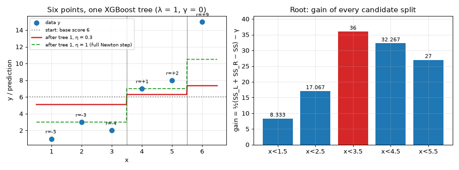
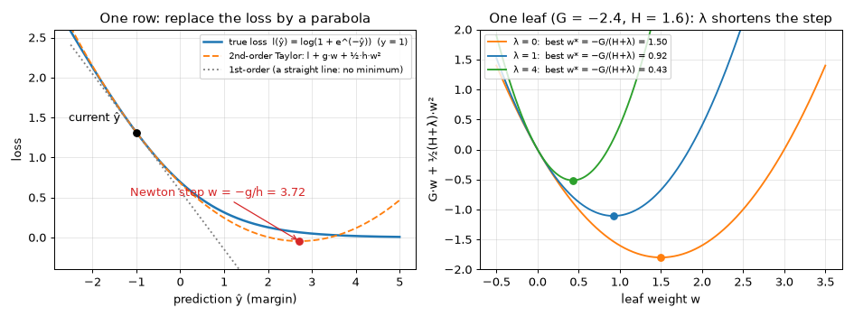
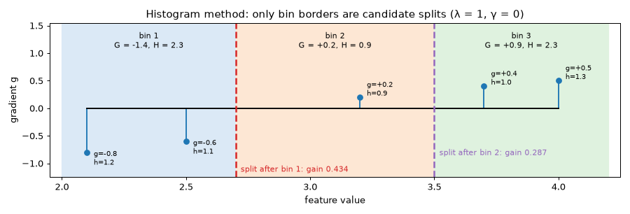

# XGBoost — explained from zero

> **Who this is for:** someone who is new to machine learning. You need school algebra (what a squared number is,
> what an average is) and a little Python. Every other idea — decision trees, loss functions, slopes and curvature,
> gradient boosting, regularisation — is built up here from scratch, with a picture or a tiny example first and the
> formula second.
>
> **How to read it:** sections 1–3 give the idea with no math. Sections 4–5 give the math, one small step at a time,
> and a complete example you can check with a pencil. Sections 6–9 are about using XGBoost in real ML work and —
> just as important — when **not** to use it. Every claim is demonstrated in the hands-on notebooks in
> [`lab/`](lab/README.md): a library notebook and a from-scratch NumPy version that reproduces `xgboost` exactly.

## Table of contents

0. [XGBoost in 30 seconds](#0-xgboost-in-30-seconds)
1. [The problem XGBoost solves](#1-the-problem-xgboost-solves)
2. [The toolbox: the seven ideas you need](#2-the-toolbox-the-seven-ideas-you-need)
3. [XGBoost step by step, in plain words](#3-xgboost-step-by-step-in-plain-words)
4. [The math: why it works](#4-the-math-why-it-works)
5. [A complete example by hand](#5-a-complete-example-by-hand)
6. [Using XGBoost in practice](#6-using-xgboost-in-practice)
7. [Why XGBoost makes sense for machine learning](#7-why-xgboost-makes-sense-for-machine-learning)
8. [Where XGBoost does NOT fit — and why](#8-where-xgboost-does-not-fit--and-why)
9. [Common misconceptions](#9-common-misconceptions)
10. [The labs](#10-the-labs)
11. [Glossary](#11-glossary)
12. [Further reading](#12-further-reading)
13. [Appendix - Assumptions made](#appendix---assumptions-made)

---

## 0. XGBoost in 30 seconds

* **XGBoost** ("eXtreme Gradient Boosting", Chen & Guestrin, 2016) is **gradient boosting** of decision trees with
  three upgrades. Gradient boosting builds many small trees one after another; each new tree corrects the mistakes
  of all the trees before it, and the final prediction is the sum of all trees.
* **Upgrade 1 — second-order (Newton) leaves.** To decide what a tree should predict, XGBoost uses not only the
  *slope* of the loss (the gradient, g) but also its *curvature* (the second derivative, h). This turns every tree
  into a Newton step and makes the same code work for **any** loss you can differentiate twice — squared error,
  log-loss, Poisson, ranking losses…
* **Upgrade 2 — regularisation written into the objective.** Each tree pays a price for every leaf (γ) and for large
  leaf values (λ for L2, α for L1). The split rule and the leaf values come straight out of minimising
  *loss + price*, so the trees are kept simple automatically.
* **Upgrade 3 — engineering.** Fast split finding (pre-sorted columns, or histograms of binned values), built-in
  handling of missing values (each split *learns* where blanks should go), multi-threading, early stopping,
  monotone and categorical support.
* The core formulas, which this README derives: for one leaf with gradient sum $G$ and hessian sum $H$,
  **leaf value** $w^* = -G/(H+\lambda)$ and **split gain**
  $\tfrac12\big[\tfrac{G_L^2}{H_L+\lambda} + \tfrac{G_R^2}{H_R+\lambda} - \tfrac{G^2}{H+\lambda}\big] - \gamma$.

---

## 1. The problem XGBoost solves

Imagine predicting a number — say, how long a hospital patient will stay — from a table of measurements. A single
decision tree asks a few yes/no questions ("is age < 60?", "is the blood test above 3.5?") and outputs a number per
answer combination. One small tree is too crude; one huge tree memorises noise.

**Gradient boosting** fixes this by adding many small trees: start with one constant guess for everyone, look at
the errors (residuals), fit a small tree to those errors, add a *fraction* of it to the guess, and repeat. After a few
hundred rounds the sum of trees is an excellent, flexible model. (The folder's
[gradient-boosting README](../05-gradient-boosting/README.md) explains this in full; §2.6 below recaps it.)

Classic gradient boosting has three weak spots, and XGBoost was built to fix exactly those:

| Weak spot of classic gradient boosting | What XGBoost does |
|---|---|
| Each tree is fitted to the **slope** of the loss only, then a separate "line search" decides how far to step — a different derivation for every loss. | Uses slope **and** curvature: one formula, $w^* = -G/(H+\lambda)$, works for any twice-differentiable loss (§4.2–4.4). |
| Nothing in the objective says "keep trees simple"; you control over-fitting only from outside (depth, learning rate). | Adds $\gamma T + \tfrac12\lambda\lVert w\rVert^2 + \alpha\lVert w\rVert_1$ to the objective, so every split and leaf has to *pay* for itself (§4.1, §4.6). |
| Slow on large tables; cannot accept missing values. | Histogram split finding, parallel scans, and a learned default direction for missing values (§4.8–4.9). |

Here is the whole idea on six points (worked through in §5):



* Left: we start everyone at the mean, **6** (dotted line). The first tree splits at $x < 3.5$ and $x < 5.5$. With
  the full Newton step (green, dashed) the three groups jump most of the way to their averages; XGBoost takes only
  30 % of that step (red, learning rate η = 0.3), so the next trees still have something to correct.
* Right: how the root split was chosen — every possible threshold gets a **gain** score (how much the regularised
  loss would drop), and the biggest one, $x < 3.5$ with gain 36, wins.

---

## 2. The toolbox: the seven ideas you need

### 2.1 Decision trees in one page

A regression **tree** is a flow chart of yes/no questions about the features, each of the form "is feature $j$ <
threshold $t$?". The final boxes are **leaves**, and each leaf holds one number, its **leaf value** $w$. To predict,
drop a row down the questions and output the leaf value where it lands. So a tree cuts the feature space into boxes
and predicts a constant in each box — a staircase, never a slope (§8.2 shows why that matters).

A tree is grown **greedily**: at each box, try every feature and every threshold, keep the split that improves the
fit most, and repeat inside the two halves until a stopping rule (e.g. `max_depth`) says stop. Deep trees fit noise
(high variance), shallow trees miss detail (high bias). Longer version: [the folder README](../README.md#2-decision-trees-in-one-page).

### 2.2 A loss function — "how wrong is a prediction?"

A **loss** $l(y, \hat y)$ turns a prediction $\hat y$ and the truth $y$ into one number; smaller is better. Training
means making the **total loss** over all rows small.

* **Squared error** (regression): $l = \tfrac12 (y - \hat y)^2$. The ½ only makes the derivatives tidy.
* **Log-loss** (yes/no classification, $y \in \{0, 1\}$): the model outputs a score $\hat y$ (any real number, called
  the **margin** or **log-odds**), turned into a probability by the **sigmoid** $p = 1/(1 + e^{-\hat y})$. Then
  $l = -[y \log p + (1-y)\log(1-p)]$: small when the model gives a high probability to what really happened.

### 2.3 Slope and curvature — the first and second derivative

For one row, picture the loss as a curve over the prediction $\hat y$ (left panel of the figure in §2.5).

* The **slope** (first derivative) $g = \partial l / \partial \hat y$ says which way is downhill and how steep.
  For squared error $g = \hat y - y$: if you predict 9 and the truth is 7, $g = 2$ — "go down".
* The **curvature** (second derivative) $h = \partial^2 l / \partial \hat y^2$ says how quickly the slope itself
  changes — how sharply the curve bends. For squared error $h = 1$ everywhere (a parabola bends the same everywhere).

XGBoost calls $g$ the **gradient** and $h$ the **hessian** (with one prediction per row they are just numbers, one
per row).

### 2.4 Taylor expansion — "replace a curve by a parabola near where you are"

Near your current prediction $\hat y$, a smooth curve looks like a parabola. If you move by a small amount $f$:

$$l(y, \hat y + f) \;\approx\; l(y, \hat y) + g\,f + \tfrac12\,h\,f^2$$

A first-order version keeps only $g f$ — a straight line, which has **no minimum** (it says "keep going forever").
The second-order version keeps the bend $\tfrac12 h f^2$, and a parabola *does* have a lowest point.

### 2.5 Newton's method — "jump to the bottom of the parabola"

The parabola $g f + \tfrac12 h f^2$ is lowest where its slope $g + h f$ is zero: $f = -g/h$. That jump is a
**Newton step**. For squared error ($h = 1$) it is $f = y - \hat y$: go exactly to the target. For log-loss the
parabola is only an approximation, so one step lands near — not at — the minimum, and later steps refine it.



Left: one row of log-loss, its parabola at the current prediction, and the Newton step to the parabola's bottom.
Right: §4.4 in a picture — for a leaf, adding λ makes the parabola steeper, so its bottom (the leaf value) moves
towards 0.

### 2.6 Gradient boosting in one page

1. Start with one constant for every row, $F_0$ (for squared error: the mean of $y$).
2. For round $m = 1, 2, \dots, M$:
   * compute for every row the **negative gradient** $-g_i$ (for squared error: the residual $y_i - F_{m-1}(x_i)$);
   * fit a small regression tree to those numbers (least squares);
   * set each leaf's value by a **line search** (the best step for that loss);
   * add it, shrunk by the **learning rate** η: $F_m = F_{m-1} + \eta \cdot \text{tree}_m$.
3. Predict with $F_M(x)$ (for classification: sigmoid of it).

That is *first-order* boosting: the tree's shape is chosen using $g$ only. XGBoost changes how the shape and the leaf
values are chosen (using $g$ and $h$ and a penalty) — the loop stays the same. Full version with examples:
[`../05-gradient-boosting/README.md`](../05-gradient-boosting/README.md).

### 2.7 Regularisation, bias and variance

**Regularisation** means adding a penalty for complexity to what you minimise, so the model prefers simple answers
unless the data strongly asks for a complex one. Two classic penalties on a list of numbers $w$:

* **L2** (ridge): $\tfrac12 \lambda \sum w_j^2$ — pulls every number towards 0, smoothly, never exactly to 0.
* **L1** (lasso): $\alpha \sum |w_j|$ — pulls towards 0 and sets small ones **exactly** to 0.

**Bias** is error from a model too simple to capture the pattern; **variance** is error from a model so flexible
that it changes a lot when the training data changes (it fits noise). Penalties trade a little bias for a lot less
variance. Longer version: [the folder README](../README.md#3-bias-and-variance-in-one-page).

That's the whole toolbox.

---

## 3. XGBoost step by step, in plain words

1. **Start** every row at the same prediction, `base_score` (for squared error: the mean of y; §4.10).
2. **Measure** for every row its gradient $g_i$ and hessian $h_i$ at the current prediction (§4.2, §4.7).
3. **Grow one tree**, level by level, up to `max_depth`:
   * for each node, add up $G = \sum g_i$ and $H = \sum h_i$ over its rows;
   * for every feature and every candidate threshold, compute the **gain** of splitting there (§4.5) — sending
     rows with a missing value left and right, and keeping the better choice (§4.9);
   * make the split with the biggest gain if it is positive and both children have $H \ge$ `min_child_weight`.
4. **Prune** splits whose gain is below γ (§4.6).
5. **Set each leaf** to $w^* = -G/(H+\lambda)$ (with α: §4.4) and **shrink** it by η.
6. **Add** the tree to the model; go back to step 2. Stop after `n_estimators` trees, or earlier when a validation
   score stops improving (**early stopping**, §6.3).
7. **Predict**: base score + the sum of all trees' leaf values (for classification, then the sigmoid).

---

## 4. The math: why it works

### 4.1 Write down what we want: the regularised objective

After $t$ rounds the model is a sum of trees, $\hat y_i = \text{base} + f_1(x_i) + \dots + f_t(x_i)$. XGBoost
minimises

$$\text{Obj} = \sum_{i=1}^{n} l(y_i, \hat y_i) + \sum_{\text{trees } k} \Omega(f_k), \qquad
\Omega(f) = \gamma T + \tfrac12 \lambda \sum_{j=1}^{T} w_j^2 + \alpha \sum_{j=1}^{T} \lvert w_j\rvert$$

where a tree $f$ has $T$ leaves with values $w_1, \dots, w_T$. In words: fit the data, but every leaf costs γ,
large leaf values cost λ (L2), and any non-zero leaf value costs α (L1). In the library: $\gamma$ = `gamma`
(alias `min_split_loss`), $\lambda$ = `reg_lambda` (default 1), $\alpha$ = `reg_alpha` (default 0).

Boosting is greedy: in round $t$ the old trees are frozen and we only choose the new tree $f$ to minimise

$$\text{Obj}^{(t)} = \sum_i l\big(y_i,\ \hat y_i^{(t-1)} + f(x_i)\big) + \Omega(f).$$

### 4.2 Step 1: replace each row's loss by its parabola (2nd-order Taylor)

$f(x_i)$ is a small correction to the current prediction, so use §2.4 for every row:

$$l\big(y_i, \hat y_i + f(x_i)\big) \approx l(y_i, \hat y_i) + g_i f(x_i) + \tfrac12 h_i f(x_i)^2,
\qquad g_i = \frac{\partial l}{\partial \hat y_i},\ h_i = \frac{\partial^2 l}{\partial \hat y_i^2}$$

The first term does not depend on the new tree, so drop it. For squared error, $l = \tfrac12 (y - \hat y)^2$ gives
$g_i = \hat y_i - y_i$ (minus the residual) and $h_i = 1$, and the parabola is **exact**, not an approximation.

**Why this matters (and why it is not a speed trick):** after this step the loss only appears through the numbers
$g_i, h_i$. The tree-building code below never needs to know which loss you chose — plug in another loss's $g, h$
and everything works. And because $h$ is used, each leaf takes a Newton step (§2.5) instead of a slope-only step.
The old notes listed the Taylor expansion under "optimised for speed"; it is about **generality and accuracy**.

### 4.3 Step 2: group the rows by leaf: G and H

A tree gives every row in leaf $j$ the same value $w_j$. So collect the rows by leaf. With
$G_j = \sum_{i \in \text{leaf } j} g_i$ and $H_j = \sum_{i \in \text{leaf } j} h_i$:

$$\text{Obj}^{(t)} \approx \sum_{j=1}^{T}\Big[\,G_j w_j + \tfrac12 (H_j + \lambda)\, w_j^2 + \alpha\lvert w_j\rvert\Big] + \gamma T$$

Each leaf now has its **own little parabola in $w_j$**, independent of all other leaves (right panel of the §2.5
figure). λ simply adds to the curvature.

### 4.4 Step 3: the best leaf value and the best possible objective

**Without α**, the bottom of $G w + \tfrac12 (H+\lambda) w^2$ is where its slope $G + (H+\lambda) w$ is zero:

$$w_j^* = -\frac{G_j}{H_j + \lambda}$$

Plugging it back in gives the lowest value each leaf can reach, $-\tfrac12 G_j^2/(H_j+\lambda)$, so for a *fixed
tree shape* the best achievable objective is

$$\text{Obj}^* = -\frac12 \sum_{j=1}^{T} \frac{G_j^2}{H_j + \lambda} + \gamma T .$$

For squared error ($g_i = -r_i$, $h_i = 1$, a leaf with $N$ rows): $w^* = \dfrac{\sum r_i}{N + \lambda}$ — the
**average residual, shrunk** (with λ = 0 it is exactly the average, as in classic boosting).

**With α (L1)**, the $\alpha\lvert w\rvert$ term has a kink at 0. Check the two sides: for $w > 0$ the slope is
$G + \alpha + (H+\lambda)w$, zero at $w = -(G+\alpha)/(H+\lambda)$, which is positive only if $G < -\alpha$; for
$w < 0$ the zero is at $w = -(G - \alpha)/(H+\lambda)$, negative only if $G > \alpha$. Otherwise ($\lvert G\rvert \le
\alpha$) the minimum is the kink, $w = 0$. All three cases in one line:

$$w^* = -\frac{S_\alpha(G)}{H + \lambda}, \qquad S_\alpha(G) = \operatorname{sign}(G)\,\max(\lvert G\rvert - \alpha,\ 0)$$

$S_\alpha$ is **soft-thresholding**: shrink $\lvert G\rvert$ by α, and if it would cross zero, stop at zero. So α
switches off leaves whose evidence $\lvert G\rvert$ is weak (Lab 3 shows leaves set exactly to 0), and everywhere
below $G^2$ becomes $S_\alpha(G)^2$.

### 4.5 Step 4: the gain of a split, and the "similarity score"

Splitting a leaf (rows with $G, H$) into a left part ($G_L, H_L$) and right part ($G_R, H_R$) changes $\text{Obj}^*$
by replacing one leaf's term with two and adding one more leaf (+γ). The **gain** = how much the objective drops:

$$\text{Gain} = \frac12\left[\frac{G_L^2}{H_L+\lambda} + \frac{G_R^2}{H_R+\lambda} - \frac{(G_L+G_R)^2}{H_L+H_R+\lambda}\right] - \gamma$$

* The quantity $\dfrac{G^2}{H+\lambda}$ is what StatQuest calls the **similarity score** (SS). For squared error it
  is $\dfrac{(\sum r_i)^2}{N + \lambda}$ — *sum first, then square*: residuals that agree in sign add up and give a big
  score; residuals that cancel give a small one. So $\text{Gain} = \tfrac12[SS_L + SS_R - SS_{parent}] - \gamma$.
* This is the split criterion: compute it for every feature and threshold, keep the largest. No separate
  "MSE reduction" is needed — but note that for squared error with λ = 0 the bracket *is* the classic reduction in
  squared error, so XGBoost generalises the usual rule rather than replacing it.
* **Units warning (verified in Lab 1):** the `xgboost` library reports, and compares with γ, the bracket **without
  the ½**: $\text{gain}_{\text{xgb}} = SS_L + SS_R - SS_{parent}$. Its tree dumps therefore show twice the number
  this README computes, and a split survives pruning when $\text{gain}_{\text{xgb}} \ge \gamma$. When you choose γ
  for the library, think in those doubled units.

### 4.6 What λ and γ really do (and pruning)

**λ, precisely.** λ appears in every denominator:

* every **leaf value** shrinks: $-G/(H+\lambda)$ instead of the Newton step $-G/H$, i.e. by a factor
  $H/(H+\lambda)$. Leaves with little hessian (few rows) shrink most: with $H = 1$ and $\lambda = 1$ the leaf takes
  half its step, with $H = 100$ it keeps 99 %;
* every **similarity score** and hence every **gain** goes down, most for small children — so splits that peel off
  a handful of rows stop paying for themselves (§5: with λ = 1 the left node refuses to split; with λ = 0 it would).

The old notes said "λ high → all 3 terms small"; that is the reason. The effect: higher bias, lower variance — a
cure for over-fitting, not a free lunch (Lab 3).

**γ and pruning.** γ is the price of one extra leaf, so a split is only worth it if its gain beats γ. How the library
applies it depends on the tree method (checked in the from-scratch notebook, section 5):

* `tree_method="exact"`: grow the tree to `max_depth` (making every split with positive gain), **then** walk back
  up and remove any split whose children are both leaves and whose gain is below γ, repeatedly. A weak split that
  enabled strong splits below it survives — the classic "grow, then prune" order.
* `hist` and `approx`: a split with gain below γ is simply not made while growing ("stop early"). On XOR-like data,
  where the first split is weak but the second is strong, the two orders give different trees.

### 4.7 The logistic loss: g = p − y, h = p(1 − p), and `min_child_weight`

With $p = 1/(1+e^{-\hat y})$ and $l = -[y\log p + (1-y)\log(1-p)]$, two lines of calculus (the sigmoid's derivative
is $p(1-p)$) give

$$g = p - y, \qquad h = p\,(1 - p).$$

* $g$ is "predicted probability minus truth": positive if we over-predict, negative if we under-predict.
* $h$ is largest (0.25) when $p = 0.5$ — the model is unsure — and tiny when $p$ is near 0 or 1.
* Leaf value: $w^* = -\dfrac{\sum (p_i - y_i)}{\sum p_i(1-p_i) + \lambda}$, in **log-odds** units.

**`min_child_weight`** is the minimum $H$ a child must have. For squared error ($h = 1$) that is simply a
minimum number of rows. For log-loss it is a minimum **confidence-weighted count**: a row with $p = 0.5$ counts
0.25, a row with $p = 0.99$ counts only 0.0099 — about 1/100 of a row. So with the default `min_child_weight = 1`,
a child of rows the model is already sure about needs ~100 of them. This automatically stops the model from carving
out tiny groups it already classifies confidently (Lab 4).

### 4.8 Finding splits: exact, approx and hist

All three compute the same gain; they differ in **which thresholds** they try and how they get $G_L, H_L$.

* **Exact greedy** (`tree_method="exact"`). Sort each feature, scan once, keep running sums of g and h; every gap
  between two neighbouring distinct values is a candidate (the threshold is their midpoint). Sorting costs
  $O(n \log n)$, so XGBoost sorts each column **once** at the start and stores the data in sorted
  **column blocks**; each level of the tree is then one linear scan per feature. Exact, but slow for big data.
* **Approximate** (`tree_method="approx"`). Before each tree, propose a limited set of candidate thresholds per
  feature from **quantiles** — but *weighted* by $h_i$ (the "weighted quantile sketch"). Why weighted: the
  second-order objective can be rewritten as $\sum_i \tfrac12 h_i\,(f(x_i) - (-g_i/h_i))^2$ + const, a squared
  error where each row has weight $h_i$, so each bin should hold a similar total hessian.
* **Histogram** (`tree_method="hist"`, the default in xgboost ≥ 2). Bin every feature **once** into at most
  `max_bin` (default 256) quantile bins. In a node, add up $G$ and $H$ per bin (a histogram — counting, no sorting),
  then only the bin borders are candidates. A trick halves the work: a child's histogram = parent's − sibling's.

The worked example from the old notes (one feature, five samples, made-up g and h from some loss, λ = 1, γ = 0):

| Sample | Feature x | g | h |
|---|---|---|---|
| 1 | 2.1 | −0.8 | 1.2 |
| 2 | 2.5 | −0.6 | 1.1 |
| 3 | 3.2 | 0.2 | 0.9 |
| 4 | 3.7 | 0.4 | 1.0 |
| 5 | 4.0 | 0.5 | 1.3 |

| Bin | Values in it | G (sum of g) | H (sum of h) |
|---|---|---|---|
| 1: (2.0, 2.7] | 2.1, 2.5 | −0.8 − 0.6 = −1.4 | 1.2 + 1.1 = 2.3 |
| 2: (2.7, 3.5] | 3.2 | 0.2 | 0.9 |
| 3: (3.5, 4.2] | 3.7, 4.0 | 0.4 + 0.5 = 0.9 | 1.0 + 1.3 = 2.3 |

* **Split after bin 1:** $G_L = -1.4, H_L = 2.3$; $G_R = 1.1, H_R = 3.2$; parent $G = -0.3, H = 5.5$.
  $\text{Gain} = \tfrac12\big[\tfrac{1.96}{3.3} + \tfrac{1.21}{4.2} - \tfrac{0.09}{6.5}\big] = \tfrac12[0.594 + 0.288 - 0.014] = \mathbf{0.434}$.
* **Split after bin 2:** $G_L = -1.2, H_L = 3.2$; $G_R = 0.9, H_R = 2.3$.
  $\text{Gain} = \tfrac12\big[\tfrac{1.44}{4.2} + \tfrac{0.81}{3.3} - \tfrac{0.09}{6.5}\big] = \tfrac12[0.343 + 0.245 - 0.014] = \mathbf{0.287}$.
* The split after bin 1 (between 2.5 and 3.2) wins. The exact method would also try $x < 2.30$ (gain 0.162) and
  $x < 3.85$ (0.109); neither is better, so here binning lost nothing (Lab 2). xgboost would print 0.868 (§4.5).



**What histograms buy and cost.** Speed: a node costs $O(\text{rows} + \text{bins})$ per feature instead of a
scan over sorted rows, and binned values fit in one byte (memory). Cost: the best threshold may fall inside a bin and
be missed — with 256 bins this is almost never noticeable (Lab 8: RMSE 1.412 vs exact 1.410 on 64 000 rows; with
16 bins 1.462). The old notes also said binning makes the model "robust to noisy data"; that is at most a mild side
effect of coarser thresholds, not a design goal.

### 4.9 Missing values: a learned default direction (sparsity-aware split finding)

Real tables have blanks. XGBoost's rule: **when scanning a feature, only visit the rows where it is present**, and
score every candidate threshold twice — once with all missing rows sent **left**, once sent **right** — keeping the
better. The chosen side is stored in the node as its **default direction**; at prediction time a missing value simply
follows it. Consequences:

* no imputation is needed, and "this value was blank" can itself be used as information (Lab 9: on data where
  blanks are informative, native handling reaches test RMSE 1.412 vs 1.564 for mean imputation);
* a split can even be "observed values vs blanks": all present values go one way, all blanks the other (Lab 9 finds
  `x3 < 5.556` where the largest observed x3 is 2.778 — the split literally asks "is x3 missing?");
* work is proportional to the number of **present** entries, which makes very sparse data fast.

**What counts as missing — the old notes' "zeros are skipped" needs a correction.** In a normal (dense) NumPy array,
only `NaN` is missing (or whatever you pass as `missing=`); **0 is an ordinary value**. Only in a **sparse** matrix
(e.g. `scipy.sparse.csr_matrix`) are the entries that are *not stored* — usually the zeros — treated as missing.
Lab 9 shows the same data giving a split `x < 0.5` (dense: 0 is a number) or a "stored vs not stored" split (sparse).

### 4.10 The starting point: `base_score`

All trees correct a starting value. Older xgboost versions started at 0.5 regardless of the data. Since xgboost 2.0
the library **estimates** `base_score` from the training labels when you do not set it — in xgboost 3.4.1 we observed
the mean of y for squared error (Lab 1 prints 6) and the mean of y as a probability for the logistic loss. It hardly
matters after many trees, but it does matter when you compare implementations or hand calculations; in this folder's
comparisons it is always set explicitly. For the logistic loss `base_score` is a **probability**; internally the
start is its log-odds.

---

## 5. A complete example by hand

Six points, one feature, squared error, **λ = 1, γ = 0, η = 0.3, `max_depth` = 2, `min_child_weight` = 1**:

| x | 1 | 2 | 3 | 4 | 5 | 6 |
|---|---|---|---|---|---|---|
| y | 1 | 3 | 2 | 7 | 8 | 15 |

**Step 1 — start.** base score = mean of y = 36/6 = **6**. Residuals $r = y - 6$: −5, −3, −4, 1, 2, 9.
Gradients $g = \hat y - y = -r$: **5, 3, 4, −1, −2, −9**; hessians $h = 1$.

**Step 2 — root.** $G = 0$, $H = 6$, similarity $SS = 0^2/(6+1) = 0$. Every threshold between neighbours:

| split | $G_L$ | $H_L$ | $SS_L = G_L^2/(H_L+1)$ | $G_R$ | $H_R$ | $SS_R$ | Gain $= \tfrac12(SS_L+SS_R-SS)$ |
|---|---|---|---|---|---|---|---|
| x < 1.5 | 5 | 1 | 25/2 = 12.5 | −5 | 5 | 25/6 = 4.167 | 8.333 |
| x < 2.5 | 8 | 2 | 64/3 = 21.333 | −8 | 4 | 64/5 = 12.8 | 17.067 |
| **x < 3.5** | 12 | 3 | 144/4 = 36 | −12 | 3 | 36 | **36** |
| x < 4.5 | 11 | 4 | 121/5 = 24.2 | −11 | 2 | 121/3 = 40.333 | 32.267 |
| x < 5.5 | 9 | 5 | 81/6 = 13.5 | −9 | 1 | 81/2 = 40.5 | 27 |

Best: **x < 3.5**, gain 36 (xgboost's dump says `gain: 72` — the doubled units of §4.5).

**Step 3 — left child (x = 1, 2, 3).** $G = 12$, $H = 3$, $SS = 144/4 = 36$.

| split | $SS_L$ | $SS_R$ | Gain |
|---|---|---|---|
| x < 1.5 | 25/2 = 12.5 | 49/3 = 16.333 | ½(28.833 − 36) = **−3.583** |
| x < 2.5 | 64/3 = 21.333 | 16/2 = 8 | ½(29.333 − 36) = **−3.333** |

Both negative → it stays a leaf. (With λ = 0 the first would be ½(25 + 24.5 − 48) = +0.75 and the tree would split
off the single point x = 1 — λ is what stops that.)

**Step 4 — right child (x = 4, 5, 6).** $G = -12$, $H = 3$, $SS = 36$.

| split | $SS_L$ | $SS_R$ | Gain |
|---|---|---|---|
| x < 4.5 | 1/2 = 0.5 | 121/3 = 40.333 | ½(40.833 − 36) = 2.417 |
| **x < 5.5** | 9/3 = 3 | 81/2 = 40.5 | ½(43.5 − 36) = **3.75** |

Split at **x < 5.5**, gain 3.75 (dump: 7.5). Depth 2 reached; stop. Pruning with γ = 0 removes nothing (any γ above
7.5 in xgboost's units would remove this split).

**Step 5 — leaf values** $w^* = -G/(H+\lambda)$, then × η:

| leaf | rows | G | H | $w^*$ | η·$w^*$ | mean residual (λ = 0 would give) |
|---|---|---|---|---|---|---|
| x < 3.5 | 1, 2, 3 | 12 | 3 | −12/4 = **−3** | −0.9 | −4 |
| 3.5 ≤ x < 5.5 | 4, 5 | −3 | 2 | 3/3 = **1** | 0.3 | 1.5 |
| x ≥ 5.5 | 6 | −9 | 1 | 9/2 = **4.5** | 1.35 | 9 |

λ shrinks the single-point leaf most (from 9 to 4.5) and the three-point leaf least (−4 to −3).

**Step 6 — new predictions** = 6 + η·w*: **5.1, 5.1, 5.1, 6.3, 6.3, 7.35**. Every point moved towards its target.

**Step 7 — round 2** (same procedure on the new residuals −4.1, −2.1, −3.1, 0.7, 1.7, 7.65): the same splits win,
leaves −9.3/4 = −2.325, 2.4/3 = 0.8, 7.65/2 = 3.825, and the predictions become 4.403, 4.403, 4.403, 6.54, 6.54,
8.497 (the from-scratch notebook prints rounds 1–3 next to xgboost's).

Lab 1 of the library notebook and sections 2–6 of the from-scratch notebook reproduce every number above;
`xgboost` itself prints the same thresholds (3.5, 5.5), leaf values (−0.900000036, 0.300000012, 1.35000002 — float32)
and predictions.

---

## 6. Using XGBoost in practice

### 6.1 The recipe

```python
import xgboost as xgb
from sklearn.model_selection import train_test_split

X_train, X_test, y_train, y_test = train_test_split(X, y, test_size=0.25, random_state=0)
X_fit, X_val, y_fit, y_val = train_test_split(X_train, y_train, test_size=0.25, random_state=0)

model = xgb.XGBRegressor(               # XGBClassifier for classes (objective="binary:logistic" by default)
    n_estimators=5000,                  # an upper limit; early stopping picks the real number (6.3)
    learning_rate=0.05,                 # η: smaller = more trees, usually a bit better
    max_depth=4,
    reg_lambda=1.0, gamma=0.0, min_child_weight=1.0,
    subsample=0.8, colsample_bytree=0.8,
    tree_method="hist",                 # default; "exact" for small data or exact reproducibility
    early_stopping_rounds=50,           # in the CONSTRUCTOR (xgboost >= 2)
    eval_metric="rmse",
)
model.fit(X_fit, y_fit, eval_set=[(X_val, y_val)], verbose=False)   # NaN in X is fine
print(model.best_iteration)            # predict() uses trees 0..best_iteration automatically
print(model.score(X_test, y_test))     # the test set, touched once
```

macOS: the `xgboost` wheel needs the OpenMP runtime — `brew install libomp`.

### 6.2 The hyper-parameters that matter

| Parameter (alias) | Default | What it does | Typical range |
|---|---|---|---|
| `n_estimators` | 100 | number of trees (rounds) | set high + early stopping |
| `learning_rate` (`eta`) | 0.3 | multiplies every leaf value; smaller → more trees, smoother fit | 0.01 – 0.3 |
| `max_depth` | 6 | depth of each tree = how many features can interact | 3 – 10 |
| `min_child_weight` | 1 | minimum hessian sum $H$ in a child (§4.7) | 1 – 20 |
| `reg_lambda` (`lambda`) | 1 | L2 on leaf values: shrinks leaves, lowers gains (§4.6) | 0 – 10 |
| `reg_alpha` (`alpha`) | 0 | L1 on leaf values: zeroes weak leaves (§4.4) | 0 – 10 |
| `gamma` (`min_split_loss`) | 0 | price per extra leaf, in xgboost's doubled gain units (§4.5–4.6) | 0 – 10 |
| `subsample` | 1 | share of rows each tree sees (random, without replacement) | 0.5 – 1 |
| `colsample_bytree` / `_bylevel` / `_bynode` | 1 | share of columns per tree / per depth level / per split | 0.5 – 1 |
| `tree_method` | `"hist"` (via `"auto"`) | `exact`, `approx`, `hist` (§4.8) | `hist` |
| `max_bin` | 256 | bins per feature for `hist` | 64 – 1024 |
| `base_score` | estimated (§4.10) | starting prediction | leave, or set explicitly to compare |
| `monotone_constraints` | none | force the prediction to only rise (+1) / fall (−1) with a feature | domain knowledge |
| `missing` | `np.nan` | which value means "missing" | — |
| `enable_categorical` + `feature_types` | off | native categorical splits (needs `hist`/`approx`) | high-cardinality categories |
| `scale_pos_weight` | 1 | up-weights the positive class in binary problems | ratio negatives / positives |

* **η × number of trees** go together: halving η roughly doubles the trees needed. Lab 6: η = 1 bottoms out at
  validation RMSE 1.790 after 14 trees and then gets worse (2.088 after 1 500 trees); η = 0.3 → 1.579 at 95 trees
  (1.686 at 1 500); η = 0.1 → 1.520 at 249 (1.572); η = 0.03 → 1.514 at 1 268 trees (1.518).
* **Subsampling** (`subsample`, `colsample_*`) makes trees less alike — bagging inside boosting. Lab 10: 0.8 / 0.8
  improved validation RMSE from 1.522 to 1.493; using only half of the 8 columns per tree made it slightly worse (1.537).
* **Monotone constraints**: `monotone_constraints="(1)"` (or a tuple, one entry per feature). Lab 11: 78 downward
  wiggles without, 0 with.

### 6.3 Early stopping

Give a **validation** set (`eval_set`) and `early_stopping_rounds=k`: after each tree the validation metric is
computed; training stops when it has not improved for k rounds, and `best_iteration` (0-based) records the best
round. Lab 7 (η = 0.05): best round 553, 604 trees built, validation RMSE 1.528, test RMSE (computed once) 1.456.
The validation set must not be the test set — picking the stopping point on the test set makes the test score
optimistic.

Early stopping matters most when the **labels** are noisy. Lab 7 (continued) re-draws 30 % of the labels at random
(about 15 % end up wrong) and boosts with η = 0.3, depth 4: validation log-loss is best after **11 trees** (0.474) and
climbs to 0.744 after 500, while training log-loss falls to 0.013. Early stopping keeps 11 trees and cuts the test
log-loss from **0.865 to 0.533**, at almost the same accuracy (0.760 vs 0.765) — the extra rounds mainly make the
probabilities over-confident.

### 6.4 Reading the output

| Attribute / method | What it is |
|---|---|
| `predict(X)` | prediction (regression) / class (classifier); uses trees up to `best_iteration` if early stopping ran |
| `predict_proba(X)` | class probabilities (classifier) |
| `predict(X, output_margin=True)` | the raw sum of trees (log-odds for logistic) |
| `apply(X)` | which leaf every row lands in, per tree |
| `best_iteration`, `best_score` | early-stopping results |
| `evals_result()` | the metric after every tree, per `eval_set` |
| `feature_importances_` | importance per feature (by default "gain"-based; see §8.6) |
| `get_booster().get_dump(dump_format="json", with_stats=True)` | every tree as JSON: `split`, `split_condition` (go **left/"yes" if x < split_condition**), `missing` (which child gets NaN), `gain` (doubled units), `cover` (= H), `leaf` (= η·w*) |
| `get_booster().save_config()` | every parameter actually used, incl. the estimated `base_score` |

### 6.5 XGBoost vs scikit-learn's gradient boosting

| | `GradientBoosting*` (sklearn) | `HistGradientBoosting*` (sklearn) | XGBoost |
|---|---|---|---|
| tree shape chosen from | least-squares fit to the negative gradients (first order) | gradients and hessians, on histograms | gradients and hessians (exact / approx / hist) |
| leaf values | line search per leaf (for log-loss: one Newton step) | $-G/(H+\lambda)$ | $-S_\alpha(G)/(H+\lambda)$ |
| explicit penalties | none on leaves (shrinkage, depth, min samples) | `l2_regularization` | λ, α, γ, `min_child_weight` |
| missing values | not accepted (impute) | native | native, learned direction |
| speed on large data | slow (exact, one thread) | fast | fast |

Lab 5: with λ = 0, sklearn's `GradientBoostingClassifier` and xgboost agree to ~1e-7 after **one** round (all
hessians are equal, so both rank splits the same way, and both set the same Newton leaf), but after 30 rounds
individual probabilities differ by up to 0.46 because xgboost weights rows by their hessian when choosing splits.
Overall quality was similar (log-loss 0.383 vs 0.382). Lab 9: on informative-missing data sklearn GBM with mean
imputation reached RMSE 1.566, `HistGradientBoostingRegressor` (native NaN) 1.428, xgboost 1.412 — HistGB is the
close cousin.

### 6.6 Avoiding leakage

* Choose `n_estimators` (early stopping), η and the other knobs on a **validation** split or by cross-validation
  of the training data; use the test set once at the end.
* Any preprocessing that learns from data (imputers, encoders, scalers — trees do not need scaling) belongs in a
  `Pipeline`, so it is fitted on training rows only (Lab 9 does this for the imputers).

---

## 7. Why XGBoost makes sense for machine learning

**The core belief behind boosted trees:** in tabular data the target is a sum of many small, possibly non-linear,
possibly interacting effects, each of which a shallow tree can capture. XGBoost adds three convictions:

1. **Use curvature, not just slope.** A Newton step knows how far to go; a slope does not. And because only $g$ and
   $h$ enter the tree builder, one implementation serves regression, classification, counts, survival and ranking.
2. **Make simplicity part of the goal.** The split rule (gain − γ) and the leaf values ($-G/(H+\lambda)$) come out of
   one objective that already includes the price of complexity, instead of being tuned only from outside.
3. **Real data is messy and big.** Missing values (Lab 9: native 1.412 vs mean-imputed 1.564 RMSE on informative
   blanks), mixed scales (trees ignore monotone transformations, so no scaling needed), many rows (hist: Lab 8),
   known monotone relationships (Lab 11) and categories (Lab 15) are handled inside the algorithm.

**It is the right tool when** the data is tabular with a few to a few thousand features, there are more rows than
features (thousands or more), the signal involves non-linear effects and interactions, and you can afford a
validation set for tuning. This is why gradient-boosted trees (XGBoost, LightGBM, CatBoost, sklearn's HistGB) remain
the default strong baseline for tabular problems.

---

## 8. Where XGBoost does NOT fit — and why

| # | Situation | Why it fails | Use instead | Lab |
|---|---|---|---|---|
| 8.1 | Few rows, many features (p ≫ n), linear signal | trees approximate a tilted plane with coarse steps; 400 features × few rows → splits on noise | Lasso / Ridge / elastic net with CV | 12 (bad-fit data) |
| 8.2 | Predicting outside the training range (trends) | a sum of trees is flat beyond the last threshold | linear model, or model the trend and boost the residuals | 13 |
| 8.3 | Tiny, noisy data | many knobs → over-tuning; CV estimates too noisy | simple / linear models, strong regularisation | 14 |
| 8.4 | Many high-cardinality categories, one-hot encoded | each split can peel off only one level | native categorical splits, target encoding, CatBoost | 15 |
| 8.5 | No budget for tuning / validation | results depend strongly on many hyper-parameters | random forest, or defaults + early stopping | 16 |
| 8.6 | Images, audio, text as raw input; or each feature's effect must be explained exactly | no notion of locality/sequence; hundreds of trees are not readable | neural networks; linear / additive models (GAMs, `interaction_constraints`) | — |

### 8.1 p ≫ n with a sparse linear signal (the bad-fit dataset)
**Why:** the truth is $y = \beta_1 x_1 + \dots + \beta_{10} x_{10}$ + noise, with 400 features and 105 training
rows. A tree approximates each straight-line effect by steps, and needs many rows per step; with 390 useless
features, many splits land on noise. Lab 12: xgboost test R² = **0.187**; even given only the 10 true features,
0.544; RidgeCV 0.162 (right shape, wrong penalty: it spreads weight over all 400); **LassoCV 0.926** — its shape
(sparse weighted sum) *is* the truth. **Fix:** a regularised linear model; try one first on any small, wide table.

### 8.2 Extrapolation
**Why:** each tree is constant beyond its last threshold, so the sum is too. Lab 13: trained on x ∈ [0, 10] with
y ≈ 3x, xgboost predicts 29.911 at x = 10, 12.5 **and** 15 (truth 30, 37.5, 45). **Fix:** linear models for trends,
or remove the trend first (e.g. fit a line, boost the residuals), or add features that make the target stationary.

### 8.3 Tiny noisy data and over-tuning
**Why:** with 60 rows, cross-validation scores are noisy, and choosing the best of many settings picks the luckiest.
Lab 14: the best of 40 random settings had CV R² **0.507** but **0.350** on fresh data; RidgeCV had CV 0.445 and
**0.539** on fresh data (best possible: 0.556). **Fix:** fewer knobs, simpler models, nested CV if you must tune.

### 8.4 High-cardinality categories
**Why:** one-hot encoding a 300-level category makes 300 sparse columns; each split separates one level from the
rest, so the trees cannot group similar levels efficiently. Integer codes impose a fake order. Lab 15: test RMSE
1.195 (one-hot), 1.316 (codes), **0.606** with native categorical splits (`enable_categorical=True`,
`feature_types`, `hist`), close to the noise floor 0.5. **Fix:** native categorical support, or target encoding done
inside cross-validation.

### 8.5 The tuning burden
**Why:** `XGBRegressor().get_params()` lists 40 parameters; at least eight interact (η, trees, depth, child weight,
λ, α, γ, two subsampling rates). Lab 16: 30 random settings on the good-fit data ranged from validation RMSE 1.516
to 2.724 (median 1.772), while the defaults gave 1.672. **Fix:** start from defaults + early stopping; tune a few
knobs with a validation scheme and a budget; consider a random forest when you cannot tune.

### 8.6 Raw unstructured data, or exact explanations needed
**Why:** trees split on single input values; pixels or word positions have meaning only in context, which CNNs and
transformers model. And a sum of hundreds of trees is not readable rule by rule; importances are approximations
(gain-based importance favours features used in many splits). **Fix:** neural networks for unstructured data;
GAM-style or linear models, or SHAP values computed carefully, when explanations must be exact. (No lab: outside this
folder's scope.)

**Rule of thumb:** before trusting XGBoost, ask — *Do I have many more rows than features? Is the signal non-linear
or interacting (if it is linear, did I try a linear model)? Will I predict inside the range I trained on? Do I have a
validation set for early stopping and tuning?*

---

## 9. Common misconceptions

| Myth | Reality |
|---|---|
| "The 2nd-order Taylor expansion is a speed optimisation." | It is a **Newton step**: it makes leaf values right for any twice-differentiable loss and lets one implementation serve all losses (§4.2). Speed comes from column blocks, histograms and threads. |
| "Exact, approx and histogram split finding are the same block-based method." | Three different methods: exact scans all sorted values; approx re-bins with a weighted quantile sketch per tree; hist bins once (256 bins) and adds up G, H per bin (§4.8). |
| "XGBoost treats zeros as missing." | Only for **sparse** input (unstored entries). In a dense array only NaN (or your `missing=` value) is missing; 0 is a value (§4.9, Lab 9). |
| "XGBoost has faster inference than GBM." | Unsupported in general: prediction cost depends on the number and depth of trees, not on the library's training tricks. Compare on your own model if it matters. |
| "λ high → all three terms small, so less over-fitting." | Precisely: λ shrinks every leaf value by $H/(H+\lambda)$ (small leaves most) and lowers every similarity score and gain, so weak splits disappear (§4.6). |
| "XGBoost uses no squared-error reduction." | Its gain is a second-order generalisation; for squared error with λ = 0 it equals the classic squared-error reduction (§4.5). |
| "Gain = ½[…] − γ, so γ is compared with half the bracket." | That is the paper's objective; the library reports and prunes with the bracket **without** the ½ (`gain` in dumps is doubled; §4.5, Lab 1). |
| "γ stops splits during growth." | With `exact`, the tree is grown first and splits with gain < γ are pruned bottom-up, so a weak split above strong ones survives; `hist`/`approx` stop early (§4.6). |
| "`min_child_weight` is the minimum number of rows in a leaf." | It is the minimum **hessian sum**; equal to a row count only for squared error. For log-loss confident rows count far less than 1 (§4.7). |
| "`base_score` is 0.5." | It was the old default. xgboost ≥ 2 estimates it from the labels when you do not set it (§4.10). |
| "Regularisation means XGBoost cannot over-fit." | It still over-fits with too many trees, deep trees or tiny data (Labs 6, 14); use early stopping. |
| "XGBoost is always the best model for tabular data." | Not for small wide linear problems (Lab 12), extrapolation (Lab 13) or tiny noisy data (Lab 14). |
| "Prefer XGBoost for large data / when GBM over-fits." | Fair rules of thumb, but sklearn's `HistGradientBoosting*` is also fast with native NaN, and over-fitting is mainly controlled by η, early stopping and depth in any booster (§6.5). |
| "XGBoost's two goals are execution speed and model performance." | A slogan, not an explanation; what actually changes vs gradient boosting is listed in §1. |

---

## 10. The labs

Everything above is demonstrated in two Jupyter notebooks. Setup, run instructions and a map of which lab proves
which claim are in **[`lab/README.md`](lab/README.md)**.

**[`lab/xgboost_lab.ipynb`](lab/xgboost_lab.ipynb)** — the library (`xgboost`, with scikit-learn for comparisons):

| Part | Labs | README sections |
|---|---|---|
| A. How XGBoost works | 1 hand example · 2 histogram example · 3 λ, γ, α · 4 logistic g/h & `min_child_weight` · 5 vs sklearn GBM · 6 η × trees · 7 early stopping (+ noisy labels) · 8 exact vs approx vs hist | 4, 5, 6.2–6.5 |
| B. Why it is useful | 9 missing values (native vs imputed vs indicator; dense vs sparse zeros) · 10 subsampling · 11 monotone constraints | 4.9, 6.2, 7 |
| C. Where it fails | 12 p ≫ n linear (bad-fit) · 13 extrapolation · 14 tiny data & over-tuning · 15 high-cardinality categories · 16 tuning burden | 8 |

**[`lab/xgboost_from_scratch.ipynb`](lab/xgboost_from_scratch.ipynb)** — a NumPy second-order booster that matches
`xgboost(tree_method="exact")` with **zero** prediction difference on both datasets:

| Section | Theory step (README §) | Implementation hurdle shown |
|---|---|---|
| 1 Gradients and hessians | 4.2, 4.7 | a sigmoid that does not overflow (naive version warns) |
| 2 Leaf weight, similarity, gain | 4.4, 4.5 | xgboost's doubled gain units |
| 3 Best threshold on one feature | 4.5, 4.8 | O(m²) naive search vs sort + cumulative sums (timing) |
| 4 Missing values, all features at once | 4.9 | trying both directions; copying xgboost's scan order and tie-breaking |
| 5 Growing and pruning a tree | 3, 4.6 | grow-then-prune vs stop-early (XOR data; matches `exact` and `hist`) |
| 6 The boosting loop | 3, 4.1, 4.10 | base score in margin units; rounds 1–3 of §5 |
| 7 32-bit floats | — | values equal in float32 cannot be split; float64 sums differ by ~5e-6 |
| 8 `min_child_weight` with logistic hessians | 4.7 | same leaves per tree as xgboost |
| 9 Early stopping | 6.3 | same best round, same predictions |
| 10 Histogram variant | 4.8 | quantile binning: error vs speed as n grows |
| 11 Final comparison | all | exact agreement on both CSVs (squared error, logistic, with α/γ/λ/`min_child_weight`) |

---

## 11. Glossary

| Term | Meaning |
|---|---|
| **Boosting** | Building models one after another, each correcting the current sum of the previous ones. |
| **Base score** | The constant every row starts from before any tree. |
| **Margin** | The raw sum of trees; for log-loss it is the log-odds, turned into a probability by the sigmoid. |
| **Loss** $l(y,\hat y)$ | How wrong one prediction is (squared error, log-loss, …). |
| **Gradient** $g$ | Slope of the loss with respect to the prediction, per row. |
| **Hessian** $h$ | Curvature (second derivative) of the loss, per row. |
| **G, H** | Sums of $g$ and $h$ over the rows in a node or leaf. |
| **Newton step** | Jump to the minimum of the local parabola: $-g/h$ (per leaf $-G/(H+\lambda)$). |
| **Leaf weight / value** $w$ | The number a leaf adds to the prediction (stored already multiplied by η). |
| **Similarity score** | StatQuest's name for $G^2/(H+\lambda)$ (squared error: $(\sum r)^2/(N+\lambda)$). |
| **Gain** | Drop in the regularised objective from a split; xgboost reports it without the ½. |
| **λ (`reg_lambda`)** | L2 penalty on leaf values. |
| **α (`reg_alpha`)** | L1 penalty on leaf values; soft-thresholds $G$. |
| **γ (`gamma`, `min_split_loss`)** | Price of one extra leaf; splits with smaller gain are pruned. |
| **η (`learning_rate`, `eta`)** | Fraction of each tree's Newton step that is kept. |
| **`min_child_weight`** | Minimum $H$ in a child. |
| **Exact / approx / hist** | All-thresholds scan / per-tree weighted-quantile candidates / one-time binning + histograms. |
| **Default direction** | The side a node sends missing values to, learned during training. |
| **Early stopping** | Stop adding trees when a validation metric stops improving. |
| **Monotone constraint** | Forcing the prediction to move in one direction with a feature. |
| **Soft-thresholding** $S_\alpha$ | Shrink towards 0 by α, stopping at 0. |
| **Data leakage** | Letting test data influence any choice made during training. |

---

## 12. Further reading

* Tianqi Chen, Carlos Guestrin, *XGBoost: A Scalable Tree Boosting System*, KDD 2016 (arXiv:1603.02754) — the
  regularised objective, the second-order gain, weighted quantile sketch, sparsity-aware split finding and column
  blocks (§4 follows its derivation).
* XGBoost documentation: *Introduction to Boosted Trees* (the same derivation in tutorial form), *Parameters*,
  *Handling missing values*, *Categorical data*, *Monotonic constraints*.
* Josh Starmer, StatQuest, *XGBoost Part 1–4* (videos) — the "similarity score" vocabulary and the
  sum-then-square intuition used in the old notes and in §4.5.
* Jerome Friedman, *Greedy Function Approximation: A Gradient Boosting Machine* (2001) — classic first-order gradient
  boosting (see [`../05-gradient-boosting/README.md`](../05-gradient-boosting/README.md)).
* scikit-learn user guide: *Histogram-Based Gradient Boosting* — the close cousin compared in Labs 9 and §6.5.
* The old notes' XGBoost-classifier bullets ("two reasons to use XGBoost … execution speed, model performance")
  follow Jason Brownlee, *A Gentle Introduction to XGBoost for Applied Machine Learning* (Machine Learning Mastery).

---

## Appendix - Assumptions made

No further input was available, so the following decisions were made on the author's behalf:

1. **Audience.** "Extremely new to ML" was taken to mean school algebra and a little Python, but no calculus,
   statistics or ML. Derivatives are introduced as slope and curvature with pictures (§2.3–2.5); every formula is
   derived one step at a time, and the complete example (§5) can be checked with a pencil.
2. **Scope.** XGBoost is presented as gradient boosting + second-order (Newton) leaves + explicit regularisation +
   systems tricks, with a short recap of first-order gradient boosting so this README stands alone; the long version
   is in [`../05-gradient-boosting/README.md`](../05-gradient-boosting/README.md). Covered: regularised objective,
   Taylor expansion, G/H, $w^*$ with λ and α, the gain and similarity score, γ-pruning, the logistic loss,
   `min_child_weight`, exact/approx/hist, missing values, base score, early stopping, subsampling, monotone
   constraints, categorical support (briefly), comparison with sklearn. Not covered: ranking/survival objectives,
   multi-class softmax details, DART, GPU training, distributed training, SHAP, LightGBM/CatBoost internals.
3. **Old content kept, corrected, dropped** (see `../EVALUATION.md` §2.7 and `AUDIT-src-factual-consistency.md`
   "XGBoost notebook"; the old notebook is in `../_archive/XGBoost.ipynb`, the overview in
   `../_archive/Ensemble Learning.ipynb` cell 5):
   * **kept** — every regressor note with the user's own corrections: per-row ½(y − ŷ)², g = ŷ − y, h = 1, mean
     starting model, $SS = (\sum r)^2/(N+\lambda)$, $w^* = \sum r/(N+\lambda)$, Gain = ½[SS_L + SS_R − SS] − γ, γ
     as `min_split_loss` and pruning, λ = L2 (`reg_lambda`), α = L1 (`reg_alpha`) soft-thresholding G; the
     histogram worked example (table, bins, G/H per bin); the missing-value default-direction explanation; the
     "no MSE reduction" remark (re-explained in §4.5).
   * **corrected** — the Taylor expansion is no longer listed under speed (§4.2); exact (column blocks), approx and
     hist are described as three methods (§4.8); "zeros are missing" is limited to sparse input (§4.9); "λ high →
     3 terms small" is explained precisely (§4.6); the histogram example's bins were made non-overlapping
     ((2.0, 2.7], (2.7, 3.5], (3.5, 4.2]) and its gain is now computed for **both** candidates (0.434 and 0.287,
     verified in Lab 2); the old "robust to noisy data" benefit of binning is qualified.
   * **qualified or dropped** — "faster inference time than GBM" (unsupported; dropped and explained in §9);
     "preferred for larger datasets" / "when GBM overfits" (kept as qualified rules of thumb in §9); the marketing
     bullets of the old overview cell (§9, credited in §12).
   * **filled in** — the empty classifier section (logistic loss, §4.7, Labs 4–5), the two empty "7." items
     (they became §4.6–4.10 and §6), and the `ModuleNotFoundError` code cell (replaced by two executed notebooks).
4. **The ½ in the gain.** The README keeps the paper's (and the user's) Gain = ½[…] − γ. Running xgboost showed its
   dumps report the bracket without the ½ and prune when that doubled number is below γ (Lab 1: dump gain 72 vs
   README 36; for the second split, dump gain 7.5, γ = 7.4 keeps it and γ = 7.6 removes it — checked while writing). Both conventions are stated wherever it
   matters.
5. **Datasets.** Generated in the notebooks with fixed seeds and saved as CSVs (4 significant digits, ~480 KB and
   ~430 KB). *Good fit*: 8 000 rows, 8 Gaussian features, a target with a sine effect, an interaction, a switch and
   four columns with ~33 % **informative, missing-not-at-random** blanks (large values go missing more often, and
   missingness shifts y together with the sign of `x8`). The first design (one column whose blanks simply shifted y)
   did *not* show an advantage over mean imputation — trees can isolate an imputed constant with two splits — so the
   missingness was made to matter jointly with another feature, which is where a learned default direction pays off.
   *Bad fit*: 150 rows × 400 features, 10 non-zero linear coefficients. Smaller synthetic sets are made inside
   individual labs.
6. **Fair comparisons.** Library comparisons use one fixed setting for all models (stated in each lab) rather than
   tuning each; hyper-parameters that are chosen (early stopping, Lasso/Ridge penalties) are chosen on validation data
   or by CV on training rows; each test set is used once per comparison; imputers sit inside a `Pipeline`.
   `base_score` is set explicitly in comparisons; xgboost 3.4.1 was observed to estimate it as the mean of y for both
   squared error and logistic loss when it is not set.
7. **Exactness of the from-scratch notebook.** The target was agreement with `tree_method="exact"` to float32
   precision; by copying xgboost's float32 storage, midpoint thresholds, forward/backward missing-value scans
   (forward only for columns with NaN), tie-breaking order, 1e-6 split threshold and bottom-up γ-pruning, the
   predictions agree **exactly** (maximum difference 0) on both CSVs, for squared error and logistic loss, including a
   run with α = 0.5, γ = 2, λ = 3, `min_child_weight` = 5, and early stopping picks the same round. These internals
   were inferred from tree dumps and behaviour, not from xgboost's documentation, and could change in other versions.
   The histogram variant uses its own (unweighted) quantile cuts, so it is compared on metrics only.
8. **Environment used to execute the notebooks:** Python 3.13.5, NumPy 2.5.4, SciPy 1.18.1, scikit-learn 1.9.1,
   Matplotlib 3.11.2, xgboost 3.4.1 on macOS (Apple silicon). Numbers quoted here come from that run; timings vary
   from run to run and machine to machine, so the README quotes accuracy numbers, not seconds.
9. **Notebooks are committed with outputs** so they can be read on GitHub; figures are rendered at low resolution
   (both notebooks together are about 0.6 MB). The folder README links (`../README.md#…`) point to the shared
   foundations page written for this folder.
10. **Structure.** Same shape as `src/PCA/README.md` (sections 0–12 + this appendix), with two notebooks instead of
    one: the library lab and the from-scratch implementation, as specified for this folder.
11. **Nothing was committed.** The changes are left in the working tree for review.
