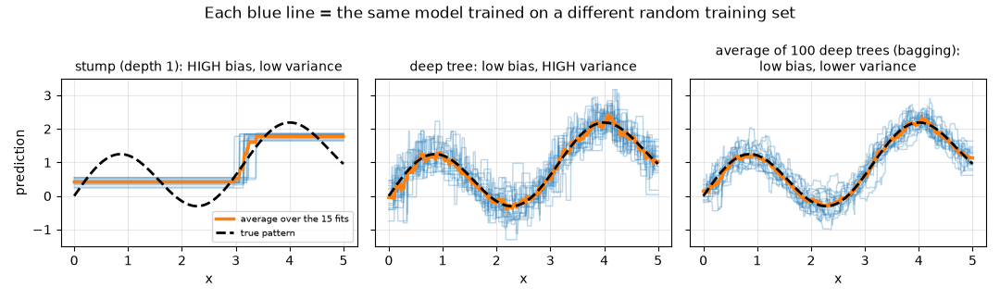
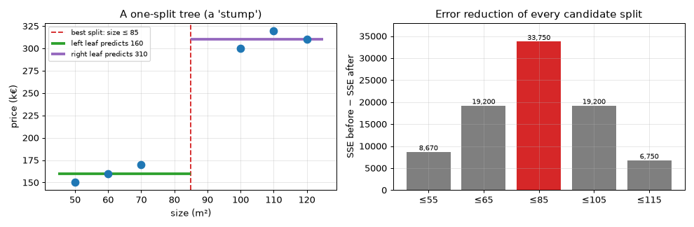
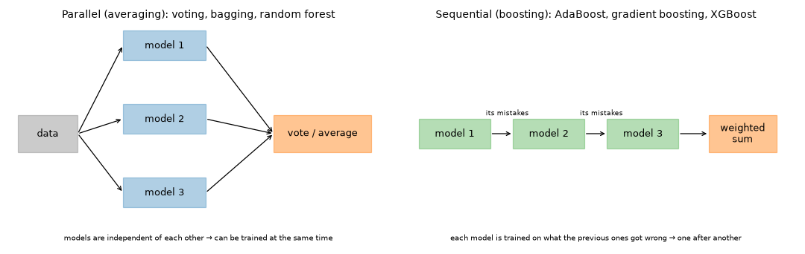

# Ensemble learning — start here

> **Who this is for:** someone who is new to machine learning. You need school algebra (averages, squares) and a
> little Python. This page builds the three ideas every ensemble method relies on — *what an ensemble is*, *what a
> decision tree is*, and *what bias and variance are* — and then points you to one folder per technique.
>
> **How to read it:** sections 0–3 are the shared foundations (read them once). Section 4 is the map of the
> techniques, section 5 helps you choose one, section 6 is the honest list of pros and cons. Each technique folder
> then has its own theory README and a `lab/` with two executed notebooks (library + from scratch).

## Table of contents

0. [Ensembles in 30 seconds](#0-ensembles-in-30-seconds)
1. [The problem ensembles solve](#1-the-problem-ensembles-solve)
2. [Decision trees in one page](#2-decision-trees-in-one-page)
3. [Bias and variance in one page](#3-bias-and-variance-in-one-page)
4. [The family map](#4-the-family-map)
5. [Which technique when — and the reading order](#5-which-technique-when--and-the-reading-order)
6. [Advantages and disadvantages of ensembles](#6-advantages-and-disadvantages-of-ensembles)
7. [Common misconceptions](#7-common-misconceptions)
8. [Rough vs refined explanations](#8-rough-vs-refined-explanations)
9. [What is in this folder](#9-what-is-in-this-folder)
10. [Glossary](#10-glossary)
11. [Further reading](#11-further-reading)
12. [Claude Code skills that teach tuning](#12-claude-code-skills-that-teach-tuning)
13. [Findings to review: non-tree members, and when an ensemble does not help](#13-findings-to-review-non-tree-members-and-when-an-ensemble-does-not-help)
14. [Appendix - Assumptions made](#appendix---assumptions-made)

---

## 0. Ensembles in 30 seconds

* An **ensemble** is a group of models whose predictions are **combined** into one prediction. (“Ensemble” is
  French for “together”.)
* One model makes mistakes for two reasons: it is **too simple** to capture the pattern (*bias*), or it is so
  flexible that it also memorises the noise of its particular training data (*variance*). Section 3 explains both.
* There are two big families:
  1. **Averaging (parallel)** — train several models *independently* and vote/average them. Mistakes that the
     models do not share cancel out, which **reduces variance**. → *voting, bagging, random forest*.
  2. **Boosting (sequential)** — train models *one after another*, each one focusing on what the previous ones got
     wrong, and add them up. This **reduces bias** (step by step the sum gets more accurate). → *AdaBoost,
     gradient boosting, XGBoost*.
* Almost all of them use **decision trees** as the building block (section 2), because trees are cheap, need no
  feature scaling, and can be made as simple (high bias) or as flexible (high variance) as you like.
* An ensemble only helps when its members are **better than guessing** and make **different** mistakes. Combining
  copies of the same model, or outvoting one good model with two bad ones, does not help (each technique's README
  has a “where it does NOT fit” section that shows this with data).

---

## 1. The problem ensembles solve

You want to guess the number of sweets in a jar. One person's guess may be wildly off. Ask a hundred people and
average their guesses, and the average is usually much closer than a typical individual — *if* they guessed
independently. If they all copied the loudest person, averaging gains nothing. Ensembles are this idea applied to
models.



Each blue line above is a model trained on a different random sample of 60 noisy points from the same
pattern (black dashed line):

* **Left — a stump** (a tree with one question). The blue lines barely move from sample to sample, but they are
  always wrong in the same way: a single step cannot draw a wave. This is **high bias**.
* **Middle — a deep tree.** On average (orange) it follows the wave, but each individual blue line is jagged and
  different from the others: it has memorised the noise of its own sample. This is **high variance**.
* **Right — the average of 100 deep trees** each trained on a resampled copy of the data (*bagging*, folder
  `02-bagging/`). Still follows the wave, but the blue lines are much calmer: averaging cancelled much of the
  noise-chasing. **Same low bias, lower variance.**

Boosting attacks the left-hand problem instead: it adds many stumps, each fixing the previous sum's mistakes,
until the staircase follows the wave (folders `04`–`06`).

---

## 2. Decision trees in one page

Every technique in this folder can use any model, but in practice the members are almost always **decision trees**.

### 2.1 What a tree is

A decision tree is a flow-chart of yes/no questions about the features, ending in a prediction:

```
            size ≤ 85 m² ?
           /              \
         yes               no
   predict 160 k€     predict 310 k€
```

* Each **question** (“is feature *j* ≤ threshold *t*?”) is a **split**; the box that asks it is an **internal
  node**; the first one is the **root**.
* Each end box is a **leaf**. A leaf predicts the **average target** of the training rows that ended there
  (regression) or the **most common class / the class proportions** (classification).
* The **depth** is the number of questions on the longest path. A depth-1 tree (one question, two leaves) is called
  a **stump**.

### 2.2 How a tree picks a question

The tree tries **every feature** and **every threshold** between neighbouring sorted values, and keeps the split
that makes the two groups most “pure”:

* **Regression:** purity = small squared error around each group's mean. The split is scored by how much it
  reduces the **sum of squared errors (SSE)**.
* **Classification:** purity = mostly one class. A common score is the **Gini impurity**
  $G = 1 - \sum_k p_k^2$, where $p_k$ is the share of class *k* in the node (0 = pure, 0.5 = a 50/50 two-class
  mix). The split is scored by the drop in Gini, weighted by group sizes.

**Worked example (regression).** Six flats: size $(50, 60, 70, 100, 110, 120)$ m², price
$(150, 160, 170, 300, 320, 310)$ k€.

* Before any split, the prediction is the mean price, $1410/6 = 235$. SSE $= 85^2+75^2+65^2+65^2+85^2+75^2 = 34{,}150$.
* Candidate “size ≤ 85”: left $\{150,160,170\}$ has mean 160 and SSE $100+0+100 = 200$; right $\{300,320,310\}$
  has mean 310 and SSE 200. Total 400, a **reduction of 33,750**.
* The other four thresholds reduce the SSE by only 8,670 (≤ 55), 19,200 (≤ 65), 19,200 (≤ 105) and 6,750
  (≤ 115). So the tree asks “size ≤ 85?” and its leaves predict 160 and 310.



Then it repeats the same search **inside each group** (recursively) until a stopping rule fires: a maximum depth,
a minimum number of rows per leaf, or no split that helps.

### 2.3 Why trees are the favourite building block

| Property | Why it matters for ensembles |
|---|---|
| Flexibility is a dial (depth) | Shallow trees = high bias / low variance (good for boosting); deep trees = low bias / high variance (good for averaging). |
| A deep tree is **unstable** | Change a few training rows and the first question can change, and with it the whole tree. That instability is exactly what averaging can cancel. |
| No feature scaling needed | A split only compares a feature with a threshold; multiplying a feature by 1000 changes nothing. |
| Handles non-linearity and interactions | A path of questions (“size ≤ 85 **and** floor ≥ 3”) is an interaction, learned automatically. |
| Fast | The best threshold of a feature can be found with one sort and one pass (each technique's from-scratch notebook implements this). |

Two weaknesses carry over to every tree ensemble: predictions are **piecewise constant** (a staircase), and a tree
**cannot extrapolate** — beyond the largest training value it simply repeats the last leaf. Every technique README
shows this in its “where it does NOT fit” section.

(For a full from-scratch classification tree with cost-complexity pruning, see the user's
[`../fromScratch/decisionTrees/`](../fromScratch/decisionTrees/) notebook.)

---

## 3. Bias and variance in one page

Imagine you could collect **many different training sets** from the same source and train the same kind of model
on each. At one input $x$ you would get many different predictions $\hat f(x)$. Then:

* **Bias** = how far the **average** of those predictions is from the truth $f(x)$. Bias is a *systematic* error:
  the model is too simple (or too constrained) to represent the pattern.
* **Variance** = how much the predictions **spread around their own average**. Variance is *instability*: the model
  reacts to the accidental noise of whichever training set it got.
* **Noise** $\sigma^2$ = randomness in $y$ that no model can predict.

For squared error these three add up exactly:

$$\underbrace{\mathbb{E}\big[(y - \hat f(x))^2\big]}_{\text{expected test error}} \;=\; \underbrace{\big(\mathbb{E}[\hat f(x)] - f(x)\big)^2}_{\text{bias}^2} \;+\; \underbrace{\mathbb{E}\big[(\hat f(x) - \mathbb{E}[\hat f(x)])^2\big]}_{\text{variance}} \;+\; \underbrace{\sigma^2}_{\text{noise}}$$

**Tiny example.** Three training sets give predictions 2, 4 and 6 at a point whose true value is 3.
Average prediction $= 4$, so bias $= 1$ and bias² $= 1$. Variance $= \big((2-4)^2 + 0^2 + (6-4)^2\big)/3 = 8/3 \approx 2.67$.
Check: the average squared distance to the truth is $\big((2-3)^2+(4-3)^2+(6-3)^2\big)/3 = 11/3 \approx 3.67 = 1 + 2.67$ ✔.

**Darts picture.** Bias is *where* the darts land on average (off-centre or not); variance is *how scattered* they
are. In the figure in section 1: the stump is a tight cluster in the wrong place, the deep tree is centred but
scattered, the bagged average is centred and tighter.

**What averaging does to variance.** At a fixed input $x$, average the predictions $\hat f_b(x)$ of $B$ models that
vary across training sets, and define (variances and covariances taken across training sets; $\sigma^2$ here is not
the noise above, and $\rho$ is the same for the errors $\hat f_b(x) - f(x)$, since $f(x)$ is fixed):

$$\sigma^2 = \frac{1}{B}\sum_{b=1}^{B}\text{Var}\big(\hat f_b\big) \qquad\qquad \rho = \frac{1}{\sigma^2}\cdot\frac{1}{B(B-1)}\sum_{i=1}^{B}\sum_{\substack{j=1\\ j\neq i}}^{B}\text{Cov}\big(\hat f_i, \hat f_j\big)$$

that is, $\sigma^2$ is the average variance of one member and $\rho$ the average covariance between two different
members, measured in units of $\sigma^2$. Then, exactly:

$$\text{Var}\Big(\tfrac{1}{B}\sum_{b=1}^{B}\hat f_b\Big) = \rho\,\sigma^2 + \frac{1-\rho}{B}\,\sigma^2$$

* Independent models ($\rho = 0$): variance shrinks like $1/B$ — ten models, a tenth of the variance.
* Correlated models: as $B$ grows the second term vanishes but the **floor $\rho\sigma^2$ stays**. With
  $\sigma^2 = 4$, $\rho = 0.5$: $B = 10$ gives $2 + 0.2 = 2.2$, and even $B = \infty$ only reaches 2.
* Averaging does **not** change the bias: the average of many biased models is still biased.
* **Checked against measurement:** [section 11 of `00-ensemble-learning/bias_variance_trees.ipynb`](00-ensemble-learning/bias_variance_trees.ipynb)
  prints every tree's variance and every pairwise $\rho$ for random forests of 1 to 7 trees and sums this formula
  term by term. With $\sigma^2$ and $\rho$ defined as above it equals the measured variance exactly — for any
  ensemble, since it is the pair-by-pair sum $\frac{1}{B^2}\sum_i\sum_j \text{Cov}(\hat f_i, \hat f_j)$ regrouped. A
  plain average of the pairwise correlations is close only when the members' variances are similar, as for trees
  grown by the same random procedure (within 0.1 % there); members of different kinds can be far off.

That one formula explains the averaging family: bagging makes $\frac{1-\rho}{B}$ small, random forests attack the
floor by lowering $\rho$, and voting works only if the members' errors are not strongly correlated. Boosting is
built differently — it reduces **bias** by fitting the remaining error step by step — and must therefore be stopped
before it starts fitting noise (variance creeps back in).

---

## 4. The family map



In the sequential picture every model's output is kept: the final prediction **adds up all of them** (with weights),
not just the last one.

| Technique | Family | What makes the members different | How they are combined | Main effect | Folder |
|---|---|---|---|---|---|
| **Voting** | parallel | different algorithms on the same data | majority vote / average of probabilities / mean | variance (and some bias, if members are complementary) | [`01-voting/`](01-voting/README.md) |
| **Bagging** | parallel | same algorithm, different **bootstrap samples** of the rows | average / vote | variance | [`02-bagging/`](02-bagging/README.md) |
| **Random forest** | parallel | bagging **+ a random subset of features at every split** | average / vote | variance (lower $\rho$ than bagging) | [`03-random-forest/`](03-random-forest/README.md) |
| **AdaBoost** | sequential | each model trained with **row weights** that grow on previously misclassified rows | weighted vote, weight = model's accuracy | bias | [`04-adaboost/`](04-adaboost/README.md) |
| **Gradient boosting** | sequential | each tree fitted to the **residuals** (negative gradient of the loss) of the current sum | sum, shrunk by a learning rate | bias | [`05-gradient-boosting/`](05-gradient-boosting/README.md) |
| **XGBoost** | sequential | gradient boosting with **second-order (Newton) leaves**, explicit regularisation and fast split finding | sum, shrunk by a learning rate | bias, with variance control | [`06-xgboost/`](06-xgboost/README.md) |

The two boosting styles are often confused (the old notes did too): **AdaBoost re-weights the rows**; **gradient
boosting changes the target** to the current residuals. Both add models one at a time.

---

## 5. Which technique when — and the reading order

**Reading order:** 01 → 02 → 03 → 04 → 05 → 06. Each README assumes only this page; later ones refer back to
earlier ones (random forest builds on bagging, XGBoost on gradient boosting).

| Your situation | Good first choice | Why |
|---|---|---|
| You already have a few decent, *different* models | Voting (or stacking) | cheap to combine; works when their mistakes differ |
| A flexible model over-fits; you want stability with little tuning | Random forest (or bagging) | averages away variance; strong defaults; OOB error for free |
| Tabular data, you want the best accuracy and can tune a bit | Gradient boosting / XGBoost / `HistGradientBoosting*` | reduces bias step by step; usually the strongest on tables |
| Many missing values, large n | XGBoost or `HistGradientBoosting*` | native missing-value handling and histogram speed |
| Labels are noisy | Random forest, or gradient boosting with a robust loss | AdaBoost's exponential loss chases mislabeled points |
| The answer must extrapolate a trend (future dates, larger sizes) | **not a tree ensemble** — a linear/trend model, or trees on detrended targets | trees repeat the last leaf beyond the training range |
| Very few rows, many features, signal roughly linear | **regularised linear model** (Ridge/Lasso) | tree ensembles have nothing to average or boost reliably |

---

## 6. Advantages and disadvantages of ensembles

The old notes listed only disadvantages; some were overstated. Corrected and completed:

### Advantages

1. **Accuracy.** On tabular data, random forests and gradient-boosted trees are among the most accurate
   off-the-shelf methods.
2. **Stability.** Averaging reduces variance, so predictions change less when the training data changes a little.
3. **Non-linearity and interactions for free.** Tree ensembles find thresholds and feature interactions without
   hand-made features.
4. **Little preprocessing.** No feature scaling for tree ensembles; XGBoost and `HistGradientBoosting*` handle
   missing values natively.
5. **Built-in validation (bagging / random forest).** The out-of-bag error estimates test error without a separate
   validation set.
6. **Combining what you have.** Voting/stacking can merge models that capture different things (e.g. a linear model
   for a trend and a tree model for interactions) — the idea in the old notes, valid when their errors differ.

### Disadvantages (and how bad they really are)

1. **Less interpretable than one small tree or a linear model.** You cannot read 500 trees. *But* feature
   importances (impurity-based and permutation), partial-dependence plots and TreeSHAP explain tree ensembles
   well, so “impossible to draw business insights” (old notes) is too strong.
2. **More computation and memory.** Training *B* models costs about *B* times one model (averaging methods
   parallelise; boosting is sequential across rounds). Prediction cost grows with the number and depth of trees:
   a few hundred shallow boosted trees cost a few hundred comparisons-and-additions per row (microseconds in
   compiled code), so “not good for real-time” (old notes) is too strong — but a forest of thousands of fully grown trees can be large and slow.
3. **Choosing and tuning members is a skill.** True for voting/stacking (which models? which weights?) and for
   boosting (learning rate, depth, rounds). Random forests are the most forgiving.
4. <a id="disadvantage-4"></a>**No extrapolation** (tree ensembles): predictions stay within the range of training targets.
5. **Boosting can over-fit noise** if run for too many rounds; averaging cannot fix bias.
6. **An ensemble is not automatically better.** If the members are worse than chance or make the same mistakes, the
   combination gains nothing or gets worse (shown with data in `01-voting/`).

---

## 7. Common misconceptions

| Myth | Reality |
|---|---|
| “The combination is always less noisy / better than each member.” | Only if members beat chance **and** their errors are not strongly correlated (section 3; `01-voting/` lab). |
| “Boosting is more accurate than bagging.” | Often on clean tabular data, not always: with noisy labels or little tuning, a random forest can win. |
| “Boosting and bagging both use voting.” | Bagging averages/votes; boosting uses a **weighted sum** built sequentially. |
| “More trees always over-fit.” | Not in averaging methods (error levels off as trees are added). In boosting, more rounds *can* over-fit — use early stopping. |
| “Random forests reduce bias.” | Averaging reduces **variance**; the bias stays about that of one deep tree. |
| “AdaBoost and gradient boosting are the same thing.” | AdaBoost re-weights rows; gradient boosting fits residuals (negative gradients). AdaBoost *is* gradient boosting with the exponential loss in disguise (see `04-adaboost/`), but the mechanics differ. |
| “Ensembles cannot be explained.” | Importances, partial dependence and TreeSHAP explain them; they are just not *self*-explanatory. |

---

## 8. Rough vs refined explanations

Common one-line explanations of why ensembles work, each next to a refined version that says what actually cancels,
what does not, and when the explanation stops being true.

| Rough version (less wrong) | Refined version |
|---|---|
| Bagging works because the individual estimators average out each other's *errors*, so the predictions are stable enough. | Bagging works because trees trained on different bootstrap samples make partly different errors. Averaging cancels the part of their errors that differs from tree to tree, which makes the prediction vary less from one training set to another. The part they share — their common bias and the error inherited from the same training data — does not cancel, so the gain stops at a floor and needs unstable members to begin with. |
| Boosting works because sequential learners learn from the mistakes of their immediate predecessor and rectify them. | Boosting works because each new weak learner is fitted to what the ensemble built so far still gets wrong — the residuals in gradient boosting, the up-weighted misclassified rows in AdaBoost — and a shrunken copy of it is added to the sum, so each round removes a little more of the remaining systematic error (bias). The prediction is the sum of all the learners. It keeps helping only while the leftover error has structure the learner can capture; once what is left is mostly noise, extra rounds fit the noise, so the number of rounds is chosen on validation data (early stopping). |

---

## 9. What is in this folder

| Path | What |
|---|---|
| [`00-ensemble-learning/`](00-ensemble-learning/) | Two notebooks: [`bias_variance_trees.ipynb`](00-ensemble-learning/bias_variance_trees.ipynb) makes section 1's figure (bias and variance of a stump, a deep tree and bagging, and how all three go flat past the training range); [`extrapolation_lab.ipynb`](00-ensemble-learning/extrapolation_lab.ipynb) is section 13.1's lab (tree and non-tree members, boosted and bagged, past the training range) |
| [`01-voting/`](01-voting/README.md) | Voting: hard, soft, weighted; mean/median for regression; stacking as the fix for its main failure |
| [`02-bagging/`](02-bagging/README.md) | Bagging, pasting, out-of-bag evaluation, random subspaces and patches |
| [`03-random-forest/`](03-random-forest/README.md) | Random forests, feature importances (MDI vs permutation) |
| [`04-adaboost/`](04-adaboost/README.md) | AdaBoost (binary and SAMME multi-class) |
| [`05-gradient-boosting/`](05-gradient-boosting/README.md) | Gradient boosting for regression, binary and multi-class classification |
| [`06-xgboost/`](06-xgboost/README.md) | XGBoost: second-order boosting, regularisation, missing values, histograms |
| [`EVALUATION.md`](EVALUATION.md) | Audit of the old notes in this folder, list of errors fixed, old → new path map |
| [`images/`](images/) | The figures on this page |

The old notebooks this folder replaced are no longer in the working tree; they can be recovered from the git history
(commit `80b823d` and earlier).

Every technique folder has the same layout: `README.md` (theory), `images/`, and `lab/` with
`<technique>_lab.ipynb` (library), `<technique>_from_scratch.ipynb` (NumPy), `data/good_fit.csv` and
`data/bad_fit.csv`, a lab `README.md` and `requirements.txt`. All notebooks are saved **with their outputs**, so you
can read them on GitHub without running anything.

---

## 10. Glossary

| Term | Meaning |
|---|---|
| **Ensemble** | A group of models whose predictions are combined. |
| **Member / base learner / base estimator** | One model inside an ensemble. |
| **Weak learner** | A model only slightly better than guessing (e.g. a stump). Boosting is built from them. |
| **Decision tree, node, split, leaf, depth, stump** | Section 2.1. |
| **Impurity (SSE, Gini)** | How mixed a node is; a split is chosen to reduce it (section 2.2). |
| **Bias** | Error of the *average* model: too simple / systematically wrong (section 3). |
| **Variance** | Spread of a model's predictions across different training sets: instability (section 3). |
| **Noise** | The part of the target no model can predict. |
| **Correlation of errors ($\rho$)** | Whether members tend to be wrong on the same rows; sets the floor of averaging (section 3). |
| **Bootstrap sample** | $n$ rows drawn *with replacement* from $n$ rows (some repeated, ~37 % left out). |
| **Out-of-bag (OOB)** | Rows a member did not see during training, used to estimate its test error. |
| **Residual** | $y - \hat y$, what the current model still gets wrong. |
| **Learning rate (shrinkage)** | The factor (< 1) by which each boosting step is scaled down. |
| **Overfitting** | Fitting the training data's noise; low training error, higher test error. |
| **Data leakage** | Letting test-set information influence training or model choice. |

---

## 11. Further reading

* James, Witten, Hastie, Tibshirani, *An Introduction to Statistical Learning* (2nd ed.), chapter 8 — trees,
  bagging, random forests, boosting, gently (the repo's ISLR notes are in [`../islr_notes`](../islr_notes)).
* Hastie, Tibshirani, Friedman, *The Elements of Statistical Learning* (2nd ed.), chapters 8, 10, 15, 16 — the
  mathematics of bagging, boosting, random forests and ensembles.
* Zhi-Hua Zhou, *Ensemble Methods: Foundations and Algorithms* (2012) — a whole book on the topic.
* scikit-learn user guide, *Ensembles: Gradient boosting, random forests, bagging, voting, stacking*.
* Each technique README lists its own sources.

---

## 12. Claude Code skills that teach tuning

Disadvantage 3 above says choosing and tuning members "is a skill". The technique READMEs explain every knob but
not the procedure (what to tune first, which symptom means which knob, how to spend a search budget, which members
to combine and with what weights). On 2026-11-19 a search of Claude Code plugin marketplaces, skill directories and
GitHub looked for skills that teach that procedure. Anthropic's own skill repositories, the large data-science
bundles and the tutor-style skills had nothing; a few small repositories do. The table's first six rows teach
**tuning** (mostly boosted trees); the rest teach **choosing and combining members** (voting, stacking, blending).

The search agents opened each file below; the files have not been reviewed line by line here. Skills can ship
scripts — read a skill before installing it.

| Skill | What it teaches | Caveats |
|---|---|---|
| [`xgboost-lightgbm-tuner`](https://github.com/MuhammadHusnainAli/vector-agentic-skills/blob/main/skills/ai-ml/classical-ml/xgboost-lightgbm-tuner/SKILL.md) (vector-agentic-skills) | A tuning order — *honest validation → early stopping → capacity → sampling → regularisation → lower learning rate for the final fit*; knobs ranked 1–7; and a table from learning-curve symptoms to fixes. Sister skills: `hyperparameter-search-planner` (grid vs random vs TPE vs Hyperband, budget arithmetic, coarse-to-fine) and `overfitting-underfitting-diagnoser`. | 0 stars; one author's bulk library; ships Python scripts |
| [`tuning-hyperparameters`](https://github.com/andikarachman/data-science-plugin/blob/master/skills/tuning-hyperparameters/SKILL.md) (andikarachman/data-science-plugin) | Search method by budget, coarse-to-fine, boosting knobs by priority, train/validation-gap thresholds, nested CV, test set used once. Install: `/plugin marketplace add andikarachman/data-science-plugin`, then `/plugin install ds@data-science-plugin`. | 14 stars; best English-language option |
| [`xgb-tuning`](https://github.com/aliyun/qwen-dianjin/blob/master/DianJin-SKILLS/financial-engineering-expert/xgb-tuning/SKILL.md) (aliyun/qwen-dianjin) | The clearest over-fit / under-fit → knob table, with priority orders and starting values from the data's size. | In Chinese; aimed at credit risk; needs its own bundled Python engine |
| [`pyrsm-xgboost`](https://github.com/radiant-ai-hub/pyrsm/blob/main/skills/pyrsm-xgboost/SKILL.md) (radiant-ai-hub/pyrsm) | Written for students: "Don't grid-search blindly. Run the baseline, check the train–test gap", then a gap → action table. Sister skill `pyrsm-rforest`. | Tied to the `pyrsm` library; grid search only; no early stopping |
| [`hyperparameter-tuning`](https://github.com/j4flmao/agent-skills/blob/main/skills/ml/hyperparameter-tuning/SKILL.md) (j4flmao/agent-skills) | Search strategy and budget only, e.g. "<20 trials → manual tuning or grid on 2–3 key params". | Not specific to tree ensembles |
| [`ml-teaching-assistant`](https://github.com/levy-n/claude-useful-skills/blob/HEAD/skills/ml-dl-skills/ml-teaching-assistant/SKILL.md) (levy-n/claude-useful-skills) | No tuning content, but a teaching template worth copying: *what healthy looks like → symptoms → causes → diagnostic steps → fixes*. | Template only |
| [`ensemble-ml-for-soil`](https://github.com/ccarbajal16/soil-dsm-skills/blob/HEAD/plugins/dsm-soil/skills/ensemble-ml-for-soil/SKILL.md) (ccarbajal16/soil-dsm-skills) | Measure how correlated the members' errors are, stop if there is nothing to gain, then compare weighting schemes on data the combiner did not see. "An ensemble beats the *mean* of its members, never reliably their *best*." Install: `/plugin marketplace add ccarbajal16/soil-dsm-skills`, then `/plugin install dsm-soil`. | 13 stars; soil-mapping examples, general method. **The only one with its own measured evidence** (n = 204): random forest and XGBoost errors correlated at r = 0.953; Bates–Granger weights +5.1 % in-sample but +2.1 % on held-out data, Granger–Ramanathan +5.1 % → −0.9 % |
| [`ensembling`](https://github.com/TranBaDat2607/claude-code-kaggle-grandmaster/blob/HEAD/plugins/kaggle-grandmaster/skills/ensembling/SKILL.md) + `ensemble-architect` agent (TranBaDat2607/claude-code-kaggle-grandmaster) | Every member predicts on the same frozen folds; sources of diversity ranked; combiners in order (mean → rank average → greedy hill climbing → constrained weights → stacking); near-duplicates pruned; honest vs in-sample blend scores. "Two models at 0.99 correlation add little; a weaker model at 0.85 correlation can add a lot." | 2 stars; Kaggle anecdotes only; relies on the repo's own `kgkit` tool |
| [`ensemble-methods`](https://github.com/snoodleboot-io/prompticorn/blob/HEAD/prompticorn/skills/ensemble-methods/verbose/SKILL.md) (snoodleboot-io/prompticorn) | The only one covering bagging and boosting tuning as ensembles: why `max_features` matters more than `n_estimators` in a forest (from ρσ² + (1 − ρ)σ²/B), a small learning rate with early stopping, shallow boosting trees, stacking on out-of-fold predictions in nested CV. | 2 stars; no citations or measurements; installed via `pip install prompticorn` |
| [`tabular-ensemble`](https://github.com/nodecode-ai/cells/blob/HEAD/tools/nodecode-tabular/skill/skills/tabular-ensemble/SKILL.md) (nodecode-ai/cells) | An adoption rule — ship the ensemble only if it beats the best single model by at least 0.5 % relative, otherwise ship the single model — plus correlation bands (> 0.98 skip, 0.85–0.98 small gain, < 0.85 good) and a capped member count. | 1 star; thresholds stated, not measured |
| [`kaggle-grind`](https://github.com/caezium/skills/blob/HEAD/kaggle-grind/SKILL.md) (caezium/skills) | Shared folds, pruning members by correlation, keeping a candidate only if its gain clears a noise floor. "Regularized LR generalizes where Caruana hill-climbing overfits." | 3 stars; leaderboard numbers from one competition (`references/s6e6_retrospective.md`) |
| [`ensemble-submit`](https://github.com/Alexdruso/data-science-stuff/blob/HEAD/.claude/skills/ensemble-submit/SKILL.md) (Alexdruso/data-science-stuff) | Blend weights by Nelder–Mead, stack when the blend plateaus, finish with greedy ensemble selection; notes that overlap of errors predicts blend lift better than correlation of probabilities. | 0 stars; personal repo; one person's Kaggle results |
| [`model-ensembling`](https://github.com/StamKavid/last-ds-mile/blob/HEAD/skills/model-ensembling/SKILL.md) (StamKavid/last-ds-mile) | Short: compare against the best single member and ship the single model if the gain is smaller than the fold-to-fold standard deviation. | 3 stars; no evidence |
| `kaggle-hill-climbing` (OlixIgnacious/agent-skills) | Greedy ensemble selection with replacement on out-of-fold predictions, then weight tuning; warns when one model holds more than 0.8 of the weight. | 5 stars; code only, no evidence |

**What none of them has:** evidence for "random forests are the most forgiving" — no skill compares how much a
random forest and a boosted model lose when left at their defaults. (`ml-for-soil-prediction`, a sibling of
`ensemble-ml-for-soil`, calls random forests "safe defaults" and boosting "tuning-sensitive", citing literature
without numbers.)

**Installed so far:** `xgboost-lightgbm-tuner` only, as a single folder in `~/.claude/skills/` (commit `63a09fa`
of vector-agentic-skills; scripts read before installing, not executed).

---

## 13. Findings to review: non-tree members, and when an ensemble does not help

> **Status: for review.** These results come from experiments run on 2026-11-19 (Python 3.13.3, scikit-learn
> 1.9.1, xgboost 3.4.1, lightgbm 4.7.0). §13.1's code is
> [`00-ensemble-learning/extrapolation_lab.ipynb`](00-ensemble-learning/extrapolation_lab.ipynb); §13.2's is not in
> the repository yet. What published research says about ensembles of non-tree members is collected in
> [`00-ensemble-learning/non_tree_ensembles_literature.md`](00-ensemble-learning/non_tree_ensembles_literature.md).

### 13.1 Extrapolation with members that are not trees (disadvantage 4)

**Question.** [Disadvantage 4](#disadvantage-4) says tree ensembles cannot extrapolate. Is that a property of trees, or of
ensembles? What if every member — the base learner in bagging, every sequential learner in boosting — is a
different kind of model, for example a small neural network?

**Setup — first curve.** 300 points from $y = 2x + 3\sin(x)$ plus Gaussian noise (σ = 1), trained on $x \in [0, 10]$, tested on
$x \in [10, 15]$. The true value is 18.4 at $x = 10.5$ and 32.0 at $x = 15$. Boosting is a hand-written
squared-loss gradient-boosting loop that accepts any regressor (100 rounds, learning rate 0.1); bagging is
`BaggingRegressor` with 50 members.

**Tree ensembles on the first curve, for reference** (prediction at $x = 15$; test RMSE on $[10, 15]$):

| Model | At $x = 15$ | RMSE |
|---|---|---|
| Random forest; gradient boosting with depth 1, 3 or 8; xgboost with depth 6 | 17.8 – 18.5 (flat) | 8.3 – 8.8 |
| xgboost with linear members (`booster="gblinear"`) | 30.2 | 2.4 — identical to one linear regression |
| Gradient boosting started from a linear model (`init=LinearRegression()`) | 27.8 | 3.1 |
| xgboost trees on top of a linear model's prediction (`base_margin`) | 28.4 | 2.8 |
| LightGBM with a linear model in each leaf (`linear_tree=True`) | **12.9** | 11.5 |

Depth changes nothing: every tree is constant beyond its last split, so any sum or average of trees is too. The
linear-leaf LightGBM went *down*, because the last leaf continued the local downward slope of the sine wave.

**Non-tree members on the first curve — alone, boosted and bagged:**

| Member | What it does past the edge | Alone: at 15 / unexplained by one member | Boosted: at 10.5 / at 15 / RMSE | Bagged: at 10.5 / at 15 / RMSE |
|---|---|---|---|---|
| Linear regression | continues one global straight line | 30.2 / 12.0 % | 21.3 / 30.2 / **2.4** | 21.3 / 30.2 / **2.4** |
| Neural net, ReLU, 16 units | continues its last straight piece | 29.3 / 12.1 % | 21.1 / 26.7 / 3.6 | 20.5 / 28.4 / 2.8 |
| Neural net, tanh, 16 units | levels off once its units saturate | 13.8 / 39.3 % | 21.8 / 25.5 / 4.1 | 13.3 / 13.4 / 12.6 |
| Cubic polynomial | shoots off; direction set by the top coefficient | 32.2 / 10.0 % | 20.6 / **9.7** / 10.8 | 22.6 / **32.3** / 3.0 |
| Spline, continued as a straight line | continues the slope at the edge | 5.7 / 2.8 % | 17.0 / 8.3 / 14.2 | 16.4 / 5.8 / 15.8 |
| Spline, held constant | flat | 17.6 / 2.8 % | 18.0 / 18.0 / 8.6 | 17.6 / 17.6 / 8.9 |
| k-nearest neighbours, k = 10 | flat (repeats the nearest edge points) | 18.4 / 2.2 % | 18.0 / 18.0 / 8.6 | 18.4 / 18.4 / 8.3 |
| Support vector regression, RBF kernel | falls back to its intercept far from the data | 9.4 / 2.4 % | 17.4 / 7.7 / 15.2 | 17.2 / 9.5 / 14.0 |

*Unexplained by one member* is $1 - R^2$ of one member, fitted once on its own, on the training data: how far the
training targets still spread around its predictions, as a share of how far they spread around their average.
Pure noise is 2.6 % of that spread, so a member near 2.6 % leaves nothing but noise for later boosting rounds.

**Are the neural nets reliable?** Prediction at $x = 15$ (truth 32.0) for five random seeds; bagging with 20
nets, boosting with 30 rounds at learning rate 0.3:

| Model | 5 seeds | Spread |
|---|---|---|
| ReLU net, single | 29.5 29.6 29.7 29.9 29.6 | 0.4 |
| ReLU net, bagged | 28.2 28.4 28.2 28.1 27.9 | 0.5 |
| ReLU net, boosted | 25.1 34.6 34.6 32.2 30.6 | **9.5** |
| tanh net, single | 18.3 17.8 18.1 18.4 17.2 | 1.2 |
| tanh net, bagged | 17.2 17.6 17.3 16.9 16.7 | 0.9 |
| tanh net, boosted | 23.5 23.6 24.2 25.1 23.8 | 1.6 |

**Second curve — one that keeps returning to zero** (lab part D). The same experiment on $y = 3\sin x$: no trend,
three zero crossings inside the training range and one in the test range; same noise, training points, ranges and
settings. Truth at $x = 15$ is 2.0, and pure noise is now 21.3 % of the training targets' spread.

| Model | At $x = 15$ | Test RMSE | RMSE inside |
|---|---|---|---|
| Predicting 0 everywhere (baseline) | 0.0 | **2.31** | — |
| Random forest / xgboost, depth 6 | −1.8 / −1.4 | 2.88 / 2.70 | 0.66 / 0.95 |
| Linear regression (alone = boosted = bagged) | 0.2 | 2.37 | 1.99 |
| ReLU nets, bagged | 0.8 | 2.36 | 1.96 |
| ReLU nets, boosted | −2.0 | 3.07 | 0.98 |
| Cubic, boosted (ridge penalty undone) | **−20.0** | 10.68 | 1.74 |
| k-NN, boosted | −1.9 | 2.99 | 1.86 |
| Spline (straight ends) / SVR, alone | −8.9 / −1.5 | 6.67 / 3.27 | 0.28 / 0.15 |
| Linear regression on $\sin x$, $\cos x$ (given the true form) | 1.9 | **0.09** | 0.07 |

**What this shows**

* **Extrapolation is a property of the members, not of the ensemble.** Boosting adds the members' predictions and
  bagging averages them, so past the training range the ensemble does whatever its members do there. Flat members
  give a flat ensemble; members that continue the edge slope give an ensemble that continues the edge slope.
* **Bagged small ReLU networks are consistent, not good.** Five seeds agree (spread 0.5), but the bagged nets are
  nearly straight lines: inside the training range they fit no better than one linear regression (RMSE against the
  true pattern 2.06 vs 1.99). That suits a rising curve and fails on one that returns to zero (second curve: 2.36,
  no better than predicting 0). Boosted ReLU nets do follow the wave inside (0.97). Averaging separately trained
  networks is common practice, often called a *deep ensemble*.
* **Boosting small ReLU networks extrapolates, but unreliably** (spread 9.5 across seeds). After the first rounds
  each net fits leftover error that is mostly noise, and those nets' slopes past the edge add up unpredictably.
  Boosting is designed for weak members; a network is already strong, which is one reason networks are rarely
  boosted.
* **tanh networks go flat like trees,** because every tanh unit levels off far from the data.
* **Continuing the edge slope is not the same as continuing the trend.** It worked for the ReLU nets here because
  the true trend is a straight line, but the spline that continued its edge slope went downhill while the truth
  went up, and a cubic's prediction at $x = 15$ moved from 32.2 to 9.7 just because boosting removed its small
  ridge penalty (the 22.6 gap between the boosted and bagged cubic above).
* **Most non-tree members left boosting nothing to do** — the two traps of 13.2. Linear models, cubics and splines
  add up to one member of their own kind, so boosting ends at that kind's best fit (undoing any ridge penalty);
  splines, k-NN and SVR already leave only 2.2–2.8 % unexplained by one member (table column above), about the
  2.6 % that is pure noise, so later rounds fit noise (boosted k-NN gets worse inside: 0.30 → 1.86). Only the
  neural nets left real error (12.1 % and 39.3 %), and only there did boosting improve the fit (2.00 → 0.97,
  3.58 → 1.19). So the table above mostly compares kinds of member, which is why the first bullet holds.
* **xgboost's `gblinear` is plain linear regression.** With no penalty it equals `LinearRegression`;
  `reg_lambda=λ` equals `Ridge(alpha=λ·n)` (xgboost scales its L2 penalty by the number of rows *n*) and
  `reg_alpha=α` equals `Lasso(alpha=α)` — largest gap 6.3e-06, float32 rounding. Boosting a linear model with
  our loop gives the same linear model, except that boosting **undoes ridge's penalty** (slope 1.770 → 1.970,
  the unpenalized slope) while it **keeps lasso's** (1.855 vs 1.857); bagging changes neither (lab, parts A and B
  continued).
* **Only a model whose shape matches the truth extrapolates** (second-curve table). On $y = 3\sin x$ no generic
  model — boosted, bagged or alone — beats predicting 0 past the edge (2.31). The linear models score 2.37,
  *exactly* their error on the first curve, because a straight line fitted to $2x + 3\sin x$ is $2x$ plus the
  line it would fit to the wave alone: on the first curve they got the trend for free. The model given the true
  form ($\sin x$, $\cos x$) reaches 0.09. Both boosting traps reappear unchanged (the boosted cubic swings to
  −20.0; boosted k-NN again fits worse inside, 0.29 → 1.86).
* **A good fit inside the range says nothing about outside it.** On the first curve SVR and the splines fit the
  training range almost perfectly (RMSE against the true pattern 0.16–0.47) and were among the worst outside it
  (test RMSE 14–16); on the second curve they fit 0.15–0.28 inside and 3.27–6.67 outside — worse than predicting 0.
* **The only fix is to put the right shape in on purpose** — a trend (`init=LinearRegression()` or xgboost's
  `base_margin` above, or "trees on detrended targets" in section 5's table), a seasonality (sine/cosine
  features), or another known form — and let the ensemble fit what is left inside the training range. Without
  knowing the shape, no model in these experiments extrapolated.
* **Wording of disadvantage 4.** "Predictions stay within the range of training targets" is true for bagging and
  random forests, which average leaf values. Boosting *adds* leaf values and can overshoot the training targets.
  What holds for every tree ensemble is that predictions go **flat beyond the edge of the training inputs**.

### 13.2 "An ensemble is not automatically better" applies beyond voting (disadvantage 6)

Disadvantage 6 cites only `01-voting/`. The same failure appears in bagging and, in a different form, in
boosting. Test MSE inside the training range, same data as 13.1:

| Members | Best member | Average of the members' errors | Error of the averaged model |
|---|---|---|---|
| Bagged deep trees (each one unstable) | 0.74 | 0.94 | **0.44** |
| Bagged linear regression (near-identical copies) | 3.97 | 4.00 | **3.97** — no gain |
| 1 good member + 2 bad members (averaged) | **0.36** | 16.89 | **6.84** |

* **Copies gain nothing in bagging either — at this sample size.** A stable model gives nearly the same fit on
  every bootstrap sample, so averaging has nothing to cancel (3.97 vs 3.97 with one feature and 300 rows; also
  `02-bagging/` §8.1: 0.8452 vs 0.8455). With few rows per feature even a linear model varies between bootstrap
  samples, and bagging it can help ([literature note](00-ensemble-learning/non_tree_ensembles_literature.md)).
* **Members worse than chance hurt bagged classifiers** just as they hurt voting: bagging classifies by majority
  vote, and with members right 45 % of the time a majority of 101 is right only 15.6 % of the time
  (`01-voting/` §8.2).
* **For regression averaging, "gets worse" needs a precise meaning.** With squared error the averaged model is
  never worse than the members are on average (6.84 < 16.89), but it can be much worse than the best member
  (6.84 vs 0.36). In bagging every member uses the same algorithm, so one bad member among good ones is rare; the
  realistic risk is copies.
* **Boosting has its own version.** Members worse than chance give AdaBoost nothing to build on — on XOR it cannot
  even start (`04-adaboost/` §8.4). A member that is too strong ends AdaBoost after one round (`04-adaboost/` §8.3).
  Gradient boosting does not stop: with a member that already explains everything but the noise, it fits the noise
  and can get worse (boosted k-NN: 0.30 → 1.86 inside on the first curve, 0.29 → 1.86 on the second; lab parts B
  and D). It avoids copies by design, because each member is fitted to the current leftover error, but it gains
  nothing if the member type cannot capture that error: boosting linear models gave exactly one linear model
  (30.2 = 30.2 in 13.1).

**Suggested wording for disadvantage 6:** "…the combination gains nothing or gets worse (voting: `01-voting/`
§8.2–8.3; bagging a stable model: `02-bagging/` §8.1; boosting too weak or too strong a member: `04-adaboost/`
§8.3–8.4)."

---

## Appendix - Assumptions made

No further input was available, so the following decisions were made on the author's behalf:

1. **Audience.** “Extremely new to ML” = school algebra and basic Python, no statistics, calculus or linear algebra.
   Decision trees and bias–variance are therefore explained here once, and every technique README recaps the parts
   it needs so it stands alone.
2. **Structure.** One folder per technique in reading order (`01`–`06`), mirroring `src/PCA/` (theory README +
   `lab/`). This page holds the shared foundations instead of repeating them six times. The full reasoning, the old
   → new path map and every error fixed are in [`EVALUATION.md`](EVALUATION.md).
3. **Old content.** The old overview notebook, the voting, bagging, random-forest, gradient-boosting and XGBoost
   notebooks and the advantages/disadvantages notebook were rewritten, not patched; their ideas are kept in the new
   READMEs (each README's appendix lists what it kept and corrected). The originals were first kept in `_archive/`
   for review and then deleted; they remain in the git history (commit `80b823d` and earlier).
4. **Advantages section** was added (the old notebook had none); two disadvantages were softened with reasons
   (real-time use and interpretability), as the repo's audit file recommended.
5. **Stacking** was not in the old notes; it appears only inside `01-voting/` as the fix for voting's main failure.
6. **`ABTesting.ipynb`**, an unrelated A/B-testing stub that sat in this folder, was removed together with the old
   notebooks; it is in the git history as well.
7. **Figures on this page.** `bias_variance_trees.png` is generated by
   [`00-ensemble-learning/bias_variance_trees.ipynb`](00-ensemble-learning/bias_variance_trees.ipynb) from synthetic
   data with a fixed seed: 60 points from $\sin(2x) + 0.3x$ plus Gaussian noise (σ = 0.4), 15 training sets, 100
   bootstrap trees. `parallel_vs_sequential.png` and `tree_split_example.png` came from a one-off script that was not
   kept. The split example's numbers were computed exactly (33,750 etc.).
8. **Environment** used for the technique notebooks: Python 3.13.5, NumPy 2.5.4, SciPy 1.18.1, scikit-learn 1.9.1,
   Matplotlib 3.11.2, xgboost 3.4.1. The `00-ensemble-learning` notebook and the later re-run of the XGBoost lab used
   Python 3.13.3 and NumPy 2.5.5; the re-run reproduced every saved model number of the earlier run.
9. **History.** The rewrite was committed in `2f8c3b0`.
