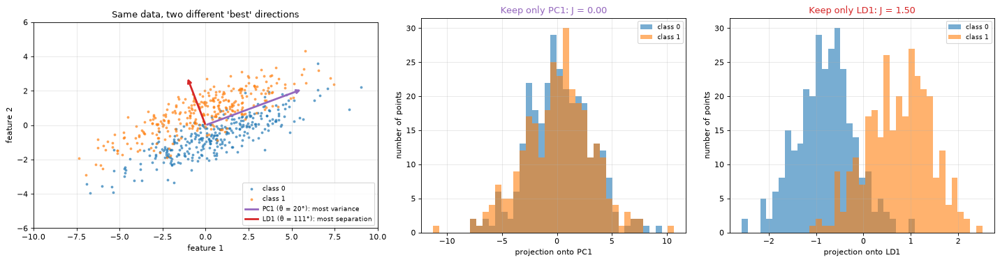

# Linear Discriminant Analysis (LDA) — explained from zero

> **Who this is for:** someone who is new to machine learning. You need school algebra (what a squared number is,
> what an average is) and a little Python. Every other idea — vectors, scatter matrices, eigenvectors — is built up
> here from scratch, with a picture or a tiny example first and the formula second.
>
> **How to read it:** sections 1–3 give the idea with no math. Sections 4–5 give the math, one small step at a time.
> Sections 6–9 are about using LDA in real ML work and — just as important — when **not** to use it.
> Every claim is demonstrated in the hands-on notebook in [`lab/`](lab/README.md).
>
> **Name clash:** in text-mining, “LDA” also means *Latent Dirichlet Allocation*, a topic model. That is a different
> method. Here LDA always means **Linear Discriminant Analysis**.

## Table of contents

0. [LDA in 30 seconds](#0-lda-in-30-seconds)
1. [The problem LDA solves](#1-the-problem-lda-solves)
2. [The toolbox: the only six ideas you need](#2-the-toolbox-the-only-six-ideas-you-need)
3. [LDA step by step, in plain words](#3-lda-step-by-step-in-plain-words)
4. [The math: from Fisher's ratio to an eigenproblem](#4-the-math-from-fishers-ratio-to-an-eigenproblem)
5. [A small example worked by hand](#5-a-small-example-worked-by-hand)
6. [Using LDA in practice](#6-using-lda-in-practice)
7. [Why LDA makes sense for machine learning](#7-why-lda-makes-sense-for-machine-learning)
8. [Where LDA does NOT fit — and why](#8-where-lda-does-not-fit--and-why)
9. [Common misconceptions](#9-common-misconceptions)
10. [The labs](#10-the-labs)
11. [Glossary](#11-glossary)
12. [Further reading](#12-further-reading)
13. [Appendix - Assumptions made](#appendix---assumptions-made)

---

## 0. LDA in 30 seconds

* You have a table: **rows = samples** (flowers, patients, images), **columns = features** (petal length, blood
  pressure, pixel values) — and, unlike PCA, a **label** for every row: which **class** it belongs to (species,
  diagnosis, digit).
* LDA looks for a **direction** — a line through feature space — such that when every point is projected onto it
  (“casts its shadow on it”),
  1. the **class centres** land **far apart**, and
  2. the points of **each class** land **close together**.
* The quality of a direction is one number, **Fisher's ratio** $J$ = (spread *between* the class centres) /
  (spread *within* the classes). LDA picks the direction with the biggest $J$, then the next best, and so on.
* With $C$ classes there are **at most $C - 1$** such directions. Two classes → one line; ten digits → at most nine.
* Mathematically, those directions solve a **generalised eigenproblem**, $S_B w = \lambda S_W w$, and each one's $J$
  is its eigenvalue $\lambda$. Sections 2–4 explain what those words mean and why they show up.
* The same method is also a **classifier**: assume every class is a bell-shaped (Gaussian) cloud of the same shape,
  and Bayes' rule gives straight-line boundaries — along exactly the same directions.

---

## 1. The problem LDA solves

Imagine two kinds of flats, “cheap” and “expensive”, described by two features. Plot them and you get a long, tilted,
cigar-shaped cloud. The two kinds overlap almost completely along the cigar, and are separated only *across* it.



Look at the picture (it is Lab 6 of the notebook):

* **Left:** blue and orange are the two classes. The purple arrow is the direction in which the data is most spread
  out (PCA's first component). The red arrow is the direction that best **separates the classes** (LDA's first
  component). They are almost at right angles.
* **Middle:** project every point onto the purple arrow and draw a histogram. The two classes sit right on top of
  each other: a classifier using only this number does no better than a coin flip (0.490 accuracy).
* **Right:** project onto the red arrow instead. Two separate humps; the same classifier scores 0.885.

That is what LDA does: **turn high-dimensional, labelled data into a few numbers per sample, chosen so that the
classes are as easy to tell apart as possible.** In 2-D you could eyeball the direction. With 13, 64 or 10 000
features you cannot — LDA finds it automatically.

Why would you want that?

| Reason | Example |
|---|---|
| **Classify** | LDA is itself a fast, tuning-free classifier with class probabilities (Labs 5, 9). |
| **See** labelled data | Squeeze 13 or 64 features into 2 axes that spread the classes apart (Labs 6–7). |
| **Compress before another model** | Give k-nearest-neighbours 9 features instead of 64 (Lab 8). |
| **Cope with few rows, many features** | With *shrinkage*, LDA stays stable when features outnumber rows (Lab 10). |

---

## 2. The toolbox: the only six ideas you need

### 2.1 Mean and class mean

The **mean** of a feature is its average. A **class mean** $m_k$ is the average of the rows of class $k$ only — for
each feature separately, so with 2 features it is a point $(\text{avg of feature 1}, \text{avg of feature 2})$, the
**centre** of that class's cloud. The **overall mean** $m$ is the centre of all rows together.

### 2.2 Variance and covariance — “how spread out?” and “do two features move together?”

For one feature with values $x_1, \dots, x_n$ and mean $\bar x$, the **variance** is the average squared distance
from the mean, $\frac{1}{n}\sum_i (x_i - \bar x)^2$. For two features, the **covariance** is the average of the
product of their distances from their means: positive if they rise together, negative if one rises as the other
falls, near 0 if unrelated. All variances and covariances of $p$ features fit in a $p \times p$ table, the
**covariance matrix** (variances on the diagonal). The PCA notes, [section 2](../PCA/README.md#2-the-toolbox-the-only-six-ideas-you-need),
build these up slowly if they are new to you.

*Why squared distances?* They give smooth formulas and, below, an exact answer via eigenvectors. The price: a few
far-away points count a lot (section 8.5).

### 2.3 Projection — “the shadow on a line”

A **direction** is written as a vector $w = (w_1, w_2, \dots)$, an arrow. The **projection** of a point $x$ onto it is
the dot product

$$z = w^\top x = w_1 x_1 + w_2 x_2 + \dots$$

Think of shining a light perpendicular to the line: $z$ is where the point's shadow lands, measured along the line.
**This single number is the point's new feature.** ($w^\top$, “w transpose”, is just $w$ written as a row so that the
multiplication above works out.) Only the direction of $w$ matters: doubling $w$ doubles every shadow position, which
stretches the line but does not change which points are close to which.

### 2.4 Within-class scatter $S_W$ — “how wide is each class?”

Take one class. For each of its points, measure how far it is from **its own class mean**, square it, and add up.
Doing this for every class and adding the results gives the **within-class scatter**. In many dimensions, “square and
add up” becomes a matrix that also records how the features co-vary inside each class:

$$S_W = \sum_{k=1}^{C} \; \sum_{i \in \text{class } k} (x_i - m_k)(x_i - m_k)^\top$$

($(x_i - m_k)(x_i - m_k)^\top$ is the $p \times p$ table of all products of the entries of $x_i - m_k$.)
$S_W$ is the covariance matrix *inside* the classes, pooled over all classes (times $n$). Small $S_W$ = tight classes.

### 2.5 Between-class scatter $S_B$ — “how far apart are the class centres?”

Now do the same with the class **centres**: how far is each class mean from the overall mean, squared, weighted by the
class size $n_k$:

$$S_B = \sum_{k=1}^{C} n_k\, (m_k - m)(m_k - m)^\top$$

Big $S_B$ = the classes sit far apart. And the punchline of section 4 is: **projected onto a direction $w$, the two
scatters become ordinary numbers**, $w^\top S_B w$ (between) and $w^\top S_W w$ (within).

### 2.6 Inverse and eigenvectors — the two pieces of matrix machinery

* The **inverse** $A^{-1}$ of a square matrix $A$ undoes it: $A^{-1}A = I$, where $I$ (the **identity**) leaves every
  vector unchanged. It is the matrix version of $1/a$. Some matrices have no inverse — just as $1/0$ does not exist —
  and that is what goes wrong with LDA when there are more features than rows (section 8.4). The 2 × 2 recipe is in
  Lab 1's collapsible cell.
* An **eigenvector** $u$ of a matrix $A$ is a direction that $A$ only stretches, never turns: $A u = \lambda u$; the
  stretch factor $\lambda$ is its **eigenvalue**. LDA needs the **generalised** version with two matrices,
  $A u = \lambda B u$. Lab 3's collapsible cell explains it; the PCA notes ([2.5–2.6](../PCA/README.md#25-a-matrix-is-a-machine-that-moves-vectors))
  explain ordinary eigenvectors with pictures.

That's the whole toolbox. Now we can say what LDA computes.

---

## 3. LDA step by step, in plain words

1. **Group** the rows by class. Compute each **class mean** and the **overall mean**.
2. Compute the **within-class scatter** $S_W$: how spread out each class is around its own centre (added over classes).
3. Compute the **between-class scatter** $S_B$: how spread out the class centres are around the overall centre.
4. Find the directions $w$ that **maximise Fisher's ratio** $J(w) = \dfrac{w^\top S_B w}{w^\top S_W w}$. They are the
   solutions of $S_B w = \lambda S_W w$, sorted from the largest $\lambda$ (= largest $J$) down. With two classes there
   is a shortcut: $w \propto S_W^{-1}(m_1 - m_0)$.
5. Keep at most $C - 1$ of them (only that many have $\lambda > 0$). These are the **linear discriminants** LD1, LD2, …
6. **Project** every sample onto them. Those numbers are its **LDA scores** — the new, smaller feature table.
7. *(As a classifier)* assign a new point to the class whose centre is closest in the projected space, after adjusting
   for how common each class is. This is the same as the Gaussian rule in section 4.4.

Geometrically: LDA first **reshapes** the space so that every class looks round (this is what dividing by $S_W$ does),
then finds the directions in which the class centres are most spread out.

---

## 4. The math: from Fisher's ratio to an eigenproblem

This section states the results. The step-by-step **proofs are in the notebook**, in collapsible “Proof” cells right
under the Lab 2, 3, 4 and 5 headings, next to the numbers that confirm them.

### 4.1 Write down what we want

Project every point onto a direction $w$: point $x_i$ lands at $z_i = w^\top x_i$, and class $k$'s centre lands at
$w^\top m_k$. We want

* the projected class centres far apart: **between-class scatter** $\sum_k n_k (w^\top m_k - w^\top m)^2$ big,
* each class tight: **within-class scatter** $\sum_k \sum_{i \in k} (z_i - w^\top m_k)^2$ small.

Both at once: maximise their ratio.

### 4.2 Fisher's criterion

The two scatters of the projections turn out to be $w^\top S_B w$ and $w^\top S_W w$, so the goal is

$$\max_w \; J(w) = \frac{w^\top S_B\, w}{w^\top S_W\, w}$$

This is **Fisher's criterion** (R. A. Fisher, 1936). Notice it doesn't care about the length of $w$ — doubling $w$
multiplies top and bottom by 4 — so only the direction matters. (Proof: Lab 2, steps 1–2.)

*Why not simply use the line joining the class means?* Because that ignores the shape of the classes. If both classes
are tilted cigars, the best line leans away from the tilt so that each class looks thin. In Lab 2 the “join the means”
line gets $J = 0.563$, the best line $J = 1.141$.

### 4.3 The answer: a generalised eigenproblem, $S_W^{-1} S_B$

Setting the derivative of $J$ to zero gives

$$S_B\, w = \lambda\, S_W\, w \qquad\Longleftrightarrow\qquad S_W^{-1} S_B\, w = \lambda\, w$$

the **generalised eigenproblem** of $(S_B, S_W)$ — equivalently, the ordinary eigenproblem of $S_W^{-1}S_B$ when $S_W$
has an inverse. And **$J$ of an eigenvector equals its eigenvalue**, so:

* the best direction (LD1) is the eigenvector with the **largest** eigenvalue,
* the next best direction (LD2) is the eigenvector with the second largest, and so on,
* for two classes the solution is simply $w \propto S_W^{-1}(m_1 - m_0)$,
* the worst direction has $J = 0$: it is at right angles to the gap between the class means, so both centres cast
  their shadow on the same spot.

(Proof: Lab 2, steps 3–5. Lab 2 also tries all 360 directions by brute force and lands on the eigenvector.)

Two facts that differ from PCA (Lab 3):

* The LDA scores are **uncorrelated inside each class**, but the LDA **axes are not at right angles** to each other
  in the original space ($S_W^{-1}S_B$ is not symmetric). On iris, $|\cos|$ between LD1 and LD2 is 0.176, not 0.
* `explained_variance_ratio_` in scikit-learn is each eigenvalue's share of the total: a share of the **class
  separation**, not of the variance. On iris, LD1 carries 99.1 % of it.

### 4.4 At most $C - 1$ components

$S_B$ is built from the $C$ vectors $m_k - m$, and their weighted sum is zero ($\sum_k n_k(m_k - m) = 0$), so only
$C - 1$ of them are independent. Hence $S_B$ — and the eigenproblem — has **at most $C - 1$ non-zero eigenvalues**
(and at most $p$, the number of features). Intuition: $C$ points always fit in a flat space of $C - 1$ dimensions;
2 class centres lie on a line, 3 on a plane. On digits (10 classes, 61 varying pixels) the 10th eigenvalue is
$6 \times 10^{-15}$, i.e. zero. (Proof: Lab 4.)

### 4.5 The same answer from Gaussians: LDA as a classifier

A completely different starting point gives the same directions. Assume:

* each class $k$ is a **Gaussian** (bell-shaped) cloud with centre $\mu_k$,
* **all classes share one covariance matrix** $\Sigma$ (same size, shape and tilt),
* class $k$ makes up a share $\pi_k$ of the population (its **prior**).

Bayes' rule then says: predict the class with the largest **discriminant score**

$$\delta_k(x) = x^\top \Sigma^{-1}\mu_k - \tfrac12 \mu_k^\top \Sigma^{-1}\mu_k + \log \pi_k$$

which is **linear** in $x$. So the boundary between two classes is a straight line (a flat plane in more dimensions),
at right angles to $w = \Sigma^{-1}(\mu_1 - \mu_0)$. Estimating $\Sigma$ by $S_W / n$ makes this exactly Fisher's
direction. The class probabilities, $P(k \mid x) = e^{\delta_k(x)} / \sum_j e^{\delta_j(x)}$, depend on $x$ only
through its LDA scores. (Proof: Lab 5, which also shows scikit-learn's `predict_proba` matches this formula to
$10^{-15}$.)

Two consequences used later:

* If the classes have **different** covariances, the $x^\top \Sigma_k^{-1} x$ terms no longer cancel and the boundary
  curves: that is **Quadratic Discriminant Analysis (QDA)** (section 8.1).
* The priors $\pi_k$ only shift the threshold along the direction, they never rotate it (section 8.6).

Fisher's derivation (4.2–4.3) needs **no** Gaussian assumption — it just finds the best-separating projections. The
Gaussian view adds two things: probabilities, and the guarantee that a linear boundary is the *best possible* one when
the assumption holds.

### 4.6 How computers actually do it

scikit-learn offers three solvers:

* **`svd`** (default) never builds $S_W$; it whitens the data (rescales it so the classes look round) and uses a
  singular value decomposition. Most accurate, and works even when $S_W$ has no inverse.
* **`eigen`** builds $S_B$ and $S_W$ and solves the generalised eigenproblem with a stable symmetric method
  (`scipy.linalg.eigh(Sb, Sw)`).
* **`lsqr`** skips the directions entirely and solves $\Sigma\, w_k = \mu_k$ for the classifier weights. Fastest, but
  classification only (no `transform`).

All three give the same directions and predictions on well-behaved data (Lab 3).

---

## 5. A small example worked by hand

Six points, two features, two classes:

* class 0: $(1,1),\ (2,3),\ (3,2)$
* class 1: $(4,2),\ (5,4),\ (6,3)$

**Step 1 — means.** $m_0 = (2, 2)$, $m_1 = (5, 3)$, overall $m = (3.5, 2.5)$.

**Step 2 — within-class scatter.** Class 0's points minus $m_0$: $(-1,-1),\ (0,1),\ (1,0)$.

* feature 1 squared: $1 + 0 + 1 = 2$; feature 2 squared: $1 + 1 + 0 = 2$; product: $1 + 0 + 0 = 1$.

Class 1's points minus $m_1$ are the same three vectors, so it gives the same table. Adding both:

$$S_W = \begin{pmatrix}2&1\\1&2\end{pmatrix} + \begin{pmatrix}2&1\\1&2\end{pmatrix} = \begin{pmatrix}4&2\\2&4\end{pmatrix}$$

**Step 3 — between-class scatter.** $m_0 - m = (-1.5, -0.5)$, $m_1 - m = (1.5, 0.5)$, each with $n_k = 3$:

$$S_B = 3\begin{pmatrix}2.25&0.75\\0.75&0.25\end{pmatrix} \times 2 = \begin{pmatrix}13.5&4.5\\4.5&1.5\end{pmatrix}$$

**Step 4 — the direction.** Two classes, so $w \propto S_W^{-1}(m_1 - m_0)$ with $m_1 - m_0 = (3, 1)$. The 2 × 2
inverse is $S_W^{-1} = \frac{1}{12}\begin{pmatrix}4&-2\\-2&4\end{pmatrix}$ (determinant $4\cdot4 - 2\cdot2 = 12$), so

$$S_W^{-1}(m_1 - m_0) = \tfrac{1}{12}(4\cdot3 - 2\cdot1,\; -2\cdot3 + 4\cdot1) = \tfrac{1}{12}(10, -2) = \tfrac16(5, -1)$$

Only the direction matters, so use $w = (5, -1)$.

**Step 5 — project** ($z = 5x_1 - x_2$):

| class 0 point | $z$ | class 1 point | $z$ |
|---|---|---|---|
| (1, 1) | 4 | (4, 2) | 18 |
| (2, 3) | 7 | (5, 4) | 21 |
| (3, 2) | 13 | (6, 3) | 27 |
| **mean** | **8** | **mean** | **22** |

Overall projected mean: 15. The classes don't overlap at all on this line.

**Step 6 — Fisher's ratio.**

* between: $3(8 - 15)^2 + 3(22 - 15)^2 = 147 + 147 = 294$
* within: class 0: $(4-8)^2 + (7-8)^2 + (13-8)^2 = 16 + 1 + 25 = 42$; class 1: $(18-22)^2 + (21-22)^2 + (27-22)^2 = 42$; total $84$
* $J = 294 / 84 = \mathbf{3.5}$

Check with the matrices: $w^\top S_W w = (5,-1)\cdot(18, 6) = 84$ ✔ and $w^\top S_B w = (5,-1)\cdot(63, 21) = 294$ ✔.
The largest generalised eigenvalue of $(S_B, S_W)$ is also 3.5 ✔ (section 4.3), and the other one is 0 ✔.

**Step 7 — compare with the “obvious” line** joining the means, $(3, 1)$: projections 4, 9, 11 and 14, 19, 21;
between $= 3\cdot 5^2 + 3\cdot 5^2 = 150$, within $= 26 + 26 = 52$, $J = 150/52 \approx 2.885$. Worse, because the
gap between the groups (11 → 14) is small compared with their spread. Fisher's line leans away from the classes' tilt.

**Step 8 — classify a new point.** With equal class sizes, the cut-off is halfway between the projected class means,
$(8 + 22)/2 = 15$. The new point $(4, 3)$ projects to $5\cdot4 - 3 = 17 > 15$ → class 1; $(3, 3)$ projects to
$12 < 15$ → class 0. (This is exactly the Gaussian rule of 4.5 with equal priors.)

> The textbook two-class formula is often written $J = (\text{gap between projected means})^2 / (s_0^2 + s_1^2)$, with
> $s_k^2$ each class's projected scatter. That is the same as ours divided by $n_0 n_1 / n$ (here 1.5): $196/84 \approx 2.333$
> vs $3.5$. A constant factor changes no direction and no ranking.

Lab 1 in the notebook does this exact computation in code and plots it.

---

## 6. Using LDA in practice

### 6.1 The recipe in scikit-learn

```python
from sklearn.discriminant_analysis import LinearDiscriminantAnalysis
from sklearn.model_selection import cross_val_score
from sklearn.neighbors import KNeighborsClassifier
from sklearn.pipeline import make_pipeline

# 1) LDA as a classifier
clf = LinearDiscriminantAnalysis()                      # solver="svd" (default)
print(cross_val_score(clf, X, y, cv=5).mean())

# 2) LDA as dimensionality reduction, inside a Pipeline (6.6)
model = make_pipeline(LinearDiscriminantAnalysis(n_components=2), KNeighborsClassifier())
print(cross_val_score(model, X, y, cv=5).mean())

# 3) Many features, few rows: shrinkage (6.3)
clf = LinearDiscriminantAnalysis(solver="lsqr", shrinkage="auto")

# After fitting:
lda = LinearDiscriminantAnalysis(n_components=2).fit(X_train, y_train)
Z = lda.transform(X_train)                              # LDA scores (the new features)
print(lda.explained_variance_ratio_)                    # each axis's share of the class separation
print(lda.predict(X_test), lda.predict_proba(X_test))   # classes and probabilities
```

### 6.2 Which solver?

| `solver` | How it works | Shrinkage? | `transform()`? | Use it when |
|---|---|---|---|---|
| `"svd"` (default) | SVD of the whitened data; never builds $S_W$ | no | yes | the default; most stable, copes with $S_W$ having no inverse |
| `"eigen"` | solves $S_B w = \lambda S_W w$ | yes | yes | you need shrinkage **and** the projected features |
| `"lsqr"` | solves $\Sigma w_k = \mu_k$ by least squares | yes | no | you need shrinkage and only want to classify; fastest |

Asking for shrinkage with `"svd"`, or `transform()` with `"lsqr"`, raises `NotImplementedError`.

### 6.3 Shrinkage: when features are many compared with rows

LDA needs the inverse of the within-class covariance. With $n$ rows and $C$ classes that matrix can only have $n - C$
independent directions, so if you have more features than that it has **no inverse**, and well before that point it
is already unreliable (tiny noisy directions get blown up). **Shrinkage** blends the estimate with a simple,
always-invertible one:

$$\hat\Sigma_{\text{shrunk}} = (1 - \alpha)\,\hat\Sigma + \alpha\,\bar\nu\, I$$

where $\bar\nu$ is the average variance of one feature and $\alpha$ between 0 and 1 says how much to blend.

* `shrinkage="auto"` picks $\alpha$ from the data with the **Ledoit–Wolf** formula. A good default whenever rows per
  class are limited — it costs almost nothing when not needed.
* `covariance_estimator=OAS()` (from `sklearn.covariance`) uses the OAS formula, often slightly better for roughly
  Gaussian data.
* `shrinkage=0.3` (a fixed number) works too, but must be tuned, and then the features must be standardised (6.5).

Lab 10: with 20 training rows and 100 features, plain LDA scores 0.667, Ledoit–Wolf 0.887, OAS 0.900.

### 6.4 `n_components`, classifier vs dimensionality reduction

* `n_components` can be at most $\min(C - 1,\ p)$. Default: that maximum. Asking for more raises an error (Lab 4).
* For a 2-D picture, use 2. As preprocessing for another model, treat it as a hyper-parameter and choose by
  cross-validation (Lab 8: on digits, LDA beats PCA at 3–4 components; PCA catches up by 9 and can go beyond).
* `n_components` only affects `transform()`. **`predict()` always uses the full model** (all $C - 1$ directions plus
  the priors), whatever `n_components` is.
* **Classifier or reducer?** Same fitted object, two uses. As a classifier it predicts directly with straight-line
  boundaries. As a reducer it hands its scores to another model (k-NN, logistic regression, …), which can then draw
  any boundary it likes in the small space.

### 6.5 Should I standardise first?

* **Plain LDA: it doesn't matter.** Changing a feature's units (or standardising) rescales $S_W$ and $S_B$ in the same
  way, so Fisher's ratio, the projections and the predictions are unchanged (Lab 11: 100 % identical predictions on
  wine with and without `StandardScaler`). This is a big difference from PCA.
* **`shrinkage="auto"`: also doesn't matter** — scikit-learn standardises internally.
* **Fixed `shrinkage=0.x`: standardise first.** The shrinkage target assumes all features have similar variances. On
  raw wine data (proline's variance is about 100 000, most others below 12) `shrinkage=0.5` scores 0.703; after
  standardising, 0.989.

### 6.6 Fit on the training data only — this matters even more than for PCA

LDA learns from the **labels**. If you fit it on all your data and then cross-validate a model on its output, the test
folds' labels have shaped the features. Lab 12 does this on **pure random noise with random labels** (true accuracy
0.5) and gets **0.845**. Inside a `Pipeline`, refitted on each training fold, the same data honestly scores 0.510.
Always put LDA in a `Pipeline` with the model that uses it.

### 6.7 Reading the output

| scikit-learn attribute | What it is | Plain words |
|---|---|---|
| `scalings_` (svd/eigen) | the directions, one per **column** | the recipe for each LDA axis |
| `explained_variance_ratio_` (svd/eigen) | eigenvalue / sum of eigenvalues | each axis's share of the **class separation** (not of the variance) |
| `transform(X)` | LDA scores | the new, smaller feature table |
| `coef_`, `intercept_` | classifier weights | class score = `X @ coef_.T + intercept_` (for two classes, one row: positive → class 1) |
| `means_`, `priors_` | class means, class shares | the $\mu_k$ and $\pi_k$ of section 4.5 |
| `covariance_` | shared within-class covariance | the $\Sigma$ of 4.5 (svd solver: only with `store_covariance=True`) |
| `predict`, `predict_proba` | class, probabilities | Bayes' rule with the shared Gaussian (Lab 5) |

* Like PCA, the **sign** of a direction is arbitrary: $w$ and $-w$ are the same axis.
* Each direction mixes all features. Large weights hint at important features only if the features are on comparable
  scales (standardise before *reading* the weights, even though LDA doesn't need it for predicting).

---

## 7. Why LDA makes sense for machine learning

**The core belief behind LDA:** each class is a single cloud, all clouds have roughly the **same shape**, and the
classes differ mainly in **where their centres are**. When that belief holds, LDA helps ML in several concrete ways:

1. **It uses the labels.** Unlike PCA, it keeps what matters for telling classes apart, even if that is a direction
   with little variance (Lab 6: 0.885 vs PCA's 0.490 on one axis).
2. **It is the best possible classifier when its assumption holds.** For Gaussian classes with a shared covariance,
   the LDA rule *is* Bayes' rule, the theoretical optimum (Lab 5).
3. **Few numbers to learn → works with little data.** It estimates one shared covariance (about $p^2/2$ numbers)
   instead of one per class like QDA. In Lab 9, with 12 rows per class, QDA scores 0.585 and LDA 0.705.
4. **No tuning, closed form, fast.** One pass over the data, no learning rate, no iterations, built-in probabilities,
   natively multiclass. A strong baseline.
5. **Big compression for free.** However many features, the result has at most $C - 1$ dimensions, chosen for
   separation (Labs 7–8). Great for plots and for distance-based models downstream.
6. **Shrinkage makes it robust in high dimensions** (Lab 10), which is why shrinkage LDA is a standard method in, for
   example, EEG-based brain–computer interfaces.
7. **Unit-free.** No scaling decisions to get wrong (Lab 11).

**It is mathematically the right tool when** (a) you have **labels**, (b) each class is roughly **one bell-shaped
cloud**, (c) the clouds have **similar covariances**, (d) the classes differ in their **means**, so a **straight**
boundary separates them, and (e) there are enough rows per class to estimate a covariance — or you use shrinkage. The
next section is what happens when one of those breaks.

---

## 8. Where LDA does NOT fit — and why

LDA always produces *an* answer; the danger is that the answer rests on an assumption your data breaks.

| # | Situation | Why LDA fails | Use instead | Lab |
|---|---|---|---|---|
| 8.1 | Classes have different covariances (spread, shape, tilt) | LDA forces one shared covariance → one straight boundary | QDA, regularised QDA, Gaussian naive Bayes | 13 |
| 8.2 | Multimodal / non-Gaussian classes (several clusters per class) | LDA summarises each class by **one** mean; the means can coincide | k-NN, tree ensembles, mixture discriminant analysis | 14 |
| 8.3 | Curved boundaries | LDA's boundaries are straight | k-NN, SVM with RBF kernel, boosting, neural nets | 14 |
| 8.4 | More features than rows ($p > n - C$), no shrinkage | $S_W$ has no inverse; LDA overfits noise directions | shrinkage (`shrinkage="auto"`), PCA first | 10 |
| 8.5 | Outliers | squared distances let a few points drag means and covariance | clean data, robust covariance, trees | 15 |
| 8.6 | Very imbalanced classes | learned priors push the boundary into the minority class | set `priors` or tune the threshold; judge with recall / balanced accuracy | 16 |
| 8.7 | No labels (clustering, exploration) | LDA needs `y` | PCA, UMAP / t-SNE, clustering | — |
| 8.8 | You want more than $C - 1$ features | $S_B$ has rank $\le C - 1$ | PCA, PLS, feature selection | 4 |

### 8.1 Unequal class covariances → QDA
**Why:** LDA pools all classes into one covariance. If one class is a tight blob and another a wide cloud around it,
the real difference is the **spread**, which a shared covariance cannot express, and the best boundary is a curve
around the tight class. Lab 13: LDA 0.693, QDA 0.887. **Fix:** QDA (one covariance per class, quadratic boundary) when
you have enough rows per class; regularised QDA (`reg_param`) in between; or a flexible model.
*Cheap test:* cross-validate LDA vs QDA; if QDA wins clearly, the shapes differ.

### 8.2 Multimodal or non-Gaussian classes
**Why:** LDA describes each class by one centre. If a class is made of two blobs in opposite corners (XOR), the class
centres can land on the same spot and *no* direction separates them. Lab 14: the best possible Fisher ratio is
0.0002 and LDA scores 0.475 (coin flip), while 15-nearest-neighbours scores 1.000. Skewed or heavy-tailed features
are a milder version: LDA still works but is no longer optimal (Lab 9: logistic regression beats LDA on breast_cancer,
0.979 vs 0.954). **Fix:** a model that makes no shape assumption (k-NN, trees, boosting), or several Gaussians per
class (mixture discriminant analysis); transform skewed features (e.g. log) before LDA.

### 8.3 Non-linear boundaries
**Why:** the shared-covariance assumption produces straight boundaries only. Lab 14's moons: LDA 0.843, 15-NN 0.923.
**Fix:** k-NN, SVM with an RBF kernel, gradient boosting, neural networks; or use LDA's scores as features for a
non-linear model.

### 8.4 More features than rows, without shrinkage
**Why:** $S_W$ has at most $n - C$ independent directions. With more features than that there is a direction in which
every training point sits exactly on its class mean, so $J$ is infinite there — a perfect-looking separation that is
pure noise. Lab 10: with 20 rows, plain LDA falls from 0.975 (1 feature) to 0.667 (100 features). **Fix:**
`solver="lsqr"` or `"eigen"` with `shrinkage="auto"` (0.887 in the same setting), or reduce the features first (PCA,
as in “Fisherfaces”).

### 8.5 Outliers
**Why:** means and covariances are averages of (squared) distances, so a few far-away points pull them strongly.
Lab 15: 8 bad rows among 408 rotate the LDA direction from 149.3° to 15.8° and drop accuracy on clean data from 0.939
to 0.856. **Fix:** look at the data; remove or cap clear errors; flag points far from their class's robust centre
(Lab 15 uses Minimum Covariance Determinant and recovers 0.939); or use a model less sensitive to extreme points.

### 8.6 Very imbalanced priors
**Why:** LDA adds $\log \pi_k$ to each class score, so a 95 % class wins every close call. Lab 16: accuracy 0.961
looks great, but only 28 % of the minority class is found (balanced accuracy 0.638). With equal priors: accuracy
0.828, minority recall 0.840, balanced accuracy 0.834. The direction is identical; only the cut-off moves. **Fix:**
set `priors`, or pick a threshold on `predict_proba` that matches the cost of each kind of mistake, and evaluate with
balanced accuracy, recall or precision–recall curves.

### 8.7 No labels
**Why:** LDA is supervised: without `y` there are no class means and nothing to separate. It cannot discover groups.
**Fix:** PCA for unsupervised compression; clustering (k-means, Gaussian mixtures) to find groups; UMAP / t-SNE to look.

### 8.8 More than $C - 1$ features wanted
**Why:** at most $C - 1$ eigenvalues are non-zero (4.4). Binary classification gives exactly one LDA feature.
**Fix:** PCA (up to $p$ components), PLS (supervised, not limited to $C - 1$), or feature selection.

**Rule of thumb:** before trusting LDA, ask — *Do I have labels? Is each class roughly one blob? Are the blobs
similarly shaped? Is a straight boundary plausible? Do I have enough rows per class (or am I using shrinkage)? Are
there outliers? Is one class rare?*

---

## 9. Common misconceptions

| Myth | Reality |
|---|---|
| “LDA is Latent Dirichlet Allocation.” | Same acronym, unrelated method (a topic model for text). |
| “LDA is just PCA with labels.” | Different goal (separation, not variance), axes not at right angles, at most $C - 1$ of them (Labs 3, 4, 6). |
| “The best direction is the line joining the class means.” | Only if every class is round. Otherwise Fisher's line leans away from the classes' tilt (Labs 1–2: $J$ 3.5 vs 2.885, 1.141 vs 0.563). |
| “`explained_variance_ratio_` is the variance LDA keeps.” | It is each axis's share of the **class separation**. LD1 kept only 10.3 % of the variance in Lab 6 yet separated the classes. |
| “LDA only works on Gaussian data.” | Fisher's derivation needs no Gaussian assumption. Gaussians (with a shared covariance) make it *optimal* and give the probabilities; it still works reasonably on roughly unimodal data (Lab 9). |
| “You must standardise before LDA.” | Plain LDA is unit-free (Lab 11). Standardise if you use a fixed shrinkage value, or to compare coefficient sizes. |
| “I can ask LDA for as many components as I like.” | At most $\min(C - 1, p)$ (Lab 4). |
| “`n_components` changes LDA's predictions.” | It only changes `transform()`; `predict()` uses the full model. |
| “High accuracy on LDA features proves they are good.” | Not if LDA saw the test labels: 0.845 on pure noise in Lab 12. Fit inside a `Pipeline`. |
| “LDA's 96 % accuracy means it works on my imbalanced data.” | Check minority recall / balanced accuracy (Lab 16: 0.961 accuracy, 0.280 minority recall). |
| “QDA is always better because it is more flexible.” | It needs far more data: 0.585 vs LDA's 0.705 with 12 rows per class (Lab 9). |

---

## 10. The labs

Everything above is demonstrated in one Jupyter notebook: **[`lab/lda_lab.ipynb`](lab/lda_lab.ipynb)**.
Setup, run instructions and a map of which lab proves which claim are in **[`lab/README.md`](lab/README.md)**.

| Part | Labs | README sections |
|---|---|---|
| A. How LDA works | 1 hand example · 2 brute-force best direction · 3 three solvers agree · 4 at most C − 1 · 5 Gaussian classifier view | 2, 4, 5 |
| B. Why it's useful | 6 LDA vs PCA · 7 digits in 2-D · 8 LDA as preprocessing · 9 LDA vs QDA vs logistic regression · 10 shrinkage for p > n · 11 scaling | 6, 7 |
| C. Where it fails | 12 label leakage · 13 unequal covariances · 14 multimodal & curved · 15 outliers · 16 imbalanced priors | 6.6, 8 |

---

## 11. Glossary

| Term | Meaning |
|---|---|
| **Sample / feature / label** | A row of the data table / a column of it / the class each row belongs to. |
| **Class mean ($m_k$, $\mu_k$)** | The average of the rows of class $k$: the class's centre. |
| **Prior ($\pi_k$)** | The share of class $k$ in the data (or the share you tell the model to assume). |
| **Projection / score** | $w^\top x$: where a point's shadow lands on the line in direction $w$. Its new feature. |
| **Within-class scatter ($S_W$)** | Sum over classes of squared distances (as a matrix) from each point to its own class mean. Small = tight classes. |
| **Between-class scatter ($S_B$)** | Sum over classes of size × squared distance (as a matrix) from class mean to overall mean. Big = classes far apart. |
| **Fisher's ratio / criterion ($J$)** | $w^\top S_B w \,/\, w^\top S_W w$: between-class over within-class scatter of the projections. |
| **Linear discriminant (LD1, LD2, …)** | A direction maximising $J$ (subject to the earlier ones); also used for the scores along it. |
| **Inverse ($A^{-1}$)** | The matrix that undoes $A$: $A^{-1}A = I$. Does not always exist. |
| **Identity ($I$)** | The matrix that changes nothing: 1s on the diagonal, 0s elsewhere. |
| **Eigenvector / eigenvalue** | $A u = \lambda u$: a direction $A$ only stretches, by factor $\lambda$. |
| **Generalised eigenproblem** | $A u = \lambda B u$ with two matrices; LDA's is $S_B w = \lambda S_W w$. |
| **Rank** | Number of independent directions a matrix can produce; $\text{rank}(S_B) \le C - 1$, $\text{rank}(S_W) \le n - C$. |
| **Trace ($\text{tr}$)** | Sum of a matrix's diagonal entries; for a covariance matrix, the total variance. |
| **Gaussian** | The bell-shaped distribution; in many dimensions described by a mean and a covariance matrix. |
| **Discriminant score ($\delta_k$)** | The (linear) score whose largest value decides the predicted class in LDA. |
| **QDA** | Quadratic Discriminant Analysis: like LDA but one covariance per class → curved boundaries. |
| **Shrinkage** | Blending an estimated covariance with a simple one ($\bar\nu I$) so it is stable and invertible. |
| **Ledoit–Wolf / OAS** | Two formulas that choose the shrinkage amount from the data. |
| **Recall / balanced accuracy** | Share of a class's rows that were found / average recall over the classes. |
| **Data leakage** | Letting test-set information influence training (e.g. fitting LDA before the split). |

---

## 12. Further reading

* R. A. Fisher, *The use of multiple measurements in taxonomic problems*, Annals of Eugenics 7 (1936) — the original
  paper; it also introduced the iris data used in Lab 3.
* James, Witten, Hastie, Tibshirani, *An Introduction to Statistical Learning* (2nd ed.), chapter 4 — LDA, QDA, naive
  Bayes and logistic regression side by side (this repo's ISLR notes are in [`../islr_notes`](../islr_notes)).
* Hastie, Tibshirani, Friedman, *The Elements of Statistical Learning*, section 4.3 — LDA, QDA, regularised
  discriminant analysis and reduced-rank (Fisher) LDA.
* Bishop, *Pattern Recognition and Machine Learning*, section 4.1.4–4.1.6 — Fisher's linear discriminant, two-class
  and multi-class.
* O. Ledoit and M. Wolf, *A well-conditioned estimator for large-dimensional covariance matrices*, Journal of
  Multivariate Analysis (2004) — the shrinkage behind `shrinkage="auto"`.
* P. Belhumeur, J. Hespanha, D. Kriegman, *Eigenfaces vs. Fisherfaces*, IEEE TPAMI (1997) — PCA then LDA for faces.
* scikit-learn user guide: *Linear and Quadratic Discriminant Analysis* — solvers, shrinkage, covariance estimators.
* This repo's [PCA notes](../PCA/README.md) — the unsupervised cousin; PCA's Lab 12 shows the case where LDA is needed.

---

## Appendix - Assumptions made

No further input was available, so the following decisions were made on the author's behalf:

1. **Audience.** “Extremely new to ML” was taken to mean: comfortable with school algebra (averages, squares) and
   basic Python, but **no** linear algebra, statistics or calculus. Every such concept (class means, scatter matrices,
   projection, inverse, eigenvectors, generalised eigenproblems, Gaussians, Bayes' rule, rank, trace, shrinkage) is
   introduced before it is used. Calculus appears only in the proof cells, and Lab 2's proof also gives a
   calculus-free route.
2. **Template.** `src/PCA/` was used as the template: the same section flow (30-second summary → problem → toolbox →
   steps → math → hand example → practice → why it fits → where it fails → misconceptions → labs → glossary → reading),
   the same lab format (goal, code with `# <- try changing this` knobs, output, “How to read this” box, collapsible
   proofs, closing summary table and model guide). Where the general variance/covariance background is identical, this
   README points to the PCA notes instead of repeating them.
3. **New folder only.** The repo had no LDA material, so nothing was replaced. Nothing outside `src/LDA/` was changed.
4. **One notebook, not scripts.** The lab is `lab/lda_lab.ipynb` (16 labs in 3 parts), with `lab/README.md` (what is
   where, how to run, how to read results) and `lab/requirements.txt`, mirroring the PCA lab.
5. **Datasets.** Only data that needs no download: data generated in the notebook and datasets bundled with
   scikit-learn (`load_iris`, `load_wine`, `load_breast_cancer`, `load_digits`, `make_moons`). Every random step uses a
   fixed seed, so results are reproducible. `load_diabetes` was not used: its target is a number, not a class.
6. **Notebook is saved with its outputs** so it can be read on GitHub without running anything. Figures are rendered
   at low resolution (80 dpi) to keep the file about 1.5 MB. The picture in section 1 (`lda_vs_pca.png`) is Lab 6's
   figure, saved from the executed notebook.
7. **Environment used to execute and verify the notebook:** Python 3.12.8, NumPy 2.5.4, SciPy 1.18.1, scikit-learn
   1.9.1, Matplotlib 3.11.2. The code uses only long-stable APIs, so other recent versions should work; exact decimals
   may differ slightly. Numbers quoted in this README (e.g. 0.490 vs 0.885 in Lab 6, 0.667 vs 0.887 in Lab 10) are
   taken from that run.
8. **Scatter normalisation.** $S_W$ and $S_B$ are **sums** (not divided by $n$), the usual convention for Fisher's
   criterion; $J$ does not depend on the choice, and neither do the directions. The two-class textbook form
   $(\text{gap})^2/(s_0^2 + s_1^2)$ differs from the $S_B$ form by the constant $n_0 n_1/n$ (noted in section 5). For
   the Gaussian view the shared covariance is $S_W / n$, which is what scikit-learn's `lsqr`/`eigen` solvers store in
   `covariance_`.
9. **Conventions.** Rows are samples and columns are features; $n$ rows, $p$ features, $C$ classes; vectors are column
   vectors; “LD1, LD2, …” name the discriminant directions, and “score” is a sample's coordinate along one.
10. **Scope.** The README teaches classical LDA in depth, from both Fisher's and the Gaussian point of view, plus
    shrinkage. QDA, logistic regression, k-NN and robust covariance appear as comparisons or fixes, not as full
    topics. Not covered: kernel (non-linear) discriminant analysis, Friedman's regularised discriminant analysis
    beyond `reg_param`, mixture discriminant analysis, sparse LDA, and heteroscedastic variants.
11. **Some claims are qualitative.** Statements about practice (shrinkage LDA being standard in EEG / brain–computer
    interfaces, “Fisherfaces”) come from the literature listed in section 12 and were not reproduced in the labs. The
    model guide at the end of the notebook says so where a row is not backed by a lab.
12. **Wording.** This section's heading follows the requested name, matching the PCA README.
13. **Nothing was committed.** The changes are left in the working tree for review.
