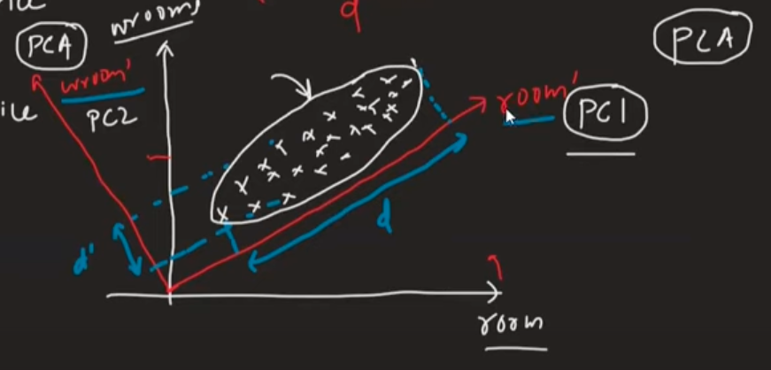

# Principal Component Analysis (PCA) — explained from zero

> **Who this is for:** someone who is new to machine learning. You need school algebra (what a squared number is,
> what an average is) and a little Python. Every other idea — vectors, matrices, eigenvectors — is built up here
> from scratch, with a picture or a tiny example first and the formula second.
>
> **How to read it:** sections 1–3 give the idea with no math. Sections 4–5 give the math, one small step at a time.
> Sections 6–9 are about using PCA in real ML work and — just as important — when **not** to use it.
> Every claim is demonstrated in the hands-on notebook in [`lab/`](lab/README.md).

## Table of contents

0. [PCA in 30 seconds](#0-pca-in-30-seconds)
1. [The problem PCA solves](#1-the-problem-pca-solves)
2. [The toolbox: the only six ideas you need](#2-the-toolbox-the-only-six-ideas-you-need)
3. [PCA step by step, in plain words](#3-pca-step-by-step-in-plain-words)
4. [The math: why eigenvectors fall out](#4-the-math-why-eigenvectors-fall-out)
5. [A complete example by hand](#5-a-complete-example-by-hand)
6. [Using PCA in practice](#6-using-pca-in-practice)
7. [Why PCA makes sense for machine learning](#7-why-pca-makes-sense-for-machine-learning)
8. [Where PCA does NOT fit — and why](#8-where-pca-does-not-fit--and-why)
9. [Common misconceptions](#9-common-misconceptions)
10. [The labs](#10-the-labs)
11. [Glossary](#11-glossary)
12. [Further reading](#12-further-reading)
13. [Appendix - Assumptions made](#appendix---assumptions-made)

---

## 0. PCA in 30 seconds

* You have a table: **rows = samples** (houses, patients, images), **columns = features** (size, age, pixel values).
* Often many columns say *almost the same thing*. A house's floor area and its number of rooms rise together.
* PCA finds **new columns** — called **principal components (PCs)** — that are mixtures of the old ones, chosen so that
  1. the 1st new column captures as much of the data's spread as any single column possibly can,
  2. the 2nd captures as much of the *remaining* spread as possible, at a right angle to the 1st, and so on,
  3. the new columns are **uncorrelated** with each other (no repeated information).
* Then you keep only the first few new columns. Fewer columns, most of the information.
* Mathematically, those new directions are the **eigenvectors of the covariance matrix**, and how much spread each
  one captures is its **eigenvalue**. Sections 2–4 explain what those words mean and why they show up.

---

## 1. The problem PCA solves

Imagine a dataset of flats with two features: **number of rooms** and **number of washrooms**. Plot them and you get
a long, tilted, cigar-shaped cloud — flats with more rooms tend to have more washrooms.



Look at the picture:

* The black axes are the original features (`room`, `wroom`).
* The cloud is stretched along a diagonal. Along that diagonal (red axis `room'`, labelled **PC1**) the points are
  spread over a long distance **d**. Across it (red axis `wroom'`, **PC2**) they are spread over only a short distance **d'**.
* If you had to describe each flat with **one** number instead of two, the best choice is its position along PC1 —
  roughly “how big is this flat overall”. Its position along PC2 (“more or fewer washrooms than usual for its size”)
  varies only a little, so dropping it loses little.

That is all PCA does: **turn the axes so they line up with the directions in which the data actually varies, then
keep the axes with the most variation.** In 2-D you could eyeball it. With 64, 1,000 or 20,000 features you cannot —
PCA finds those axes automatically.

Why would you want fewer columns?

| Reason | Example |
|---|---|
| **See** the data | You can't plot 64 dimensions; you can plot 2 PCs (Lab 6). |
| **Compress** it | Store 20 numbers per image instead of 64 (Lab 7). |
| **Clean** it | The small components are mostly noise; drop them (Lab 8). |
| **Speed up / stabilise** models | Fewer, uncorrelated inputs → faster training, more stable linear models (Lab 9). |

---

## 2. The toolbox: the only six ideas you need

### 2.1 Mean and centering

The **mean** of a feature is its average. **Centering** means subtracting the mean from every value, so the new
average is 0. Geometrically, it slides the whole cloud so its centre sits on the origin `(0, 0)`. PCA always centres
first, because we care about how points spread **around their centre**, not about where the centre is.

### 2.2 Variance — “how spread out?”

For one feature with centred values $x_1, \dots, x_n$:

$$\text{Var}(x) = \frac{1}{n}\sum_{i=1}^{n} x_i^2$$

i.e. the average squared distance from the mean. Big variance = values are spread out = the feature *varies*
between samples and therefore can tell samples apart. A feature that is the same for everyone (variance 0) carries no
information.

*Why squared distances and not plain distances (mean absolute deviation)?* Both measure spread, but squares give
(a) a smooth, differentiable formula, (b) the clean matrix formula in section 4 that turns PCA into an eigenvector
problem with an exact answer, and (c) the Pythagoras link between “variance kept” and “error made” (section 4.6).
With absolute values none of these hold and there is no closed-form solution.

### 2.3 Covariance and the covariance matrix — “do two features move together?”

For two centred features $x$ and $y$:

$$\text{Cov}(x, y) = \frac{1}{n}\sum_{i=1}^{n} x_i\, y_i$$

* Positive → when $x$ is above its mean, $y$ tends to be above its mean too (rooms & washrooms).
* Negative → they move in opposite directions.
* Near zero → no linear relationship.

With $p$ features, put every variance and covariance into a $p \times p$ table, the **covariance matrix** $S$:

$$S = \begin{pmatrix} \text{Var}(x_1) & \text{Cov}(x_1,x_2) & \cdots \\ \text{Cov}(x_2,x_1) & \text{Var}(x_2) & \cdots \\ \vdots & & \ddots \end{pmatrix}$$

Variances on the diagonal, covariances off it. It is **symmetric** ($\text{Cov}(x_1,x_2)=\text{Cov}(x_2,x_1)$) —
remember this, it matters in section 4.4. If $X$ is the centred data table ($n$ rows × $p$ columns), the whole
matrix is one formula: $S = \frac{1}{n} X^\top X$.

> Libraries divide by $n-1$ instead of $n$ (the “sample” covariance). That multiplies every number in $S$ by the
> same constant, which changes no directions and no percentages. This README uses $n$ to keep the arithmetic clean.

### 2.4 Vectors, unit vectors and projection — “the shadow on a line”

A **vector** is an arrow, written as a list of numbers: $u = (0.6, 0.8)$ means “0.6 along x, 0.8 along y”.
Its **length** is $\lVert u\rVert = \sqrt{0.6^2 + 0.8^2} = 1$. A vector of length 1 is a **unit vector**; we use
unit vectors to describe pure *directions*.

The **dot product** of two vectors multiplies matching entries and adds them up:
$u^\top x = u_1 x_1 + u_2 x_2 + \dots$

If $u$ is a unit vector, $u^\top x$ is the **projection** of point $x$ onto the line through the origin in direction
$u$: shine a light perpendicular to the line and $u^\top x$ is where the point's shadow lands, measured along the
line. **This single number is the point's new coordinate along that direction.** Two vectors are **orthogonal**
(at right angles) exactly when their dot product is 0.

### 2.5 A matrix is a machine that moves vectors

Multiplying a matrix by a vector gives a new vector. For example with
$S = \begin{pmatrix} 2.5 & 1.5 \\ 1.5 & 2.5 \end{pmatrix}$:

$$S\begin{pmatrix}1\\0\end{pmatrix} = \begin{pmatrix}2.5\\1.5\end{pmatrix}$$

The input pointed along the x-axis; the output points somewhere else and is longer. In general a matrix both
**turns** and **stretches** vectors. If you feed it every unit vector (a circle), the outputs form an **ellipse**
(Lab 2 draws this).

### 2.6 Eigenvectors and eigenvalues — “the directions that don't turn”

For most inputs the machine turns the arrow. But a few special directions only get **stretched** (or shrunk),
never turned:

$$S\,u = \lambda\,u$$

* $u$ is an **eigenvector** (“own-vector” in German): a direction the matrix leaves pointing the same way.
* $\lambda$ (lambda) is its **eigenvalue**: the stretch factor.

For the $S$ above: $S\,(1,1) = (4, 4) = 4\,(1,1)$, so $(1,1)$ is an eigenvector with $\lambda = 4$;
$S\,(1,-1) = (1,-1)$, so $(1,-1)$ is an eigenvector with $\lambda = 1$. On the ellipse picture, the eigenvectors are
exactly its **long and short axes**.

Two facts to keep in mind:

* An eigenvector is a *direction*: $u$, $2u$ and $-u$ are all “the same” eigenvector. We always rescale to length 1,
  and the sign (+/−) is arbitrary — software may give you $-u$ instead of $u$.
* A $p \times p$ covariance matrix has $p$ eigenvectors, all at right angles to each other, and all eigenvalues are
  $\ge 0$ (section 4.4 says why).

That's the whole toolbox. Now we can say what PCA really computes.

---

## 3. PCA step by step, in plain words

1. **Centre** every feature (subtract its mean).
2. *(If features have different units — e.g. euros and centimetres — also **standardise**: divide each by its
   standard deviation. See section 6.2.)*
3. Compute the **covariance matrix** $S$ — a summary of how every feature spreads and co-moves.
4. Find the **eigenvectors** and **eigenvalues** of $S$. Sort them from the largest eigenvalue to the smallest.
5. The eigenvectors are the **principal component directions** (PC1, PC2, …). Each eigenvalue is the **variance of
   the data along that direction**.
6. Decide how many to keep, $k$ — usually enough to keep 90–95 % of the total variance (section 6.3).
7. **Project** every sample onto the top $k$ directions (take $k$ dot products). These $k$ numbers per sample are its
   **scores** — your new, smaller feature table.

Geometrically, steps 1–7 are: **shift** the cloud to the origin, **rotate** the axes to line up with the cloud's
natural directions, and **drop** the axes along which the cloud is thin.

---

## 4. The math: why eigenvectors fall out

This section answers the question nobody explains: *why on earth would eigenvectors be the answer?* It states the
results; the step-by-step **proof is in [Lab 3](lab/pca_lab.ipynb)**, in the collapsible “Proof” cell right under the
Lab 3 heading, next to the numbers that confirm it.

### 4.1 Write down what we want

We want the unit vector $u$ ($\lVert u\rVert = 1$) along which the centred data is most spread out. Each sample
$x_i$ lands at $z_i = u^\top x_i$ on that line (its “shadow”). The unit-length rule matters: without it we could make
the variance infinite just by making $u$ longer.

### 4.2 The covariance matrix appears on its own

**The variance of the data along any direction $u$ is $u^\top S u$.** The covariance matrix is a complete “spread
calculator”: give it a direction, it tells you the variance in that direction. So the problem becomes

$$\max_{u} \; u^\top S\, u \quad \text{such that} \quad u^\top u = 1$$

(Proof: Lab 3, step 1.)

### 4.3 The answer: the top eigenvector

The best $u$ satisfies $S u = \lambda u$, the eigenvector equation, and **the variance along an eigenvector equals
its eigenvalue**. So the best direction is the eigenvector with the **largest** eigenvalue. That's PC1.

More generally, **the variance in any direction is a weighted average of the eigenvalues**. That is why PC1 gets
$\lambda_1$, the best direction at right angles to PC1 gets $\lambda_2$ (PC2), and so on: it explains the whole ordering
of principal components. (Proof: Lab 3, step 2.)

### 4.4 Why the components are at right angles (and the eigenvalues are ≥ 0)

These are not extra assumptions; they come for free because $S$ is **symmetric**.

* **Right angles.** Take eigenvectors $u_1, u_2$ with different eigenvalues $\lambda_1 \ne \lambda_2$. Symmetry means
  $(Su_1)^\top u_2 = u_1^\top (S u_2)$. The left side is $\lambda_1 u_1^\top u_2$, the right side is
  $\lambda_2 u_1^\top u_2$. Subtract: $(\lambda_1 - \lambda_2)\, u_1^\top u_2 = 0$, so $u_1^\top u_2 = 0$ — they are
  orthogonal. (The general statement is the *spectral theorem*: a symmetric matrix always has a full set of orthogonal
  eigenvectors.) This is the real reason PCA's new axes are perpendicular: **we did not ask for perpendicular axes —
  maximising variance plus a symmetric matrix delivers them.**
* **Non-negative.** Each eigenvalue is a variance ($\lambda = u^\top S u$), and a variance can't be negative.
* **Uncorrelated scores.** The covariance between the scores on two different PCs is $u_1^\top S u_2 = \lambda_2 u_1^\top u_2 = 0$.
  So the new features are **uncorrelated** (Lab 4).

### 4.5 Nothing is lost by rotating: total variance

The **total variance** of a dataset is the sum of the variances of all its features — the sum of the diagonal of $S$
(called the *trace*). A basic fact of linear algebra is that the trace also equals the sum of the eigenvalues:

$$\text{Var}(x_1) + \dots + \text{Var}(x_p) = \text{tr}(S) = \lambda_1 + \dots + \lambda_p$$

So rotating to the PC axes keeps the total spread exactly the same; it just **piles as much of it as possible into
the first few axes**. That's why we can talk about each PC's *share*:

$$\text{explained variance ratio of PC}_j = \frac{\lambda_j}{\lambda_1 + \dots + \lambda_p}$$

### 4.6 A second view of the same thing: smallest reconstruction error

Another way to ask the question: *which line lets me describe every point by its shadow and make the smallest
total error?* The answer is the same line. Variance kept + error made = total variance, for every line (Pythagoras),
so **maximising what's kept is exactly the same as minimising what's lost**. Keeping $k$ components, the average
squared reconstruction error is precisely the sum of the eigenvalues you dropped: $\lambda_{k+1} + \dots + \lambda_p$.
(Proof: Lab 3, step 3; Lab 3 also checks it by brute force, and Lab 7 on real images.)

### 4.7 How computers actually do it: SVD

Software doesn't usually build $S$ at all. It uses the **singular value decomposition** of the centred data,
$X = U\,\Sigma\,V^\top$. Then $X^\top X = V\Sigma^2 V^\top$, which means:

* the columns of $V$ are the eigenvectors of $S$ (the PC directions — `pca.components_` in scikit-learn, one per row),
* the eigenvalues are $\sigma_j^2 / n$ (or $/(n-1)$),
* the scores are $XV = U\Sigma$.

Same answer, but numerically more accurate and faster for wide data (Lab 4 shows all three methods agree).

---

## 5. A complete example by hand

Four samples, two features: $(5,7),\ (1,3),\ (4,4),\ (2,6)$.

**Step 1 — centre.** Mean $= (3, 5)$. Centred points: $(2,2),\ (-2,-2),\ (1,-1),\ (-1,1)$.

**Step 2 — covariance matrix** (divide by $n = 4$):

* $\text{Var}(x_1) = (4+4+1+1)/4 = 2.5$
* $\text{Var}(x_2) = (4+4+1+1)/4 = 2.5$
* $\text{Cov}(x_1,x_2) = (4+4-1-1)/4 = 1.5$

$$S = \begin{pmatrix} 2.5 & 1.5 \\ 1.5 & 2.5\end{pmatrix}$$

**Step 3 — eigenvalues.** Solve $\det(S - \lambda I) = 0$: $(2.5-\lambda)^2 - 1.5^2 = 0 \Rightarrow 2.5 - \lambda = \pm 1.5 \Rightarrow \lambda_1 = 4,\ \lambda_2 = 1$.

**Step 4 — eigenvectors.** For $\lambda = 4$: $(S - 4I)u = 0$ gives $-1.5u_1 + 1.5u_2 = 0$, so $u_1 = u_2$:
$e_1 = (1,1)/\sqrt2 \approx (0.707, 0.707)$. For $\lambda = 1$: $u_1 = -u_2$: $e_2 = (1,-1)/\sqrt2$.
Check: $e_1^\top e_2 = (1-1)/2 = 0$ — at right angles. ✔

**Step 5 — scores** (dot each centred point with each eigenvector):

| centred point | PC1 score $= e_1^\top x$ | PC2 score $= e_2^\top x$ |
|---|---|---|
| (2, 2) | 4/√2 ≈ **2.83** | 0 |
| (−2, −2) | **−2.83** | 0 |
| (1, −1) | 0 | 2/√2 ≈ **1.41** |
| (−1, 1) | 0 | **−1.41** |

**Step 6 — check everything.**

* Variance of PC1 scores $= (8 + 8 + 0 + 0)/4 = 4 = \lambda_1$ ✔. Variance of PC2 scores $= (0+0+2+2)/4 = 1 = \lambda_2$ ✔.
* Total variance before: $2.5 + 2.5 = 5$. After: $4 + 1 = 5$ ✔ (nothing lost by rotating).
* Explained variance ratio: PC1 $= 4/5 = 80\%$, PC2 $= 20\%$.
* **Compress to 1 number per point** (keep PC1 only) and rebuild: $\hat x = \text{mean} + (\text{score}_1)\, e_1$.
  Points 1 and 2 are rebuilt perfectly; points 3 and 4 both become the mean $(3,5)$, each off by a squared distance
  of 2. Average error $= (0+0+2+2)/4 = 1 = \lambda_2$ — exactly the eigenvalue we dropped ✔ (section 4.6).

Lab 1 in the notebook does this exact computation in code and plots it.

---

## 6. Using PCA in practice

### 6.1 The recipe in scikit-learn

```python
from sklearn.decomposition import PCA
from sklearn.linear_model import LogisticRegression
from sklearn.model_selection import train_test_split
from sklearn.pipeline import make_pipeline
from sklearn.preprocessing import StandardScaler

X_train, X_test, y_train, y_test = train_test_split(X, y, test_size=0.3, random_state=0)

model = make_pipeline(
    StandardScaler(),              # only if features have different units (6.2)
    PCA(n_components=0.95),        # keep enough components for 95 % of the variance (6.3)
    LogisticRegression(),
)
model.fit(X_train, y_train)        # scaler + PCA are fitted on the TRAINING data only (6.5)
print(model.score(X_test, y_test))

pca = model.named_steps["pca"]
print(pca.n_components_)               # how many components it kept
print(pca.explained_variance_ratio_)   # each kept component's share of the variance
```

### 6.2 Should I standardise first?

PCA chases variance, and variance depends on **units**. Measure a length in millimetres instead of metres and its
variance grows a million-fold — PCA will then think that feature is the most important thing in the world.

* Features in **different units / very different ranges** (age in years, income in euros, height in cm):
  **standardise** (`StandardScaler`: subtract mean, divide by standard deviation). This is the same as doing PCA on
  the *correlation* matrix instead of the covariance matrix.
* Features in the **same unit** where bigger spread genuinely means more signal (pixel intensities, word counts on the
  same scale): usually **don't** standardise — it would inflate noisy, nearly-constant features.

Lab 10 shows the wine dataset: without scaling, PC1 is 99.8 % “proline” simply because proline is measured in
hundreds while everything else is measured in single digits.

### 6.3 How many components (k)?

There is no single correct $k$; there are good heuristics:

1. **Cumulative explained variance** — keep the smallest $k$ that reaches a target, typically **90 % or 95 %**.
   In scikit-learn pass the target directly: `PCA(n_components=0.95)`. (`explained_variance_ratio_` is a *result* you
   read after fitting; you don't set it.) On the digits data (64 features), 90 % needs 21 components and 95 % needs 29
   (Lab 5).
2. **Scree plot / elbow** — plot each component's share; keep the components before the curve flattens out.
3. **Downstream performance (best when you have a model)** — treat $k$ as a hyper-parameter and pick it by
   cross-validation on the metric you actually care about. Lab 9: digit-classification accuracy rises quickly up to
   ~15 components and then plateaus near the no-PCA accuracy.
4. **Purpose-driven** — for a scatter plot, $k = 2$ or $3$, whatever the variance.

### 6.4 Reading the output

| scikit-learn attribute | What it is | Plain words |
|---|---|---|
| `components_` (shape $k \times p$) | eigenvectors, one per **row** | the recipe for each new feature: how much of each old feature goes in |
| `explained_variance_` | eigenvalues | variance along each PC |
| `explained_variance_ratio_` | eigenvalue / total | share of the total spread |
| `mean_` | feature means | what gets subtracted first |
| `transform(X)` | scores | the new, smaller feature table |
| `inverse_transform(Z)` | reconstruction | go back to the original features (with the dropped detail missing) |

* The entries of a component are often called **loadings**. A large positive/negative loading means that original
  feature pushes the score strongly up/down.
* **Sign is arbitrary.** Two libraries (or two runs on slightly different data) may return $u$ vs $-u$. Same axis,
  flipped scores. Never read meaning into the sign alone.

### 6.5 Fit on the training data only

PCA learns something from data (means and directions). If you fit it on all your data before splitting into
train/test, the test set has influenced your features — a form of **data leakage** that makes test scores slightly
optimistic. Put PCA inside a `Pipeline` (as in 6.1) so that during cross-validation it is re-fitted on each training
fold only.

---

## 7. Why PCA makes sense for machine learning

**The core belief behind PCA:** real-world high-dimensional data is usually *redundant* — its points don't fill all
$p$ dimensions but lie close to a much flatter, lower-dimensional sheet. Handwritten digits have 64 pixels, but
neighbouring pixels are strongly correlated (a stroke covers several of them), so the images really vary in far fewer
ways. When that belief holds, PCA helps ML in several concrete ways:

1. **Curse of dimensionality.** With many features, data becomes sparse: points are far from each other, distances
   become less meaningful, and models need far more samples. Fewer dimensions → distance-based methods (k-NN,
   k-means, SVM with RBF kernel) and density estimates work better.
2. **Multicollinearity.** In linear/logistic regression, strongly correlated inputs make coefficients unstable (a
   tiny data change can swing them wildly). PCs are uncorrelated by construction, so regression on PCs
   (“principal component regression”) is stable.
3. **Noise reduction.** Signal is concentrated in a few high-variance directions; random noise spreads thinly over
   *all* directions. Dropping the low-variance components removes much more noise than signal (Lab 8).
4. **Speed and memory.** Fewer inputs → faster training and prediction, smaller models, smaller storage (Lab 7: 20
   components store the digits in about a third of the space).
5. **Visualisation & exploration.** Plotting PC1 vs PC2 is often the first look at a new dataset — clusters, outliers
   and batch effects show up immediately (Lab 6).
6. **No labels needed.** PCA is unsupervised, so it can learn from large amounts of unlabelled data.

**It is mathematically the right tool when** the important structure is (a) **linear** (flat), (b) shows up as
**large variance**, (c) in features with **comparable scales**, and (d) the data has no extreme outliers. The next
section is what happens when one of those breaks.

---

## 8. Where PCA does NOT fit — and why

PCA always produces *an* answer; the danger is that it's the answer to a question you didn't ask. Each case below
breaks one assumption from section 7.

| # | Situation | Why PCA fails | Use instead | Lab |
|---|---|---|---|---|
| 8.1 | Features in different units, unscaled | variance depends on units | standardise first | 10 |
| 8.2 | Curved / non-linear structure | PCA only rotates and drops *flat* directions | Kernel PCA, Isomap, UMAP, t-SNE, autoencoders | 11 |
| 8.3 | The label lives in a low-variance direction | PCA ignores labels; big variance ≠ useful | LDA, PLS, supervised feature selection | 12 |
| 8.4 | Outliers | squared distances let a few points dominate | remove/cap outliers, robust PCA | 13 |
| 8.5 | Features are (nearly) uncorrelated | no redundancy to compress | keep the features, or select features | 14 |
| 8.6 | You need to un-mix independent sources | uncorrelated ≠ independent | ICA | 15 |
| 8.7 | Results must be explainable feature-by-feature | every PC mixes all features | feature selection, sparse PCA | 10 |
| 8.8 | Sparse / count / categorical data | centering destroys sparsity; variance of 0/1 codes is not meaningful spread | TruncatedSVD (LSA), MCA, NMF | — |

### 8.1 Unscaled features with different units
**Why:** variance is in squared units. A feature measured in large numbers dominates $S$, so PC1 just points at
it. You haven't learned structure — you've learned your choice of units. **Fix:** standardise (section 6.2).

### 8.2 Non-linear structure
**Why:** PCA can only describe the data with straight axes (a flat line, plane, …). If the data lies on a curve — two
concentric rings, a spiral, a rolled-up sheet — any straight projection folds distant parts of the curve on top of
each other. In Lab 11 the inner circle's shadow lands in the middle of the outer ring's shadow, and a classifier on the
1-D PCA projection is at coin-flip accuracy (0.46). **Fix:** Kernel PCA (does PCA in an implicit, richer feature space —
1.00 accuracy on the same data), or manifold methods (Isomap, UMAP, t-SNE for visualisation), or autoencoders.

### 8.3 Variance is not the same as usefulness for your target
**Why:** PCA never looks at $y$. It keeps high-variance directions. If the classes differ only along a direction with
small spread, PCA puts that direction last and you drop it. Lab 12: PC1 holds 96 % of the variance yet gives 0.55
accuracy (coin flip); the discarded PC2 gives 0.99. **Fix:** check the downstream metric when choosing $k$; use a
supervised method — **LDA** (finds directions that separate classes) or **PLS** (directions that predict $y$).

### 8.4 Outliers
**Why:** because distances are squared, a point 10× further away counts 100× more. A handful of extreme points can
rotate PC1 towards themselves. Lab 13: 5 outliers among 205 points swing PC1 from ~41° to ~124°. **Fix:** find and
handle outliers first; or use robust PCA variants (e.g. PCA on a robust covariance estimate such as Minimum Covariance
Determinant, which recovers ~41° in the lab).

### 8.5 Nothing to compress
**Why:** PCA compresses by exploiting correlation. If the features are unrelated, every direction has about the same
variance; the scree plot is flat and you need almost all components to reach 90 %. Lab 14: 10 independent features need
all 10 components for 95 %; 10 features driven by 2 hidden causes need just 2. A quick look at the correlation matrix tells
you in advance. **Fix:** don't use PCA; keep or select the original features.

### 8.6 Uncorrelated is not independent
**Why:** PCA only uses variances and covariances (an ellipse's worth of information). That guarantees uncorrelated
outputs, but if your data is a mix of separate signals (two voices recorded by two microphones), many rotations give
the same ellipse and PCA picks the variance-maximising one, which is generally still a mix. Lab 15: PCA recovers the
sources with correlation ~0.89; ICA recovers them at 1.00. **Fix:** Independent Component Analysis (ICA).

### 8.7 Interpretability is required
**Why:** each PC is a weighted sum of *all* original features (Lab 10's bar chart: 12 of the 13 wine chemicals get a
clearly non-zero weight in PC1). “PC3 went up by 0.4” is hard to explain to a doctor, a regulator or a customer.
**Fix:** feature selection (keeps original, named features), or sparse PCA (forces most loadings to 0).

### 8.8 Sparse, count or categorical data
**Why:** text as word counts or one-hot-encoded categories is mostly zeros. Centring turns all those zeros into non-zero
numbers (memory blow-up), and the “variance” of 0/1 indicator columns is not a meaningful notion of spread. **Fix:**
`TruncatedSVD` (SVD without centring — Latent Semantic Analysis for text), Multiple Correspondence Analysis for
categorical data, NMF for counts.

**Rule of thumb:** before trusting PCA, ask — *Are my features on comparable scales? Is the interesting structure
roughly flat? Is “high variance” what I care about? Are there outliers? Are the features correlated at all?*

---

## 9. Common misconceptions

| Myth | Reality |
|---|---|
| “PCA selects the most important features.” | It **creates** new features, each a mix of *all* old ones. To keep original features, use feature selection. |
| “PCA is just an axis shift.” | It's a **shift** (centring) + a **rotation** (+ dropping axes). No stretching. |
| “We use eigenvectors *because* we want perpendicular axes.” | We maximise variance; that *forces* $Su = \lambda u$. Perpendicularity is a free consequence of $S$ being symmetric (section 4.4). |
| “High explained variance = good features for my model.” | Only if variance relates to your target. See 8.3. |
| “Set `explained_variance_ratio_ = 0.95` to keep 95 %.” | That attribute is read-only output. Use `PCA(n_components=0.95)`. |
| “PCA makes features independent.” | It makes them **uncorrelated**. Independent only in special cases (e.g. Gaussian data). See 8.6. |
| “The sign of a component means something.” | $u$ and $-u$ are the same axis; signs can flip between runs/libraries. |
| “Always standardise before PCA.” | Standardise when units differ; for same-unit data (pixels) it can hurt (6.2). |
| “PCA improves accuracy.” | It removes information; at best it ties the baseline while being smaller/faster, sometimes it helps by removing noise (Labs 8–9). |

---

## 10. The labs

Everything above is demonstrated in one Jupyter notebook: **[`lab/pca_lab.ipynb`](lab/pca_lab.ipynb)**.
Setup, run instructions and a map of which lab proves which claim are in **[`lab/README.md`](lab/README.md)**.

| Part | Labs | README sections |
|---|---|---|
| A. How PCA works | 1 hand example · 2 eigenvectors visually · 3 brute-force best direction · 4 eig vs SVD vs sklearn | 2, 4, 5 |
| B. Why it's useful | 5 explained variance · 6 eigen-digits & 2-D map · 7 compression · 8 denoising · 9 PCA + classifier | 6, 7 |
| C. Where it fails | 10 units · 11 non-linear · 12 label in low variance · 13 outliers · 14 nothing to compress · 15 PCA vs ICA | 8 |
| D. Does PCA help this model? | 16 trees after PCA · 17 PCA before clustering | notebook's model guide |

---

## 11. Glossary

| Term | Meaning |
|---|---|
| **Sample / feature** | A row of the data table / a column of it. |
| **Centring** | Subtracting each feature's mean so the data's centre is at the origin. |
| **Standardising** | Centring, then dividing each feature by its standard deviation (unit-free, variance 1). |
| **Variance** | Average squared distance from the mean — how spread out a feature is. |
| **Covariance** | Average product of two centred features — whether they move together. |
| **Covariance matrix ($S$)** | $p \times p$ table of all variances (diagonal) and covariances (off-diagonal). Symmetric. |
| **Unit vector** | An arrow of length 1, used to represent a direction. |
| **Projection / score** | $u^\top x$: where a point's shadow lands on the line in direction $u$. Its new coordinate. |
| **Orthogonal** | At right angles; dot product = 0. |
| **Eigenvector** | A direction a matrix only stretches, never turns: $Su = \lambda u$. |
| **Eigenvalue ($\lambda$)** | The stretch factor of an eigenvector. For $S$: the variance along that eigenvector. |
| **Principal component (PC)** | An eigenvector of $S$, ordered by eigenvalue. Also used loosely for its scores. |
| **Loading** | One entry of a principal component: the weight of one original feature in that PC. |
| **Explained variance (ratio)** | A PC's eigenvalue (as a share of the sum of all eigenvalues). |
| **Scree plot** | Bar/line plot of explained variance per component; used to spot the “elbow”. |
| **Reconstruction** | Mapping scores back to the original features: mean + Σ score × component. |
| **Trace** | Sum of a matrix's diagonal; for $S$ it is the total variance = sum of eigenvalues. |
| **SVD** | Singular value decomposition $X = U\Sigma V^\top$; how software computes PCA. |
| **Data leakage** | Letting test-set information influence training (e.g. fitting PCA before the split). |

---

## 12. Further reading

* Jonathon Shlens, *A Tutorial on Principal Component Analysis* (arXiv:1404.1100) — the classic gentle derivation.
* James, Witten, Hastie, Tibshirani, *An Introduction to Statistical Learning* (2nd ed.), chapter 12 — PCA in an ML
  context (this repo's ISLR notes are in [`../islr_notes`](../islr_notes)).
* Bishop, *Pattern Recognition and Machine Learning*, chapter 12 — the maximum-variance and minimum-error derivations,
  probabilistic and kernel PCA.
* scikit-learn user guide: *Decomposing signals in components* — PCA, KernelPCA, TruncatedSVD, FastICA, sparse PCA.
* Video demo from the original notes: [more components → higher accuracy, up to a limit](https://youtu.be/tofVCUDrg4M?t=90&si=Zdz1nkVQzV1pWv9N) (reproduced in Lab 9).

---

## Appendix - Assumptions made

No further input was available, so the following decisions were made on the author's behalf:

1. **Audience.** “Extremely new to ML” was taken to mean: comfortable with school algebra (averages, squares) and
   basic Python, but **no** linear algebra, statistics or calculus. Every such concept (variance, covariance, vectors,
   projection, matrices, eigenvectors, Lagrange multipliers) is introduced from scratch before it is used, and calculus
   is optional (the proof in Lab 3 has a calculus-free route).
2. **Rewrite, not patch.** The previous README (terse notes) was replaced entirely. Its ideas are all kept — the
   `pca_intuition.png` sketch, variance vs mean absolute deviation, the projected-variance objective, the solution
   steps, explained variance and its 90/95 % heuristic, the “when PCA is inapplicable” list, and the YouTube demo —
   but re-explained. Errors flagged for this file in the repo's `AUDIT-src-factual-consistency.md` were fixed: the
   undefined “A, B, C, D” proof is replaced by the trace argument (4.5); “eigen-decomposition because we need
   orthogonal directions” is replaced by the correct reasoning (4.3–4.4); `explained_variance_ratio_ = 0.95` is replaced
   by `PCA(n_components=0.95)` (6.3); “axis shift” is replaced by shift + rotation, and the reason for using variance is
   given (2.2). The audit file itself was not edited.
3. **One notebook, not scripts.** The user preferred a single Jupyter notebook and all demos fit naturally in one, so
   the lab is `lab/pca_lab.ipynb` (17 labs in 4 parts). A short `lab/README.md` was still added (what is where, how to
   run, how to read results) because a newcomer benefits from it even with a single notebook, plus a
   `lab/requirements.txt`.
4. **Datasets.** Only data that needs no download: synthetic data generated in the notebook and datasets bundled with
   scikit-learn (`load_digits`, `load_wine`, `make_circles`). Every random step uses a fixed seed so results are
   reproducible.
5. **Notebook is committed with its outputs** so it can be read on GitHub without running anything. Figures are rendered
   at low resolution to keep the file about 1.2 MB (the audit file flags very large notebooks as a problem).
6. **Environment used to execute and verify the notebook:** Python 3.14, NumPy 2.5, SciPy 1.18, scikit-learn 1.9,
   Matplotlib 3.11. The code uses only long-stable APIs, so other recent versions should work; exact decimals in the
   outputs may differ slightly. Numbers quoted in this README (e.g. 21/29 components for 90/95 % on digits, 0.46 vs 1.00
   on circles) are taken from that run.
7. **Covariance normalisation.** Hand calculations divide by $n$ for clean arithmetic; scikit-learn divides by $n-1$.
   This is stated wherever it matters; it changes no directions or ratios.
8. **Conventions.** Rows are samples and columns are features; vectors are column vectors; principal directions are
   unit vectors; “PC” refers to the direction, and “score” to a sample's coordinate along it.
9. **Scope.** The README teaches classical (linear, unsupervised) PCA in depth. Kernel PCA, LDA, ICA, robust PCA,
   TruncatedSVD and sparse PCA appear only as contrasts in the “where PCA doesn't fit” material, not as full topics.
   Probabilistic PCA and incremental PCA are not covered.
10. **Wording.** This section's heading follows the requested name with the spelling corrected (“Assumptions”).
11. **Nothing was committed.** The changes are left in the working tree for review.
