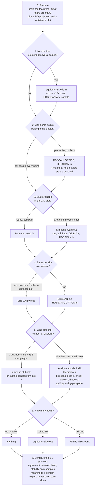

# Clustering (unsupervised learning) — explained from zero

> **Who this is for:** someone new to machine learning. You need school algebra (averages, squares, square roots) and a
> little Python. This page names the ideas and gives a **flowchart for choosing a method** (§3); the theory of each
> method lives in the README of its folder under [`lab/`](lab/README.md), next to two notebooks that demonstrate it: a
> library notebook (scikit-learn / SciPy) and a from-scratch notebook (the same algorithm in NumPy, checked against the
> library). "Lab N" means library Lab N; the labs are numbered 1–12 across the folders.

## Table of contents

0. [Clustering in 30 seconds](#0-clustering-in-30-seconds)
1. [What is a cluster?](#1-what-is-a-cluster)
2. [Where each idea is explained](#2-where-each-idea-is-explained)
3. [Choosing a method: the flowchart](#3-choosing-a-method-the-flowchart)
4. [The labs](#4-the-labs)
5. [Further reading](#5-further-reading)
6. [Not yet covered](#6-not-yet-covered)
7. [Appendix - Assumptions made](#appendix---assumptions-made)

---

## 0. Clustering in 30 seconds

* **Clustering** splits rows of data into groups (**clusters**) so that rows in the same group are similar and rows in
  different groups are not, **without** being told what the groups are. That is what makes it *unsupervised*: there
  is no target column to learn from.
* Uses: customer segments, grouping documents or images, finding unusual points (the ones that fit no group),
  compressing data (replace each point by its cluster's centre), exploring a new dataset.
* No algorithm is best everywhere (Lab 12). Each one carries an assumption about what a cluster *is*, and the
  results are only as good as the match between that assumption and your data. The flowchart in §3 matches the two.

## 1. What is a cluster?

A dataset here is a table: $n$ rows (points, samples) and $d$ numeric columns (features). Each row is a point in
$d$-dimensional space. The output of clustering is one **label** per row: a cluster number, or −1 for "noise" in the
density methods.

There is no single definition of a cluster, and each algorithm picks one:

* **Compact:** points close to a common centre (k-means, ward linkage).
* **Connected:** points linked by a chain of close neighbours (single linkage, DBSCAN).
* **Dense:** a region with many points per unit of space, separated by sparser regions (DBSCAN, OPTICS, HDBSCAN).
* **Nested:** clusters inside clusters (hierarchical clustering shows every level).

Lab 3 shows why the definition matters: four blobs arranged as two pairs are "2 clusters" at one scale and
"4 clusters" at another, and both answers are right.

## 2. Where each idea is explained

Each link goes to the section that explains the term; the flowchart in §3 uses the terms in **bold**.

**Shared tools** · [`lab/05-in-practice/README.md`](lab/05-in-practice/README.md)
* [§1 Distance](lab/05-in-practice/README.md#1-distance): **Euclidean**, Manhattan and cosine distance.
* [§2 Scaling](lab/05-in-practice/README.md#2-scaling): **standardising** each feature so no unit dominates.
* [§3 Judging a clustering](lab/05-in-practice/README.md#3-judging-a-clustering): **ARI** ([defined step by step](lab/05-in-practice/README.md#the-adjusted-rand-index-ari-step-by-step)) / NMI against known groups;
  **silhouette**, Davies–Bouldin, Calinski–Harabasz without them; **stability**.
* [§4 Many features](lab/05-in-practice/README.md#4-many-features-the-curse-of-dimensionality): the **curse of
  dimensionality**; reduce with **PCA** first.

**Centroid: k-means** · [`lab/01-kmeans/README.md`](lab/01-kmeans/README.md). Each cluster is a centre; points go to the nearest one.
* [§1 Inertia](lab/01-kmeans/README.md#1-inertia-within-cluster-sum-of-squares-wcss): **inertia / WCSS**, the squared
  spread around each centroid, and why it's called inertia.
* [§2–4 Goal, algorithm, stopping](lab/01-kmeans/README.md#3-the-algorithm-lloyds-algorithm): **centroid**, **Lloyd's
  algorithm** (assign, update, repeat), local minima.
* [§5 k-means++](lab/01-kmeans/README.md#5-the-start-matters-k-means): spread-out starts and `n_init`.
* [§6 Choosing k](lab/01-kmeans/README.md#6-choosing-k): the **elbow** and the **silhouette**.
* [§7 Assumptions and failures](lab/01-kmeans/README.md#7-assumptions-and-failures): **round** clusters only;
  **outliers** steal centroids; k-medoids.
* [§8 Cost and variants](lab/01-kmeans/README.md#8-cost-and-variants): **MiniBatchKMeans** for millions of rows.

**Hierarchical: agglomerative** · [`lab/02-hierarchical/README.md`](lab/02-hierarchical/README.md). Merge the closest clusters into a tree.
* [§1 The algorithm](lab/02-hierarchical/README.md#1-the-algorithm): the **dendrogram** and **cutting** it at a height
  or at k.
* [§2 Linkage](lab/02-hierarchical/README.md#2-linkage-the-distance-between-two-clusters): **single** (chains),
  complete, average, **ward** (compact, like k-means); Lance–Williams.
* [§3 Cophenetic correlation](lab/02-hierarchical/README.md#3-judging-the-tree-the-cophenetic-correlation): how
  faithful the tree is.
* [§4 Cost and use cases](lab/02-hierarchical/README.md#4-cost-and-use-cases): **n² memory**; structure at several
  scales.

**Density: DBSCAN** · [`lab/03-dbscan/README.md`](lab/03-dbscan/README.md). A cluster is a dense region; the rest is noise.
* [§1 Definitions](lab/03-dbscan/README.md#1-definitions): **eps**, **min_samples**, core / border / **noise** points.
* [§2 The algorithm](lab/03-dbscan/README.md#2-the-algorithm): growing clusters through core points.
* [§3 Choosing eps](lab/03-dbscan/README.md#3-choosing-eps-and-min_samples): the **k-distance plot**.
* [§4 Strengths and weaknesses](lab/03-dbscan/README.md#4-strengths-and-weaknesses): any **shape**; one **density**
  for all clusters.

**Density, multi-scale: OPTICS and HDBSCAN** · [`lab/04-optics-hdbscan/README.md`](lab/04-optics-hdbscan/README.md). DBSCAN at every eps at once.
* [§1–2 Definitions and algorithm](lab/04-optics-hdbscan/README.md#1-definitions): core distance, reachability, the
  **reachability plot**.
* [§3 Extracting clusters](lab/04-optics-hdbscan/README.md#3-extracting-clusters): an eps cut (= DBSCAN) or the **xi**
  method.
* [§4 HDBSCAN](lab/04-optics-hdbscan/README.md#4-hdbscan): **mixed densities**, one setting, `min_cluster_size`.
* [§5 DBSCAN vs OPTICS](lab/04-optics-hdbscan/README.md#5-dbscan-vs-optics-when-to-use-which).

## 3. Choosing a method: the flowchart

Start with every method as a candidate. Each question rules some in or out; you end with two or three survivors and
compare them. Shape (step 3) and density (step 4) usually rule out the most, so if the pictures from step 0 already
answer them, start there.

**Step by step**, with the evidence for each rule:

0. **Prepare.** Standardise the features: on wine, k-means goes from ARI 0.37 to 0.90 (Lab 10,
   [scaling](lab/05-in-practice/README.md#2-scaling)). With dozens of features or more, reduce with PCA first
   ([many features](lab/05-in-practice/README.md#4-many-features-the-curse-of-dimensionality)). Then draw the two
   pictures that answer steps 3 and 4: a 2-D projection (PCA, t-SNE or UMAP) and a
   [k-distance plot](lab/03-dbscan/README.md#3-choosing-eps-and-min_samples).
1. **Tree or clusters at several scales?** For a taxonomy, or segments with sub-segments: yes → agglomerative
   ([hierarchical §4](lab/02-hierarchical/README.md#4-cost-and-use-cases)). Its n² memory rules it out above about
   10⁴ rows; HDBSCAN also builds a tree, or cluster a sample. If no, agglomerative stays optional. This is about
   nested groups, not graphs: data given as edges between nodes (a network) needs spectral clustering or community
   detection, which are not covered here.
2. **Can some points belong to no cluster?** Yes → the density methods label them noise
   ([DBSCAN §1](lab/03-dbscan/README.md#1-definitions)). k-means must place every point, and three outliers took a
   centroid of their own while two real blobs merged (Lab 4,
   [k-means §7](lab/01-kmeans/README.md#7-assumptions-and-failures)). No → k-means and agglomerative assign every
   point.
3. **Shape.** Round, compact, similar sizes → k-means and ward. Stretched, moons or rings → k-means is out (ARI 0.56,
   0.25 and 0.00, Lab 4) and so is ward. Single linkage finds the moons (1.00) but one bridge of points merges two
   blobs (Lab 6, [linkage](lab/02-hierarchical/README.md#2-linkage-the-distance-between-two-clusters)); DBSCAN finds
   them too (1.00, Lab 7).
4. **Density.** One clear bend in the k-distance plot → DBSCAN with eps at the bend. Dense and sparse clusters
   together → no single eps works (Lab 8, [DBSCAN §4](lab/03-dbscan/README.md#4-strengths-and-weaknesses)): HDBSCAN or
   OPTICS with xi find all three blobs (Lab 9, [HDBSCAN](lab/04-optics-hdbscan/README.md#4-hdbscan)).
5. **Who sets the number of clusters?** In unsupervised work it is almost never known; the data arrives unlabelled.
   * **A business limit sets it** (5 marketing campaigns, a 16-colour palette, a budget of k segments): k-means at that
     k, or cut the dendrogram into k. The question is then whether k clusters are a useful summary, not whether they
     are the "true" ones.
   * **The data must say (the usual case):** the density methods find the number themselves, and a dendrogram can be
     cut at a height instead of a count. k-means needs k chosen from evidence: scan k and read the elbow, silhouette,
     stability on resamples and the gap statistic together
     ([interview discussion](lab/01-kmeans/interview_discussion.md)). No single one is enough: on pure noise the elbow
     and silhouette still pick 4 (silhouette 0.41, Lab 3, [choosing k](lab/01-kmeans/README.md#6-choosing-k)), and of
     these only the gap statistic can answer "there are no clusters".
6. **How many rows?** Up to about 10⁴, anything. Beyond that, agglomerative's n² memory is the limit. At millions,
   MiniBatchKMeans ([k-means §8](lab/01-kmeans/README.md#8-cost-and-variants)); OPTICS is the slowest of the density
   methods (Lab 9).
7. **Compare the survivors.** Check how much their labels agree (ARI of one against the other), whether each is stable
   across seeds and resamples, and whether the clusters mean something. Never pick by silhouette alone: it preferred
   the wrong k-means split of the moons, 0.49 vs 0.05 (Lab 11,
   [judging](lab/05-in-practice/README.md#3-judging-a-clustering)). No method wins on all of iris, wine and digits
   (Lab 12).

**Fit and weak spot of each method:**

| Method | Fits | Weak spot | Evidence |
|---|---|---|---|
| k-means | round clusters of similar size, k fixed by a business limit or chosen from evidence, any number of rows | other shapes, outliers, unequal spreads; always returns k clusters | Labs 3, 4 |
| agglomerative, ward | like k-means, plus a tree | like k-means; n² memory | Lab 6 |
| agglomerative, single | chains with clean gaps | a bridge of points or noise merges clusters | Lab 6 |
| DBSCAN | any shape, noise, one density | mixed densities; a narrow eps range; many features | Labs 7, 8 |
| OPTICS | exploring every density level | slow; xi is a setting too | Lab 9 |
| HDBSCAN | mixed densities, unknown eps | many features: distances stop meaning anything and points turn to noise | Lab 9 |

Not covered here: Gaussian mixtures, Birch, mean shift, affinity propagation and spectral clustering
([§6](#6-not-yet-covered)).

## 4. The labs

Setup, run instructions and a map of which lab answers which question are in **[`lab/README.md`](lab/README.md)**.

| Folder | Theory | Library lab (scikit-learn / SciPy) | From scratch (NumPy, checked against the library) |
|---|---|---|---|
| [`lab/01-kmeans/`](lab/01-kmeans/) | [README](lab/01-kmeans/README.md) | [Labs 1–4](lab/01-kmeans/kmeans_lab.ipynb): how it moves, starts, choosing k, failures | [k-means, k-means++, 3-pair toy, silhouette, elbow](lab/01-kmeans/kmeans_from_scratch.ipynb) |
| [`lab/02-hierarchical/`](lab/02-hierarchical/) | [README](lab/02-hierarchical/README.md) | [Labs 5–6](lab/02-hierarchical/hierarchical_lab.ipynb): dendrograms, linkages | [agglomerative with Lance–Williams](lab/02-hierarchical/hierarchical_from_scratch.ipynb) |
| [`lab/03-dbscan/`](lab/03-dbscan/) | [README](lab/03-dbscan/README.md) | [Labs 7–8](lab/03-dbscan/dbscan_lab.ipynb): eps from the k-distance plot, mixed density | [DBSCAN](lab/03-dbscan/dbscan_from_scratch.ipynb) |
| [`lab/04-optics-hdbscan/`](lab/04-optics-hdbscan/) | [README](lab/04-optics-hdbscan/README.md) | [Lab 9](lab/04-optics-hdbscan/optics_hdbscan_lab.ipynb): reachability plot, xi, HDBSCAN | [OPTICS and its eps cuts](lab/04-optics-hdbscan/optics_from_scratch.ipynb) |
| [`lab/05-in-practice/`](lab/05-in-practice/) | [README](lab/05-in-practice/README.md) | [Labs 10–12](lab/05-in-practice/in_practice_lab.ipynb): scaling, scores without labels, real data, summary, guide | — (no new algorithm) |

Running k-means in production (monitoring, retrain decisions, the retrain playbook) is in
[`kmeans_in_production.ipynb`](lab/01-kmeans/kmeans_in_production.ipynb); defining its very first training window is in
[`first_go_live_scenarios.md`](lab/01-kmeans/first_go_live_scenarios.md).

The original notebooks this folder grew from are kept in [`_archive/`](_archive/).

## 5. Further reading

* scikit-learn user guide, [Clustering](https://scikit-learn.org/stable/modules/clustering.html) and the
  [comparison of clustering algorithms](https://scikit-learn.org/stable/auto_examples/cluster/plot_cluster_comparison.html)
  (the six shapes of Lab 4).
* Hastie, Tibshirani & Friedman, *The Elements of Statistical Learning*, §14.3 (cluster analysis).
* Papers for each method are listed at the end of its folder's README.

## 6. Not yet covered

To visit after DBSCAN, HDBSCAN, agglomerative and OPTICS. All of them are in scikit-learn 1.9.1.

| Method | A cluster is | `predict` for a new point? | Why visit it |
|---|---|---|---|
| Gaussian mixture (`GaussianMixture`, `BayesianGaussianMixture`) | a Gaussian: a mean and a covariance; points go to the most probable one | yes, plus `predict_proba` for soft memberships | stretched, tilted clusters of different sizes; the closest challenger to k-means among the methods that can predict |
| Birch | many small subclusters (each kept as a mean), optionally grouped into `n_clusters` | yes: the nearest subcluster's centroid | one pass over the data and `partial_fit` in chunks, so built for big data; a cluster made of many subclusters can bend |
| Mean shift | the points nearest a density peak (mode); `bandwidth` sets the scale | yes: the nearest mode | finds the number of clusters itself; slow on large n (`bin_seeding` helps) |
| Affinity propagation | the points nearest an exemplar, a real data point chosen by message passing; `preference` sets roughly how many | yes: the nearest exemplar; every point gets −1 if the fit didn't converge | finds the number of clusters itself; its n × n similarity matrix limits it to a few thousand rows |
| Spectral clustering | a group in a similarity graph | no, only `fit_predict` | graph data and non-convex shapes |

* Mean shift and affinity propagation assign each point to its nearest representative, as k-means does, so their
  borders are straight and they fail on the same curved shapes; what they add is choosing k themselves.

## Appendix - Assumptions made

1. **Scope.** The folder held four notebooks (k-means, hierarchical, DBSCAN, OPTICS), so those four algorithms are the
   core, plus HDBSCAN as the modern follow-up to OPTICS and the scores used to judge clusters. Gaussian mixture models,
   spectral clustering and mean shift are only mentioned.
2. **Structure.** This README names the ideas and holds the method-choice flowchart. The `lab/` folder has its own
   README (setup and lab map) and one folder per method, each with a theory README, a notebook using the library
   implementations and a from-scratch notebook with markdown explanations and line-by-line code comments. The
   in-practice folder (distance, scaling, judging, many features) has only a library notebook, because it introduces
   no new algorithm.
3. **Original notes.** Their content (algorithm steps, the elbow method and its programmatic detection, the problems
   lists, the hierarchical use cases, the DBSCAN reference) is merged into the folder READMEs; the notebooks themselves
   were moved to `_archive/` unchanged. One rule was corrected: DBSCAN gives a border point to the first cluster that
   reaches it, not to the nearest core point ([DBSCAN §2](lab/03-dbscan/README.md#2-the-algorithm)). The open
   questions in the notes are answered: how to choose eps and min_samples
   ([DBSCAN §3](lab/03-dbscan/README.md#3-choosing-eps-and-min_samples)), what to do with outliers in k-means
   ([k-means §7](lab/01-kmeans/README.md#7-assumptions-and-failures)), what happens with sub-clusters, varying
   densities and sizes, and non-round shapes (Labs 3, 4, 8).
4. **Data.** Synthetic 2-D data (so results can be seen) plus scikit-learn's bundled iris, wine and digits; no
   internet needed. "True" groups are used only to grade results with ARI.
5. **Numbers.** Every number quoted here comes from the executed notebooks (scikit-learn 1.9.1, NumPy 2.5, SciPy 1.18,
   Python 3.12.8). Timings depend on the machine and are only described qualitatively.
