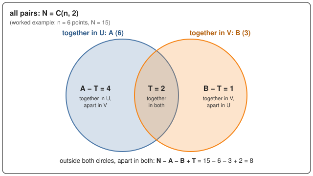

# Clustering in practice: distance, scaling, judging, many features

> Part of the [clustering notes](../../README.md); see there for [choosing a method](../../README.md#3-choosing-a-method-the-flowchart).
> Lab in this folder: [`in_practice_lab.ipynb`](in_practice_lab.ipynb) (Labs 10–12). It introduces no new algorithm,
> so it has no from-scratch notebook. Everything here applies to every method:
> [k-means](../01-kmeans/README.md), [hierarchical](../02-hierarchical/README.md), [DBSCAN](../03-dbscan/README.md),
> [OPTICS / HDBSCAN](../04-optics-hdbscan/README.md).

1. [Distance](#1-distance)
2. [Scaling](#2-scaling)
3. [Judging a clustering](#3-judging-a-clustering)
4. [Many features: the curse of dimensionality](#4-many-features-the-curse-of-dimensionality)
5. [Common misconceptions](#5-common-misconceptions)
6. [Terms](#6-terms)

## 1. Distance

Every method here measures how far apart two points are. The default is the **Euclidean distance** (straight line):

$$d(x, y) = \sqrt{\sum_{j=1}^{d} (x_j - y_j)^2}$$

Others: **Manhattan** ($\sum_j |x_j - y_j|$, less sensitive to one large difference) and **cosine distance**
($1 - \cos\theta$, the angle between two vectors, common for text where only the direction of a word-count vector
matters, not its length). k-means is tied to squared Euclidean distance (its centroid is a mean); hierarchical,
DBSCAN and OPTICS accept any distance.

## 2. Scaling

A distance adds up differences over all features, so a feature measured in big numbers dominates. In the wine data
(Lab 10) the "proline" column spreads about 2,600 times more than the smallest one; unscaled, k-means essentially
clusters on proline alone (ARI 0.37), and after **standardising** (each feature: subtract its mean, divide by its
standard deviation) it scores 0.90. Standardise unless the features share a unit and a scale that mean something
(pixels, coordinates in metres).

## 3. Judging a clustering

**With true labels** (only when testing a method on data where the answer is known):

* **ARI (adjusted Rand index):** over all pairs of points, how often the clustering and the truth agree on "same group"
  vs "different group", corrected so random labels score 0; 1 = identical. In the labs, noise points count as one
  extra group. Defined step by step [below](#the-adjusted-rand-index-ari-step-by-step).
* **NMI (normalised mutual information):** how much a point's cluster tells you about its true group, 0–1.

**Without labels** (the usual situation):

* **Silhouette** ([k-means §6](../01-kmeans/README.md#6-choosing-k)): −1 to 1, higher is better.
* **Davies–Bouldin:** for each cluster, the worst (spread of i + spread of j) / distance between their centres,
  averaged; lower is better.
* **Calinski–Harabasz:** between-cluster spread / within-cluster spread, adjusted for k; higher is better.

All three internal scores reward **round, well-separated** clusters. On the moons (Lab 11) DBSCAN is exactly right
(ARI 1.00) and k-means wrong (0.25), yet silhouette (0.05 vs 0.49), Davies–Bouldin and Calinski–Harabasz all prefer
k-means. Use them to compare settings of one method that makes round clusters, not to compare methods. The real test
is whether the clusters mean something to someone who knows the domain, and whether they are **stable** (similar
clusters on a resample of the data).

### The adjusted Rand index (ARI), step by step

Every lab grades its clusterings with the ARI, and the [flowchart](../../README.md#3-choosing-a-method-the-flowchart)
uses it to compare two methods' labels. 
- **Origin:** the Rand index is from Rand (1971),
  [*Objective criteria for the evaluation of clustering methods*](https://doi.org/10.1080/01621459.1971.10482356)
  (JASA); its chance-adjusted version, the ARI, is from Hubert & Arabie (1985),
  [*Comparing partitions*](https://doi.org/10.1007/BF01908075) (Journal of Classification).
- It compares two labelings of the same n points, U (say the true groups) and V (the clusters). 
- The label *names* don't matter, only which points share a label.

**1. Look at pairs, not points.** There are $\binom{n}{2}$ pairs of points. Each pair falls in one of four cases:

| | together in V | apart in V |
|---|---|---|
| **together in U** | agree | disagree |
| **apart in U** | disagree | agree |

**2. The Rand index** is the fraction of pairs where U and V agree:

$$\text{RI} = \frac{\text{pairs together in both} + \text{pairs apart in both}}{\binom{n}{2}}$$

It is 1 for identical labelings, but it is far from 0 for nonsense: 
- take 400 points whose truth is 4 groups of 100 points each; purely random labels score **RI ≈ 0.63**, 
  because most pairs are "apart" in both just by chance. 
- Worse, splitting the 400 points into **400 one-point clusters** (a useless answer: it calls every pair "apart") scores 
  **0.75**: of the 79,800 pairs, 60,000 really are apart in the truth (19,800 are together: 4 × 4,950), and the RI
  counts each of those as a correct "apart". 
- The ARI gives both of these answers 0.

<b>Where 0.63 and 0.75 come from, step by step</b>

- **First, count the pairs.**
  - All pairs: 400 × 399 / 2 = **79,800** (pick a first point in 400 ways and a second in 399; halve, because the pair
    A–B is the same as B–A).
  - Together in the truth: one group of 100 holds 100 × 99 / 2 = 4,950 pairs; 4 groups hold 4 × 4,950 = **19,800**.
  - Apart in the truth: the rest, 79,800 − 19,800 = **60,000**.
- **Purely random labels score RI ≈ 0.63** (each point gets cluster 0, 1, 2 or 3 by a roll of a 4-sided die):
  - Two points get the same random cluster 1 time in 4 (whatever the first rolls, the second matches it with
    chance 1/4), and different clusters 3 times in 4.
  - Of the 19,800 pairs together in the truth, about 1/4 are also together in V: 19,800 / 4 = 4,950 agreements.
  - Of the 60,000 pairs apart in the truth, about 3/4 are also apart in V: 60,000 × 3/4 = 45,000 agreements.
  - RI = (4,950 + 45,000) / 79,800 = 49,950 / 79,800 ≈ **0.626**.
  - Most of the score is the 45,000: most pairs are "apart" in both just by chance.
- **400 one-point clusters score RI ≈ 0.75** (every point alone, so V calls every pair "apart"):
  - Together in both: 0 (V never puts two points together).
  - Apart in both: all 60,000 pairs apart in the truth, since V calls every pair apart.
  - RI = (0 + 60,000) / 79,800 ≈ **0.752**.
  - It gets all 19,800 together-pairs wrong, yet still scores 0.75, because they are only a quarter of the pairs.

**3. Adjust for chance.** Subtract what random labels would score and rescale so the best possible score is 1:

$$\text{ARI} = \frac{\text{RI} - \mathbb{E}[\text{RI}]}{\max \text{RI} - \mathbb{E}[\text{RI}]} = \frac{\text{your score} - \text{luck's score}}{\text{perfect score} - \text{luck's score}}$$

where $\mathbb{E}[\text{RI}]$ (luck's score) is the average over random labelings that keep the same cluster sizes.

**4. Compute it from the contingency table.** 
  - Let $n_{ij}$ = number of points in group $i$ of U and cluster $j$ of V (i $^{th}$ row j $^{th}$ column of the contingency table), $a_i = \sum_j n_{ij}$ (size of group $i$, i.e. sum of $i^{th}$ row), $b_j = \sum_i n_{ij}$ (size of cluster $j$, i.e. sum of $j^{th}$ column). 
  - Then $\sum_{ij}\binom{n_{ij}}{2}$ counts the pairs together in both, and

$$\text{ARI} = \frac{\sum_{ij}\binom{n_{ij}}{2} - \dfrac{\sum_i\binom{a_i}{2}\,\sum_j\binom{b_j}{2}}{\binom{n}{2}}}{\tfrac12\left[\sum_i\binom{a_i}{2} + \sum_j\binom{b_j}{2}\right] - \dfrac{\sum_i\binom{a_i}{2}\,\sum_j\binom{b_j}{2}}{\binom{n}{2}}}$$

  - (numerator: pairs together in both, minus the number expected by chance; denominator: the largest possible value minus the same expectation).

<b>The formula in four counts: N, A, B, T, and where each piece comes from</b>

Numbers in brackets are from the worked example just below (6 points).
C(m, 2) = m × (m − 1) / 2 is the number of pairs among m points (the $\binom{m}{2}$ in the formula).

- **The four counts:**
  - **N = C(n, 2):** all pairs of points. (C(6, 2) = 15)
  - **A = Σ_i C(a_i, 2):** pairs **together in U**. Group i has a_i points, so it holds C(a_i, 2) pairs; add over
    the groups. (3 + 3 = 6)
  - **B = Σ_j C(b_j, 2):** pairs **together in V**, the same count over the clusters. (1 + 1 + 1 = 3)
  - **T = Σ_ij C(n_ij, 2):** pairs **together in both**. Two points share a group *and* a cluster only if they sit in
    the same cell of the contingency table, and cell (i, j) holds C(n_ij, 2) such pairs. (1 + 1 = 2)
- **As a picture:** each circle is the set of pairs one labeling puts together; T is where they overlap.

  

- **As a table:** step 1's table, filled in with the counts.

  | | together in V | apart in V | total |
  |---|---|---|---|
  | **together in U** | T (2) | A − T (4) | A (6) |
  | **apart in U** | B − T (1) | N − A − B + T (8) | N − A (9) |
  | **total** | B (3) | N − B (12) | N (15) |

  - The totals depend only on the group and cluster **sizes**. Once T is known, the other three cells follow by
    subtraction, so T is the one number that says how well V matches U.
  - "Apart in both" = all pairs − together in U − together in V + T (T was taken away twice, so it is added back
    once).
- **Your RI in these counts:** the agreeing cells are T and N − A − B + T, so
  - RI = (T + N − A − B + T) / N = (N + 2T − A − B) / N. (15 + 4 − 9) / 15 = 10 / 15 = 0.67.
- **Luck's portion: A × B / N.**
  - Luck = shuffle V's labels at random, keeping its cluster sizes.
  - Any one pair then lands together in V with chance **B / N**. (Points 1 and 2: whatever label point 1 gets, 1 of the
    5 labels left matches it; 1 / 5 = 3 / 15.)
  - Only the **A** pairs together in U can count towards T, and each one makes it with chance B / N.
  - So luck's T is **A × B / N** pairs on average. (6 × 3 / 15 = 1.2)
  - Luck's "apart in both" is then N − A − B + A × B / N. (15 − 6 − 3 + 1.2 = 7.2)
  - Luck's RI, the $\mathbb{E}[\text{RI}]$ of step 3: (N + 2 × A × B / N − A − B) / N. (8.4 / 15 = 0.56)
- **The perfect score: ½(A + B).**
  - T can't exceed A (every pair in T is together in U), nor B, so it can't exceed their average ½(A + B) either.
  - If V groups the points exactly as U does, T = A = B = ½(A + B) and RI = 1.
  - It is an upper bound: reached only when A = B. (½(6 + 3) = 4.5; here T can be at most 3)
- **Numerator: your T − luck's T = T − A × B / N.** (2 − 1.2 = 0.8)
  - The apart side gives the same number: (N − A − B + T) − (N − A − B + A × B / N) = T − A × B / N.
    (8 − 7.2 = 0.8)
  - So beating luck on "together" pairs and on "apart" pairs is one and the same amount; the formula counts it once.
- **Denominator: perfect T − luck's T = ½(A + B) − A × B / N.** (4.5 − 1.2 = 3.3)
- **Where step 2's C(n, 2) went:**
  - RI − luck's RI = 2 × (T − A × B / N) / N. (10 / 15 − 8.4 / 15 = 1.6 / 15)
  - Perfect RI − luck's RI = 2 × (½(A + B) − A × B / N) / N. (15 / 15 − 8.4 / 15 = 6.6 / 15)
  - Divide one by the other: the 2 / N cancels. C(n, 2) stays only inside luck's portion, A × B / N.
- **So:** ARI = (T − A × B / N) / (½(A + B) − A × B / N), the formula above written with short names.
  (0.8 / 3.3 = 0.2424)

**Worked example.** 
- 6 points; truth U = `[0, 0, 0, 1, 1, 1]`, clusters V = `[0, 0, 1, 1, 2, 2]`.

| | cluster 0 | cluster 1 | cluster 2 | $a_i$ |
|---|---|---|---|---|
| **group 0** | 2 | 1 | 0 | 3 |
| **group 1** | 0 | 1 | 2 | 3 |
| $b_j$ | 2 | 2 | 2 | n = 6 |

* Pairs together in both: $\binom{2}{2} + \binom{2}{2} = 2$ (the other cells hold 0 or 1 point, so no pairs).
* $\sum_i\binom{a_i}{2} = 3 + 3 = 6$; $\sum_j\binom{b_j}{2} = 1 + 1 + 1 = 3$; $\binom{6}{2} = 15$.
* Expected by chance: $6 \times 3 / 15 = 1.2$. Largest possible: $\tfrac12(6 + 3) = 4.5$.
* **ARI** $= (2 - 1.2) / (4.5 - 1.2) = 0.8 / 3.3 =$ **0.24**.
* For comparison, the **Rand index** is $(2 + 8) / 15 =$ **0.67**: 2 pairs together in both, and 8 apart in both
  (15 pairs, minus the 2, minus the 4 pairs split by V that U keeps together, minus the 1 pair V joins that U keeps
  apart). The ARI shows how weak this match really is.

`sklearn.metrics.adjusted_rand_score(U, V)` gives 0.2424 and `rand_score(U, V)` 0.6667.

**The two nonsense answers from step 2, by ARI:** random labels (RI ≈ 0.63) and 400 one-point clusters (RI ≈ 0.75)
both score ARI ≈ 0.

<b>The ARI of random labels (whose RI was 0.63) and of 400 one-point clusters (whose RI was 0.75), step by step</b>

- **Short names for the four counts in the formula above** (as in step 4's collapsible; C(m, 2) = m × (m − 1) / 2
  is the number of pairs among m points):
  - N = C(n, 2): all pairs.
  - T = Σ C(n_ij, 2): pairs together in both U and V.
  - A = Σ C(a_i, 2): pairs together in U.
  - B = Σ C(b_j, 2): pairs together in V.
  - The chance term is AB/N, and ARI = (T − AB/N) / (½(A + B) − AB/N).
- **The truth is the same in both cases** (4 groups of 100), so two counts never change:
  - N = 400 × 399 / 2 = **79,800**.
  - A = 4 × C(100, 2) = 4 × 4,950 = **19,800**.
- **Case 1: random labels.** One concrete draw, V = `np.random.default_rng(0).integers(0, 4, 400)`. Its contingency
  table:

  | | cluster 0 | cluster 1 | cluster 2 | cluster 3 | $a_i$ |
  |---|---|---|---|---|---|
  | **group 0** | 19 | 25 | 33 | 23 | 100 |
  | **group 1** | 23 | 22 | 19 | 36 | 100 |
  | **group 2** | 27 | 21 | 20 | 32 | 100 |
  | **group 3** | 21 | 21 | 33 | 25 | 100 |
  | $b_j$ | 90 | 89 | 105 | 116 | n = 400 |

  - T: add C(n_ij, 2) over all 16 cells, one row at a time.
    - Group 0: C(19, 2) + C(25, 2) + C(33, 2) + C(23, 2) = 171 + 300 + 528 + 253 = 1,252.
    - Group 1: C(23, 2) + C(22, 2) + C(19, 2) + C(36, 2) = 253 + 231 + 171 + 630 = 1,285.
    - Group 2: C(27, 2) + C(21, 2) + C(20, 2) + C(32, 2) = 351 + 210 + 190 + 496 = 1,247.
    - Group 3: C(21, 2) + C(21, 2) + C(33, 2) + C(25, 2) = 210 + 210 + 528 + 300 = 1,248.
    - T = 1,252 + 1,285 + 1,247 + 1,248 = **5,032**.
  - B = C(90, 2) + C(89, 2) + C(105, 2) + C(116, 2) = 4,005 + 3,916 + 5,460 + 6,670 = **20,051**.
  - Chance term: AB/N = 19,800 × 20,051 / 79,800 = 397,009,800 / 79,800 ≈ **4,975.06**.
  - ½(A + B) = (19,800 + 20,051) / 2 = 39,851 / 2 = **19,925.5**.
  - Numerator: T − AB/N = 5,032 − 4,975.06 = 56.94.
  - Denominator: ½(A + B) − AB/N = 19,925.5 − 4,975.06 = 14,950.44.
  - **ARI** = 56.94 / 14,950.44 ≈ **0.0038**.
  - Why T ≈ AB/N: a share A/N ≈ 0.248 of all pairs is together in U, and a share B/N ≈ 0.251 is together in V.
    Labels that ignore U put a pair together in both at rate (A/N) × (B/N), which is AB/N pairs out of N. Random
    labels hit about that many (5,032 against 4,975.06), so the numerator is ≈ 0.
  - This draw's RI, for comparison:
    - Together in U or V (or both): A + B − T = 19,800 + 20,051 − 5,032 = 34,819.
    - Apart in both: 79,800 − 34,819 = 44,981.
    - RI = (5,032 + 44,981) / 79,800 = 50,013 / 79,800 ≈ **0.627**, while the ARI is ≈ **0.0038**.
  - Other draws give other small numbers: over 200 random labelings the ARI stays between −0.006 and 0.013 (see
    Properties below), always hovering around 0.
- **Case 2: 400 one-point clusters.**
  - Each cluster holds one point, so every n_ij is 0 or 1. C(0, 2) = C(1, 2) = 0, so T = **0**.
  - Every b_j = 1, so B = 400 × C(1, 2) = **0**.
  - A = 19,800, so AB/N = 19,800 × 0 / 79,800 = **0**.
  - ½(A + B) = (19,800 + 0) / 2 = 9,900.
  - **ARI** = (0 − 0) / (9,900 − 0) = **0**.
- **One more useless answer: all 400 points in one cluster.**
  - B = C(400, 2) = 79,800 (every pair is together in V).
  - Each group sits whole in that cluster, so T = 4 × C(100, 2) = 19,800.
  - AB/N = 19,800 × 79,800 / 79,800 = 19,800. ½(A + B) = (19,800 + 79,800) / 2 = 49,800.
  - **ARI** = (19,800 − 19,800) / (49,800 − 19,800) = 0 / 30,000 = **0**.
  - RI: 19,800 pairs together in both, 0 apart in both, so RI = 19,800 / 79,800 ≈ **0.248**.
- **Side by side** (truth: 4 groups of 100 points):

  | labeling | RI | ARI |
  |---|---|---|
  | identical to the truth | 1 | 1 |
  | random labels (the draw above) | 0.627 | 0.0038 |
  | 400 one-point clusters | 0.752 | 0 |
  | all 400 points in one cluster | 0.248 | 0 |

- The RI's score for a useless answer depends on its cluster sizes (0.248 for one big cluster, 0.752 for 400 tiny
  ones); the ARI gives every chance-level answer ≈ 0.

**Properties**

* **1** only when the two labelings group the points identically (renaming labels doesn't matter).
* **About 0** for random labels (−0.006 to 0.013 over 200 random labelings of the 400 points above); it can be
  slightly **negative**, meaning worse than chance.
* **Symmetric:** ARI(U, V) = ARI(V, U), so it can compare any two clusterings, with no truth needed: two methods
  (flowchart step 7) or two runs on resampled data (stability).
* The two labelings may have **different numbers of clusters**.
* It counts pairs, and a cluster of size m holds about m²/2 of them, so **big clusters weigh more**: misplacing a few
  points of a small cluster barely moves it.

**Pitfalls** (later papers refine the ARI; none refutes it, and it remains the standard)

* **Luck's model may be the wrong one.** Luck's portion, A × B / N, assumes a shuffle that keeps both labelings'
  cluster sizes fixed.
  * Algorithms don't behave that way: repeated k-means runs keep k but their cluster sizes vary a lot. A different
    luck model can change which of two clusterings ranks higher, and whether a method beats chance at all
    ([Gates & Ahn, 2017](https://www.jmlr.org/papers/v18/17-039.html)).
  * The fixed-size model also ignores sampling randomness. A multinomial version, the MARI, shows the ARI is biased for
    small n; the gap all but vanishes for large n
    ([Sundqvist, Chiquet & Rigaill, 2022](https://doi.org/10.1007/s00180-022-01230-7)).
* **Big clusters dominate.** The ARI is a weighted average of per-cluster agreement, with weights that grow with the
  *square* of cluster size, so it mostly reports the large clusters
  ([Warrens & van der Hoef, 2022](https://doi.org/10.1007/s00357-022-09413-z)).
  * Rule of thumb: use the ARI when the reference has **large, equal-sized** clusters; use the **AMI** (adjusted
    mutual information) when it is **unbalanced with small clusters**
    ([Romano, Vinh, Bailey & Verspoor, 2016](https://www.jmlr.org/papers/v17/15-627.html)).
* **A lopsided scale.** The top is 1, but the bottom is not −1: the lowest possible ARI depends on the number and
  sizes of the clusters ([Chacón & Rastrojo, 2022](https://doi.org/10.1007/s11634-022-00491-w)). So a value such as
  0.6 has no universal meaning; compare ARIs on the same data, not across datasets.
* **It needs a truth.** Real data rarely has one, and a clustering that scores low may still be a valid structure that
  the truth didn't label. Without labels, ARI is still useful between two clusterings (methods or resamples).
* **Noise counted as a group.** These labs count DBSCAN / HDBSCAN noise (−1) as one extra group, so a large noise set
  acts as one large cluster and gets the large-cluster weight above.

Reference: Hubert & Arabie (1985), [*Comparing partitions*](https://doi.org/10.1007/BF01908075), Journal of
Classification (the ARI); Rand (1971),
[*Objective criteria for the evaluation of clustering methods*](https://doi.org/10.1080/01621459.1971.10482356), JASA
(the Rand index).

## 4. Many features: the curse of dimensionality

With many features, distances between random points become nearly equal: the farthest-to-nearest ratio falls from
hundreds in 2-D to about 1.2 in 1,000-D (PCA lab, Lab 0). "Nearest centroid", "within eps" and "closest cluster" all
lose meaning, and every irrelevant feature adds noise to every distance. Remedies: select the relevant features, or
**reduce dimensions** with PCA first (the PCA lab's Lab 17 shows k-means, agglomerative and Gaussian mixtures improving
after PCA on noisy data; Lab 12 here clusters the 64-pixel digits on 20 principal components). For visualising
clusters, t-SNE or UMAP on top of PCA is standard.

## 5. Common misconceptions

| Misconception | Reality |
|---|---|
| "A higher silhouette means a better clustering." | Only among round clusters; it prefers the wrong k-means split of the moons over the right DBSCAN one (Lab 11). |
| "Scaling doesn't matter for clustering." | It can be the difference between ARI 0.37 and 0.90 (Lab 10). |

## 6. Terms

| Term | Meaning |
|---|---|
| **Standardising** | Subtract each feature's mean and divide by its standard deviation. |
| **ARI / NMI** | Agreement with known true groups (1 = identical, ~0 = random). |
| **Davies–Bouldin / Calinski–Harabasz** | Label-free scores: lower / higher is better. |
| **Curse of dimensionality** | With many features, all pairwise distances become nearly equal. |
